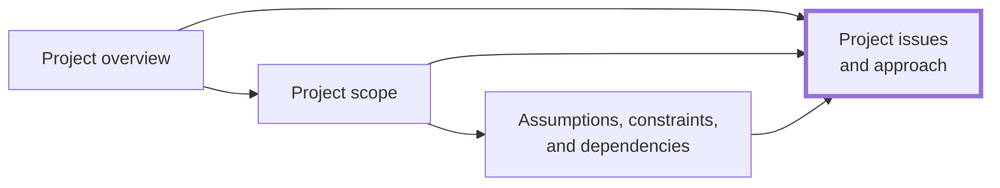

---
specdojo:
  id: specdojo:prj-issues-and-approach-rulebook
  type: rulebook
  deliverable_type: project
  status: draft
  target_format: markdown
  recipe: specdojo:prj-issues-and-approach-recipe
  sample: specdojo:prj-issues-and-approach-sample
  template: specdojo:prj-issues-and-approach-template
  based_on:
    - specdojo:rulebook-authoring-standard
  supersedes: []
  translated_from:
    locale: ja
    commit: 550eb428d358fae1c50aa8f2a33d6980638899bb
---

# Project Issues and Approach Rulebook

Define issues and approaches so stakeholders can quickly agree on the problems, which to address, how, and why.

## 1. General policy

- Organize issues and agree on the approach as the basis for decisions. Detailed design, implementation, and test design are outside scope.
- Distinguish facts and observations from assumptions and hypotheses; label them when mixed.
- Present at least two approaches. Distinguish alternatives from complementary measures addressing different issues or causes, and explain adoption.
- Follow the project's member definitions for role assignments and the [[specdojo:document-metadata-standard|Document Metadata Standard]] for promotion of `status`, approval, revision, retirement, and handing unresolved matters to the register. Do not repeat those rules here or in deliverables. Formatting and lint belong to repository validation.

## 2. Position in the documentation

Use the overview's background and necessity, the project's scope, and the conditions defined by assumptions, constraints, and dependencies.



## 3. File naming and IDs

- Location: `docs/ja/projects/<project-id>/020-project-definition/prj-issues-and-approach.md`, following the [[specdojo:docs-structure-guide|Documentation Structure Guide]].
- Filename: `prj-issues-and-approach.md`.
- ID: `<project-id>:prj-issues-and-approach`, for example `prj-0001:prj-issues-and-approach`.

## 4. Recommended frontmatter

The [[specdojo:document-metadata-standard|Document Metadata Standard]] and `docs/specdojo/schemas/v1/deliverable-frontmatter.schema.yaml` define allowed keys, required fields, and types.

Use `project` for `specdojo.type` and `specdojo:prj-issues-and-approach-rulebook` for `specdojo.rulebook`. List directly supporting overview, scope, assumptions, constraints, and dependencies in `specdojo.based_on`, or `[]` if none.

```yaml
---
specdojo:
  id: prj-0001:prj-issues-and-approach
  type: project
  status: draft
  rulebook: specdojo:prj-issues-and-approach-rulebook
  based_on:
    - prj-0001:prj-overview
    - prj-0001:prj-scope
    - prj-0001:prj-assumptions-constraints-dependencies
  supersedes: []
---
```

## 5. Content structure

The template declared in frontmatter is authoritative for the heading structure. Use this order:

| Section                        | Required | Content and acceptance conditions                                                                             |
| ------------------------------ | -------- | ------------------------------------------------------------------------------------------------------------- |
| Introduction, below H1         | Yes      | Usage situation, decisions supported, and what is and is not being agreed                                     |
| Issues                         | Yes      | Issue, impact, and priority (`High` / `Medium` / `Low`) for each issue                                        |
| Causes, including hypotheses   | Yes      | Causes per issue, separating facts and hypotheses with evidence                                               |
| Candidate approaches           | Yes      | At least two approaches, their alternative or complementary relationship, and corresponding issues and causes |
| Adopted approach and rationale | Yes      | Chosen approach, decision criteria, reasons for combining measures, and rejected alternatives with reasons    |
| Trade-offs and risks           | No       | Costs accepted, risks, mitigation, and responses if premises fail                                             |
| Next decisions and tasks       | No       | Research, checks, or approvals for the next decision, with completion criteria and deadlines                  |
| Review and change management   | No       | Triggers, review viewpoints, and responses; omit where and by whom reviews are recorded                       |

## 6. Writing guidance

See the sample declared in frontmatter for a completed example. Use bullets and only necessary tables. Mark unresolved matters with `_TODO_` or `_UNDECIDED_`.

### 6.1. Introduction

In one or two sentences, state the usage situation and decision the document supports. Do not assign approvers or user roles. Separate the matters being agreed (priority issues, adopted approach, deferred matters) from exclusions such as detailed design or technology selection.

### 6.2. Issues

Describe the troubling situation without assuming a solution. Good: “We notice falling stock too late and run out.” Bad: “There is no automatic ordering.” Assign issue IDs so causes, approaches, and decisions can refer to them.

Use `High` (must address initially), `Medium` (address initially but may follow other work), or `Low` (can defer). The impact must explain the priority.

| Issue ID | Issue | Impact | Priority | Notes |
| -------- | ----- | ------ | -------- | ----- |
| P-01     |       |        | High     |       |

### 6.3. Causes, including hypotheses

Break causes down: missing information, absent criteria, varying procedures, or system constraints. Identify each as fact or hypothesis, with a source, observation, or verification method. Good: “Hypothesis: stock-check timing is undefined, inferred from stockout situations.” Bad: an unsupported claim that work “depends on individuals.”

| Issue ID | Cause type | Description | Evidence / notes |
| -------- | ---------- | ----------- | ---------------- |

### 6.4. Candidate approaches

Classify each as an alternative or complementary measure. Describe it and its expected effect in one to three lines. Give approach IDs and corresponding issues. Check that complementary measures have distinct roles.

Delegate detailed comparison of complete alternatives for the same decision to `prj-comparison-of-alternatives`; identify the question requiring comparison here.

| Approach ID | Approach | Relationship | Summary | Expected effect | Issues addressed |
| ----------- | -------- | ------------ | ------- | --------------- | ---------------- |

### 6.5. Adopted approach and rationale

State the adopted approaches, explain them using criteria such as effect, cost, time, risk, and fit with actual work, and state the priority among criteria. Give one line of rationale for each rejected alternative.

For complementary measures, state which issue or cause each handles and why one alone is insufficient. Describe a core/supporting relationship or sequence only when one exists.

| Candidate | Decision | Rationale |
| --------- | -------- | --------- |

### 6.6. Trade-offs and risks (optional)

Describe what is given up, deferred, or tolerated as a trade-off. Pair each possible risk with mitigation. Use the categories `Trade-off` and `Risk` consistently.

| Category | Description | Mitigation |
| -------- | ----------- | ---------- |

### 6.7. Next decisions and tasks (optional)

List additional research, checks, and approvals with purpose, completion criteria, and deadline or decision timing. Good: “Confirm the initial-release function list before development starts.” Bad: “Consider migration” without completion criteria. Use roles already adopted in the project's organization definition.

| Task | Purpose | Completion criteria | Deadline / decision timing | Responsible role |
| ---- | ------- | ------------------- | -------------------------- | ---------------- |

### 6.8. Review and change management (optional)

List triggers such as disproved hypotheses, scope or premise changes, decisions affecting the approach, or realized risks. Pair each with review viewpoints and a response. Common operations govern the location and responsibility for records, so do not restate them.

| Review trigger | Review viewpoints | Response |
| -------------- | ----------------- | -------- |

## 7. Prohibited content

| Content                                                                      | Reason                                                    |
| ---------------------------------------------------------------------------- | --------------------------------------------------------- |
| Detailed database, API, or screen design                                     | Belongs to product specifications and design              |
| Vague expressions such as “roughly” or “appropriately”                       | Cannot be agreed or verified                              |
| Defining issues as missing solutions                                         | Hides the problem and fixes the means prematurely         |
| Only one approach without considering alternatives or complements            | Obscures decisions and coverage of issues                 |
| Rejecting a complementary measure as an alternative                          | Loses the need to handle distinct causes together         |
| Adoption without criteria or rationale                                       | Cannot be explained later and leads to repeated decisions |
| Identifiable personal or organizational information, or private observations | Leaves nonpublic information in issues, causes, and risks |
