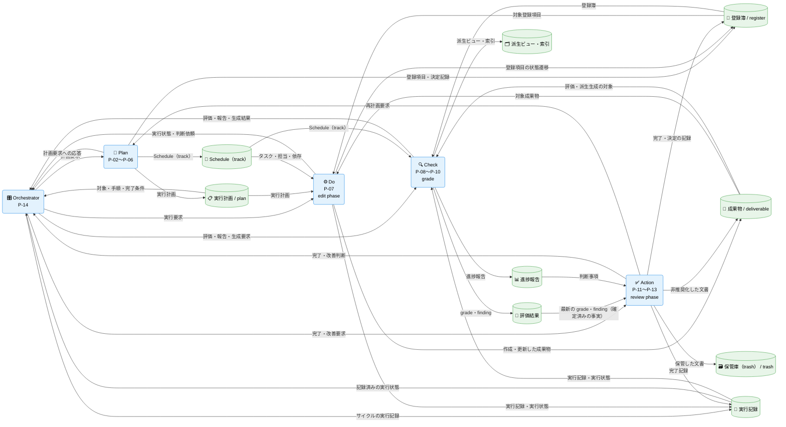
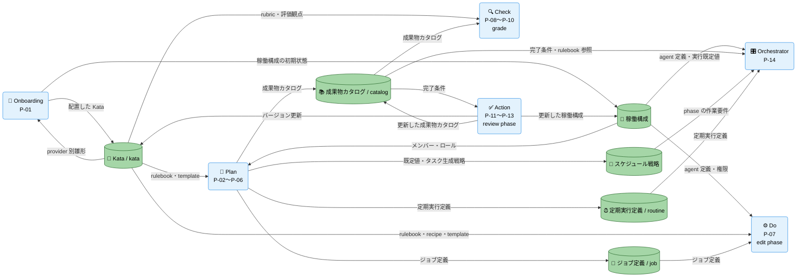
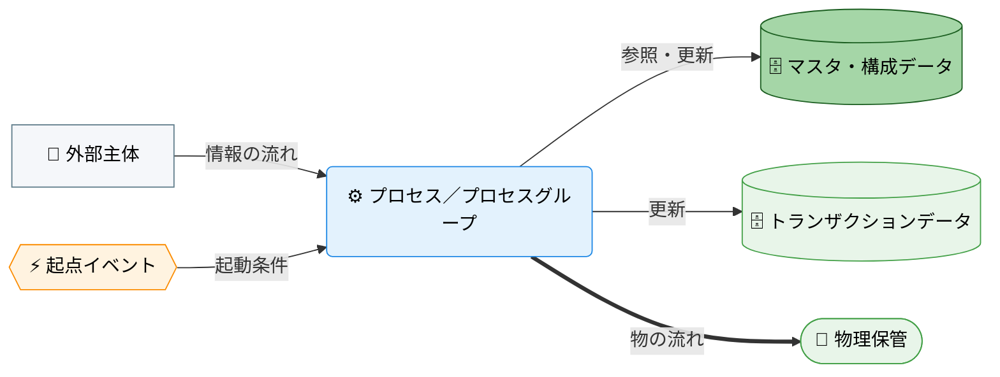

---
specdojo:
  id: cdfd-overview
  type: flow
  status: ready
  rulebook: specdojo:cdfd-overview-rulebook
  based_on: []
  supersedes: []
---

# 概念データフロー図（全体概要）: SpecDojo

SpecDojo を活用したプロジェクト運営の全体概要について、立ち上げから成果物作成、レビュー、承認までを PDCA サイクルに沿った業務プロセスとして整理する。

## 1. 目的

SpecDojo を活用した仕様駆動開発の全体像をプロセス領域とデータの連関として整理し、PO による領域分割の承認および後続の詳細 CDFD 作成の設計入力とする。

## 2. 適用範囲

- **対象**: SpecDojo を用いたプロジェクト開始から成果物作成・評価・改善を含むライフサイクル全体。
- **対象外**: 各領域の内部プロセス、操作手順、および状態定義・遷移（プロセスグループ別 CDFD および [[specdojo:stsd-rulebook|STSD]] を参照）。
- 人間と AI Agent の責任分担（承認・最終判断は人間、作成・評価は AI Agent に委譲可能）および補助操作（参照・検証）の扱いは、本プロダクト共通の方針に従う。

## 3. プロセス領域

業務は 14 のプロセス領域に分かれ、六つのプロセスグループにまとめる。受け渡しは「概念データフロー（概要）」の図を正本とする。主な担当は [[prj-0001:pm-roles|ロール一覧]] の Role code に統一する。

### 3.1. Onboarding（P-01）

<!-- prettier-ignore -->
| 領域 ID | プロセス領域 | 業務目的 | 主な担当 | 起点イベント |
| --- | --- | --- | --- | --- |
| `P-01` | プロジェクト初期セットアップ | プロジェクトの推進環境を整備する。 | PO、ARC | PO が新しいプロジェクトを立ち上げた |

### 3.2. Plan（P-02〜P-06）

<!-- prettier-ignore -->
| 領域 ID | プロセス領域 | 業務目的 | 主な担当 | 起点イベント |
| --- | --- | --- | --- | --- |
| `P-02` | 登録簿定義 | ticket ベースで気付いた TODO や問題・課題、メモ、決定事項等を記録する。 | PM（起票は全参加者） | タスクや課題等が判明した、意思決定した |
| `P-03` | 成果物カタログ定義 | プロジェクトの成果物を定義する。 | BA（提案は全参加者） | 何を成果物として管理するかの判断が確定した |
| `P-04` | スケジュール計画展開 | 成果物カタログとスケジュール戦略から、作成する成果物ごとのタスクを Schedule に展開する。 | PM | 成果物カタログが整備された |
| `P-05` | 定期実行定義 | 定義された時期・条件に基づき、継続的な確認または実行を定義する。 | PM、OPS | 定期的に確認・実行する事項が判明した |
| `P-06` | ジョブ定義 | runner が直接実行する決定論的コマンド、または agent へ委譲する判断を定義する。 | PM（定義は全参加者） | 定型的に実行する処理の手順が定まった |

### 3.3. Do（P-07）

<!-- prettier-ignore -->
| 領域 ID | プロセス領域 | 業務目的 | 主な担当 | 起点イベント |
| --- | --- | --- | --- | --- |
| `P-07` | タスク実行 | 実行可能なタスクを人または AI Agent が担当し、成果物と検証可能な実行結果を残す。 | PM（実担当は各タスクの owner ロール） | 実行指示された |

### 3.4. Check（P-08〜P-10）

<!-- prettier-ignore -->
| 領域 ID | プロセス領域 | 業務目的 | 主な担当 | 起点イベント |
| --- | --- | --- | --- | --- |
| `P-08` | 成果物評価 | editor から独立した runner が成果物や登録項目の対応結果を一度だけ確認し、品質や適合性を評価する。 | QE | 成果物の内容または評価コンテキストの変化に対する評価要求が発行された |
| `P-09` | 進捗可視化報告 | プロジェクトの進捗状況を可視化し、関係者に報告する。 | PM | 定期的な報告時期が到来した |
| `P-10` | 派生生成閲覧提供 | 派生成果物の生成および閲覧を提供する。 | ARC | 派生成果物の生成が要求された |

### 3.5. Action（P-11〜P-13）

<!-- prettier-ignore -->
| 領域 ID | プロセス領域 | 業務目的 | 主な担当 | 起点イベント |
| --- | --- | --- | --- | --- |
| `P-11` | タスク完了 | review phase で最新の grade・finding と完了条件を照合し、タスクの完了可否を確定して記録する。 | PO、PM | 最新の grade・finding と完了要求がそろった |
| `P-12` | 稼働構成管理 | SpecDojo の稼働構成を変更管理する。 | ARC | 稼働構成の変更要求が発生した |
| `P-13` | 非推奨化保管 | 役割を終えた、または新 ID へ引き継がれた文書を非推奨化し、誤参照を防ぐ保管場所へ移す。 | PM、ARC | 文書が新 ID へ引き継がれた、または継続利用しないと判断された |

### 3.6. Orchestrator（P-14）

<!-- prettier-ignore -->
| 領域 ID | プロセス領域 | 業務目的 | 主な担当 | 起点イベント |
| --- | --- | --- | --- | --- |
| `P-14` | オーケストレーター | プロジェクト全体のタスクやプロセスの PDCA を調整・管理する。 | PM（対話型運転は全参加者、自動運転は runner） | プロジェクトが開始された、PDCA の各サイクルが到来した |

## 4. データストア

読み書きするデータストアをマスタ・構成データとトランザクションデータに分けて示す。`<project-id>` は `docs/ja/projects/<project-id>/` を指す。

### 4.1. マスタ・構成データ

<!-- prettier-ignore -->
| データストア | 主な内容 | 主な保管先 |
| --- | --- | --- |
| 稼働構成 | SpecDojo を稼働させる最低限の設定。リポジトリ層は SpecDojo の依存とバージョン、プロジェクト登録・パス設定、実行既定値、索引規則、agent 名簿・権限、オーケストレーター・executor・reporter の定義と入口指示。プロジェクト層は人間のメンバー、ロール、レビュー観点 | `package.json`、 `.specdojo/specdojo.config.json`、 `.specdojo/agent-members.yaml`、 `.specdojo/exec-defaults.yaml`、 `.specdojo/index-config.yaml`、 `.specdojo/<provider>/`、 `.claude/agents/`、 `.claude/settings.json`、 `.codex/`、 `.opencode/`、 `.agents/*.agent.md`、 `.github/agents/`、 `CLAUDE.md`、 `AGENTS.md`、 `<project-id>/030-project-management/pm-members.yaml`、 `<project-id>/030-project-management/pm-roles.yaml`、 `<project-id>/030-project-management/pm-review-viewpoints.yaml` |
| Kata / kata | rulebook、recipe、template、sample、standard、schema、plan・result テンプレート、既定レビュー観点、評価 rubric、provider 別の agent 定義・設定の雛形、agent 向けの記述ルールと skill。内容は product 側で保守し、プロジェクトでは配置とバージョン更新だけを行う | `docs/ja/specdojo/`、 `docs/specdojo/schemas/`、 `templates/<provider>/`、 `.github/instructions/`、 `.claude/rules/`、 `.claude/skills/`、 `.agents/skills/` |
| 成果物カタログ / catalog | 成果物 ID、種別、依存、完了条件、根拠参照。担当は持たず、スケジュール戦略の `owner_rules` から Schedule（track）へ展開する | `<project-id>/010-deliverables-catalog/dct-*.yaml` |
| スケジュール戦略 | 既定値、トラックごとのタスク生成戦略（対象カタログ、approach、phase の作業要件、ゲート・マイルストーンの定義） | `<project-id>/schedule/sch-defaults.yaml`、 `<project-id>/schedule/sch-strategy-<track>.yaml` |
| 定期実行定義 / routine | 周期・条件、対象ジョブ、次回判定に使う状態 | `<project-id>/routines/rtn-*.yaml` |
| ジョブ定義 / job | 実行手順、runner 直接実行か agent 委譲か、成功条件 | `<project-id>/jobs/job-*.yaml` |

### 4.2. トランザクションデータ

<!-- prettier-ignore -->
| データストア | 主な内容 | 主な保管先 |
| --- | --- | --- |
| 登録簿 / register | 登録項目の個票、登録簿索引、状態遷移イベント | `<project-id>/controls/project-register/` |
| Schedule（track） | トラックごとのタスク、担当、期間、依存と、タスクに依存するマイルストーン。スケジュール戦略と成果物カタログから `schedule build` で生成する計画の正本であり、タスクの状態は持たない。状態は実行記録を正本とする | `<project-id>/schedule/sch-track-<track>.yaml`、 `<project-id>/schedule/sch-milestones.yaml`、 `<project-id>/timeline/` |
| 実行計画 / plan | plan。タスクごとの実施手順、対象文書、完了条件 | `<project-id>/execution/exec/plans/` |
| 実行記録 | result、状態遷移イベント、evidence、trial、ジョブ実行記録、agent 実行ログ | `<project-id>/execution/exec/results/`、 `<project-id>/execution/exec/events/`、 `<project-id>/execution/exec/evidence/`、 `<project-id>/execution/exec/trials/`、 `<project-id>/execution/jobs/runs/`、 `logs/` |
| 成果物 / deliverable | プロジェクトで作成・更新する成果物本体。プロジェクト定義（概要、憲章、スコープ）や計画書も含む | `docs/ja/product/`（`trash/` を除く）、 `<project-id>/020-project-definition/`、 `<project-id>/030-project-management/`（稼働構成に属する YAML を除く） |
| 保管庫（trash） / trash | 非推奨化して退避した文書 | `docs/ja/product/trash/`、 `<project-id>/trash/` |
| 評価結果 | 完了条件の判定、grade、finding | `<project-id>/execution/grade/`、 成果物 Frontmatter の `grade`（成果物データストアとファイルを共有し、`grade` キーだけを評価結果の正本として埋め込む） |
| 進捗報告 | ダッシュボード、クリティカルパス、ガントチャート、各種ログの生成ビュー | `<project-id>/execution/generated/`、 `<project-id>/controls/generated/` |
| 派生ビュー・索引 | YAML の閲覧ページ、文書索引、サイトビルド出力（進捗報告に含まれる生成ビューを除く） | 各 `generated/<name>.md`、 `.specdojo/doc-index.json` |

## 5. 概念データフロー（概要）

六つのプロセスグループとデータストアの間の受け渡しを示す。矢印は情報の受け渡しであり、更新エッジは更新前の参照を含む。

### 5.1. トランザクションデータの流れ

Orchestrator が PDCA を駆動し、Plan・Do・Check・Action が各トランザクションデータを更新・参照する流れを示す。

凡例は「凡例（本プロダクト共通）」に従う。外部主体や各領域の内部イベントは図示を省略し、表を参照する。

### 5.2. マスタ・構成データの流れ

Onboarding が初期構成を整え、各グループがマスタ・構成データを参照し、Action が承認済み変更を反映する流れを示す。

凡例は「凡例（本プロダクト共通）」に従う。トランザクションデータとの受け渡しは前図を参照する。

## 6. 詳細 CDFD 一覧

プロセスグループ別 CDFD はグループ内部の正本、ユースケース別 CDFD は複数グループ横断の順序と引き渡し条件の正本とする。

### 6.1. プロセスグループ別 CDFD

<!-- prettier-ignore -->
| プロセスグループ | 含む領域 | プロセスグループ別 CDFD |
| --- | --- | --- |
| Onboarding | `P-01` | `cdfd-onboarding` |
| Plan | `P-02`〜`P-06` | `cdfd-plan` |
| Do | `P-07` | `cdfd-do` |
| Check | `P-08`〜`P-10` | `cdfd-check` |
| Action | `P-11`〜`P-13` | `cdfd-action` |
| Orchestrator | `P-14` | `cdfd-orchestrator` |

### 6.2. ユースケース別 CDFD

<!-- prettier-ignore -->
| ケース ID | ユースケース | 業務目的 | 横断するプロセスグループ | ユースケース別 CDFD |
| --- | --- | --- | --- | --- |
| `C-01` | 登録簿起票から完了まで | 登録項目の起票から、対応、評価、完了記録までの引き渡しを定める | Plan → Do → Check → Action | `cdfd-uc-register` |
| `C-02` | 成果物の作成から完了まで | 成果物カタログの定義からタスク展開、実行、評価、完了記録までの引き渡しを定める | Plan → Do → Check → Action | `cdfd-uc-deliverable` |

## 7. 凡例（本プロダクト共通）

本プロダクトの全 CDFD（本書、プロセスグループ別 CDFD、ユースケース別 CDFD）が共通して参照するノード形状・色・絵文字の対応を示す。

<!-- prettier-ignore -->
| 概念 | 形状 | 色 | 絵文字例 |
| --- | --- | --- | --- |
| プロセス／プロセスグループ | 角丸長方形 | 青（`#e3f2fd` / `#1e88e5`） | 業務内容が伝わる絵文字（例: ⚙️） |
| 起点イベント | 六角形 | 橙（`#fff3e0` / `#fb8c00`） | 出来事が伝わる絵文字（例: 🚦） |
| データストア（マスタ・構成データ） | 円柱 | 濃い緑（`#a5d6a7` / `#1b5e20`） | 保管物が伝わる絵文字（例: 📐） |
| データストア（トランザクションデータ） | 円柱 | 薄い緑（`#e8f5e9` / `#43a047`） | 保管物が伝わる絵文字（例: 📒） |
| 物理保管 | スタジアム形 | 薄い緑（トランザクションデータと同じ） | 保管場所が伝わる絵文字（例: 🏬） |
| 外部主体 | 四角 | グレー（`#f5f7fa` / `#607d8b`） | 主体が伝わる絵文字（例: 👤） |
| 情報の流れ | ラベル付き `-->` | — | — |
| 物の流れ | ラベル付き `==>` | — | — |

ノード形状・線種の記法は `specdojo:cdfd-mermaid-rulebook` に従い、本章で採用する色・絵文字の割り当てを固定する。詳細 CDFD は本章を参照し再掲しない。
