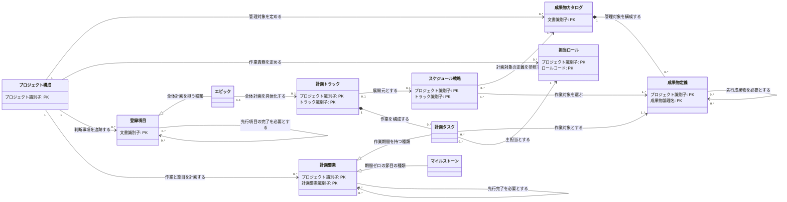

---
specdojo:
  id: prj-0001:ccd-project-planning
  type: data
  status: draft
  rulebook: specdojo:ccd-mermaid-rulebook
  based_on:
    - prj-0001:bdd-register-entry
---

# 概念クラス図（プロジェクトの立上と計画）

## 1. 目的と適用範囲

参加者が交代しても、管理する成果物、計画の根拠、作業責任と先後関係を共通の仕様から引き継げるよう、プロジェクト構成・運用構成・登録項目・成果物カタログ・スケジュール戦略・計画トラックの関係を定義する。PO は対象範囲の合意に、ARC・DEV はモデル設計に、QE は識別子と関連の整合性確認に用いる。

業務上の境界は [[prj-0001:cdfd-uc-schedule|概念データフロー図（スケジュール計画から完了まで）]]、計画の規則は [[specdojo:sch-rulebook|スケジュール作成ルール]]、[[specdojo:dct-rulebook|成果物カタログ作成ルール]]、[[specdojo:pjr-rulebook|プロジェクト登録簿作成ルール]] に従う。

- 成果物定義はカタログ内の管理単位を表す。成果物本体、実行計画・結果・イベント、派生ビューは対象外とする。
- 運用構成のうち、計画の担当を定めるロールを扱う。人間・agent の名簿、実行既定値、provider 固有設定の内部構造は対象外とする。担当ロールと実行者の対応は [[specdojo:pm-members-rulebook|プロジェクトメンバー定義作成ルール]] に委ねる。
- 本図は立上げ・計画途中の未展開状態も含む。図の主キーは業務上の識別単位であり、主キー以外の属性は第4章の辞書に委ねる。

## 2. 概念クラス図

計画要素はタスクとマイルストーンに共通する識別・依存を表す抽象概念であり、保存対象は下位概念のタスクとマイルストーンとする。戦略とトラックは、生成規則と展開済み計画を別に変更・参照するため別概念とする。キーの継承は第4章に示す。

## 3. 関連定義と多重度の根拠

多重度は図の起点側・先側の順に示す。親子はまとまりの内部の所有を表し、構成情報や正本ファイルの削除に伴う物理的な一括削除を意味しない。

| 関連（起点 - 先）                 | 関係種別 | 多重度           | 役割名                     | 業務上の理由・根拠                                                                                                                                                                               |
| --------------------------------- | -------- | ---------------- | -------------------------- | ------------------------------------------------------------------------------------------------------------------------------------------------------------------------------------------------ |
| プロジェクト構成 - 成果物カタログ | 参照     | `1` 対 `0..*`    | 管理対象を定める           | 各カタログの管理主体は一つの project。立上げ時は未定義でよく、対象領域の追加や物理分割により複数になる。構成から参照を外してもカタログ自体の廃棄判断とは分ける。                                 |
| プロジェクト構成 - 担当ロール     | 参照     | `1` 対 `0..*`    | 作業責務を定める           | ロールは project ごとの責務として定義する。初期設定中は未定義でよいが、タスクの担当を確定する前に必要なロールを定義する。                                                                        |
| プロジェクト構成 - 登録項目       | 参照     | `1` 対 `0..*`    | 判断事項を追跡する         | 個票は所属登録簿を通じて一つの project に属する。事項がまだなければ0件、発見・判断の都度追加する。構成変更だけで判断記録を失わせない。                                                           |
| プロジェクト構成 - 計画要素       | 参照     | `1` 対 `0..*`    | 作業と節目を計画する       | 作業・節目は一つの project の計画に属する。計画展開前は0件でよく、範囲やフェーズに応じて増える。                                                                                                 |
| 成果物カタログ - 成果物定義       | 親子     | `1` 対 `0..*`    | 管理対象を構成する         | 定義は一つのカタログの管理対象として成立し、同じ project 内で重複登録しない。作成途中の空のグループを許容し、定義の追加により増える。成果物本体の寿命とは別である。                              |
| 成果物定義 - 成果物定義           | 参照     | `0..*` 対 `0..*` | 先行成果物を必要とする     | 前提なしの成果物も、複数の入力を要する成果物もある。同じ先行成果物を複数の後続成果物が利用でき、カタログの境界を越えて参照できる。                                                               |
| スケジュール戦略 - 成果物カタログ | 参照     | `0..*` 対 `1..*` | 計画対象の定義を参照する   | 戦略は対象カタログを一つ以上特定する。一つのカタログを複数 track の戦略が選択でき、まだ選択されないカタログも残せる。                                                                            |
| スケジュール戦略 - 成果物定義     | 参照     | `0..*` 対 `1..*` | 作業対象を選ぶ             | 実行可能な戦略は一つ以上の work 成果物を対象とし、その選択集合を担当・進め方の規則で網羅する。同じ成果物を複数 track で再修正でき、control・generated や計画未展開の成果物は選択されなくてよい。 |
| 計画トラック - スケジュール戦略   | 参照     | `0..1` 対 `0..1` | 展開元とする               | 同じ project・track の戦略から対応するトラックを展開する。戦略の作成から初回展開まではトラックがなく、戦略を持たない既存トラックも扱う。両者を別の正本として参照する。                           |
| 計画トラック - 計画タスク         | 親子     | `1` 対 `0..*`    | 作業を構成する             | タスクは一つの track の実行単位として成立する。展開前や節目のみの計画では0件でよく、成果物・フェーズ・反復に応じて増える。                                                                       |
| 計画要素 - 計画タスク             | 継承     | —                | 作業期間を持つ種類         | タスクは期間を持つ計画要素であり、識別と依存の性質を引き継ぐ。                                                                                                                                   |
| 計画要素 - マイルストーン         | 継承     | —                | 期間ゼロの節目の種類       | ゲート・承認・リリース地点は期間ゼロの計画要素であり、識別と依存の性質を引き継ぐ。                                                                                                               |
| 計画要素 - 計画要素               | 参照     | `0..*` 対 `0..*` | 先行完了を必要とする       | 前提なし、複数前提、複数後続のいずれも成立する。タスク同士、タスクと節目、節目同士の依存および track を越える依存を表す。                                                                        |
| 計画タスク - 成果物定義           | 参照     | `0..*` 対 `1..*` | 作業対象とする             | 通常は一つの成果物を扱い、横断タスクは複数成果物をまとめて扱う。成果物側は未展開なら0件、フェーズ分割・反復・複数 track で複数タスクになる。                                                     |
| 計画タスク - 担当ロール           | 参照     | `0..*` 対 `1`    | 主担当とする               | 実行する各タスクの主責任は一つの定義済み Role code に定める。同じロールが複数タスクを担い、未割当のロールも存在できる。レビュー観点や承認責任を主担当の代わりにしない。                          |
| 登録項目 - エピック               | 継承     | —                | 全体計画を担う種類         | epic は登録項目として識別・追跡し、track 全体の範囲と完了判断を担う。子 todo・Schedule との責務分担は [[prj-0001:bdd-register-entry\|業務データ辞書（登録項目個票）]] に従う。                   |
| エピック - 計画トラック           | 参照     | `0..1` 対 `0..1` | 全体計画を具体化する       | epic は一つの track を指定し、同じ project 内で epic の track を重複させない。計画展開前は対応するトラックがなく、epic 未登録の既存トラックも存在できる。後者は全体計画へ出さない。              |
| 登録項目 - 登録項目               | 参照     | `0..*` 対 `0..*` | 起票元をたどる             | 起票元なし、複数の起票元、同じ起票元からの複数項目を扱う。epic と子 todo もこの関係で表し、子は独立して追跡する。project を越える起票元も識別する。                                              |
| 登録項目 - 登録項目               | 参照     | `0..*` 対 `0..*` | 先行項目の完了を必要とする | 前提なし、複数の先行項目、同じ項目を待つ複数の後続項目を扱う。起票元とは独立した指定であり、project を越える依存も識別する。                                                                     |

整合性確認では次を満たすことを必須とする。

- 第4章の識別範囲で各主キーの一意性と全参照先の存在を確認する。
- 計画要素と登録項目の先行依存では自己参照・循環を禁止する。
- 成果物の選択は戦略の対象カタログ内に限定する。再修正で成果物定義の所属カタログを変更しない。
- トラックの計画に実行状態を複製しない。状態の正本は実行記録とし、epic の完了判断は登録項目の辞書に従う。主要判断・完了判断は人間が行う。

## 4. 参照業務データ辞書

主キーの対応名と識別範囲を示す。タスクの ID が導出値でも業務上の識別単位は維持する。未作成辞書との対応は既存の識別単位に基づく `_ASSUMPTION_` とし、辞書の物理名・属性定義は未照合である。

| エンティティ                         | 主キーの対応                                                                                                | 参照先業務データ辞書                                            |
| ------------------------------------ | ----------------------------------------------------------------------------------------------------------- | --------------------------------------------------------------- |
| プロジェクト構成                     | 設定に登録する project の識別子。設定内で一意                                                               | `prj-0001:bdd-project-config`（未作成）                         |
| 担当ロール                           | project の識別子と Role code。Role code は project 内で一意                                                 | `prj-0001:bdd-operations-config`（未作成）                      |
| 成果物カタログ                       | project 修飾の文書 `id`。project を含めて一意                                                               | `prj-0001:bdd-deliverables-catalog`（未作成）                   |
| 成果物定義                           | project の識別子と `local_id`。`local_id` はカタログの物理分割を通じて project 内で一意                     | `prj-0001:bdd-deliverables-catalog`（未作成）                   |
| スケジュール戦略                     | project の識別子と `track`。`track` は project 内で一意                                                     | `prj-0001:bdd-schedule-strategy`（未作成）                      |
| 計画トラック                         | `project_id` と `track`。`track` は project 内で一意                                                        | `prj-0001:bdd-schedule-track`（未作成）                         |
| 計画要素・計画タスク・マイルストーン | project の識別子と計画要素の `id`。`id` はタスク・マイルストーンを通じて project 内で一意。下位クラスは継承 | `prj-0001:bdd-schedule-track`（未作成）                         |
| 登録項目・エピック                   | project 修飾の文書 `id`。project を含めて一意。エピックは継承                                               | [[prj-0001:bdd-register-entry\|業務データ辞書（登録項目個票）]] |

## 5. 未解決事項

| 論点                                 | 現在の扱い                                                                                                                                                                                                                                                                      | 解消責務・確認条件                                                                                                                 |
| ------------------------------------ | ------------------------------------------------------------------------------------------------------------------------------------------------------------------------------------------------------------------------------------------------------------------------------- | ---------------------------------------------------------------------------------------------------------------------------------- |
| 未作成辞書との対応                   | `_ASSUMPTION_` 第4章の5辞書との主キーの対応名・識別範囲・関連は未照合であり、図は既存の識別単位と多重度を維持する。登録項目・エピックの主キーと役割分担は作成済みの登録項目辞書に照合した。                                                                                     | 辞書が作成された時点で BA が名称・識別範囲・関連との対応を照合する。属性詳細の確定は辞書で行う。                                   |
| 実装エビデンスの調査範囲             | `src/catalog/catalog.ts` では project ごとのカタログ解決、カタログ群の読込と検証の呼出しを確認した。`src/exec/exec.ts` はコマンド登録等の再公開のみで、戦略・トラック・登録項目間の関係や検証処理の内部は確認できない。                                                         | PM が実体の型定義・参照解決を調査入力へ追加する別の調査を手配し、BA・ARC が照合する。未確認を実装との一致または乖離と判定しない。  |
| 既存データストア定義の状態管理の表現 | `_UNDECIDED_` 既存記述では [[prj-0001:cdsd-planning\|概念データストア定義（プロジェクトの立上と計画）]] が Schedule を「計画・状態遷移の正本」とするとされる。本書は計画と実行状態の正本を分ける扱いを維持する。参照範囲に当該定義・CDFD が含まれず、今回の読み合わせは未実施。 | BA・ARC がデータストア定義の責務を確認し、必要な文書修正を別タスクへ申し送る。実装修正の必要性は指定エビデンスからは判断できない。 |
