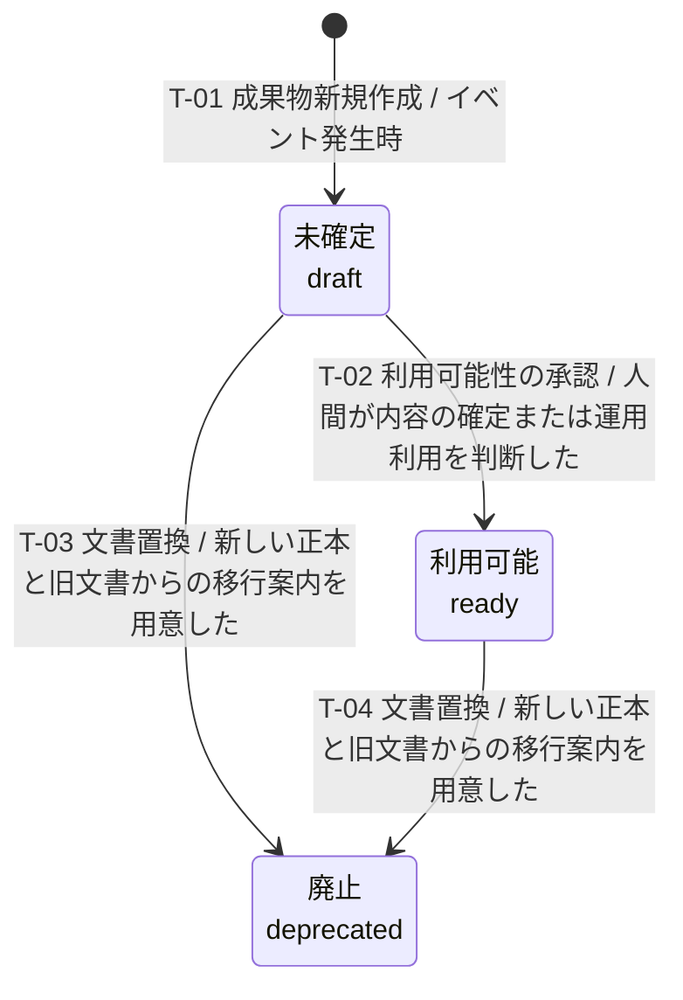

---
specdojo:
  id: prj-0001:stsd-deliverable
  type: data
  status: draft
  rulebook: specdojo:stsd-rulebook
  based_on:
    - prj-0001:bdd-deliverable
  supersedes: []
---

# ステータス定義（成果物）

成果物の状態と状態遷移を定義する。

## 1. 目的

成果物の内容の確定状況と利用可能性を管理し、仕様を書く人・読む人が、検討中の成果物、利用できる成果物、役割を終えた成果物を区別して参照先を選べるようにする。担当交代後も同じ状態に基づいて判断を引き継げるようにする。

## 2. 適用範囲

- 対象: Markdown 成果物本体の共通メタ情報で管理する状態を対象とする。
- 業務範囲: 新規作成、内容の確定・利用可能性の判断、文書の再定義・分割・統合による旧文書の置換を扱う。状態の意味・生成時の扱いは [[specdojo:document-metadata-standard|ドキュメントメタ情報標準]]、置換と廃棄は [[specdojo:id-and-file-naming-standard|ID・ファイル命名標準]] を根拠とする。
- 対象外: タスク自体の状態管理は扱わない。廃棄による保管場所の変更は、成果物の状態変更とは区別する。
- 到達点と継続管理: 利用可能は通常の到達点、廃止は旧文書としての到達点である。廃止後も旧 ID からの参照確認と保管場所・カタログの参照先更新を続けるため、廃止を出力遷移のない継続状態とし、終了点は置かない。廃止からの復帰可否や利用可能からの降格経路は未決であり、禁止と確定したものではない。

## 3. 状態の判定

- 状態の正本: 成果物本体の Frontmatter にある `specdojo.status` とする。カタログは参照先を示すものであり、状態の正本ではない。
- 一意判定: `specdojo.status` の単一値を「状態一覧」の成立条件と照合する。保管場所やタスクの完了から状態を導出しない。廃棄処理も状態を変更しないため、`trash/` にあることを廃止の成立条件にしない。
- 互換の扱い: _UNDECIDED_: 旧状態値・旧イベントの読み替え、値の欠落・規約外の値の補完や移行の規則は、指定実装では確認できない。現在の状態値や遷移へ暗黙に読み替えず、今後の検討メモに残す。

## 4. 状態一覧

成立条件は記録値の判定であり、その値に至る判断や承認が実施されたことの証明ではない。

| 値           | 状態名   | 通称   | 意味                                                                                                                          | 成立条件                                       | 管理場所                                               |
| ------------ | -------- | ------ | ----------------------------------------------------------------------------------------------------------------------------- | ---------------------------------------------- | ------------------------------------------------------ |
| `draft`      | 未確定   | 下書き | 作成・検討中で、内容の確定または運用に使えることをまだ示していない成果物                                                      | 成果物本体の `specdojo.status` が `draft`      | 成果物本体の Frontmatter                               |
| `ready`      | 利用可能 | -      | 人や agent が書く成果物では人間が内容を確認して確定したもの。生成成果物では運用に使えるもので、再生成による内容更新を伴い得る | 成果物本体の `specdojo.status` が `ready`      | 成果物本体の Frontmatter                               |
| `deprecated` | 廃止     | -      | 現行の参照先としての役割を終えた旧成果物。文書置換では移行先の案内を残す                                                      | 成果物本体の `specdojo.status` が `deprecated` | 成果物本体の Frontmatter（廃棄先へ移動した文書を含む） |

## 5. 状態遷移

`T-01`〜`T-04` は既存の業務規約を保持している。指定された `src/deliverable/deliverable.ts` と `src/deliverable/trash.ts` では、状態値の許容範囲、生成時の初期値、状態変更の権限・条件を検証する実装は確認できないため、図表の規約が機械的に強制されるとはみなさない。

| 遷移 ID | 遷移元   | 遷移先   | イベント         | 条件                                       | 補足                                                                                                                                                                 |
| ------- | -------- | -------- | ---------------- | ------------------------------------------ | -------------------------------------------------------------------------------------------------------------------------------------------------------------------- |
| `T-01`  | 開始     | 未確定   | 成果物新規作成   | イベント発生時                             | メタ情報標準の新規作成時の規約。指定実装は生成処理を別モジュールへ委譲しており、初期値の出力は未確認                                                                 |
| `T-02`  | 未確定   | 利用可能 | 利用可能性の承認 | 人間が内容の確定または運用利用を判断した   | agent は昇格させない。成果物ごとの承認者、受入条件、証跡と、実装による権限・条件の検証は未確認                                                                       |
| `T-03`  | 未確定   | 廃止     | 文書置換         | 新しい正本と旧文書からの移行案内を用意した | ID・ファイル命名標準の文書置換手順に基づく。旧状態別の適用可否は指定実装で未確認。移行関係は新文書の `supersedes` に記録し、旧文書の ID とカタログエントリを維持する |
| `T-04`  | 利用可能 | 廃止     | 文書置換         | 新しい正本と旧文書からの移行案内を用意した | 置換手順と実装の確認状況は `T-03` を参照                                                                                                                             |

廃棄は状態を保った保管場所の変更であり、自己遷移として追加しない。確認した実装は文書を `trash/` へ移し、カタログの対象エントリの `path` だけを更新して `local_id` を維持する。状態が廃止でなくても警告だけで処理を続ける。

## 6. 今後の検討メモ

| 論点                                                                                                                                                                                                                                             | 影響する状態・遷移     | 決定者       | 決定時期                   |
| ------------------------------------------------------------------------------------------------------------------------------------------------------------------------------------------------------------------------------------------------ | ---------------------- | ------------ | -------------------------- |
| _UNDECIDED_: `prj-0001:bdd-deliverable` は未作成。業務状態名・通称、成果物の種類ごとの承認者・受入条件・証跡を合意する。記録値と承認の整合性を誰が確認するかも定める                                                                             | 全状態、`T-02`         | BA、PO       | 業務データ辞書の仕様策定時 |
| _TODO_: カタログが許容値・遷移規則の根拠として挙げる `src/deliverable/deliverable.ts` には、その列挙・検証処理がない。全状態の値検証と `T-01`〜`T-04` の実装確認は未了。委譲先の生成処理、状態変更・検証の実装を根拠に追加して業務規約と照合する | 全状態、`T-01`〜`T-04` | BA、ARC、DEV | 実装エビデンスの見直し時   |
| _UNDECIDED_: 降格、廃止からの復帰、後継文書を伴わない廃止、旧状態値・旧イベントの読み替え、欠落・規約外の状態値の扱いは参照範囲で確定できない。未確認の矢印や暗黙の初期値を追加せず、許可する遷移元・先と判定・移行の規則を合意する              | 全状態                 | BA、PO、ARC  | 本定義の受入承認前         |
