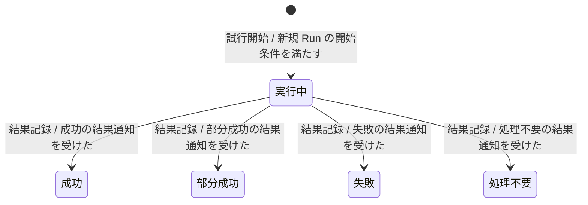
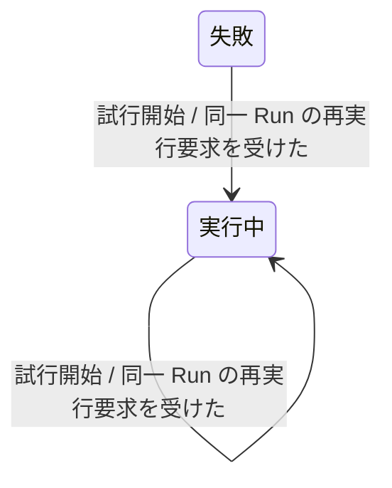

---
specdojo:
  id: stsd-job-run
  type: data
  status: draft
  rulebook: specdojo:stsd-rulebook
  based_on: []
  supersedes: []
---

# ステータス定義（Job Run）

## 1. 概要

Job 定義と冪等キーで識別される一件の Job Run について、現行実装（AS-IS）の試行開始、結果記録、再試行を定義する。運用担当・BA・PO は再実行と確認要否を判断し、ARC・DEV・QE は状態管理と状態ベースのテスト設計に利用することで、人と AI Agent が試行履歴を引き継げるようにする。

- 状態の正本: プロジェクトの実行領域にある `jobs/runs/<run_id>.json` の `state`。各試行の結果は同じ記録の `attempts` の `status` を正とする。checkpoint の生成済み集約記録は現在状態の正本ではない。
- 一意判定: Run は保存された `state` 一つで判定する。過去の試行の失敗や実行中が残っていても Run の状態を上書きして判定しない。実行中は処理の生存を保証しない。
- 対象範囲: 通常実行で永続化された Run を扱う。未作成の Run は状態一覧に含めず、dry-run の仮記録も対象外とする。新規のコマンド実行では、事前判定がスキップを返すと Run・試行を保存しないため、処理不要への遷移にはしない。
- 業務上の到達点と継続管理: 成功・部分成功・失敗・処理不要の結果記録を一試行の到達点とする。結果記録後もレビュー結果と確認時刻を更新する管理が続くため、終了点は置かない。成功・部分成功・処理不要は、本図で出力遷移のない継続状態とする。

状態値・試行の型は `src/job/definition.ts` の `JobRunState`・`JobRunAttempt`、開始・結果・レビュー記録は `src/job/job.ts` の `materializeJobRun`・`completeJobRun`・`recordJobRunReview` に基づく。結果を選ぶ業務判断の未確認範囲は「今後の検討メモ」に残す。

## 2. 状態一覧

成立条件は Run の記録に対する条件である。同じ値を持つ試行は、その試行だけの開始・結果を表す。

| 値          | 状態名   | 通称 | 意味                                                                             | 成立条件                      | 管理場所     |
| ----------- | -------- | ---- | -------------------------------------------------------------------------------- | ----------------------------- | ------------ |
| `running`   | 実行中   | -    | 最新試行の開始が記録され、その試行の結果がまだ記録されていない                   | Run の `state` が `running`   | Job Run 記録 |
| `succeeded` | 成功     | -    | 成功として結果が記録された Run。受入承認や統合完了まではこの状態だけで保証しない | Run の `state` が `succeeded` | Job Run 記録 |
| `partial`   | 部分成功 | -    | 部分成功として結果が記録された Run。同じ Run の自動的な再試行対象にはならない    | Run の `state` が `partial`   | Job Run 記録 |
| `failed`    | 失敗     | -    | 失敗として結果が記録され、同じ Run で試行を追加できる                            | Run の `state` が `failed`    | Job Run 記録 |
| `noop`      | 処理不要 | -    | 処理不要として結果が記録された Run。Run 作成前のスキップとは区別する             | Run の `state` が `noop`      | Job Run 記録 |

## 3. 状態遷移図

業務状態は5、遷移は7であり、実行中に接続する入出力遷移が6を超えるため、開始・結果記録と再試行に分割する。接続状態は実行中・失敗であり、全体の到達性は両図をつないで読む。

### 3.1. 開始・結果記録（T-01〜T-05）

### 3.2. 再試行（T-06〜T-07）

## 4. 遷移の説明

開始条件は、有効な Job 定義・入力・空でない冪等キーが解決でき、同一 Run の記録がなく、通常実行で事前判定によるスキップ・異常がないことである。同一 Run の再実行要求では、Job と冪等キーの一致を確認する。

`T-01`・`T-06`・`T-07` は `src/job/job.ts` の `materializeJobRun`、`T-02`〜`T-05` は同ファイルの `completeJobRun` で確認できる。結果通知は四つのうち一つを受け取る記録上の条件であり、終了コードなどから通知を選ぶ規則は参照範囲では確定しない。

| 遷移 ID | 遷移元 | 遷移先   | イベント | 条件                          | 補足                                                                                                                                     |
| ------- | ------ | -------- | -------- | ----------------------------- | ---------------------------------------------------------------------------------------------------------------------------------------- |
| `T-01`  | 開始   | 実行中   | 試行開始 | 新規 Run の開始条件を満たす   | Run と第1試行の開始を保存する。保存後に実行計画の作成が失敗しても、実行中の記録は残り得る                                                |
| `T-02`  | 実行中 | 成功     | 結果記録 | 成功の結果通知を受けた        | -                                                                                                                                        |
| `T-03`  | 実行中 | 部分成功 | 結果記録 | 部分成功の結果通知を受けた    | -                                                                                                                                        |
| `T-04`  | 実行中 | 失敗     | 結果記録 | 失敗の結果通知を受けた        | -                                                                                                                                        |
| `T-05`  | 実行中 | 処理不要 | 結果記録 | 処理不要の結果通知を受けた    | -                                                                                                                                        |
| `T-06`  | 失敗   | 実行中   | 試行開始 | 同一 Run の再実行要求を受けた | 過去の試行を再開せず保持し、試行番号を一つ増やして新しい試行の開始を記録する。Run の入力・タスク・開始前 checkpoint は既存記録を引き継ぐ |
| `T-07`  | 実行中 | 実行中   | 試行開始 | 同一 Run の再実行要求を受けた | 新しい試行を追加するための自己遷移。前の試行を失敗扱いにはせず、実行中のまま保持する。新規作成時の事前判定は再実施しない                 |

- 成功・部分成功・処理不要の Run に同じ要求が来た場合、既存結果を返し、試行・状態を更新しない。レビュー結果の記録も `state` と試行の `status` を変えないため、図の自己遷移にはしない。
- 各結果記録（`T-02`〜`T-05`）では、Run と最新試行を同じ結果に更新し、最新試行に完了時刻・結果参照を設定する。証跡参照・終了コード・理由は渡された場合だけ記録する。試行単位の実行中から各結果への変化もこれらの遷移に対応する。
- checkpoint は Job に定義があり、結果が `advance_on` の対象の場合だけ進める。許容される対象は成功・処理不要で、未指定時は両方を対象とする。更新有無は結果状態を変えず、部分成功を成功に読み替えない。

## 5. 今後の検討メモ

| 論点                                                                                                                                                                                                                                                                                                                                 | 影響する状態・遷移                             | 決定者            | 決定時期                           |
| ------------------------------------------------------------------------------------------------------------------------------------------------------------------------------------------------------------------------------------------------------------------------------------------------------------------------------------ | ---------------------------------------------- | ----------------- | ---------------------------------- |
| _UNDECIDED_: `prj-0001:bdd-job-run` は未作成。状態名・イベント名、部分成功と処理不要の業務上の境界、および成功の受入条件を合意する必要がある。指定実装は結果の受取・保存を確認できるが、呼出元による終了コード・agent の成否・レビュー・統合結果からの状態選択は未確認。`partial_exit_code` の宣言だけでは選択規則全体を確定できない | 全状態、`T-02`〜`T-05`                         | BA、PO、QE        | 業務データ辞書の策定・本書の承認時 |
| _UNDECIDED_: 実行中の再実行で前の試行が実行中のまま残る。指定実装に生存確認・重複実行の排除はなく、呼出元の排他制御は未確認。安全な再試行の判断責任と残留試行の確定方法を合意する                                                                                                                                                    | 実行中、`T-07`                                 | PO、運用担当、ARC | 再試行・復旧方針の合意時           |
| _UNDECIDED_: 結果の保存処理は試行の存在を確認するが、遷移元が実行中かは確認せず、記録済み結果を再更新できる。本図は開始から結果記録までの経路を扱い、結果訂正を承認済みの業務遷移として追加しない。結果訂正を許すか、遷移元を制限するかを決める                                                                                      | 成功・部分成功・失敗・処理不要、`T-02`〜`T-05` | BA、PO、ARC       | 結果訂正方針の合意時               |

業務データ辞書の作成後、合意内容を照合して `based_on` へ追加する。
