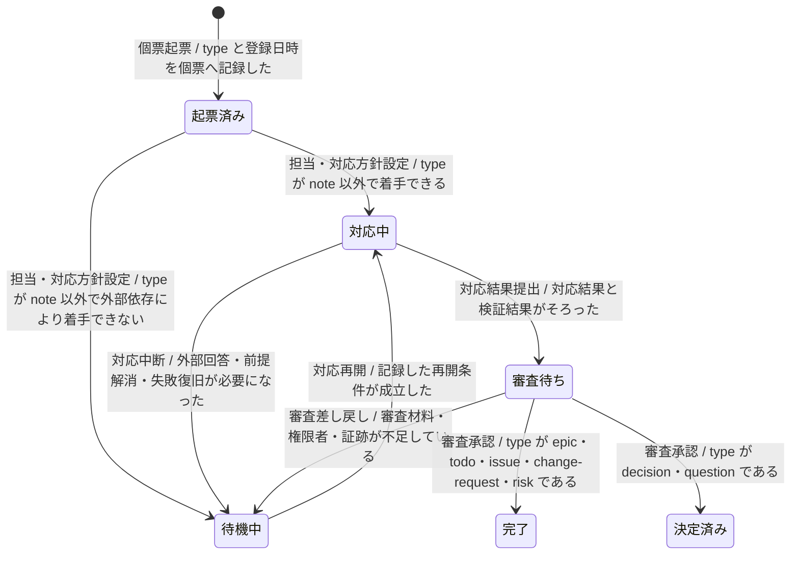
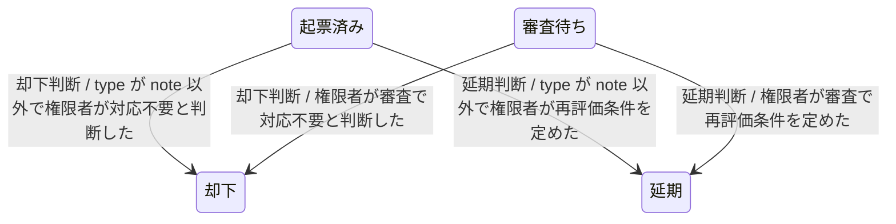
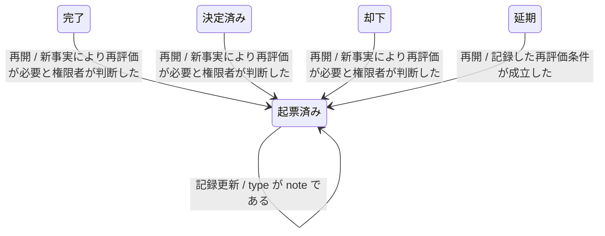

---
specdojo:
  id: stsd-register-entry
  type: data
  status: draft
  rulebook: specdojo:stsd-rulebook
  based_on: []
  supersedes: []
---

# ステータス定義（登録項目個票）

## 1. 概要

登録簿で追跡する計画外事項・判断事項（登録項目）について、現行運用（AS-IS）の起票から対応、審査、終了、再開までの状態と遷移を定義する。項目 owner と type 別承認者は現在状態から次の行動と終了判断を、ARC・QE・DEV は状態遷移の設計・検証・実装の基礎として利用する。

- 対象: 登録簿の一項目一ファイルの個票で管理する登録項目（`epic`、`todo`、`question`、`risk`、`issue`、`change-request`、`decision`、`note`）
- スコープ: 現行運用（AS-IS）の起票、担当・対応方針設定、人または AI Agent による対応・調査、審査・終了判断、終了項目の再開
- 状態の正本: 個票 Frontmatter の `item_status`。登録日時・完了日時・結論はそれぞれ `registered_at`・`completed_at`・`conclusion` で保持する。登録項目一覧や状態別ビューは個票から再生成する派生物である
- 一意判定: `item_status` の単一の値で現在状態を判定する。履歴は個票とは別の event ファイルで管理する。旧来の個票内 event を外部へ移し、Git 履歴を event に変換する処理がある。履歴の最終到達状態と現在状態を一致させる方針は維持するが、その検証本体は今回の確認範囲外である
- 日時の記録: 登録日時と完了日時は UTC・RFC 3339・秒精度で個票へ保持する。一覧の登録日・完了日はプロジェクトの IANA タイムゾーンへ変換した暦日として導出し、期限は同タイムゾーン上の暦日として保持する
- 終了点を置かない理由: 業務上の到達点は完了・決定済み・却下・延期である。いずれも再評価のため再開できる状態として管理を続け、ライフサイクルを閉じない。`note` は起票済みのまま共有・備忘の記録を更新し続ける。本書の全図を通して、出力遷移のない継続状態はない
- AI Agent の責任範囲: AI Agent は対応・調査と検証を支援するが項目を終端化しない。完了・決定・却下・延期・再開の判断は人間が担う

`epic` は Frontmatter の `track` で track を担い、具体的な作業は `derived_from` でつないだ子 todo で実施する。自身は `exec run --register` と夜間 queue の対象にしない。子項目と schedule を判断材料に人が close し、子の状態から自動遷移しない。

指定実装で確認したのは状態値、個票の読み書き、旧履歴のイベント分類である。以下の業務上の意味・承認方針・遷移条件は既存定義を保持する。実装による強制を確認できない点は「今後の検討メモ」に区別し、履歴に現れる遷移から業務上の許可を推定しない。

### 1.1. type 別の審査・承認と到達できる状態

| type             | 審査・承認者               | 審査待ち後の主な判断                               | 既定の証跡       |
| ---------------- | -------------------------- | -------------------------------------------------- | ---------------- |
| `change-request` | 変更承認権限者（PO / CCB） | 承認後に完了、または却下・延期・待機               | PR approve       |
| `decision`       | 当該領域の意思決定者       | 決定済み、または却下・延期・追加確認の待機         | 個票と commit    |
| `risk`           | リスクオーナー             | 対応完了・受容による完了、延期、追加確認の待機     | 個票と commit    |
| `question`       | 回答権限者                 | 回答確定後に決定済み、または追加確認の待機         | 個票と commit    |
| `issue`          | 課題リード                 | 対応確認後に完了、または却下・延期                 | result と commit |
| `epic`           | track の完了を判断する人   | 子項目と schedule を確認して完了、または却下・延期 | 個票と commit    |
| `todo`           | 項目 owner・レビュー担当   | 対応確認後に完了、または延期・待機                 | result と commit |
| `note`           | 審査・承認の対象外         | 審査へ進めず、起票済みのまま記録を更新し続ける     | 個票と commit    |

既定は commit による証跡とする。PR 承認を強制するのは、`develop → main` 昇格、`change-request` 承認、不可逆・高リスク・framework schema 破壊的変更の三ケースである。詳細は [[specdojo:register-operation-guide|登録簿運用ガイド]] と [[specdojo:git-branching-standard|Git ブランチ運用標準]] を正とする。

## 2. 状態一覧

現在状態の成立条件は正本の状態値で判定する。担当・期限・証跡などの業務上の充足条件と、その実装検証の確認範囲は第 5 章に示す。

| 値            | 状態名   | 通称   | 意味                                                                        | 成立条件                                                    | 管理場所         |
| ------------- | -------- | ------ | --------------------------------------------------------------------------- | ----------------------------------------------------------- | ---------------- |
| `open`        | 起票済み | 未着手 | 起票または再開され、対応に着手していない項目。`note` では継続更新できる記録 | `item_status` が `open`（未設定・空欄時も読み取りでは同値） | 個票 Frontmatter |
| `in-progress` | 対応中   | -      | 担当者または AI Agent が対応・調査している項目                              | `item_status` が `in-progress`                              | 個票 Frontmatter |
| `waiting`     | 待機中   | 保留   | 外部回答、前提解消、失敗復旧、審査材料の補完を待つ項目                      | `item_status` が `waiting`                                  | 個票 Frontmatter |
| `review`      | 審査待ち | -      | 対応結果について人間の審査・承認を待つ項目                                  | `item_status` が `review`                                   | 個票 Frontmatter |
| `done`        | 完了     | -      | 対応が確認され、追跡を終えた項目                                            | `item_status` が `done`                                     | 個票 Frontmatter |
| `decided`     | 決定済み | -      | 判断・回答が確定し、追跡を終えた `decision` または `question`               | `item_status` が `decided`                                  | 個票 Frontmatter |
| `rejected`    | 却下     | -      | 対応・変更を行わないと判断した項目                                          | `item_status` が `rejected`                                 | 個票 Frontmatter |
| `deferred`    | 延期     | -      | 現時点では実施せず、再評価条件の成立を待つ項目                              | `item_status` が `deferred`                                 | 個票 Frontmatter |

## 3. 状態遷移図

業務状態は 8、遷移は 18 だが、起票済みへの入出力遷移の合計が 6 を超えるため、業務フェーズで三図に分ける。接続状態は、3.1 と 3.2 が起票済み・審査待ち、3.1 と 3.3 が起票済み・完了・決定済み、3.2 と 3.3 が起票済み・却下・延期である。各図で同じ表示名と `state_id` を使い、初期点は 3.1 にだけ置く。

### 3.1. 着手・対応・審査（T-01、T-03、T-04、T-07〜T-12）

### 3.2. 却下・延期（T-05、T-06、T-13、T-14）

### 3.3. 記録更新・再開（T-02、T-15〜T-18）

## 4. 遷移の説明

業務イベントと条件は既存の定義を維持する。指定実装での対応は、旧履歴の起票が `add`、遷移先が対応中なら `start`、待機中なら `wait`、審査待ちなら `review`、完了・決定済みなら `close`、却下なら `reject`、延期なら `defer`、終端から非終端への変更なら他の分類より優先して `reopen` である。これは履歴の分類であり、以下の許可元状態・条件の検証を示すものではない（第 5 章）。

| 遷移 ID | 遷移元   | 遷移先   | イベント           | 条件                                                             | 補足                                                                                                    |
| ------- | -------- | -------- | ------------------ | ---------------------------------------------------------------- | ------------------------------------------------------------------------------------------------------- |
| `T-01`  | 開始     | 起票済み | 個票起票           | type と登録日時を個票へ記録した                                  | 提起者・BA・PM が type を選ぶ。計画済み作業は Schedule で扱い、登録簿へ重複登録しない                   |
| `T-02`  | 起票済み | 起票済み | 記録更新           | type が `note` である                                            | `note` は審査・終了の対象外で、起票済みのまま内容を更新する。対応や判断が必要になったら別項目を起票する |
| `T-03`  | 起票済み | 対応中   | 担当・対応方針設定 | type が `note` 以外で着手できる                                  | 担当・期限・人または AI Agent の対応経路を個票へ記録する                                                |
| `T-04`  | 起票済み | 待機中   | 担当・対応方針設定 | type が `note` 以外で外部依存により着手できない                  | 待機理由と再開条件を記録する                                                                            |
| `T-05`  | 起票済み | 却下     | 却下判断           | type が `note` 以外で権限者が対応不要と判断した                  | 却下理由と完了日時を記録する                                                                            |
| `T-06`  | 起票済み | 延期     | 延期判断           | type が `note` 以外で権限者が再評価条件を定めた                  | 延期理由と再評価条件を記録する                                                                          |
| `T-07`  | 対応中   | 待機中   | 対応中断           | 外部回答・前提解消・失敗復旧が必要になった                       | AI Agent 実行・検査・result 作成・commit の失敗時は項目を終端化せず、失敗理由と result を残して待機する |
| `T-08`  | 待機中   | 対応中   | 対応再開           | 記録した再開条件が成立した                                       | 失敗復旧後は保持した成果物・result を確認してから再実行または人対応を選ぶ                               |
| `T-09`  | 対応中   | 審査待ち | 対応結果提出       | 対応結果と検証結果がそろった                                     | AI Agent の成功時もここまでで止まり、終端化は人間の審査で行う                                           |
| `T-10`  | 審査待ち | 待機中   | 審査差し戻し       | 審査材料・権限者・証跡が不足している                             | 不足情報、取得責任者、再審査条件を記録する                                                              |
| `T-11`  | 審査待ち | 完了     | 審査承認           | type が `epic`・`todo`・`issue`・`change-request`・`risk` である | type 別承認者が承認し、結論と完了日時を記録する。`change-request` は PR approve を証跡とする            |
| `T-12`  | 審査待ち | 決定済み | 審査承認           | type が `decision`・`question` である                            | 意思決定者または回答権限者が確定し、結論と完了日時を記録する                                            |
| `T-13`  | 審査待ち | 却下     | 却下判断           | 権限者が審査で対応不要と判断した                                 | 却下理由と完了日時を記録する                                                                            |
| `T-14`  | 審査待ち | 延期     | 延期判断           | 権限者が審査で再評価条件を定めた                                 | 延期理由と再評価条件を記録する                                                                          |
| `T-15`  | 完了     | 起票済み | 再開               | 新事実により再評価が必要と権限者が判断した                       | 旧結論を消さずに再開理由を追記し、完了日時を削除する                                                    |
| `T-16`  | 決定済み | 起票済み | 再開               | 新事実により再評価が必要と権限者が判断した                       | 旧結論を消さずに再開理由を追記し、完了日時を削除する                                                    |
| `T-17`  | 却下     | 起票済み | 再開               | 新事実により再評価が必要と権限者が判断した                       | 旧結論を消さずに再開理由を追記し、完了日時を削除する                                                    |
| `T-18`  | 延期     | 起票済み | 再開               | 記録した再評価条件が成立した                                     | 延期理由を残したまま再開理由を追記する                                                                  |

## 5. 今後の検討メモ

| 論点                                                                                                                                                                                                                                                                                                                                                                                                            | 影響する状態・遷移              | 決定者      | 決定時期                     |
| --------------------------------------------------------------------------------------------------------------------------------------------------------------------------------------------------------------------------------------------------------------------------------------------------------------------------------------------------------------------------------------------------------------- | ------------------------------- | ----------- | ---------------------------- |
| _TODO_: `src/register/item.ts` で 8 状態と現在状態の読み書きを確認した。一方、起票時の type・登録日時、起票済みの完了日時なし、対応中の担当・期限・対応内容、待機理由・再開条件、審査待ちの対応結果・検証結果・承認対象・証跡候補、完了・決定済み・却下の結論と完了日時、延期理由・再評価条件は既存の業務条件として保持する。延期の完了日時を要求しない方針を含め、状態ごとの必須検証は指定実装から確認できない | 全状態、`T-01`、`T-03`〜`T-18`  | BA、ARC、QE | 状態別の検証設計の確定前     |
| _TODO_: `src/register/register.ts` は現在の起票を `create-commands.ts`、遷移を `transition-commands.ts`、更新・終端操作の制御を `update.ts` に委譲している。これらは指定エビデンス外で未調査である。`T-01` は履歴の起票分類、`T-03`〜`T-14` は遷移先による分類だけを確認した。許可元状態、起票時の初期状態、type 別終端先・承認者・証跡、Agent の成功・失敗時の制御、`epic` の実行制約は追加調査で確かめる      | `T-01`、`T-03`〜`T-14`、第 1 章 | ARC、QE     | 遷移実装・受入テストの確定前 |
| _UNDECIDED_: 再開先を起票済みとする既存方針を保持する。旧履歴変換では終端 4 状態から非終端のどの状態への変更も `reopen` に分類し、実際の遷移元・先を残す。対応中・待機中・審査待ちへの直接再開を業務上認めるかは未決であり、起票済みを経由したものとは解釈しない。再開理由・旧結論の保持と完了日時削除の実行も未確認                                                                                            | `T-15`〜`T-18`                  | PO、ARC     | 再開条件の承認時             |
| _UNDECIDED_: 却下・延期は起票済みと審査待ちからとする既存方針を保持する。対応中・待機中からも受け付けるという旧記述は、今回の指定実装では再確認できない。許可範囲を追加調査し、必要なら業務方針または実装の別タスクで扱う                                                                                                                                                                                       | `T-05`、`T-06`、`T-13`、`T-14`  | PO、ARC     | 却下・延期条件の承認時       |
| _UNDECIDED_: `note` を起票済みで継続更新し終了させない既存方針を保持する。旧履歴の状態不変の通常更新は `update` となるが、`note` 限定の自己遷移や着手・終了の拒否は指定実装から確認できない                                                                                                                                                                                                                     | `T-02`〜`T-06`、`T-11`〜`T-14`  | PO、ARC、QE | `note` の受入条件の確定前    |
| _TODO_: 業務データ辞書（`bdd-register-entry.yaml`）はカタログに定義されているが未作成である。作成後に用語を照合し、依存関係上許可された `prj-0001:bdd-register-entry` を `based_on` に追加する                                                                                                                                                                                                                  | 全状態                          | BA          | `bdd-register-entry` 作成時  |
