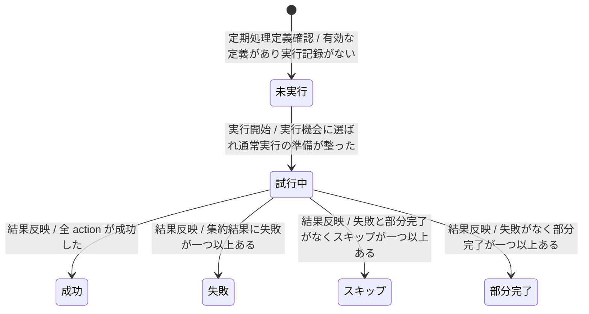
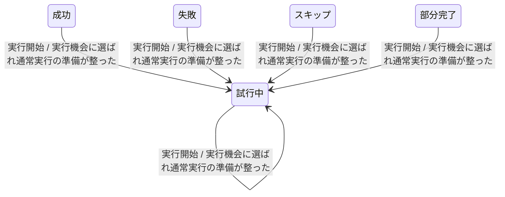

---
specdojo:
  id: stsd-routine-run
  type: data
  status: draft
  rulebook: specdojo:stsd-rulebook
  based_on: []
  supersedes: []
---

# ステータス定義（定期処理の実行結果）

## 1. 概要

定期処理定義（routine）一件の直近の実行結果について、現行運用（AS-IS）の実行開始から結果確定、次の実行までの状態と遷移を定義する。PM・運用担当が結果と確認要否を共通の記録から判断できるようにし、個人の記憶に依存する確認・引継ぎの負担を減らす（[[prj-0001:prj-overview|プロジェクト概要]] の `BV-03`）。状態が一意に分からなければ、PM・運用担当は完了確認と再実行の要否を判断できない。

BA は業務定義との照合と状態・遷移の説明を担い、PO は本書の業務承認前に正常・例外経路の妥当性を確認する。ARC・QE・DEV は、同じ判定条件を状態管理の設計・検証・実装に利用する。

- 対象: 定期処理定義一件の実行状態（直前実行時刻、直前結果、cron の処理済み予定時刻）
- スコープ: due（実行時期到来）の判定、実行開始の先行記録、action の結果集約と記録。委譲先の登録項目・task・Job Run の状態は対象外とし、[[prj-0001:stsd-register-entry|ステータス定義（登録項目個票）]]、[[prj-0001:stsd-task-execution|ステータス定義（タスク実行）]]、[[prj-0001:stsd-job-run|ステータス定義（Job Run）]] を参照する
- 状態の正本: routine 実行状態の `last_run` と `last_result`。`last_scheduled_for` は cron の処理済み予定時刻、配列 action の `last_action_results` は段別結果である。実行履歴は結果確定後の記録であり、現在状態の正本とはしない
- 一意判定: 実行記録がなければ未実行、記録があれば `last_result` の値で判定する。未実行に保存される結果値はない。開始時に同じ記録の `last_run` と `last_result: running` を更新するため、前回の結果を今回の結果とみなさない。結果が欠落した旧記録や不正な記録は推測で状態に割り当てず、今後の検討メモで扱う
- 業務上の到達点と継続管理: 一回の実行は成功・部分完了・失敗・スキップのいずれかの結果記録を到達点とする。これらの結果は次の実行開始まで管理し、disabled でも明示 ID 実行で更新できるため、終了点は置かない。全状態に次の実行への出力遷移があり、出力遷移のない継続状態はない

判定・更新規則の実装エビデンスは `src/routine/routine.ts`、型と実行機会の選択の実装エビデンスは `src/routine/definition.ts` である。先行する業務データ辞書 `bdd-routine-definition` は未作成のため、業務定義との整合は未確認であり、参照済みの根拠を示す `based_on` は空のままとする（検討項目 `M-04`）。実装の現在動作の確認を業務承認の代わりにはしない。

### 1.1. due 判定と実行機会の選択

| 定義・経路         | 起動条件と選択                                                                                                                                                                                                                           | 実行後の次回判定                                                                                                                 |
| ------------------ | ---------------------------------------------------------------------------------------------------------------------------------------------------------------------------------------------------------------------------------------- | -------------------------------------------------------------------------------------------------------------------------------- |
| interval           | `last_run` がないか不正、または現在時刻との差が interval 以上なら一回 due とする。interval は正の整数と分・時・日・週の単位で定義する。                                                                                                  | 委譲前に更新した `last_run` から次の interval を判定する。失敗・skip でも同じ実行機会を直ちに再試行しない                        |
| cron               | timezone 上の5フィールド cron に一致する予定時刻を選ぶ。`missed_run: skip` は現在分だけを対象とし、処理済み時刻より新しい場合に選ぶ。`latest` または未指定は処理済み時刻の後から現在分までの最新一件、`all` は各予定時刻を古い順に選ぶ。 | 委譲前に各予定時刻を `last_scheduled_for` へ記録する。処理済み時刻がないか不正な場合、`latest`・`all` は直近の一致一件だけを選ぶ |
| 特定 ID の即時実行 | 指定 ID が存在すれば、enabled と due にかかわらず現在時刻を scheduled time として一回選ぶ。                                                                                                                                              | 通常実行と同じく `last_run` と結果を記録する                                                                                     |
| disabled           | due 一括選択から除外する。                                                                                                                                                                                                               | 状態を更新せず、明示 ID 実行または定義変更を待つ                                                                                 |

cron の探索範囲は最大366日であり、処理済み時刻からの探索で1000件を超える一致があると、`latest`・`all` とも実行前に異常終了する。interval と cron は同じ定義へ同時指定できない。routine 全体の lock を取得できない場合や実行前の準備に失敗した場合は、実行状態を更新しない。lock は1時間を超えると古いものとして取得し直す。

`missed_run: skip` で取りこぼした予定時刻は実行せず、状態・履歴を記録しない。次回も現在分の一致と処理済み時刻を比較する。この経路は、action を試行した結果としてのスキップ（`T-05`）とは区別する。

### 1.2. 結果の集約規則

- `action` は Job への委譲または SpecDojo サブコマンドの実行を単一オブジェクト、または1件以上の配列で指定する。配列は先頭から同期的に実行し、各段が結果を返す限り、失敗・部分完了・スキップでも後段を続行する。
- 各 action は、委譲先から専用のスキップ終了通知を受けた場合はスキップ、正常終了し最終の Job 結果通知が部分完了の場合は部分完了、それ以外の正常終了は成功、その他は失敗とする。委譲先内部の判断や成果物作成の有無は本書では確定しない。
- 全体結果は失敗、部分完了、スキップ、成功の優先順で集約する。単一 action はその結果を採用する。配列 action では各段の1始まりの index、kind、結果を `last_action_results` に記録し、単一 action では段別結果を記録しない。
- 開始時に前回の理由・段別結果を消し、結果確定時に今回の理由と段別結果だけを反映する。その後、予定時刻・開始時刻・完了時刻・結果・関連 Job Run ID・取得できた理由を実行履歴へ追記する。dry-run では状態も履歴も記録しない。

## 2. 状態一覧

| 値        | 状態名   | 通称 | 意味                                                                                     | 成立条件                                              | 管理場所         |
| --------- | -------- | ---- | ---------------------------------------------------------------------------------------- | ----------------------------------------------------- | ---------------- |
| -         | 未実行   | -    | 参照できる実行試行の記録がない定期処理                                                   | routine 実行状態に当該 routine の記録がない           | routine 実行状態 |
| `running` | 試行中   | -    | 実行開始を記録し、今回の結果がまだ確定していない定期処理。処理の生存は保証しない         | `last_run` と `last_result: running` が記録されている | routine 実行状態 |
| `success` | 成功     | -    | 直近の全 action が成功した定期処理                                                       | `last_run` と `last_result: success` が記録されている | routine 実行状態 |
| `partial` | 部分完了 | -    | 直近の action に部分完了があり、失敗はない定期処理。スキップを伴う場合も含む             | `last_run` と `last_result: partial` が記録されている | routine 実行状態 |
| `failure` | 失敗     | -    | 直近の action に一つ以上の失敗がある定期処理。他の段の成功等を伴う場合も含む             | `last_run` と `last_result: failure` が記録されている | routine 実行状態 |
| `skipped` | スキップ | -    | 直近の action にスキップがあり、失敗・部分完了はない定期処理。成功した段を伴う場合も含む | `last_run` と `last_result: skipped` が記録されている | routine 実行状態 |

## 3. 状態遷移図

業務状態は6、遷移は11であり、試行中に接続する入出力遷移が6を超えるため、初回実行と結果反映、次の実行開始で二図に分ける。接続状態は試行中・成功・部分完了・失敗・スキップであり、両図で同じ表示名と `state_id` を使う。

### 3.1. 初回実行と結果反映（T-01〜T-05、T-09）

### 3.2. 次の実行開始（T-06〜T-08、T-10〜T-11）

## 4. 遷移の説明

| 遷移 ID | 遷移元   | 遷移先   | イベント         | 条件                                       | 補足                                                                                                                         |
| ------- | -------- | -------- | ---------------- | ------------------------------------------ | ---------------------------------------------------------------------------------------------------------------------------- |
| `T-01`  | 開始     | 未実行   | 定期処理定義確認 | 有効な定義があり実行記録がない             | 定義の読込と実行状態の参照により判定する。未実行という結果値は書き込まない                                                   |
| `T-02`  | 未実行   | 試行中   | 実行開始         | 実行機会に選ばれ通常実行の準備が整った     | due または明示 ID 実行で選ばれ、dry-run ではなく、実行前の準備と lock 取得が完了した場合。委譲前に開始時刻と試行中を記録する |
| `T-03`  | 試行中   | 成功     | 結果反映         | 全 action が成功した                       | 委譲対象なし等の扱いは委譲先の通知に従い、routine 側で独自に判定しない                                                       |
| `T-04`  | 試行中   | 失敗     | 結果反映         | 集約結果に失敗が一つ以上ある               | 同じ実行機会は直ちに再試行せず、次の定期機会または明示実行を待つ                                                             |
| `T-05`  | 試行中   | スキップ | 結果反映         | 失敗と部分完了がなくスキップが一つ以上ある | 一部の段が成功していてもこの結果になる。同じ実行機会は消化済みとする                                                         |
| `T-06`  | 成功     | 試行中   | 実行開始         | 実行機会に選ばれ通常実行の準備が整った     | 開始条件は `T-02` と同じ。今回の開始時刻・試行中で前回の記録を更新する                                                       |
| `T-07`  | 失敗     | 試行中   | 実行開始         | 実行機会に選ばれ通常実行の準備が整った     | 開始条件は `T-02` と同じ。前回失敗の有無は選択条件に使わない                                                                 |
| `T-08`  | スキップ | 試行中   | 実行開始         | 実行機会に選ばれ通常実行の準備が整った     | 開始条件は `T-02` と同じ。次の実行で対象を再評価する                                                                         |
| `T-09`  | 試行中   | 部分完了 | 結果反映         | 失敗がなく部分完了が一つ以上ある           | スキップが含まれていても部分完了を優先する                                                                                   |
| `T-10`  | 部分完了 | 試行中   | 実行開始         | 実行機会に選ばれ通常実行の準備が整った     | 開始条件は `T-02` と同じ。部分完了だけを理由に即時再試行しない                                                               |
| `T-11`  | 試行中   | 試行中   | 実行開始         | 実行機会に選ばれ通常実行の準備が整った     | 開始条件は `T-02` と同じ。前回の試行中記録だけでは次の実行を拒否しない。開始時刻等を更新し、前回試行の結果は確定しない       |

## 5. 今後の検討メモ

以下は未登録の PJR 転記候補であり、担当・期限は後続作業への申し送りである。PM への報告時に各 ID を `docs/ja/projects/prj-0001/controls/project-register/` の別項目として登録し、担当と日程を確定する。表の期限は日付未確定でも先送りしないための着手・承認ゲートを示す。

| ID     | 論点・選択肢と業務影響                                                                                                                                                                                                                              | 影響する状態・遷移                     | 担当 Role | 成果・完了条件                                                                                                                                                                                          | 決定者・判断期限                                 |
| ------ | --------------------------------------------------------------------------------------------------------------------------------------------------------------------------------------------------------------------------------------------------- | -------------------------------------- | --------- | ------------------------------------------------------------------------------------------------------------------------------------------------------------------------------------------------------- | ------------------------------------------------ |
| `M-01` | _UNDECIDED_: 開始後の例外で試行中が残る場合の復旧。人間が確認して再実行する案は確認負担と再実行時の重複処理、失敗へ補正する仕組みを設ける案は生存中処理の誤判定が課題。結果記録後の履歴追記失敗では確定結果は戻らず、履歴との不一致も復旧対象とする | 試行中、`T-03`〜`T-05`、`T-09`、`T-11` | ARC       | 復旧案を PO へ提示し、採用案・検知条件・確認証跡・再実行／結果補正の条件・実施担当・問い合わせ先を承認記録へ残す。QE が例外からの引渡し条件を確認する                                                   | PO。本書の業務承認前、復旧設計の着手前           |
| `M-02` | _UNDECIDED_: 重複起動を現行どおり lock 取得失敗で停止する案は今回の結果が残らず、`policy.overlap: skip` として記録する案は進行中結果を上書きしない管理単位が必要。1時間超の lock 取得し直しによる重複処理の許容範囲も判断する                       | `T-02`、`T-06`〜`T-08`、`T-10`〜`T-11` | ARC       | `M-01` と合わせて停止／スキップの扱いと重複防止・結果保護の条件を PO へ提示し、採用案と `T-11` の扱いを承認記録へ残す                                                                                   | PO。本書の業務承認前、重複起動設計の着手前       |
| `M-03` | _UNDECIDED_: 結果値がない旧記録や不正・欠損記録の移行・復旧。現行は読めない状態ファイルを空として扱い、次回書込みで再生成するため、未実行は過去の実行がないことを保証しない                                                                         | 未実行、試行中、`T-01`                 | ARC       | 旧記録を判定不能として確認へ回すか、証跡から補正するかを比較し、移行規則と欠損時の業務判断を承認記録へ残す                                                                                              | PO。本書の業務承認前、既存記録の移行前           |
| `M-04` | _UNDECIDED_: 未作成の `bdd-routine-definition` が先行依存である。`based_on` への追加だけでは根拠不足を解消できない                                                                                                                                  | 全状態・全遷移                         | BA        | 辞書を先に作成し、対象・用語・実行機会・結果の意味を本書と照合して PO の確認を得る。その後、許可された依存の `based_on` 反映を行う。PM は辞書作成→本書照合→後続設計の順序と Schedule への影響を記録する | PO。本書の業務承認前、後続の状態管理設計の着手前 |

`M-01` の運用案では、運用担当が試行中の記録と実行の生存を別に確認し、開始時刻・予定時刻・結果値、委譲先の通知、取得できた履歴を証跡候補として ARC に調査を依頼する。生存確認ができない場合の再実行・結果補正の可否と PM へのエスカレーションは PO の判断対象であり、自動検知の閾値や確定した復旧手順はまだない。

本書の業務承認には `M-01`〜`M-04` の解消が必要である。BA が辞書との整合、ARC が結果対応と例外時の境界、QE が状態・遷移の検証結果を確認し、PO が業務妥当性を承認する。公開前にはその証跡と静的検査結果を確認する。`ready` への昇格は人間が行う。
