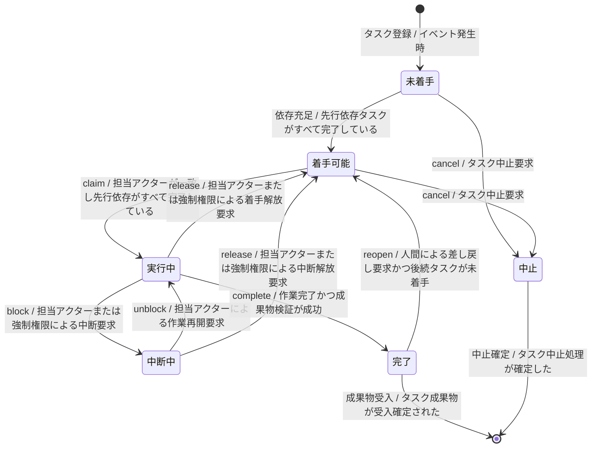

---
specdojo:
  id: prj-0001:stsd-task-execution
  type: data
  status: draft
  rulebook: specdojo:stsd-rulebook
  based_on:
    - prj-0001:bdd-exec-state
    - prj-0001:bdd-exec-event
  supersedes: []
---

# ステータス定義（タスク実行）

SpecDojo におけるタスク実行（Task Execution）のライフサイクルが取り得る状態と状態遷移を定義する。業務分析担当（BA）とプロダクトオーナー（PO）はタスク進行要件と受入条件の合意に利用し、アーキテクト（ARC）、開発担当（DEV）、品質確認担当（QE）は状態導出・状態管理実装および状態遷移テスト設計の参照として利用する。

## 1. 概要

- 対象: スケジュール帳票またはプロジェクト登録簿に基づいて実行されるタスク実行（Task Execution）
- スコープ: 現行実装（AS-IS）におけるタスク実行のライフサイクル（タスク登録、依存解決、着手、中断、再開、着手解放、完了、差し戻し、中止）
- 利用目的と利用者:
  - 業務分析担当（BA）: タスク進行要件、状態定義、受入条件の明確化
  - プロダクトオーナー（PO）: 状態遷移の業務的妥当性の確認・承認
  - アーキテクト（ARC）・開発担当（DEV）: イベント駆動の状態再構成、動的導出、状態ガードの実装参照
  - 品質確認担当（QE）: 状態ベースのテスト設計（正常系・異常系・境界値）への活用
- 状態の正本:
  - 状態変更イベント（`ExecEventV1`）を追記記録するイベントログ（`events/` 配下の JSON ファイル）およびタスク依存関係を保持するスケジュール帳票（`ScheduleIndex`）。
  - `ready`（着手可能）はイベントログに記録される永続化された状態ではなく、記録された最新状態が `todo`（未着手）であり、かつ先行依存タスクがすべて完了（`done`）していることから動的に導出される。
- 一意判定:
  - 対象タスクのイベントログ（追記型イベント列）を時系列で再生（fold）して得られる最新状態と、スケジュール帳票の依存充足判定により、任意の時点でただ一つの状態（未着手、着手可能、実行中、中断中、完了、中止）に一意に判定する。

## 2. 状態一覧

| 値          | 状態名   | 通称     | 意味                                                                                                                | 成立条件                                                                                           | 管理場所                                   |
| ----------- | -------- | -------- | ------------------------------------------------------------------------------------------------------------------- | -------------------------------------------------------------------------------------------------- | ------------------------------------------ |
| `todo`      | 未着手   | 依存待ち | タスクが登録されたが、先行依存タスクが未完了であるため着手できない待機状態                                          | 記録された状態が `todo` であり、先行依存タスクに未完了（`done` 以外）が存在する                    | イベントログ、スケジュール帳票             |
| `ready`     | 着手可能 | 着手待ち | 先行依存がすべて完了し、担当アクターが着手（claim）を宣言できる状態（記録された状態ではなく依存充足から動的に導出） | 記録された状態が `todo` であり、すべての先行依存タスクの状態が `done` である（依存が充足している） | スケジュール帳票（動的導出）、イベントログ |
| `doing`     | 実行中   | 進行中   | 担当アクターによって着手（claim）され、作業または処理が進行している状態                                             | 記録された最新イベントが `claim` または `unblock` である                                           | イベントログ                               |
| `blocked`   | 中断中   | 中断     | 実行中に障害、外部依存、確認待ちなどの理由で作業が一時停止し、再開または解放を待っている状態                        | 記録された最新イベントが `block` である                                                            | イベントログ                               |
| `done`      | 完了     | 完了     | タスクの全作業および成果物の検証が正常に完了した終了状態（後続タスクの着手条件を満たす）                            | 記録された最新イベントが `complete` である                                                         | イベントログ                               |
| `cancelled` | 中止     | 中止     | タスクが不要または実行不能と判断され、永久に破棄された終了状態                                                      | 記録された最新イベントが `cancel` である                                                           | イベントログ                               |

## 3. 状態遷移図

## 4. 遷移の説明

| 遷移 ID | 遷移元   | 遷移先   | イベント   | 条件                                             | 補足                                                                             |
| ------- | -------- | -------- | ---------- | ------------------------------------------------ | -------------------------------------------------------------------------------- |
| `T-01`  | 開始     | 未着手   | タスク登録 | イベント発生時                                   | スケジュール帳票または登録簿へのタスク起票時に初期状態として生成される           |
| `T-02`  | 未着手   | 着手可能 | 依存充足   | 先行依存タスクがすべて完了している               | 先行タスクがすべて `done` となった時点で動的に導出される（イベントログ記録なし） |
| `T-03`  | 着手可能 | 実行中   | `claim`    | 担当アクターが一致し先行依存がすべて完了している | 指定アクターが着手を宣言して作業権限を確保する                                   |
| `T-04`  | 実行中   | 中断中   | `block`    | 担当アクターまたは強制権限による中断要求         | 外部障害や依存待ち等の理由により、作業の一時停止と異常終了理由を記録する         |
| `T-05`  | 中断中   | 実行中   | `unblock`  | 担当アクターによる作業再開要求                   | 中断要因が解消された後、同一アクターが作業を再開する                             |
| `T-06`  | 実行中   | 着手可能 | `release`  | 担当アクターまたは強制権限による着手解放要求     | 仕掛中の着手を解放し、先行依存が充足した再着手待ち（`ready`）へ戻す              |
| `T-07`  | 中断中   | 着手可能 | `release`  | 担当アクターまたは強制権限による中断解放要求     | 中断中の試行を放棄し、先行依存が充足した再着手待ち（`ready`）へ戻す              |
| `T-08`  | 実行中   | 完了     | `complete` | 作業完了かつ成果物検証が成功                     | 担当アクターが全作業の完了と検証合格を記録し、後続タスクの着手を可能にする       |
| `T-09`  | 完了     | 着手可能 | `reopen`   | 人間による差し戻し要求かつ後続タスクが未着手     | 人間のみ実行可能。後続タスクが進行・完了していない場合に限り、再作業待ちへ戻す   |
| `T-10`  | 未着手   | 中止     | `cancel`   | タスク中止要求                                   | 着手前のタスクを恒久的に破棄・中止する                                           |
| `T-11`  | 着手可能 | 中止     | `cancel`   | タスク中止要求                                   | 着手可能となったが不要となったタスクを恒久的に破棄・中止する                     |
| `T-12`  | 完了     | 終了     | 成果物受入 | タスク成果物が受入確定された                     | プロジェクト進行または成果物利用により、タスク実行ライフサイクルを完了する       |
| `T-13`  | 中止     | 終了     | 中止確定   | タスク中止処理が確定した                         | 不要タスクの破棄処理を終了し、ライフサイクルから除外する                         |

## 5. 今後の検討メモ

| 論点                                                                                  | 影響する状態・遷移                         | 決定者   | 決定時期                    |
| ------------------------------------------------------------------------------------- | ------------------------------------------ | -------- | --------------------------- |
| _UNDECIDED_: 状態を変更しないイベント（note / link / estimate）の業務仕様上の位置づけ | 全状態、自己遷移                           | BA、ARC  | 次期実行機能拡張時          |
| _UNDECIDED_: 先行依存の巻き戻しに伴う着手可能から未着手への逆導出の扱い               | `未着手`、`着手可能`、`T-02`               | BA、PO   | `bdd-exec-state` 仕様策定時 |
| _ASSUMPTION_: レガシー cancel イベント（doing / blocked からの cancel）の後方互換扱い | `実行中`、`中断中`、`中止`、`T-10`、`T-11` | ARC、DEV | イベントスキーマ v2 検討時  |
