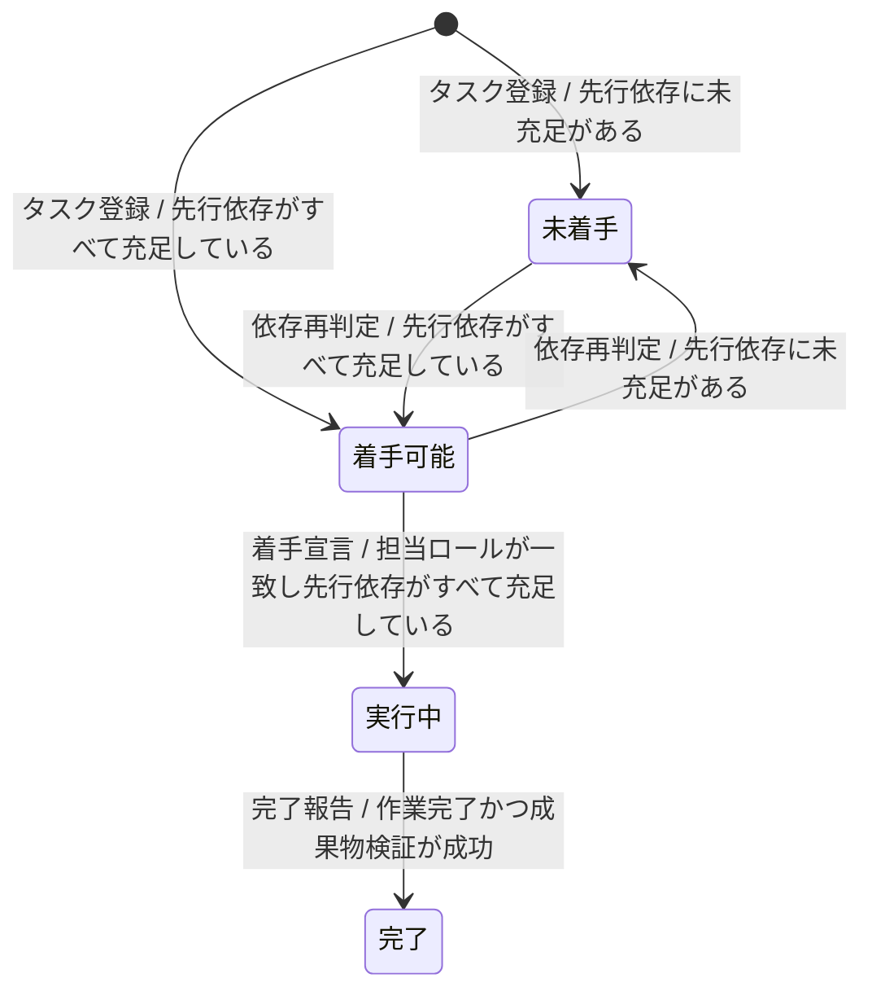
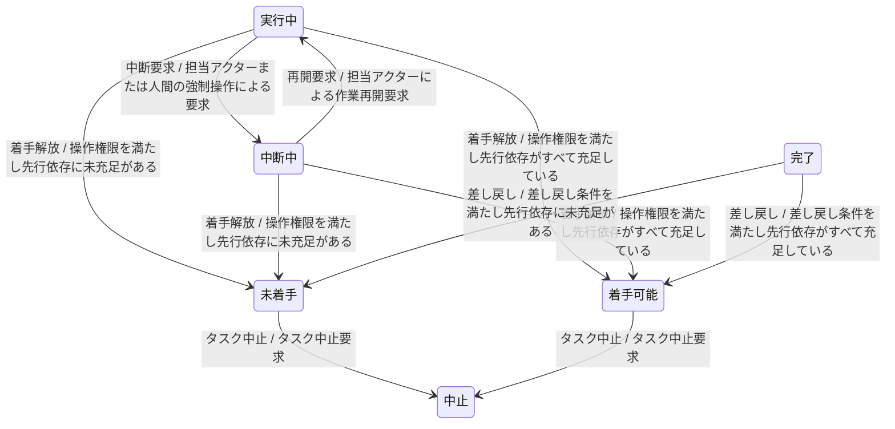

---
specdojo:
  id: prj-0001:stsd-task-execution
  type: data
  status: draft
  rulebook: specdojo:stsd-rulebook
  based_on:
    - prj-0001:bdd-exec-state
    - prj-0001:bdd-exec-event
  supersedes: []
---

# ステータス定義（タスク実行）

SpecDojo におけるタスク実行（Task Execution）のライフサイクルが取り得る状態と状態遷移を定義する。

## 1. 概要

- 対象: スケジュール帳票またはプロジェクト登録簿に基づいて実行されるタスク実行（Task Execution）
- スコープ: 現行実装（AS-IS）におけるタスク実行のライフサイクル（タスク登録、依存解決、着手、中断、再開、着手解放、完了、差し戻し、中止）
- 利用目的と利用者: 業務分析担当（BA）とプロダクトオーナー（PO）はタスク進行要件と受入条件を合意し、状態遷移の業務的妥当性を確認・承認する。アーキテクト（ARC）・開発担当（DEV）は状態導出・状態管理実装に、品質確認担当（QE）は正常系・例外系・境界の状態遷移テスト設計に利用し、人と AI Agent が記録を基に作業を分担・引き継げるようにする。
- 状態の正本:
  - 状態変更イベント（`ExecEventV1`）を追記記録するイベントログ（`events/` 配下の JSON ファイル）およびタスク依存関係を保持するスケジュール帳票（`ScheduleIndex`）。
  - 先行依存の充足は、タスクなら完了（`done`）、マイルストーン・ゲートならその先行依存がすべて充足していることで判定する。依存先が存在しない場合や、マイルストーン・ゲートをたどって循環する場合は未充足とし、依存がない場合は充足とする。中止（`cancelled`）は完了の代わりにならない。
- 一意判定:
  - 対象タスクのイベントログ（追記型イベント列）を再生して得る基本状態を正とする。イベントがないタスクの基本状態は `todo` とし、同時刻のイベントは状態遷移として成立する順に並べて再生する。
  - 基本状態が `todo` の場合だけ、依存充足により未着手か着手可能かを判定する。`ready` は永続化しない導出状態であり、依存が再び未充足になれば未着手へ戻る。他の基本状態は依存の変化だけでは変えない。
  - `note`（補足記録）、`link`（参照の追加）、`estimate`（見積更新）は状態を変えないため、最新イベントの種類だけでは現在状態を判定しない。状態の意味が変わらない記録更新は図の自己遷移にしない。
- 対象範囲の到達点: 完了は後続タスクの依存充足に用い、必要なら差し戻せる到達点とする。中止は以後の状態変更を行わない継続状態とし、補足記録の追記と状態の確認は続ける。現行のイベント型に「成果物受入」「中止確定」はなく、完了・中止後も記録に基づく状態管理を継続するため、終了点への追加遷移は置かない。
- 互換性の境界: 以下の図表は現在発行する状態変更を扱う。過去の実行中・中断中からの `cancel` は、中止ではなく基本状態を `todo` に戻す記録として再生し、依存を再判定する。現在この操作は `release` で記録する。

## 2. 状態一覧

| 値          | 状態名   | 通称     | 意味                                                                                             | 成立条件                                                                                       | 管理場所                                   |
| ----------- | -------- | -------- | ------------------------------------------------------------------------------------------------ | ---------------------------------------------------------------------------------------------- | ------------------------------------------ |
| `todo`      | 未着手   | 依存待ち | タスクが登録されたが、先行依存が未充足であるため着手できない待機状態                             | 基本状態が `todo` で、未充足の先行依存が一つ以上ある                                           | イベントログ、スケジュール帳票             |
| `ready`     | 着手可能 | 着手待ち | 先行依存がすべて充足し、担当アクターが着手を宣言できる導出状態                                   | 基本状態が `todo` で、すべての先行依存が充足している（依存なしを含む）                         | スケジュール帳票（動的導出）、イベントログ |
| `doing`     | 実行中   | 進行中   | 担当アクターによって着手され、作業または処理が進行している状態                                   | イベント列の再生結果が `doing`。最後に状態を変えたイベントが `claim` または `unblock` である   | イベントログ                               |
| `blocked`   | 中断中   | 中断     | 実行中に障害、外部依存、確認待ちなどの理由で作業が一時停止し、再開または解放を待っている状態     | イベント列の再生結果が `blocked`。最後に状態を変えたイベントが `block` である                  | イベントログ                               |
| `done`      | 完了     | -        | タスクの全作業および成果物の検証が正常に完了したと報告された状態（後続タスクの着手条件を満たす） | イベント列の再生結果が `done`。最後に状態を変えたイベントが `complete` である                  | イベントログ                               |
| `cancelled` | 中止     | -        | タスクが不要または実行不能と判断され、恒久的に中止された状態                                     | イベント列の再生結果が `cancelled`。着手前の基本状態 `todo` に対する `cancel` が記録されている | イベントログ                               |

## 3. 状態遷移図

着手可能に接続する遷移が 6 本を超えるため、通常系と例外系に分割する。未着手・着手可能・実行中・完了を図間の接続状態とし、初期点からの到達性は両図をつないで読む。

通常系（`T-01`〜`T-03`、`T-08`、`T-14`〜`T-15`）。

例外系（`T-04`〜`T-07`、`T-09`〜`T-11`、`T-16`〜`T-18`）。

## 4. 遷移の説明

着手解放の「操作権限」は、担当アクターからの要求、または強制操作を明示した人間からの要求を指す。完了報告にも同じ操作権限を要する。「差し戻し条件」は、人間からの要求であり、直接・間接の後続タスクに実行中・中断中・完了が一つもないことを指す。

| 遷移 ID | 遷移元   | 遷移先   | イベント   | 条件                                             | 補足                                                                                                           |
| ------- | -------- | -------- | ---------- | ------------------------------------------------ | -------------------------------------------------------------------------------------------------------------- |
| `T-01`  | 開始     | 未着手   | タスク登録 | 先行依存に未充足がある                           | タスクが実行管理の対象になった時点の判定。登録自体に状態変更イベントは不要                                     |
| `T-02`  | 未着手   | 着手可能 | 依存再判定 | 先行依存がすべて充足している                     | イベントログへ記録せず、現在の依存関係と状態から導出する                                                       |
| `T-03`  | 着手可能 | 実行中   | 着手宣言   | 担当ロールが一致し先行依存がすべて充足している   | `claim`。指定アクターが作業権限を確保する。ロール照合の例外は検討メモ参照                                      |
| `T-04`  | 実行中   | 中断中   | 中断要求   | 担当アクターまたは人間の強制操作による要求       | `block`。外部障害や確認待ち等による一時停止と理由を記録する                                                    |
| `T-05`  | 中断中   | 実行中   | 再開要求   | 担当アクターによる作業再開要求                   | `unblock`。中断要因の解消後、同一アクターが再開する業務要件を維持する。権限の実装との差異は検討メモ参照        |
| `T-06`  | 実行中   | 着手可能 | 着手解放   | 操作権限を満たし先行依存がすべて充足している     | `release`。仕掛中の着手を解放して基本状態を `todo` に戻し、再着手可能と判定する                                |
| `T-07`  | 中断中   | 着手可能 | 着手解放   | 操作権限を満たし先行依存がすべて充足している     | `release`。中断中の試行を放棄して基本状態を `todo` に戻し、再着手可能と判定する                                |
| `T-08`  | 実行中   | 完了     | 完了報告   | 作業完了かつ成果物検証が成功                     | `complete`。操作権限を持つアクターが完了と検証合格を報告する。完了イベントだけで成果物の受入承認まで保証しない |
| `T-09`  | 完了     | 着手可能 | 差し戻し   | 差し戻し条件を満たし先行依存がすべて充足している | `reopen`。完了記録を消さずに基本状態を `todo` に戻し、再作業待ちへ戻す。後続が中止の場合は差し戻しを妨げない   |
| `T-10`  | 未着手   | 中止     | タスク中止 | タスク中止要求                                   | `cancel`。着手前のタスクを恒久的に中止する。実行中・中断中からは直接中止せず、先に着手解放する                 |
| `T-11`  | 着手可能 | 中止     | タスク中止 | タスク中止要求                                   | `cancel`。着手可能となったが不要となったタスクを恒久的に中止する                                               |
| `T-14`  | 開始     | 着手可能 | タスク登録 | 先行依存がすべて充足している                     | 依存がないタスクも、未着手を経由せず初めから着手可能と判定する                                                 |
| `T-15`  | 着手可能 | 未着手   | 依存再判定 | 先行依存に未充足がある                           | 先行タスクの差し戻し等で着手条件を失う。対象タスク自身のイベントは追加しない                                   |
| `T-16`  | 実行中   | 未着手   | 着手解放   | 操作権限を満たし先行依存に未充足がある           | `release`。基本状態を `todo` に戻した後も、依存が充足するまで再着手できない                                    |
| `T-17`  | 中断中   | 未着手   | 着手解放   | 操作権限を満たし先行依存に未充足がある           | `release`。中断中の試行を放棄し、依存待ちへ戻す                                                                |
| `T-18`  | 完了     | 未着手   | 差し戻し   | 差し戻し条件を満たし先行依存に未充足がある       | `reopen`。基本状態を `todo` に戻し、依存が充足してから再作業に着手する                                         |

## 5. 今後の検討メモ

| 論点                                                                                                                                                                                                                    | 影響する状態・遷移     | 決定者      | 決定時期                     |
| ----------------------------------------------------------------------------------------------------------------------------------------------------------------------------------------------------------------------- | ---------------------- | ----------- | ---------------------------- |
| _UNDECIDED_: `prj-0001:bdd-exec-state`、`prj-0001:bdd-exec-event` は未作成。状態名・通称・イベントの業務的合意を本文と照合し、承認する必要がある。現行動作の確認だけでは業務上の承認を代替しない                        | 全状態・全遷移         | BA、PO      | 両業務データ辞書の仕様策定時 |
| _UNDECIDED_: 担当ロール一致の要件に対し、現行の着手判定は両者のロール指定がある場合だけ照合し、明示的な不一致許可も受け付ける。例外の業務上の許可条件を合意するまで本文の一致要件を維持する                             | 着手可能、`T-03`       | BA、PO      | `bdd-exec-event` 仕様策定時  |
| _UNDECIDED_: 同一アクターによる再開要件に対し、参照した再開判定は中断中であることのみを確認し、アクターを照合しない。他者による再開を許す承認根拠がないため、本文の要件を維持して責任境界を合意する                     | 中断中、実行中、`T-05` | BA、PO、ARC | `bdd-exec-event` 仕様策定時  |
| _UNDECIDED_: 完了の業務条件は作業完了・成果物検証成功を維持するが、参照した完了判定が確認するのは状態と操作権限である。検証合格・受入承認の証跡と確認責任は参照範囲で確定できないため、後続の業務データ辞書で明確にする | 完了、`T-08`           | BA、PO      | `bdd-exec-event` 仕様策定時  |
