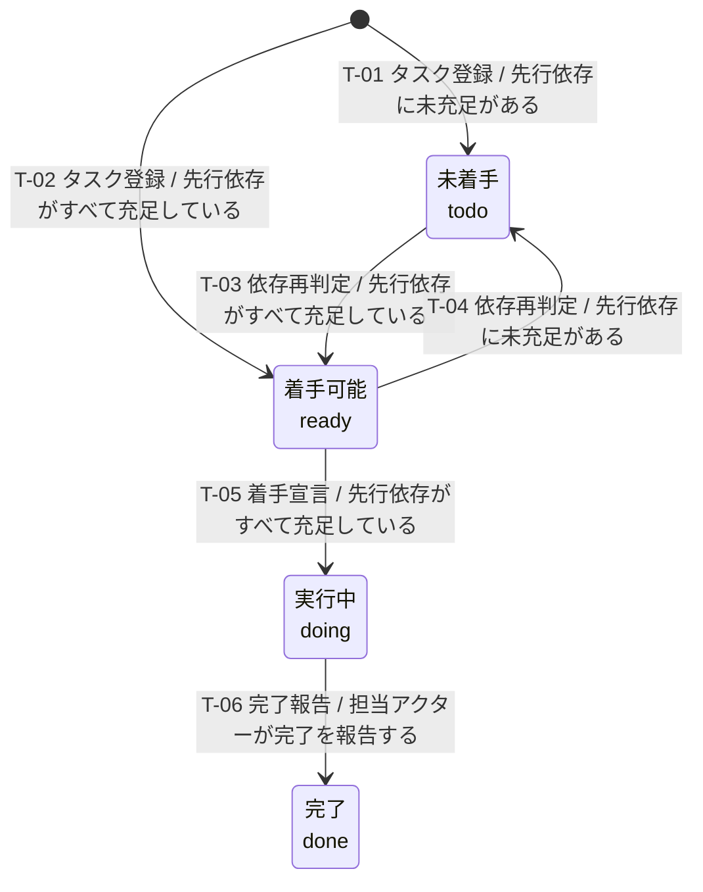
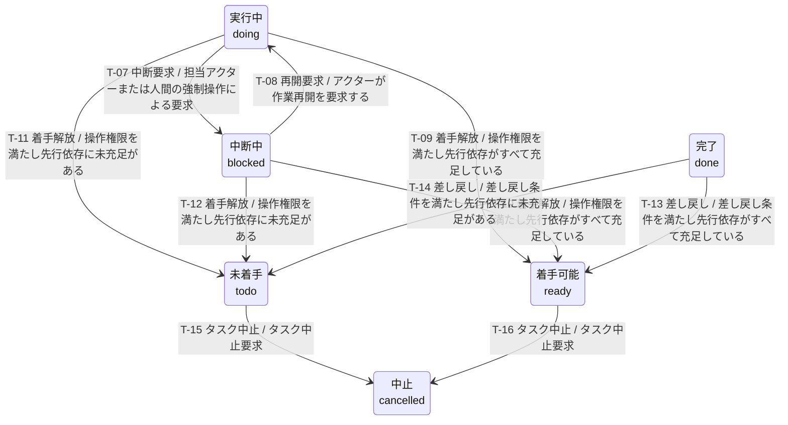

---
specdojo:
  id: prj-0001:stsd-task-execution
  type: data
  status: draft
  rulebook: specdojo:stsd-rulebook
  based_on:
    - prj-0001:bdd-exec-state
    - prj-0001:bdd-exec-event
  supersedes: []
---

# ステータス定義（タスク実行）

タスク実行（Task Execution）の状態と状態遷移を定義する。

## 1. 目的

タスク実行の状態は、スケジュール帳票のタスクの段階（着手前・実行中・中断中・完了・中止）を管理する。人と AI Agent はこの状態を使い、次に着手できるタスクの選択、止まった作業の引き継ぎ、後続へ進めるかの判断を行う。

## 2. 適用範囲

- 対象: スケジュール帳票のタスク実行（Task Execution）
- 業務範囲: タスク登録から、依存解決、着手、中断、再開、着手解放、完了、差し戻し、中止まで。
- 到達点: 完了は後続タスクの依存充足に用い、必要なら差し戻せる到達点とする。中止は以後の状態変更を行わない継続状態とし、補足記録の追記と状態の確認を続ける。このため終了点は置かず、終了点のためだけの追加イベントも定義しない。

## 3. 状態の判定

- 状態の正本: 状態変更イベントを追記するイベントログと、タスク依存関係を保持するスケジュール帳票。集約した現在状態はこれらからの派生情報とする。
- 一意判定:
  - 対象タスクのイベント列を時刻の昇順に再生して得る基本状態を正とする。イベントがないタスクの基本状態は `todo` とし、同時刻のイベントは状態遷移として成立する順に並べて再生する。不正な形式のイベントは黙って読み飛ばさずエラーとする。
  - 基本状態が `todo` の場合だけ、現在状態の確認時に先行依存の充足を再判定し、状態一覧に従って未着手・着手可能を導出する。`ready` は永続化せず、他の基本状態は依存の変化だけでは変えない。
  - 先行依存の充足は、タスクなら完了（`done`）、マイルストーン・ゲートならその先行依存がすべて充足していることで判定する。依存先が存在しない場合や、マイルストーン・ゲートをたどって循環する場合は未充足とし、依存がない場合は充足とする。中止（`cancelled`）は完了の代わりにならない。
  - `note`（補足記録）、`link`（参照の追加）、`estimate`（見積更新）は状態を変えないため、最新イベントの種類だけでは現在状態を判定しない。状態の意味が変わらない記録更新は図の自己遷移にしない。
- 互換の扱い: 以下の図表は現在発行する状態変更を扱う。過去の実行中・中断中からの `cancel` は、中止ではなく基本状態を `todo` に戻す記録として再生し、依存を再判定する。現在この操作は `release` で記録する。

## 4. 状態一覧

| 値          | 状態名   | 通称     | 意味                                                                                         | 成立条件                                                                                       | 管理場所                                   |
| ----------- | -------- | -------- | -------------------------------------------------------------------------------------------- | ---------------------------------------------------------------------------------------------- | ------------------------------------------ |
| `todo`      | 未着手   | 依存待ち | タスクが登録されたが、先行依存が未充足であるため着手できない待機状態                         | 基本状態が `todo` で、未充足の先行依存が一つ以上ある                                           | イベントログ、スケジュール帳票             |
| `ready`     | 着手可能 | 着手待ち | 先行依存がすべて充足し、担当アクターが着手を宣言できる導出状態                               | 基本状態が `todo` で、すべての先行依存が充足している（依存なしを含む）                         | スケジュール帳票（動的導出）、イベントログ |
| `doing`     | 実行中   | 進行中   | 担当アクターによって着手され、作業または処理が進行している状態                               | イベント列の再生結果が `doing`。最後に状態を変えたイベントが `claim` または `unblock` である   | イベントログ                               |
| `blocked`   | 中断中   | 中断     | 実行中に障害、外部依存、確認待ちなどの理由で作業が一時停止し、再開または解放を待っている状態 | イベント列の再生結果が `blocked`。最後に状態を変えたイベントが `block` である                  | イベントログ                               |
| `done`      | 完了     | -        | タスクの作業完了が報告された状態（後続タスクの着手条件を満たす）                             | イベント列の再生結果が `done`。最後に状態を変えたイベントが `complete` である                  | イベントログ                               |
| `cancelled` | 中止     | -        | タスクが不要または実行不能と判断され、恒久的に中止された状態                                 | イベント列の再生結果が `cancelled`。着手前の基本状態 `todo` に対する `cancel` が記録されている | イベントログ                               |

## 5. 状態遷移

着手可能に接続する遷移が 6 本を超えるため、通常系と例外系に分割する。未着手・着手可能・実行中・完了を図間の接続状態とし、初期点からの到達性は両図をつないで読む。

共通条件・補足:

- `T-06`・`T-07` の操作権限は、担当アクターからの要求、または強制操作を明示した人間からの要求を指す。
- `T-09`〜`T-12` の着手解放（`release`）は実行中の着手を解放、または中断中の試行を放棄する。操作権限は `T-06`・`T-07` と同じとする。
- `T-13`〜`T-14` の差し戻し（`reopen`）は完了記録を消さない。差し戻し条件は、人間からの要求であり、直接・間接の後続タスクに実行中・中断中・完了が一つもないこととする。
- `T-09`〜`T-14` は基本状態を `todo` に戻し、先行依存を再判定する。

### 5.1. 通常系（`T-01`〜`T-06`）

| 遷移 ID | 遷移元   | 遷移先   | イベント   | 条件                         | 補足                                                                                                                                                                                                      |
| ------- | -------- | -------- | ---------- | ---------------------------- | --------------------------------------------------------------------------------------------------------------------------------------------------------------------------------------------------------- |
| `T-01`  | 開始     | 未着手   | タスク登録 | 先行依存に未充足がある       | タスクが実行管理の対象になった時点の判定。登録自体に状態変更イベントは不要                                                                                                                                |
| `T-02`  | 開始     | 着手可能 | タスク登録 | 先行依存がすべて充足している | 依存なしを含む                                                                                                                                                                                            |
| `T-03`  | 未着手   | 着手可能 | 依存再判定 | 先行依存がすべて充足している | イベントログへ記録せず、現在の依存関係と状態から導出する                                                                                                                                                  |
| `T-04`  | 着手可能 | 未着手   | 依存再判定 | 先行依存に未充足がある       | 先行タスクの差し戻し等で着手条件を失う。対象タスク自身のイベントは追加しない                                                                                                                              |
| `T-05`  | 着手可能 | 実行中   | 着手宣言   | 先行依存がすべて充足している | `claim`。指定アクターが作業権限を確保する。ロール一致を必須とせず、別ロールでも着手できる。ただしタスクと実行者の双方でロールを指定した場合は照合し、不一致には明示的な許可を要する                       |
| `T-06`  | 実行中   | 完了     | 完了報告   | 担当アクターが完了を報告する | `complete`。共通の操作権限を適用する。自動の実行では runner が executor の成功・result の確認・親の検証と統合の成功の後にだけ記録し、失敗時は中断になる。完了イベントだけで成果物の受入承認まで保証しない |

### 5.2. 例外系（`T-07`〜`T-16`）

| 遷移 ID | 遷移元   | 遷移先   | イベント   | 条件                                             | 補足                                                                                           |
| ------- | -------- | -------- | ---------- | ------------------------------------------------ | ---------------------------------------------------------------------------------------------- |
| `T-07`  | 実行中   | 中断中   | 中断要求   | 担当アクターまたは人間の強制操作による要求       | `block`。共通の操作権限を適用し、外部障害や確認待ち等による一時停止と理由を記録する            |
| `T-08`  | 中断中   | 実行中   | 再開要求   | アクターが作業再開を要求する                     | `unblock`。中断したアクターとの一致を要さず、別アクターでも再開できる                          |
| `T-09`  | 実行中   | 着手可能 | 着手解放   | 操作権限を満たし先行依存がすべて充足している     | `release`。共通の操作権限を適用する                                                            |
| `T-10`  | 中断中   | 着手可能 | 着手解放   | 操作権限を満たし先行依存がすべて充足している     | `release`。共通の操作権限を適用する                                                            |
| `T-11`  | 実行中   | 未着手   | 着手解放   | 操作権限を満たし先行依存に未充足がある           | `release`。共通の操作権限を適用する                                                            |
| `T-12`  | 中断中   | 未着手   | 着手解放   | 操作権限を満たし先行依存に未充足がある           | `release`。共通の操作権限を適用する                                                            |
| `T-13`  | 完了     | 着手可能 | 差し戻し   | 差し戻し条件を満たし先行依存がすべて充足している | `reopen`。共通の差し戻し条件を適用し、後続が中止の場合は差し戻しを妨げない                     |
| `T-14`  | 完了     | 未着手   | 差し戻し   | 差し戻し条件を満たし先行依存に未充足がある       | `reopen`。共通の差し戻し条件を適用する                                                         |
| `T-15`  | 未着手   | 中止     | タスク中止 | タスク中止要求                                   | `cancel`。着手前のタスクを恒久的に中止する。実行中・中断中からは直接中止せず、先に着手解放する |
| `T-16`  | 着手可能 | 中止     | タスク中止 | タスク中止要求                                   | `cancel`                                                                                       |
