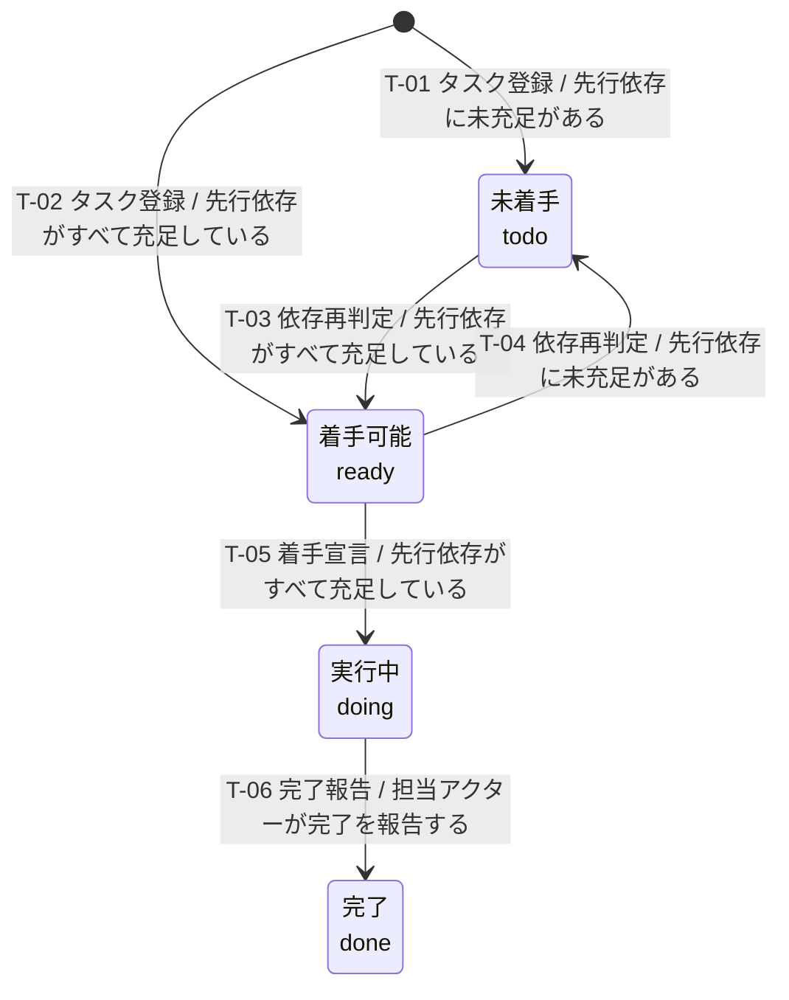
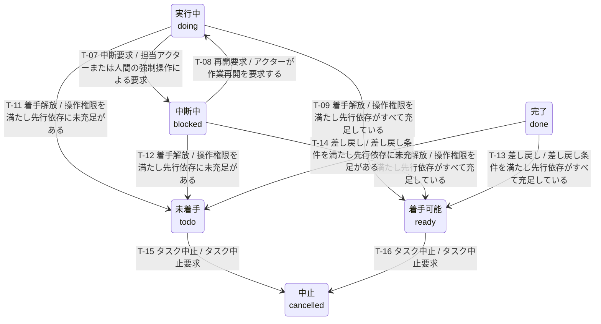

---
specdojo:
  id: prj-0001:stsd-task-execution
  type: data
  status: draft
  rulebook: specdojo:stsd-rulebook
  based_on:
    - prj-0001:bdd-exec-state
    - prj-0001:bdd-exec-event
  supersedes: []
---

# ステータス定義（タスク実行）

タスク実行（Task Execution）の状態と状態遷移を定義する。

## 1. 目的

タスク実行の状態は、スケジュール帳票のタスクの段階（着手前・実行中・中断中・完了・中止）を管理する。人と AI Agent はこの状態を使い、次に着手できるタスクの選択、止まった作業の引き継ぎ、後続へ進めるかの判断を行う。

## 2. 適用範囲

- 対象: スケジュール帳票のタスク実行（Task Execution）
- 業務範囲: タスク登録から、依存解決、着手、中断、再開、着手解放、完了、差し戻し、中止まで。
- 到達点: 完了は後続タスクの依存充足に用い、必要なら差し戻せる到達点とする。中止は以後の状態変更を行わない継続状態とし、補足記録の追記と状態の確認を続ける。このため終了点は置かず、終了点のためだけの追加イベントも定義しない。

## 3. 状態の判定

- 状態の正本: 状態変更イベントを追記するイベントログと、タスク依存関係を保持するスケジュール帳票。集約した現在状態はこれらからの派生情報とする。
- 一意判定:
  - 対象タスクのイベント列を時刻の昇順に再生して得る基本状態を正とする。同時刻のイベントは「同時刻の再生順序」に従う。イベントがないタスクの基本状態は `todo` とする。不正な形式のイベントは黙って読み飛ばさずエラーとする。
  - 基本状態が `todo` の場合だけ、現在状態の確認時に先行依存の充足を再判定し、状態一覧に従って未着手・着手可能を導出する。`ready` は永続化せず、他の基本状態は依存の変化だけでは変えない。
  - 先行依存の充足は、タスクなら完了（`done`）、マイルストーン・ゲートならその先行依存がすべて充足していることで判定する。依存先が存在しない場合や、マイルストーン・ゲートをたどって循環する場合は未充足とし、依存がない場合は充足とする。中止（`cancelled`）は完了の代わりにならない。
  - `note`（補足記録）、`link`（参照の追加）、`estimate`（見積更新）は状態を変えないため、最新イベントの種類だけでは現在状態を判定しない。状態の意味が変わらない記録更新は図の自己遷移にしない。
  - 担当アクターは、実行中・中断中のタスクの着手を持つアクター（claim の持ち主）であり、最新イベントの記録者とは区別する。`claim` の記録者を担当アクターとし、`note`・`link`・`estimate`・`block`（人間の強制操作による中断を含む）・引き取りを指定しない `unblock` は、記録者が誰でも担当アクターを変えない。引き取りを指定した `unblock` だけが、その記録者へ担当アクターを移す。基本状態が `todo`・`done`・`cancelled` になると担当アクターはなくなる。
- 同時刻の再生順序: 同じ秒のイベントの並べ方を次のとおり定める。この並べ方の正本は `src/exec/events.ts` のイベント記録の読み込みとし、本書と食い違う場合は正本に合わせて本書を直す。
  - 種類の既定順（`claim` → `note` → `block`・`complete`・`estimate`・`link` → `unblock`・`reopen` → `release`・`cancel`）で並べ、同順位は記録ファイルのパスの昇順とする。
  - 同じタスクの同時刻のイベントが複数ある場合は、残りの並びの先頭から、直前までの基本状態と直前のイベントの記録者に対して成立する最初のイベントを一つずつ選んで再生し、成立するものがなければ残りの先頭を採る。担当アクターは判定に使わない。
  - 成立するイベント: `note`・`link`・`estimate` は常に成立する。`todo` では `claim`・`cancel`、`doing` では `block`・`complete`・`release`・`cancel`、`blocked` では `unblock`・`release`・`cancel`、`done` では `reopen` が成立する。
  - 競合する着手: 同じ秒に `claim` が複数ある場合、同じ秒に `release` か `block` も記録したアクターの `claim` を、そうでないアクターの `claim` より先に採る。自動の実行の再開に伴う `claim` は、通常の `claim` より後に採る。
  - 実行中からの記録: 直前の記録者が同じ秒に `block`・`complete`・`release`・`cancel` のいずれかを記録していれば、別のアクターの同種の記録より先に採る。同じ秒に直前の記録者の `block` と `unblock` があり `reopen` がない場合、`complete` は `block`・`unblock` の後に採る。
  - pipeline の再開: `pipeline_stage` と `pipeline_state_ref` が一致する `block`・`unblock` が同じ秒にある場合、その `block` を再開されない別の停止より先に採る。中断中に `unblock` が複数ある場合は、直前の `block` と両項目が一致するものを先に採る。両項目のないイベントは従来の順序に従う。
  - 例: 同じアクターが同じ秒に `claim`・`block`・`unblock`・`complete` を記録した場合は、パスの順によらずこの順に再生し、基本状態は `done` になる。アクター A が同じ秒に `claim`・`release` を、アクター B が `claim` を記録した場合は、A の `claim`・`release`、B の `claim` の順に再生し、担当アクターは B になる。
- 互換の扱い: 以下の図表は現在発行する状態変更を扱う。過去の実行中・中断中からの `cancel` は、中止ではなく基本状態を `todo` に戻す記録として再生し、依存を再判定する。現在この操作は `release` で記録する。担当アクターの規則は過去のイベントにも同じく適用し、過去に別のアクターが記録した `note` や引き取りを指定しない `unblock` があっても、担当アクターは `claim` の記録者のままとする。担当アクターを保持しない旧形式の集約状態は、最新イベントの記録者を担当アクターとして読む。

## 4. 状態一覧

| 値          | 状態名   | 通称     | 意味                                                                                         | 成立条件                                                                                       | 管理場所                                   |
| ----------- | -------- | -------- | -------------------------------------------------------------------------------------------- | ---------------------------------------------------------------------------------------------- | ------------------------------------------ |
| `todo`      | 未着手   | 依存待ち | タスクが登録されたが、先行依存が未充足であるため着手できない待機状態                         | 基本状態が `todo` で、未充足の先行依存が一つ以上ある                                           | イベントログ、スケジュール帳票             |
| `ready`     | 着手可能 | 着手待ち | 先行依存がすべて充足し、担当アクターが着手を宣言できる導出状態                               | 基本状態が `todo` で、すべての先行依存が充足している（依存なしを含む）                         | スケジュール帳票（動的導出）、イベントログ |
| `doing`     | 実行中   | 進行中   | 担当アクターによって着手され、作業または処理が進行している状態                               | イベント列の再生結果が `doing`。最後に状態を変えたイベントが `claim` または `unblock` である   | イベントログ                               |
| `blocked`   | 中断中   | 中断     | 実行中に障害、外部依存、確認待ちなどの理由で作業が一時停止し、再開または解放を待っている状態 | イベント列の再生結果が `blocked`。最後に状態を変えたイベントが `block` である                  | イベントログ                               |
| `done`      | 完了     | -        | タスクの作業完了が報告された状態（後続タスクの着手条件を満たす）                             | イベント列の再生結果が `done`。最後に状態を変えたイベントが `complete` である                  | イベントログ                               |
| `cancelled` | 中止     | -        | タスクが不要または実行不能と判断され、恒久的に中止された状態                                 | イベント列の再生結果が `cancelled`。着手前の基本状態 `todo` に対する `cancel` が記録されている | イベントログ                               |

## 5. 状態遷移

着手可能に接続する遷移が 6 本を超えるため、通常系と例外系に分割する。未着手・着手可能・実行中・完了を図間の接続状態とし、初期点からの到達性は両図をつないで読む。

共通条件・補足:

- `T-06`・`T-07` の操作権限は、要求したアクターが担当アクター（「状態の判定」の claim の持ち主）と一致すること、または強制操作を明示した人間からの要求であることを指す。最新イベントの記録者とは照合しない。人間の強制操作による記録でも担当アクターは変わらない。
- 自動の実行では、runner は自身が着手または再開した実行に限り、段を進めたアクターが担当アクターと異なっても、担当アクターとして `T-06`・`T-07` を記録する。中断の記録には担当アクターと失敗した段のアクターの両方を残す。
- `T-09`〜`T-12` の着手解放（`release`）は実行中の着手を解放、または中断中の試行を放棄する。操作権限は `T-06`・`T-07` と同じとする。
- `T-13`〜`T-14` の差し戻し（`reopen`）は完了記録を消さない。差し戻し条件は、人間からの要求であり、直接・間接の後続タスクに実行中・中断中・完了が一つもないこととする。
- `T-09`〜`T-14` は基本状態を `todo` に戻し、先行依存を再判定する。

### 5.1. 通常系（`T-01`〜`T-06`）

| 遷移 ID | 遷移元   | 遷移先   | イベント   | 条件                         | 補足                                                                                                                                                                                                      |
| ------- | -------- | -------- | ---------- | ---------------------------- | --------------------------------------------------------------------------------------------------------------------------------------------------------------------------------------------------------- |
| `T-01`  | 開始     | 未着手   | タスク登録 | 先行依存に未充足がある       | タスクが実行管理の対象になった時点の判定。登録自体に状態変更イベントは不要                                                                                                                                |
| `T-02`  | 開始     | 着手可能 | タスク登録 | 先行依存がすべて充足している | 依存なしを含む                                                                                                                                                                                            |
| `T-03`  | 未着手   | 着手可能 | 依存再判定 | 先行依存がすべて充足している | イベントログへ記録せず、現在の依存関係と状態から導出する                                                                                                                                                  |
| `T-04`  | 着手可能 | 未着手   | 依存再判定 | 先行依存に未充足がある       | 先行タスクの差し戻し等で着手条件を失う。対象タスク自身のイベントは追加しない                                                                                                                              |
| `T-05`  | 着手可能 | 実行中   | 着手宣言   | 先行依存がすべて充足している | `claim`。記録者が担当アクターになる。ロール一致を必須とせず、別ロールでも着手できる。ただしタスクと実行者の双方でロールを指定した場合は照合し、不一致には明示的な許可を要する                             |
| `T-06`  | 実行中   | 完了     | 完了報告   | 担当アクターが完了を報告する | `complete`。共通の操作権限を適用する。自動の実行では runner が executor の成功・result の確認・親の検証と統合の成功の後にだけ記録し、失敗時は中断になる。完了イベントだけで成果物の受入承認まで保証しない |

### 5.2. 例外系（`T-07`〜`T-16`）

| 遷移 ID | 遷移元   | 遷移先   | イベント   | 条件                                             | 補足                                                                                                                                                                                      |
| ------- | -------- | -------- | ---------- | ------------------------------------------------ | ----------------------------------------------------------------------------------------------------------------------------------------------------------------------------------------- |
| `T-07`  | 実行中   | 中断中   | 中断要求   | 担当アクターまたは人間の強制操作による要求       | `block`。共通の操作権限を適用し、外部障害や確認待ち等による一時停止と理由を記録する                                                                                                       |
| `T-08`  | 中断中   | 実行中   | 再開要求   | アクターが作業再開を要求する                     | `unblock`。中断したアクター・担当アクターとの一致を要さず、別アクターでも再開できる。担当アクターは変えず、人間が引き取りを指定した場合だけ記録者へ移す。人間以外は引き取りを指定できない |
| `T-09`  | 実行中   | 着手可能 | 着手解放   | 操作権限を満たし先行依存がすべて充足している     | `release`。共通の操作権限を適用する                                                                                                                                                       |
| `T-10`  | 中断中   | 着手可能 | 着手解放   | 操作権限を満たし先行依存がすべて充足している     | `release`。共通の操作権限を適用する                                                                                                                                                       |
| `T-11`  | 実行中   | 未着手   | 着手解放   | 操作権限を満たし先行依存に未充足がある           | `release`。共通の操作権限を適用する                                                                                                                                                       |
| `T-12`  | 中断中   | 未着手   | 着手解放   | 操作権限を満たし先行依存に未充足がある           | `release`。共通の操作権限を適用する                                                                                                                                                       |
| `T-13`  | 完了     | 着手可能 | 差し戻し   | 差し戻し条件を満たし先行依存がすべて充足している | `reopen`。共通の差し戻し条件を適用し、後続が中止の場合は差し戻しを妨げない                                                                                                                |
| `T-14`  | 完了     | 未着手   | 差し戻し   | 差し戻し条件を満たし先行依存に未充足がある       | `reopen`。共通の差し戻し条件を適用する                                                                                                                                                    |
| `T-15`  | 未着手   | 中止     | タスク中止 | タスク中止要求                                   | `cancel`。着手前のタスクを恒久的に中止する。実行中・中断中からは直接中止せず、先に着手解放する                                                                                            |
| `T-16`  | 着手可能 | 中止     | タスク中止 | タスク中止要求                                   | `cancel`                                                                                                                                                                                  |

## 6. 今後の検討メモ

- _UNDECIDED_: 上流の `bdd-exec-state`・`bdd-exec-event` が未作成のため、状態名・イベント名・担当アクターの項目は、統合済みの実装の現在動作（[[prj-0001:pjr-m495-exec-unblock-keeps-claim-owner]]、[[prj-0001:pjr-t4g3-exec-block-after-actor-switch]]）に合わせている。両辞書の作成時に BA が照合し、食い違う場合に本書と辞書のどちらを正とするかを PO が決め、ARC・DEV が本書または実装を直す。辞書が本書の確定（140）までに作成されない場合は、PO が 140 で現在の名称を正として確定するかを決める。影響は全状態と `T-05`〜`T-12`、追跡は [[prj-0001:pjr-tn43-user-decisions-pending]] とする。
- _UNDECIDED_: 担当アクターを claim の持ち主とし、移すのは人間の引き取り指定に限る権限の規則（`T-05`〜`T-12`）の業務上の承認。PO が本書の確定（140）で決め、承認の前に BA が業務上の正確さを、QE・DEV が状態遷移テストと実装の参照としての使いやすさを確認する。追跡は [[prj-0001:pjr-tn43-user-decisions-pending]] とする。
- 本書の `ready` への昇格は、上の 2 件が決まり、140 で人間が承認した後に行う。本書を直すタスクの完了は、本書の確定を意味しない。
