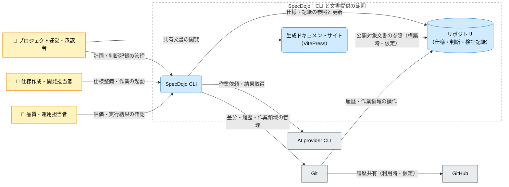

---
specdojo:
  id: cnd-specdojo
  type: architecture
  status: draft
  owner: ARC
  rulebook: specdojo:cnd-rulebook
  part_of: []
  based_on:
    - cxd-specdojo
  supersedes: []
---

# SpecDojo C4コンテナ図

## 1. 概要

[[cxd-specdojo|SpecDojo C4コンテキスト図]] の CLI を実行単位として展開し、仕様・判断・検証記録の保管先と外部ツールの関係を定義する。併せて、記録を参加者へ伝える派生経路として生成ドキュメントサイト（VitePress）を示す。[[prj-0001:prj-overview|プロジェクト概要]] の共有・継承の原則に沿い、編集する正本と閲覧用の生成物を区別する。

本図はインフラ設計への入力となる配置前提と結合対象を示す初版である。物理ホスト、ポート、公開範囲、認証方式、配備手順は確定せず、CLI の内部モジュール、コマンド構文、ファイル構造は各詳細仕様へ委ねる。

上位図のローカル実行の仮定を引き継ぐ。サイトの構築・配備の仮定は「Container（コンテナ）」に示す。

## 2. C4コンテナ図（Mermaid）

矢印は主たる利用・依頼・参照の向きで、応答を含む。閲覧は代表として運営・承認者から描くが、他の参加者の閲覧権限を制限する意味ではない。Git / GitHub は上位図の一要素をローカル機構と共有先へ分けた表示で、リモート接続経路は仮定である。

## 3. 要素と境界の定義

### 3.1. 対象システムとシステム境界

境界内は CLI による制御、ファイルとして保持する記録、閲覧用文書の提供である。推論とエージェント作業は AI provider CLI、履歴機構は Git、利用時のリモート共有は GitHub に委ねる。外部ツールが同じ端末にあっても責務の境界は変えない。物理配置を示す枠ではない。

### 3.2. Person（人・ロール）

| Person（図中ラベル）     | 利用目的・接点                                       | 判断・確認の責務                                                 |
| ------------------------ | ---------------------------------------------------- | ---------------------------------------------------------------- |
| プロジェクト運営・承認者 | CLI で計画・判断を管理し、サイトで共有文書を閲覧する | 主要判断と公開可否を担う。閲覧できることを承認済みの意味にしない |
| 仕様作成・開発担当者     | CLI で対象を選び、仕様整備と作業を起動する           | AI へ渡す文脈と返された変更を確認して引き継ぐ                    |
| 品質・運用担当者         | CLI で評価・実行結果を確認する                       | 不足・失敗・結果不明と未決事項を識別する                         |

上位図と同じ利用目的による区分であり、プロジェクトの RACI や実際の操作権限は定めない。

### 3.3. Container（コンテナ）

| コンテナ（図中ラベル）              | 責務                                                                           | 技術区分・実行配備の前提                                                                                                                          |
| ----------------------------------- | ------------------------------------------------------------------------------ | ------------------------------------------------------------------------------------------------------------------------------------------------- |
| SpecDojo CLI                        | 型による成果物整備、計画・判断・検証記録の管理、外部作業の起動と結果の取り扱い | ローカルで起動するコマンド。人と AI Agent が同じ正本を参照する。ランタイム・バージョンは本図では固定しない                                        |
| 生成ドキュメントサイト（VitePress） | 公開対象として選んだ文書を閲覧用に構成し、参加者へ提供する                     | _ASSUMPTION_: 文書を構築時に読み、静的生成物を配備する単位。構築環境と配信先は別途選ぶ。閲覧時に CLI の起動やリポジトリの直接参照を要しない構成案 |

サイトの構築・配備を CLI が直接起動するか、別の実行基盤が担うかは未確定である。閲覧先から CLI を操作する経路は本図の対象外とする。

### 3.4. Data Store（データストア）

| ストア（図中ラベル）               | 保持する情報・正本                                                       | アクセスと生成物の境界                                                                                                                         |
| ---------------------------------- | ------------------------------------------------------------------------ | ---------------------------------------------------------------------------------------------------------------------------------------------- |
| リポジトリ（仕様・判断・検証記録） | 人と AI Agent が引き継ぐファイル群。仕様、判断、検証・実行記録を保持する | CLI が参照・更新し、Git が履歴・作業領域を操作する。サイトは公開対象だけを構築時に参照する案。図はすべての編集主体や排他制御を示すものではない |

リポジトリはデータを置く単位であり、Git プロセスや GitHub サービスと同一視しない。サイトの静的生成物は正本の派生物で、閲覧先の編集を正本へ反映する経路は定義しない。

### 3.5. External Software System（外部システム）

| 外部システム（図中ラベル） | 利用条件・責任分界                                                       | 不在・障害時の影響                                                         |
| -------------------------- | ------------------------------------------------------------------------ | -------------------------------------------------------------------------- |
| AI provider CLI            | AI に作業を委譲する場合に使用。推論と作業を担い、特定製品には固定しない  | 結果や途中変更が不明になり得る。未変更・承認済みとは推定しない             |
| Git                        | ローカルの差分・履歴・作業領域の管理に使用。記録内容の業務判断は担わない | 競合や操作失敗を識別する必要がある。保持範囲と復旧の保証は連携契約へ委ねる |
| GitHub                     | リモート共有を選んだ場合の外部保管・レビュー基盤                         | 共有失敗をローカル作業失敗と分ける。全機能での必須接続とはしない           |

### 3.6. Relationship（関係・連携契約）

正本欄の未作成文書名は引き継ぎ候補であり、確定した契約を表さない。

| 関係 ID  | 起点 → 終点                                                              | 図中ラベル                         | 方式・条件と情報の要点                                                              | 詳細の正本                                                       |
| -------- | ------------------------------------------------------------------------ | ---------------------------------- | ----------------------------------------------------------------------------------- | ---------------------------------------------------------------- |
| `REL-01` | プロジェクト運営・承認者 → SpecDojo CLI                                  | 計画・判断記録の管理               | 人の CLI 操作。入力した判断と現在の記録                                             | 上位図の `REL-01` が参照する CLI リファレンス                    |
| `REL-02` | 仕様作成・開発担当者 → SpecDojo CLI                                      | 仕様整備・作業の起動               | 人の CLI 操作。対象と作業指示、返された結果                                         | 上位図の `REL-02` が参照する CLI 仕様                            |
| `REL-03` | 品質・運用担当者 → SpecDojo CLI                                          | 評価・実行結果の確認               | 人の CLI 操作。評価対象と実行記録                                                   | 上位図の `REL-03` が参照する CLI リファレンス                    |
| `REL-04` | プロジェクト運営・承認者 → 生成ドキュメントサイト（VitePress）           | 共有文書の閲覧                     | _ASSUMPTION_: ブラウザから閲覧する。公開範囲・到達先は未確定                        | `ifd-specdojo` へ引き継ぐ                                        |
| `REL-05` | SpecDojo CLI → リポジトリ（仕様・判断・検証記録）                        | 仕様・記録の参照と更新             | ローカルファイルの読み書き。詳細な配置・構造は再定義しない                          | [[cxd-specdojo\|上位コンテキスト図]] の中核責務、各記録の schema |
| `REL-06` | 生成ドキュメントサイト（VitePress） → リポジトリ（仕様・判断・検証記録） | 公開対象文書の参照（構築時・仮定） | _ASSUMPTION_: 構築工程のファイル読取。更新された正本の反映には再構築・配備が必要    | `ifd-specdojo` で構築・配備の境界を具体化する                    |
| `REL-07` | SpecDojo CLI → AI provider CLI                                           | 作業依頼・結果取得                 | 外部 CLI の呼び出し。文脈と結果・証跡を授受する                                     | 上位図の `REL-04` が参照する外部コマンド連携仕様                 |
| `REL-08` | SpecDojo CLI → Git                                                       | 差分・履歴・作業領域の管理         | ローカル操作。対象変更と履歴を確認・管理する                                        | `ifx-cmd-git-cli`（未作成）                                      |
| `REL-09` | Git → リポジトリ（仕様・判断・検証記録）                                 | 履歴・作業領域の操作               | ローカルの版管理機構。CLI による内容更新とは責務を分ける                            | `ifx-cmd-git-cli`（未作成）                                      |
| `REL-10` | Git → GitHub                                                             | 履歴共有（利用時・仮定）           | _ASSUMPTION_: リモート共有の概念経路。GitHub CLI 経由や直接接続の区別、認証は未確定 | `ifx-cmd-git-cli`、`ifx-cmd-github-cli`（未作成）                |

## 4. 技術前提・制約と検証観点

### 4.1. 技術前提・制約

- 配置設計では、書込可能な作業環境、外部 CLI の実行環境、文書構築環境、閲覧用配信先を区別する。同一ホストへの集約やクラウド利用の要否は決定しない。
- _ASSUMPTION_: 配信先には承認した公開対象の生成物だけを渡す。リポジトリ全体や実行記録を無条件で公開しない。選別方式と認証境界は「メモ / 将来課題」の確認対象とする。
- 文書生成や AI 作業の成功から成果物の承認を導かない。外部へ渡す情報と認証の管理は連携契約で確認し、本図に認証値や未確認の秘密情報非保持保証を置かない。

### 4.2. コンテナ間・外部依存の検証対象

以下は検証設計への入力であり、実施済みテストや合格保証ではない。

| 確認区分     | 対象関係・境界                 | 観測する結果                                                                     | 主確認ロール |
| ------------ | ------------------------------ | -------------------------------------------------------------------------------- | ------------ |
| 正本と閲覧物 | `REL-05`、`REL-06`、`REL-04`   | 正本の変更と構築・配備後の閲覧内容を対応付け、構築失敗時の配信状態を識別できるか | QE / DEV     |
| AI 委譲      | `REL-07`                       | 外部 CLI 不在・拒否・応答欠落と、返された結果・途中変更を区別できるか            | QE / ARC     |
| 履歴と共有   | `REL-08`〜`REL-10`             | ローカル競合とリモート共有失敗を分け、残った変更を確認できるか                   | QE / DEV     |
| 公開境界     | リポジトリ → 構築環境 → 配信先 | 公開対象の選別と閲覧範囲が人間の判断に一致するか                                 | ARC / PO     |

## 5. メモ / 将来課題

| 対象・論点         | 影響範囲                                                              | 担当ロール | 解消条件・引き継ぎ先                                                                                           |
| ------------------ | --------------------------------------------------------------------- | ---------- | -------------------------------------------------------------------------------------------------------------- |
| 実行・配備の仮定   | CLI、サイト、`REL-04`・`REL-06`。上位図はローカル実行も仮定としている | ARC        | `cpd-specdojo-cli` と `ifd-specdojo` の整備で CLI の実行単位、構築主体、配信先を具体化し、本図の仮定と照合する |
| 公開対象と到達範囲 | `REL-06` と配信先。選別・認証方式が未確定                             | ARC / PO   | ARC が選別と配備境界の案を整理し、PO が公開可否を判断した後にインフラ設計へ反映する                            |
| リモート経路・認証 | `REL-10` の Git 経由は仮定。GitHub CLI の関与も未確認                 | ARC / DEV  | `ifx-cmd-git-cli`、`ifx-cmd-github-cli` で呼出元、接続方式、失敗時の保持範囲を確認する                         |
| AI 作業の結果不明  | `REL-07`。途中変更と外部へ渡す情報の扱い                              | ARC / QE   | 上位図の外部コマンド連携仕様を具体化する際に、結果欠落と保持記録の期待値を定め、結合検証へ渡す                 |
