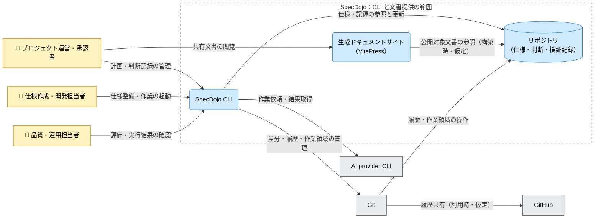

---
specdojo:
  id: cnd-specdojo
  type: architecture
  status: draft
  owner: ARC
  rulebook: specdojo:cnd-rulebook
  part_of: []
  based_on:
    - cxd-specdojo
  supersedes: []
---

# SpecDojo C4コンテナ図

## 1. 概要

[[cxd-specdojo|SpecDojo C4コンテキスト図]] の CLI を実行単位として展開し、仕様・判断・検証記録の保管先と外部ツールの関係を定義する。併せて、記録を参加者へ伝える派生経路として生成ドキュメントサイト（VitePress）を示す。[[prj-0001:prj-overview|プロジェクト概要]] の共有・継承の原則に沿い、編集する正本と閲覧用の生成物を区別する。

本図はインフラ設計への入力となる配置前提と結合対象を示す初版である。物理ホスト、ポート、公開範囲、認証方式、配備手順は確定せず、CLI の内部モジュール、コマンド構文、ファイル構造は各詳細仕様へ委ねる。

上位図のローカル実行の仮定を引き継ぐ。PO が承認の基準とする配備の方針と、今承認する範囲・留保した範囲は「配備の基準と承認範囲」に示す。

ARC が構成案を担当し、BA は利用者代表と CLI 操作・文書閲覧の利用場面、DEV は実行単位と接続方式、QE は境界ごとの観測結果、OPS はサイトの構築・配信と公開の前提を確認する。人間の `PO` が対象範囲、残るリスク、公開可否を判断する。

## 2. C4コンテナ図（Mermaid）

矢印は主たる利用・依頼・参照の向きで、応答を含む。閲覧は代表として運営・承認者から描くが、他の参加者の閲覧権限を制限する意味ではない。Git / GitHub は上位図の一要素をローカル機構と共有先へ分けた表示で、リモート接続経路は仮定である。

## 3. 要素と境界の定義

### 3.1. 対象システムとシステム境界

境界内は CLI による制御、ファイルとして保持する記録、閲覧用文書の提供である。推論とエージェント作業は AI provider CLI、履歴機構は Git、利用時のリモート共有は GitHub に委ねる。外部ツールが同じ端末にあっても責務の境界は変えない。物理配置を示す枠ではない。

### 3.2. Person（人・ロール）

| Person（図中ラベル）     | 利用目的・接点                                       | 判断・確認の責務                                                 |
| ------------------------ | ---------------------------------------------------- | ---------------------------------------------------------------- |
| プロジェクト運営・承認者 | CLI で計画・判断を管理し、サイトで共有文書を閲覧する | 主要判断と公開可否を担う。閲覧できることを承認済みの意味にしない |
| 仕様作成・開発担当者     | CLI で対象を選び、仕様整備と作業を起動する           | AI へ渡す文脈と返された変更を確認して引き継ぐ                    |
| 品質・運用担当者         | CLI で評価・実行結果を確認する                       | 不足・失敗・結果不明と未決事項を識別する                         |

上位図と同じ利用目的による区分であり、プロジェクトの RACI や実際の操作権限は定めない。

### 3.3. Container（コンテナ）

| コンテナ（図中ラベル）              | 責務                                                                           | 技術区分・実行配備の前提                                                                                                                                                                            |
| ----------------------------------- | ------------------------------------------------------------------------------ | --------------------------------------------------------------------------------------------------------------------------------------------------------------------------------------------------- |
| SpecDojo CLI                        | 型による成果物整備、計画・判断・検証記録の管理、外部作業の起動と結果の取り扱い | ローカルで起動するコマンド。人と AI Agent が同じ正本を参照する。ランタイム・バージョンは本図では固定しない                                                                                          |
| 生成ドキュメントサイト（VitePress） | 公開対象として選んだ文書を閲覧用に構成し、参加者へ提供する                     | 文書を構築時に読み、静的生成物を配備する単位。現在の実装では VitePress の構築自体を CLI のコマンドからは起動しない。構築環境と配信先は別途選ぶ。閲覧時に CLI の起動やリポジトリの直接参照を要しない |

閲覧先から CLI を操作する経路は本図の対象外とする。

### 3.4. Data Store（データストア）

| ストア（図中ラベル）               | 保持する情報・正本                                                       | アクセスと生成物の境界                                                                                                                         |
| ---------------------------------- | ------------------------------------------------------------------------ | ---------------------------------------------------------------------------------------------------------------------------------------------- |
| リポジトリ（仕様・判断・検証記録） | 人と AI Agent が引き継ぐファイル群。仕様、判断、検証・実行記録を保持する | CLI が参照・更新し、Git が履歴・作業領域を操作する。サイトは公開対象だけを構築時に参照する案。図はすべての編集主体や排他制御を示すものではない |

リポジトリはデータを置く単位であり、Git プロセスや GitHub サービスと同一視しない。サイトの静的生成物は正本の派生物で、閲覧先の編集を正本へ反映する経路は定義しない。

### 3.5. External Software System（外部システム）

| 外部システム（図中ラベル） | 利用条件・責任分界                                                       | 不在・障害時の影響                                                         |
| -------------------------- | ------------------------------------------------------------------------ | -------------------------------------------------------------------------- |
| AI provider CLI            | AI に作業を委譲する場合に使用。推論と作業を担い、特定製品には固定しない  | 結果や途中変更が不明になり得る。未変更・承認済みとは推定しない             |
| Git                        | ローカルの差分・履歴・作業領域の管理に使用。記録内容の業務判断は担わない | 競合や操作失敗を識別する必要がある。保持範囲と復旧の保証は連携契約へ委ねる |
| GitHub                     | リモート共有を選んだ場合の外部保管・レビュー基盤                         | 共有失敗をローカル作業失敗と分ける。全機能での必須接続とはしない           |

### 3.6. Relationship（関係・連携契約）

正本欄の未作成文書名は引き継ぎ候補であり、確定した契約を表さない。

| 関係 ID  | 起点 → 終点                                                              | 図中ラベル                         | 方式・条件と情報の要点                                                                                        | 詳細の正本                                                                                                                                        |
| -------- | ------------------------------------------------------------------------ | ---------------------------------- | ------------------------------------------------------------------------------------------------------------- | ------------------------------------------------------------------------------------------------------------------------------------------------- |
| `REL-01` | プロジェクト運営・承認者 → SpecDojo CLI                                  | 計画・判断記録の管理               | 人の CLI 操作。入力した判断と現在の記録                                                                       | 上位図の `REL-01` が参照する CLI リファレンス                                                                                                     |
| `REL-02` | 仕様作成・開発担当者 → SpecDojo CLI                                      | 仕様整備・作業の起動               | 人の CLI 操作。対象と作業指示、返された結果                                                                   | 上位図の `REL-02` が参照する CLI 仕様                                                                                                             |
| `REL-03` | 品質・運用担当者 → SpecDojo CLI                                          | 評価・実行結果の確認               | 人の CLI 操作。評価対象と実行記録                                                                             | 上位図の `REL-03` が参照する CLI リファレンス                                                                                                     |
| `REL-04` | プロジェクト運営・承認者 → 生成ドキュメントサイト（VitePress）           | 共有文書の閲覧                     | 留保の対象（「配備の基準と承認範囲」）。ブラウザから閲覧する。公開範囲・到達先は未確定                        | [[ifd-specdojo\|インフラ構成図（SpecDojo実行環境）]] へ引き継ぐ                                                                                   |
| `REL-05` | SpecDojo CLI → リポジトリ（仕様・判断・検証記録）                        | 仕様・記録の参照と更新             | ローカルファイルの読み書き。詳細な配置・構造は再定義しない                                                    | [[cxd-specdojo\|上位コンテキスト図]] の中核責務、`docs/specdojo/schemas/v1/` の各 schema、[[specdojo:command-reference\|CLIコマンドリファレンス]] |
| `REL-06` | 生成ドキュメントサイト（VitePress） → リポジトリ（仕様・判断・検証記録） | 公開対象文書の参照（構築時・仮定） | 留保の対象（「配備の基準と承認範囲」）。構築工程のファイル読取。更新された正本の反映には再構築・配備が必要    | [[ifd-specdojo\|インフラ構成図（SpecDojo実行環境）]] で構築・配備の境界を具体化する                                                               |
| `REL-07` | SpecDojo CLI → AI provider CLI                                           | 作業依頼・結果取得                 | 外部 CLI の呼び出し。文脈と結果・証跡を授受する                                                               | [[ifx-cmd-ai-provider-cli\|AI provider CLI 非対話起動のコマンド連携仕様]]                                                                         |
| `REL-08` | SpecDojo CLI → Git                                                       | 差分・履歴・作業領域の管理         | ローカル操作。対象変更と履歴を確認・管理する                                                                  | `ifx-cmd-git-cli`（未作成）                                                                                                                       |
| `REL-09` | Git → リポジトリ（仕様・判断・検証記録）                                 | 履歴・作業領域の操作               | ローカルの版管理機構。CLI による内容更新とは責務を分ける                                                      | `ifx-cmd-git-cli`（未作成）                                                                                                                       |
| `REL-10` | Git → GitHub                                                             | 履歴共有（利用時・仮定）           | 留保の対象（「配備の基準と承認範囲」）。リモート共有の概念経路。GitHub CLI 経由や直接接続の区別、認証は未確定 | `ifx-cmd-git-cli`、`ifx-cmd-github-cli`（未作成）                                                                                                 |

## 4. 技術前提・制約と検証観点

### 4.1. 技術前提・制約

- 配置設計では、書込可能な作業環境、外部 CLI の実行環境、文書構築環境、閲覧用配信先を区別する。同一ホストへの集約やクラウド利用の要否は決定しない。
- 配信先には承認した公開対象の生成物だけを渡す（人間の `PO` が 2026-11-15 に承認）。リポジトリ全体や実行記録を無条件で公開しない。選別方式と認証境界は「メモ / 将来課題」の確認対象とする。
- 文書生成や AI 作業の成功から成果物の承認を導かない。外部へ渡す情報と認証の管理は連携契約で確認し、本図に認証値や未確認の秘密情報非保持保証を置かない。

### 4.2. 配備の基準と承認範囲

PO が承認の基準とする配備の方針を次に定める。物理ホスト、ポート、製品バージョンは定めない。

| 単位                                | 動かす場所・時点                                                   | 配備しないもの                                                                |
| ----------------------------------- | ------------------------------------------------------------------ | ----------------------------------------------------------------------------- |
| SpecDojo CLI                        | 利用者の作業環境で、操作のたびに起動する                           | 常駐サービス・サーバーとして配備しない。配信先や閲覧先からは起動しない        |
| リポジトリ（仕様・判断・検証記録）  | 作業環境のファイル群を正本とし、Git が履歴・作業領域を管理する     | 正本そのものを配信先へ置かない                                                |
| AI provider CLI、Git                | 境界外のツールとして、CLI と同じ作業環境で利用する（上位図の仮定） | SpecDojo の一部として同梱・配備しない                                         |
| 生成ドキュメントサイト（VitePress） | 構築環境で公開対象の文書から静的生成物を作り、配信先へ配備する     | リポジトリ全体と実行記録を配信しない。閲覧時に CLI やリポジトリへ接続させない |
| GitHub                              | リモート共有を選んだ場合だけ使う外部の共有先                       | 全機能で必須の接続先にしない                                                  |

今の時点で承認する範囲と留保した範囲を次のとおり区別する。留保した範囲は承認の対象から外し、留保の間も下表の後続作業だけを進める。

| 範囲                                                                                                                | 人間の `PO` の判断と追跡先                                                                                      | 留保の間も進めてよい作業                                                                                                | 保留する作業                                                                |
| ------------------------------------------------------------------------------------------------------------------- | --------------------------------------------------------------------------------------------------------------- | ----------------------------------------------------------------------------------------------------------------------- | --------------------------------------------------------------------------- |
| 承認を求める範囲: コンテナとストアの分割、上表の配備の基準、`REL-01`〜`REL-03`・`REL-05`・`REL-07`〜`REL-09` の経路 | 本図の基準としての承認は、T-KATA-WAVE-1 の 140 で人間の `PO` が判断する。それまで完了条件 DC-002 は未充足とする | [[cpd-specdojo-cli\|SpecDojo CLI C4コンポーネント図]] の内部構成、連携契約、結合検証設計を本図の基準で進める            | 承認の記録までは、本図を基準とする配備設計を確定しない                      |
| 留保 A: 文書サイトの閲覧の認証と配信（構築環境、配信先、公開範囲、到達先。`REL-04`・`REL-06`）                      | 人間の `PO` が留保を承認した（2026-11-15。運用設計・非機能要件の整備まで）。追跡先の PJR は未登録               | 作業環境でのサイト構築と内容確認、[[ifd-specdojo\|インフラ構成図（SpecDojo実行環境）]] での候補整理、選別方式の案の作成 | 配信先への公開、認証方式と配信先の確定、配信の運用手順の確定                |
| 留保 B: `REL-10` のリモート共有経路と認証                                                                           | 人間の `PO` が留保を承認した（2026-11-15。追跡先は [[prj-0001:pjr-cjmn-ifx-cmd-git-github\|PJR-CJMN]]）         | `REL-08`・`REL-09` のローカル操作の実装と検証、PJR-CJMN での連携仕様の作成                                              | GitHub への接続方式と認証の確定、リモート共有を前提とする結合検証の合否判定 |

差し戻しの判断は [[prj-0001:pjr-tn43-user-decisions-pending|PJR-TN43]] に記録されている。本改訂のレビュー記録と PO の承認記録は未作成である。`ready` への昇格前に grade の再評価と人間の `PO` の承認記録をそろえる。公開前には OPS が承認した範囲と公開する範囲を照合し、留保 A の解消を確認する。

### 4.3. コンテナ間・外部依存の検証対象

以下は検証設計への入力であり、実施済みテストや合格保証ではない。各行の結果を満たせば Pass、違反があれば Fail とし、留保した範囲や期待結果が未確定の項目は未判定として受入を保留する。

| 確認区分     | 対象関係・境界                 | 観測する結果                                                                                                                                           | 主確認ロール   |
| ------------ | ------------------------------ | ------------------------------------------------------------------------------------------------------------------------------------------------------ | -------------- |
| 利用場面     | `REL-01`〜`REL-04`             | 各 Person の CLI 操作と文書閲覧の場面が、上位図の利用目的と一致するか                                                                                  | BA             |
| 正本と閲覧物 | `REL-05`、`REL-06`、`REL-04`   | 承認した公開対象を構築すると、正本と同じ版の内容を閲覧でき、公開対象外を含まない。構築失敗時は配信済みの版と区別できる                                 | QE / DEV       |
| 正本の障害   | `REL-05`、`REL-06`             | 読取不能時は記録を取得できたと扱わない。書込不能・中断時は操作の成功を通知せず、失敗した操作と保存済みの変更を区別できる。回復の期待値は未確定とする   | QE / DEV       |
| AI 委譲      | `REL-07`                       | 正常時は渡した対象・文脈に対する結果と証跡を受け取り、変更と実行記録をリポジトリで照合できる。外部 CLI 不在・拒否・応答欠落を返された結果と区別できる  | QE / ARC       |
| 履歴と共有   | `REL-08`〜`REL-10`             | 正常時は CLI が対象とした変更が Git の差分・履歴に現れ、作業領域と一致する。共有後はリモートの履歴がローカルと一致する。ローカル競合と共有失敗を分ける | QE / DEV       |
| 公開境界     | リポジトリ → 構築環境 → 配信先 | 公開対象の選別と閲覧範囲が人間の判断に一致するか                                                                                                       | ARC / OPS / PO |

## 5. メモ / 将来課題

配置・接続・公開の判断を妨げる論点は、ARC が影響と対応案を PM へ報告し、PM が PJR の課題・リスク・決定記録へ登録する。登録後は ARC が追跡先を本表へ記録する。

| 対象・論点         | 区分と追跡先                 | 影響範囲                                                              | 担当ロール     | 判断時点                                              | 解消条件・引き継ぎ先                                                                                                                                                                    |
| ------------------ | ---------------------------- | --------------------------------------------------------------------- | -------------- | ----------------------------------------------------- | --------------------------------------------------------------------------------------------------------------------------------------------------------------------------------------- |
| 実行・配備の仮定   | 決定候補。PJR は未登録       | CLI、サイト、`REL-04`・`REL-06`。上位図はローカル実行も仮定としている | ARC            | T-KATA-WAVE-1 の 140 の PO 判断、インフラ設計の着手前 | [[cpd-specdojo-cli\|SpecDojo CLI C4コンポーネント図]] と [[ifd-specdojo\|インフラ構成図（SpecDojo実行環境）]] で CLI の実行単位、構築主体、配信先を具体化し、本図の配備の基準と照合する |
| 公開対象と到達範囲 | 課題（留保 A）。PJR は未登録 | `REL-06` と配信先。選別・認証方式が未確定                             | ARC / PO / OPS | 運用設計の着手前、配信先への初回公開前                | ARC が選別と配備境界の案を整理し、PO が公開可否を判断した後にインフラ設計へ反映する                                                                                                     |
| リモート経路・認証 | 課題（留保 B）。PJR-CJMN     | `REL-10` の Git 経由は仮定。GitHub CLI の関与も未確認                 | ARC / DEV      | リモート共有を前提とする結合検証の着手前              | `ifx-cmd-git-cli`、`ifx-cmd-github-cli` で呼出元、接続方式、失敗時の保持範囲を確認する                                                                                                  |
| AI 作業の結果不明  | リスク。PJR は未登録         | `REL-07`。途中変更と外部へ渡す情報の扱い                              | ARC / QE       | `REL-07` の結合検証設計の着手前                       | [[ifx-cmd-ai-provider-cli\|AI provider CLI 非対話起動のコマンド連携仕様]] と照合して結果欠落と保持記録の期待値を定め、結合検証へ渡す                                                    |
| 正本の障害時の回復 | リスク。PJR は未登録         | `REL-05`・`REL-06`。中断時に残る変更と回復の扱い                      | ARC / DEV / QE | `REL-05` の結合検証設計の着手前                       | CLI の仕様と schema で中断時の保持範囲と回復の期待値を定め、結合検証へ渡す                                                                                                              |

本図の境界やコンテナを改訂するときは [[specdojo:cnd-rulebook|C4コンテナ図作成ルール]] の「メモ / 将来課題」に従う。ARC が [[cxd-specdojo|上位コンテキスト図]]、[[cpd-specdojo-cli|SpecDojo CLI C4コンポーネント図]]、[[ifd-specdojo|インフラ構成図（SpecDojo実行環境）]] への影響を確認し、DEV が連携契約、QE が結合検証の対象と証跡を追従させる。OPS は人間の `PO` が承認を記録した版を公開の元とする。
