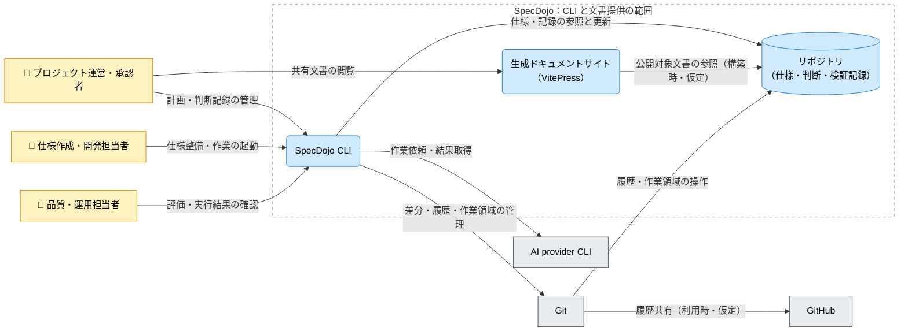

---
specdojo:
  id: cnd-specdojo
  type: architecture
  status: ready
  owner: ARC
  rulebook: specdojo:cnd-rulebook
  part_of: []
  based_on:
    - cxd-specdojo
  supersedes: []
---

# SpecDojo C4コンテナ図

## 1. 概要

[[cxd-specdojo|SpecDojo C4コンテキスト図]] の CLI を実行単位として展開し、仕様・判断・検証記録の保管先と外部ツールの関係を定義する。併せて、記録を参加者へ伝える派生経路として生成ドキュメントサイト（VitePress）を示す。[[prj-0001:prj-overview|プロジェクト概要]] の共有・継承の原則に沿い、編集する正本と閲覧用の生成物を区別する。

本図はインフラ設計への入力となる配置前提と結合対象を示す初版である。物理ホスト、ポート、公開範囲、認証方式、配備手順は確定せず、CLI の内部モジュール、コマンド構文、ファイル構造は各詳細仕様へ委ねる。

上位図のローカル実行の仮定を引き継ぐ。配備の基準は「配備の基準」に示す。

## 2. C4コンテナ図（Mermaid）

矢印は主たる利用・依頼・参照の向きで、応答を含む。閲覧は代表として運営・承認者から描くが、他の参加者の閲覧権限を制限する意味ではない。Git / GitHub は上位図の一要素をローカル機構と共有先へ分けた表示で、リモート接続経路は仮定である。

## 3. 要素と境界の定義

### 3.1. 対象システムとシステム境界

境界内は CLI による制御、ファイルとして保持する記録、閲覧用文書の提供である。推論とエージェント作業は AI provider CLI、履歴機構は Git、利用時のリモート共有は GitHub に委ねる。物理配置を示す枠ではない。

### 3.2. Person（人・ロール）

| Person（図中ラベル）     | 利用目的・接点                                       |
| ------------------------ | ---------------------------------------------------- |
| プロジェクト運営・承認者 | CLI で計画・判断を管理し、サイトで共有文書を閲覧する |
| 仕様作成・開発担当者     | CLI で対象を選び、仕様整備と作業を起動する           |
| 品質・運用担当者         | CLI で評価・実行結果を確認する                       |

上位図と同じ利用目的による区分であり、RACI や操作権限は定めない。

### 3.3. Container（コンテナ）

| コンテナ（図中ラベル）              | 責務                                                   | 技術区分・配置前提                                                                      |
| ----------------------------------- | ------------------------------------------------------ | --------------------------------------------------------------------------------------- |
| SpecDojo CLI                        | 成果物整備、計画・判断・検証記録の管理、外部作業の起動 | ローカルで起動するコマンド。ランタイム・バージョンは固定しない                          |
| 生成ドキュメントサイト（VitePress） | 公開対象の文書を閲覧用に構成し、参加者へ提供する       | 構築時に文書を読み、静的生成物を配備する。構築環境と配信先は別途選ぶ。閲覧時は CLI 不要 |

### 3.4. Data Store（データストア）

| ストア（図中ラベル）               | 正本                                   | 生成物との境界                                                       |
| ---------------------------------- | -------------------------------------- | -------------------------------------------------------------------- |
| リポジトリ（仕様・判断・検証記録） | 仕様、判断、検証・実行記録のファイル群 | サイトの静的生成物は派生物。閲覧先の編集を正本へ戻す経路は定義しない |

リポジトリは Git プロセスや GitHub サービスと同一視しない。

### 3.5. External Software System（外部システム）

| 外部システム（図中ラベル） | 利用条件・責任分界                                  | 不在・障害時の影響                                           |
| -------------------------- | --------------------------------------------------- | ------------------------------------------------------------ |
| AI provider CLI            | AI へ作業を委譲する場合に使用。特定製品に固定しない | 結果や途中変更が不明になり得る。未変更・承認済みと推定しない |
| Git                        | ローカルの差分・履歴・作業領域の管理に使用          | 競合や操作失敗を識別する。復旧の保証は連携契約へ委ねる       |
| GitHub                     | リモート共有を選んだ場合だけ使用                    | 共有失敗をローカル作業失敗と分ける                           |

### 3.6. Relationship（関係・連携契約）

未作成の文書名は引き継ぎ候補であり、確定した契約を表さない。`REL-04`・`REL-06`・`REL-10` は留保の対象で、扱いは「メモ / 将来課題」に示す。

| 関係 ID  | 起点 → 終点                                                              | 図中ラベル                         | 方式・条件と情報の要点                                       | 詳細の正本                                                 |
| -------- | ------------------------------------------------------------------------ | ---------------------------------- | ------------------------------------------------------------ | ---------------------------------------------------------- |
| `REL-01` | プロジェクト運営・承認者 → SpecDojo CLI                                  | 計画・判断記録の管理               | 人の CLI 操作。判断と現在の記録                              | [[cxd-specdojo\|上位図]] の `REL-01`                       |
| `REL-02` | 仕様作成・開発担当者 → SpecDojo CLI                                      | 仕様整備・作業の起動               | 人の CLI 操作。対象と作業指示、返された結果                  | [[cxd-specdojo\|上位図]] の `REL-02`                       |
| `REL-03` | 品質・運用担当者 → SpecDojo CLI                                          | 評価・実行結果の確認               | 人の CLI 操作。評価対象と実行記録                            | [[cxd-specdojo\|上位図]] の `REL-03`                       |
| `REL-04` | プロジェクト運営・承認者 → 生成ドキュメントサイト（VitePress）           | 共有文書の閲覧                     | ブラウザから閲覧する。公開範囲・到達先は未確定               | [[ifd-specdojo\|インフラ構成図]]                           |
| `REL-05` | SpecDojo CLI → リポジトリ（仕様・判断・検証記録）                        | 仕様・記録の参照と更新             | ローカルファイルの読み書き                                   | [[specdojo:command-reference\|CLIリファレンス]]、各 schema |
| `REL-06` | 生成ドキュメントサイト（VitePress） → リポジトリ（仕様・判断・検証記録） | 公開対象文書の参照（構築時・仮定） | 構築工程のファイル読取。正本の更新反映には再構築・配備が必要 | [[ifd-specdojo\|インフラ構成図]]                           |
| `REL-07` | SpecDojo CLI → AI provider CLI                                           | 作業依頼・結果取得                 | 外部 CLI の呼び出し。文脈と結果・証跡を授受する              | [[ifx-cmd-ai-provider-cli\|AI provider CLI 連携仕様]]      |
| `REL-08` | SpecDojo CLI → Git                                                       | 差分・履歴・作業領域の管理         | ローカル操作。対象変更と履歴を確認・管理する                 | `ifx-cmd-git-cli`（未作成）                                |
| `REL-09` | Git → リポジトリ（仕様・判断・検証記録）                                 | 履歴・作業領域の操作               | ローカルの版管理機構。内容更新とは責務を分ける               | `ifx-cmd-git-cli`（未作成）                                |
| `REL-10` | Git → GitHub                                                             | 履歴共有（利用時・仮定）           | リモート共有の概念経路。接続方式と認証は未確定               | `ifx-cmd-git-cli`、`ifx-cmd-github-cli`（未作成）          |

## 4. 技術前提・制約と検証観点

### 4.1. 技術前提・制約

- 配置設計では、書込可能な作業環境、外部 CLI の実行環境、文書構築環境、閲覧用配信先を区別する。同一ホストへの集約やクラウド利用の要否は決定しない。
- 配信先には公開対象の生成物だけを渡す。リポジトリ全体や実行記録を無条件で公開しない。
- 文書生成や AI 作業の成功から成果物の承認を導かない。本図に認証値や秘密情報の非保持保証を置かない。

### 4.2. 配備の基準

PO が承認の基準とする配備の方針を次に定める。物理ホスト、ポート、製品バージョンは定めない。

| 単位                                | 動かす場所・時点                                         | 配備しないもの                                                    |
| ----------------------------------- | -------------------------------------------------------- | ----------------------------------------------------------------- |
| SpecDojo CLI                        | 利用者の作業環境で、操作のたびに起動する                 | 常駐サービスとして配備しない。配信先や閲覧先からは起動しない      |
| リポジトリ（仕様・判断・検証記録）  | 作業環境のファイル群を正本とし、Git が履歴を管理する     | 正本そのものを配信先へ置かない                                    |
| AI provider CLI、Git                | 境界外のツールとして、CLI と同じ作業環境で利用する       | SpecDojo の一部として同梱・配備しない                             |
| 生成ドキュメントサイト（VitePress） | 構築環境で公開対象から静的生成物を作り、配信先へ配備する | リポジトリ全体と実行記録を配信しない。閲覧時に CLI へ接続させない |
| GitHub                              | リモート共有を選んだ場合だけ使う外部の共有先             | 全機能で必須の接続先にしない                                      |

### 4.3. コンテナ間・外部依存の検証対象

以下は検証設計への入力であり、合格保証ではない。期待結果が未確定の項目や留保した範囲は未判定とする。

| 確認区分     | 対象関係・境界                 | 正常時の結果                                              | 失敗時の観測結果                                       | 主確認ロール   |
| ------------ | ------------------------------ | --------------------------------------------------------- | ------------------------------------------------------ | -------------- |
| 利用場面     | `REL-01`〜`REL-04`             | 各 Person の操作が上位図の利用目的と一致する              | 不一致の場面を識別できる                               | BA             |
| 正本と閲覧物 | `REL-05`、`REL-06`、`REL-04`   | 公開対象だけが正本と同じ版で閲覧できる                    | 構築失敗時は配信済みの版と区別できる                   | QE / DEV       |
| 正本の障害   | `REL-05`、`REL-06`             | 記録を取得・保存できる                                    | 読取不能・書込不能・中断を成功と扱わない。回復は未確定 | QE / DEV       |
| AI 委譲      | `REL-07`                       | 結果と証跡を受け取り、変更をリポジトリで照合できる        | 外部 CLI 不在・拒否・応答欠落を結果と区別できる        | QE / ARC       |
| 履歴と共有   | `REL-08`〜`REL-10`             | 変更が Git の差分・履歴に現れ、共有後はリモートと一致する | ローカル競合と共有失敗を分ける                         | QE / DEV       |
| 公開境界     | リポジトリ → 構築環境 → 配信先 | 公開対象と閲覧範囲が人間の判断に一致する                  | 公開対象外の混入を識別できる                           | ARC / OPS / PO |

## 5. メモ / 将来課題

配置・接続・公開の判断を妨げる論点は、ARC が影響と対応案を PM へ報告し、PM が PJR の課題・リスク・決定記録へ登録する。登録後は ARC が追跡先を本表へ記録する。

| 対象・論点         | 区分と追跡先                                                                                    | 影響範囲                                                              | 担当ロール     | 判断時点                                              | 解消条件・引き継ぎ先                                                                                                                                                                    |
| ------------------ | ----------------------------------------------------------------------------------------------- | --------------------------------------------------------------------- | -------------- | ----------------------------------------------------- | --------------------------------------------------------------------------------------------------------------------------------------------------------------------------------------- |
| 実行・配備の仮定   | 決定候補。PJR は未登録                                                                          | CLI、サイト、`REL-04`・`REL-06`。上位図はローカル実行も仮定としている | ARC            | T-KATA-WAVE-1 の 140 の PO 判断、インフラ設計の着手前 | [[cpd-specdojo-cli\|SpecDojo CLI C4コンポーネント図]] と [[ifd-specdojo\|インフラ構成図（SpecDojo実行環境）]] で CLI の実行単位、構築主体、配信先を具体化し、本図の配備の基準と照合する |
| 公開対象と到達範囲 | 課題（留保 A）。[[prj-0001:pjr-pst5-docs-site-auth-and-delivery\|PJR-PST5]]（運用設計まで留保） | `REL-04`・`REL-06` と配信先。閲覧の認証、配信、選別方式が未確定       | ARC / PO / OPS | 運用設計の着手前、配信先への初回公開前                | 作業環境でのサイト構築、内容確認、選別方式の案の整理は進める。配信先への公開、認証方式と配信先の確定は保留し、PO が公開可否を判断した後にインフラ設計へ反映する                         |
| リモート経路・認証 | 課題（留保 B）。[[prj-0001:pjr-cjmn-ifx-cmd-git-github\|PJR-CJMN]]（留保）                      | `REL-10` の Git 経由は仮定。GitHub CLI の関与も未確認                 | ARC / DEV      | リモート共有を前提とする結合検証の着手前              | `REL-08`・`REL-09` のローカル操作の実装・検証と連携仕様の作成は進める。接続方式と認証の確定、リモート共有を前提とする合否判定は保留する                                                 |
| AI 作業の結果不明  | リスク。PJR は未登録                                                                            | `REL-07`。途中変更と外部へ渡す情報の扱い                              | ARC / QE       | `REL-07` の結合検証設計の着手前                       | [[ifx-cmd-ai-provider-cli\|AI provider CLI 非対話起動のコマンド連携仕様]] と照合して結果欠落と保持記録の期待値を定め、結合検証へ渡す                                                    |
| 正本の障害時の回復 | リスク。PJR は未登録                                                                            | `REL-05`・`REL-06`。中断時に残る変更と回復の扱い                      | ARC / DEV / QE | `REL-05` の結合検証設計の着手前                       | CLI の仕様と schema で中断時の保持範囲と回復の期待値を定め、結合検証へ渡す                                                                                                              |

本図の境界やコンテナを改訂するときは [[specdojo:cnd-rulebook|C4コンテナ図作成ルール]] の「メモ / 将来課題」に従う。ARC が [[cxd-specdojo|上位コンテキスト図]]、[[cpd-specdojo-cli|SpecDojo CLI C4コンポーネント図]]、[[ifd-specdojo|インフラ構成図（SpecDojo実行環境）]] への影響を確認し、DEV が連携契約、QE が結合検証の対象と証跡を追従させる。OPS は人間の `PO` が承認を記録した版を公開の元とする。
