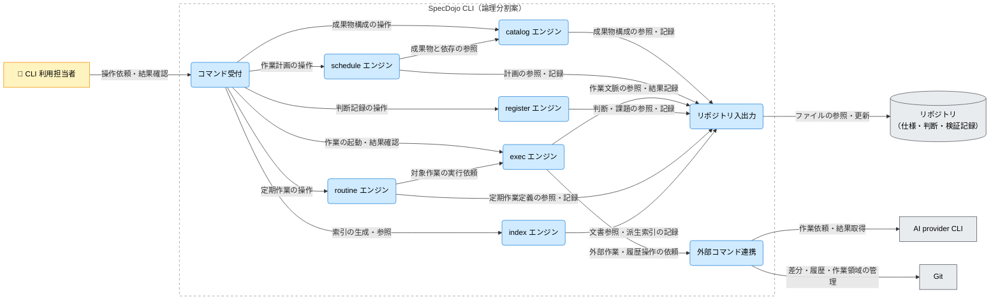

---
specdojo:
  id: cpd-specdojo-cli
  type: architecture
  status: draft
  owner: ARC
  rulebook: specdojo:cpd-rulebook
  part_of: []
  based_on:
    - cnd-specdojo
  supersedes: []
---

# SpecDojo CLI C4コンポーネント図

## 1. 概要

[[cnd-specdojo|SpecDojo C4コンテナ図]] の SpecDojo CLI を、catalog・schedule・exec・register・routine・index の主要エンジンと共通の接点へ展開する。各責務の論理配置、依存方向、結合時に確認する境界を定義し、実装配置とテスト設計の入力にする。[[prj-0001:prj-overview|プロジェクト概要]] の共有・継承の原則から、参加者が参照する正本と検索用の派生情報、作業結果と人間の判断を区別する。

_ASSUMPTION_: 本書の内部構成は、上位図のローカル CLI を一つの実行単位として保つ初版の論理分割案である。CLI の入口が catalog・schedule・exec・register・routine・index の各コマンド群を個別に登録していることは実装で確認したが、エンジン間の実際の呼出関係とソース配置は確認できていないため、以下の内部依存を実装確認済みとは扱わない。照合先と担当は「メモ / 将来課題」に示す。

対象は指定した主要エンジンと、リポジトリ・外部 CLI への代表的な経路に限る。他の補助機能、内部クラス、コマンド構文、記録のキー・値、状態遷移の詳細、サイトの構築・配備は各正本へ委ねる。

ARC が分割案を整理し、DEV と QE が実装・結合設計への対応を確認する。業務判断と公開可否は本図では確定しない。

## 2. C4コンポーネント図（Mermaid）

矢印は主たる利用・依頼の向きで、返される結果も同じ関係に含む。実行順や全操作での必須通過を意味しない。Git によるリポジトリ操作、GitHub への共有、サイトへの文書提供は上位図に残し、内部図では CLI の直接の接点までを描く。

## 3. 要素と境界の定義

### 3.1. 対象コンテナ境界と利用者

境界内は CLI の入力受付、責務別の処理、記録と外部依頼への接点である。リポジトリは上位図と同じ境界外の保持単位であり、内部 DB を新設しない。同じ端末上の AI provider CLI と Git も CLI 内部へ取り込まない。図中の論理分割は別プロセス・別配備を要求しない。

| 上位図の Person          | 本図の接点と確認する結果                                                         |
| ------------------------ | -------------------------------------------------------------------------------- |
| プロジェクト運営・承認者 | CLI 利用担当者として受付へ計画・判断記録の操作を依頼し、記録された内容を確認する |
| 仕様作成・開発担当者     | 同じ受付へ成果物の整備・作業起動を依頼し、対象と返された変更を確認する           |
| 品質・運用担当者         | 同じ受付で実行結果と検証記録を確認し、失敗・結果不明を識別する                   |

これは利用目的の対応であり、権限や承認手続を新たに定義しない。

### 3.2. コンポーネントと論理配置

| コンポーネント    | 固有の責務                                                     | 主な入力 → 出力                               | 論理配置・境界                                   |
| ----------------- | -------------------------------------------------------------- | --------------------------------------------- | ------------------------------------------------ |
| コマンド受付      | 操作対象を解釈し、対応する責務へ依頼して結果を利用者へ返す     | 操作依頼 → 対象エンジンへの依頼・表示結果     | 入力境界。各記録の業務判断を持たない             |
| catalog エンジン  | 対象成果物の構成と依存関係を扱う                               | 成果物構成 → 参照・整合確認に用いる成果物情報 | 成果物構成の責務。作業の実行は扱わない           |
| schedule エンジン | 成果物情報を基に作業計画を扱う                                 | 成果物・依存と計画操作 → 作業計画             | 計画の責務。外部作業を直接実行しない             |
| exec エンジン     | 指定作業の文脈を組み立て、作業の起動と返された結果・証跡を扱う | 実行対象・文脈 → 作業結果・実行記録           | 実行制御の責務。成果物の承認は行わない           |
| register エンジン | 課題と人間の判断を引き継げる記録として扱う                     | 課題・判断の操作 → 判断・課題記録             | 判断記録の責務。AI の成功から判断を生成しない    |
| routine エンジン  | 定期作業の定義と対象作業の起動依頼を扱う                       | 定期作業定義・実行契機 → 作業依頼             | 定期作業の責務。実行処理は exec に委ねる案       |
| index エンジン    | 文書の識別・参照に使う派生索引を扱う                           | 正本文書 → 検索・解決用索引                   | 参照支援の責務。索引を文書の内容の正本にしない   |
| リポジトリ入出力  | 各責務が扱う記録をファイルとして参照・更新する                 | 読書き要求 → 内容・保存結果                   | 共通の記録接点。更新可否の業務判断は依頼側に残す |
| 外部コマンド連携  | 外部 CLI を呼び出し、実行可否と返された結果を依頼側へ渡す      | 外部操作依頼 → 応答・失敗情報                 | 共通の外部接点。AI 作業と Git 操作の契約は分ける |

### 3.3. ストアと外部依存

| 要素・区分                      | 保持内容または委ねる責務                             | 利用条件・失敗の影響                                                           |
| ------------------------------- | ---------------------------------------------------- | ------------------------------------------------------------------------------ |
| リポジトリ（ストア）            | 仕様・判断・検証記録の正本と、索引などの派生ファイル | 内容の読取・書込に使用。保存失敗と処理未実施を同一視しない                     |
| AI provider CLI（外部システム） | 推論と委譲された作業                                 | AI 作業を依頼する場合に使用。不在・拒否・応答欠落では途中変更と結果を確認する  |
| Git（外部システム）             | ローカルの差分・履歴・作業領域の管理                 | 履歴操作を伴う場合に使用。競合や失敗と、既に残ったファイル変更を分けて確認する |

### 3.4. 関係と詳細の正本

内部関係は概要の仮定に従う。未作成の詳細設計・連携仕様の名前は引き継ぎ候補であり、確定した契約や実在するファイルを表さない。

| 関係 ID  | 起点 → 終点                          | 授受情報・条件                                             | 詳細の正本                                          |
| -------- | ------------------------------------ | ---------------------------------------------------------- | --------------------------------------------------- |
| `REL-01` | CLI 利用担当者 → コマンド受付        | 操作依頼と表示結果。上位図の利用者3区分を集約              | CLI リファレンス（構文・値の既存正本を DEV が特定） |
| `REL-02` | コマンド受付 → catalog エンジン      | 成果物構成の操作と処理結果                                 | 同上                                                |
| `REL-03` | コマンド受付 → schedule エンジン     | 作業計画の操作と処理結果                                   | 同上                                                |
| `REL-04` | コマンド受付 → exec エンジン         | 作業の起動依頼と結果確認                                   | 同上                                                |
| `REL-05` | コマンド受付 → register エンジン     | 課題・判断記録の操作と処理結果                             | 同上                                                |
| `REL-06` | コマンド受付 → routine エンジン      | 定期作業の操作と処理結果                                   | 同上                                                |
| `REL-07` | コマンド受付 → index エンジン        | 索引生成・参照の操作と処理結果                             | 同上                                                |
| `REL-08` | schedule エンジン → catalog エンジン | 計画対象の成果物と依存関係の参照                           | 内部設計（DEV が実装対応・契約の所在を確認）        |
| `REL-09` | routine エンジン → exec エンジン     | 対象作業の実行依頼と結果。契機や再実行条件は未確定         | 同上                                                |
| `REL-10` | catalog エンジン → リポジトリ入出力  | 成果物構成の参照・記録                                     | 記録 schema（DEV が対象の既存正本を特定）           |
| `REL-11` | schedule エンジン → リポジトリ入出力 | 作業計画の参照・記録                                       | 同上                                                |
| `REL-12` | exec エンジン → リポジトリ入出力     | 作業文脈の参照と結果・証跡の記録                           | 同上                                                |
| `REL-13` | register エンジン → リポジトリ入出力 | 課題・判断記録の参照・記録                                 | 同上                                                |
| `REL-14` | routine エンジン → リポジトリ入出力  | 定期作業定義の参照・記録                                   | 同上                                                |
| `REL-15` | index エンジン → リポジトリ入出力    | 文書の参照と派生索引の記録                                 | 索引の schema・生成仕様（DEV が既存正本を特定）     |
| `REL-16` | リポジトリ入出力 → リポジトリ        | ファイルの内容と保存結果。上位図の `REL-05` を具体化       | ファイル入出力の内部設計（所在未確認）              |
| `REL-17` | exec エンジン → 外部コマンド連携     | 外部作業・履歴操作の依頼と結果                             | 外部呼出しの内部設計（所在未確認）                  |
| `REL-18` | 外部コマンド連携 → AI provider CLI   | 作業文脈と結果・証跡。上位図の `REL-07` を具体化           | 上位図が参照する外部コマンド連携仕様                |
| `REL-19` | 外部コマンド連携 → Git               | 差分・履歴・作業領域の管理結果。上位図の `REL-08` を具体化 | `ifx-cmd-git-cli`（未作成）                         |

## 4. 技術前提・制約と検証観点

### 4.1. 技術前提・制約

- 依存は受付から責務別エンジン、エンジンから共通の接点へ向ける案とする。共通の接点が特定エンジンの業務判断を呼び戻す構成は本案に含めない。
- `REL-08` は成果物構成の参照、`REL-09` は作業実行の委譲であり、相手の記録を直接更新する関係とはしない。正確な内部 API と他の横断依存は実装対応の確認後に詳細化する。
- 外部 AI はリポジトリへ途中変更を残し得る。図のリポジトリ入出力をすべての編集主体が通るという保証や、処理の原子性・排他・自動再試行の保証は置かない。
- 上位図のローカル実行の仮定を維持し、ランタイム・バージョン・物理配置は固定しない。実行結果の取得と保存を、主要判断・承認・公開許可から分ける。

### 4.2. コンポーネント間の検証対象

以下は QE / DEV が結合設計へ使う観測点であり、実施済みテストや合格保証ではない。

| 対象関係           | 条件                                         | 観測する結果                                                                           |
| ------------------ | -------------------------------------------- | -------------------------------------------------------------------------------------- |
| `REL-01`〜`REL-07` | 指定した操作が処理される／対象が解決できない | 意図した責務へ渡った依頼と、利用者へ返す対象・結果・失敗の識別                         |
| `REL-08`           | 成果物や依存関係が欠ける                     | 計画が参照した対象と不足理由。未確認の依存を解決済みと扱わないこと                     |
| `REL-09`           | 対象作業を起動する／起動できない             | 定期作業の依頼と実行記録の対応。再実行可否は詳細契約で定めること                       |
| `REL-10`〜`REL-16` | 読取不能・保存失敗・派生索引と正本の不一致   | 残った記録と保存できなかった範囲。索引の結果だけで正本の存在・更新成功を保証しないこと |
| `REL-17`・`REL-18` | 外部 CLI 不在・拒否・応答欠落                | 未起動、返された失敗、結果不明の区別と途中変更の確認先                                 |
| `REL-17`・`REL-19` | Git の操作失敗・競合                         | 履歴操作の成否と保持された変更。AI 作業自体の結果と分けて確認できること                |

## 5. メモ / 将来課題

| 対象・論点         | 影響                                                                       | 担当ロール | 解消条件・引き継ぎ先                                                                                             |
| ------------------ | -------------------------------------------------------------------------- | ---------- | ---------------------------------------------------------------------------------------------------------------- |
| 内部構成と実装対応 | 全コンポーネントと内部関係は論理分割案。ソース配置の直接参照としては未確定 | ARC / DEV  | 実装と既存内部設計を照合し、受付・各エンジン・共通接点の配置と依存方向を確定する。差異は本図と詳細設計へ反映する |
| 正本の具体的な参照 | `REL-01`〜`REL-17` の構文・構造・内部契約の ID が未接続                    | DEV        | 既存リファレンス・schema・内部設計の ID と担当範囲を特定して関係表へ接続する。詳細を本図に複製しない             |
| 外部依頼と途中変更 | `REL-18`・`REL-19`。応答欠落・保存失敗・競合後の回復条件が未確定           | ARC / QE   | 上位図の外部コマンド連携仕様と `ifx-cmd-git-cli` で結果・証跡・保持範囲を定め、結合設計へ期待値を渡す            |
| 実行・配備の前提   | ローカルでの一実行単位は上位図からの仮定。サイト構築主体は本図で解消しない | ARC        | `ifd-specdojo` で作業環境と構築・配備の単位を確認し、上位図と本図の境界に差異があれば調整する                    |
