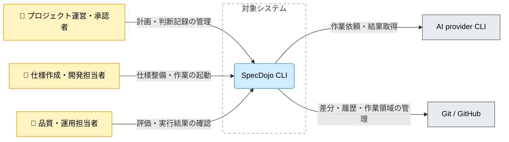

---
specdojo:
  id: cxd-specdojo
  type: architecture
  status: draft
  rulebook: specdojo:cxd-rulebook
  part_of: []
  based_on: []
  supersedes: []
---

# SpecDojo C4コンテキスト図

## 1. 概要

SpecDojo CLI を、仕様・判断・検証の記録を人と AI Agent が共有して作業を引き継ぐための対象システムとして定義する。[[prj-0001:prj-overview|プロジェクト概要]] の判断原則を受け、本図では利用者、AI provider CLI、Git / GitHub との責任分界を示す。社会課題の定義、期待価値、主要判断、公開可否は人間が責任を持ち、CLI の実行成功だけで承認済みとは扱わない。

| 対象者                   | 課題・関心事                                   | 本図で確認する内容                             |
| ------------------------ | ---------------------------------------------- | ---------------------------------------------- |
| プロジェクト運営・承認者 | 技術支援を使いながら当事者価値と判断責任を保つ | 対象範囲、外部へ委ねる責務、人間が判断する境界 |
| 仕様作成・開発担当者     | 同じ仕様を使って作成・実装・改善を引き継ぐ     | 利用者と外部ツールの接点、下位設計へ渡す境界   |
| 品質・運用担当者         | 外部依存の失敗や中断を識別する                 | AI 実行結果と履歴の確認対象、未確定の連携条件  |

内部のコンテナ・コンポーネント分割、CLI 構文、ファイル構造は扱わない。図中の利用者区分は製品の利用目的による分類であり、プロジェクトの RACI や操作権限を定めるものではない。

## 2. C4コンテキスト図（Mermaid）

矢印は主たる利用・依頼の方向であり、応答は同じ関係に含む。Git / GitHub は版管理と共有の委譲先をまとめた表示で、GitHub への直接接続や全操作での通信を意味しない。

## 3. 要素と境界の定義

### 3.1. 対象システムとシステム境界

| 項目               | 内容                                                                                                              |
| ------------------ | ----------------------------------------------------------------------------------------------------------------- |
| システム名         | SpecDojo CLI                                                                                                      |
| 提供する中核責務   | 実践の型を用いた成果物整備、計画・判断・検証記録の管理、AI 作業の起動と結果の取り扱い                             |
| 境界内に含める範囲 | 仕様と実行記録を扱う CLI の制御、外部ツールへ渡す作業依頼と返された結果の管理                                     |
| 境界外へ委ねる範囲 | 推論・エージェント作業の実行は AI provider CLI、版管理とリモート共有は Git / GitHub、主要判断と承認は人間へ委ねる |

_ASSUMPTION_: 初版は利用者の作業環境で CLI と外部ツールを動かし、Git 管理のファイルを共有・継承する構成として整理する。稼働配置や接続方式を確定したものではなく、確認先は「メモ / 将来課題」に示す。

### 3.2. Person（人・ロール）

| Person（図中ラベル）     | 対応ロール・利用者区分                       | 利用目的・主な関わり                           | 境界上の接点・確認責務                                    |
| ------------------------ | -------------------------------------------- | ---------------------------------------------- | --------------------------------------------------------- |
| プロジェクト運営・承認者 | 当事者の価値・計画・主要判断を確認する参加者 | 計画と判断の記録を共有し、次の作業を選ぶ       | CLI の記録を参照し、支援結果を採用するかを人間が判断する  |
| 仕様作成・開発担当者     | 仕様を書く参加者、技術協力者                 | 実践の型で成果物を整備し、必要な作業を起動する | AI へ渡す対象と返された変更を確認し、次の担当者へ引き継ぐ |
| 品質・運用担当者         | 検証と継続運用を担う参加者                   | 評価結果と外部依存の状態を確認する             | 結果の不足・失敗・未決事項を識別し、人間の判断へ戻す      |

社会課題の当事者全員が CLI を直接操作するとは限らない。直接操作しない関係者の知識や確認は仕様・判断記録を介して扱い、図の Person を実利用者の全一覧とはしない。

### 3.3. External Software System（外部システム）

| 外部システム（図中ラベル） | 区分・利用条件                                                    | 対象システムとの責任分界                                                                              | 不在・障害時の影響と境界上の扱い                                                                              |
| -------------------------- | ----------------------------------------------------------------- | ----------------------------------------------------------------------------------------------------- | ------------------------------------------------------------------------------------------------------------- |
| AI provider CLI            | AI に作業を委譲する場合の外部実行基盤                             | SpecDojo が依頼・結果を管理し、外部 CLI が推論と作業を実行する。特定製品には固定しない                | 委譲した作業の結果を得られない。失敗と結果不明を識別する必要があり、成果物が未変更・承認済みとは推定しない    |
| Git / GitHub               | Git はローカルの履歴・作業領域、GitHub は利用時のリモート共有基盤 | SpecDojo が版管理操作を利用し、履歴・作業領域の機構は Git、リモート保管やレビュー機能は GitHub が担う | ローカル操作の失敗とリモート共有の失敗を分けて確認する。GitHub 不在をすべてのローカル作業の停止条件とはしない |

外部ツールが同じ端末にあっても責務は境界外に置く。異常時の状態遷移、自動再試行、復旧手順の保証は本図では定めず、連携契約へ引き継ぐ。

### 3.4. Relationship（関係・連携契約）

| 関係 ID  | 起点 → 終点                             | 図中ラベル                 | やり取りする情報・制御の要点               | 連携方式・境界                              | 正本・関連仕様                                                    |
| -------- | --------------------------------------- | -------------------------- | ------------------------------------------ | ------------------------------------------- | ----------------------------------------------------------------- |
| `REL-01` | プロジェクト運営・承認者 → SpecDojo CLI | 計画・判断記録の管理       | 計画・判断の入力と現在の記録の参照         | 人間による CLI 操作                         | [[specdojo:command-reference\|CLIコマンドリファレンス]]           |
| `REL-02` | 仕様作成・開発担当者 → SpecDojo CLI     | 仕様整備・作業の起動       | 整備する対象・作業指示と結果の確認         | 人間による CLI 操作                         | [[clis-exec-commands\|実行制御コマンド群 CLI 仕様]]               |
| `REL-03` | 品質・運用担当者 → SpecDojo CLI         | 評価・実行結果の確認       | 評価対象と検証・実行記録                   | 人間による CLI 操作                         | [[specdojo:command-reference\|CLIコマンドリファレンス]]           |
| `REL-04` | SpecDojo CLI → AI provider CLI          | 作業依頼・結果取得         | 作業対象・文脈を渡し、結果と証跡を受け取る | 外部 CLI 呼び出し                           | [[ifx-cmd-ai-provider-cli\|AI provider CLI 外部コマンド連携仕様]] |
| `REL-05` | SpecDojo CLI → Git / GitHub             | 差分・履歴・作業領域の管理 | 変更と履歴を確認し、作業領域を管理する     | ローカル Git 操作。リモート接続経路は未確定 | `ifx-cmd-git-cli`、`ifx-cmd-github-cli`（未作成）                 |

## 4. 技術前提・制約と検証観点

### 4.1. 技術前提・制約

- 人間と AI Agent が同じ仕様と判断記録を参照できることを境界の前提とする。記録形式や構文の詳細は本書で再定義しない。
- AI provider CLI の実行と成果物の承認を分離する。`draft` の作成・更新結果から `ready` への昇格を自動的に導かない。
- 外部ツールへ渡す情報、認証の管理者、公開可能な範囲は契約で確認する。本図に認証値を記載せず、CLI が秘密情報を一切保持しないという実装保証も置かない。

### 4.2. システム境界・外部依存の検証観点

以下は下流の検証設計へ渡す対象であり、検証済みの保証ではない。

| 確認区分         | 対象関係・境界     | 検証観点                                                                                        | 主確認ロール |
| ---------------- | ------------------ | ----------------------------------------------------------------------------------------------- | ------------ |
| 利用者と判断責任 | `REL-01`〜`REL-03` | 直接操作する利用者と主要判断を担う人間を識別でき、AI 作業完了と承認を区別できるか               | PO / BA      |
| AI への委譲      | `REL-04`           | 外部 CLI の不在・認証拒否・異常終了・応答欠落を与えたとき、結果と途中変更を識別できるか         | QE / ARC     |
| 履歴と共有       | `REL-05`           | ローカル Git の競合と GitHub への接続失敗を分け、保持された変更と再開に必要な情報を確認できるか | QE / ARC     |

## 5. メモ / 将来課題

| 対象・論点                        | 影響範囲                                               | 担当ロール | 解消条件・引き継ぎ先                                                                                                                                                                            |
| --------------------------------- | ------------------------------------------------------ | ---------- | ----------------------------------------------------------------------------------------------------------------------------------------------------------------------------------------------- |
| ローカル実行という仮定と内部構成  | CLI・外部ツールの配置と共有単位                        | ARC        | [[cnd-specdojo\|SpecDojo C4コンテナ図]]、[[cpd-specdojo-cli\|SpecDojo CLI C4コンポーネント図]]、[[ifd-specdojo\|インフラ構成図（SpecDojo実行環境）]] の整備時に実行境界を照合し、仮定を更新する |
| Git / GitHub の接続と失敗時の扱い | `REL-05`。直接接続・CLI 経由の区別、必須機能と任意機能 | ARC / DEV  | 未作成の `ifx-cmd-git-cli`、`ifx-cmd-github-cli` で実際の呼び出し経路・認証境界・失敗時の保持範囲を確認する                                                                                     |
| AI 実行の結果不明・情報の持ち出し | `REL-04`。途中変更、認証管理、外部へ渡す情報           | ARC / QE   | 外部コマンド連携仕様で期待結果と扱う情報を照合し、境界テストの期待値を定める。根拠が不足する保証は追加しない                                                                                    |
