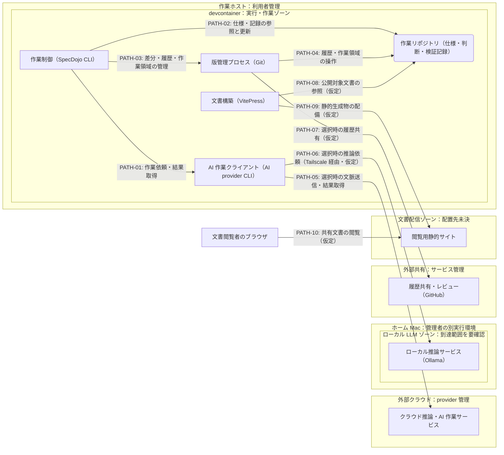

---
specdojo:
  id: ifd-specdojo
  type: architecture
  status: draft
  owner: ARC
  rulebook: specdojo:ifd-mermaid-rulebook
  part_of: []
  based_on:
    - cnd-specdojo
  supersedes: []
---

# インフラ構成図（SpecDojo実行環境）

## 1. 概要

[[cnd-specdojo|SpecDojo C4コンテナ図]] の CLI、リポジトリ、外部ツールを、ローカル実行環境と外部サービスの配置案へ対応付ける。devcontainer／ホストからクラウド AI provider、Tailscale 経由のホーム Mac、GitHub へ出る情報と通信境界を識別し、インフラ設計・セキュリティゾーン設計・障害切り分けの入力にする。

[[prj-0001:prj-overview|プロジェクト概要]] の継承・参加負荷の原則に沿い、特定の AI 製品や個人のホーム Mac を全利用者の必須基盤にはしない。本書は代表構成の初版であり、実環境での接続・隔離の検証結果や公開承認を表さない。接続値、認証設定、CLI 構文、記録 schema、監視閾値、復旧操作は対象外とし、詳細の委譲先は「メモ / 将来課題」で扱う。

## 2. インフラ構成図（Mermaid）

_ASSUMPTION_: CLI と外部 CLI を devcontainer で実行し、作業リポジトリと文書構築工程を同じ作業環境から利用する配置案である。ホスト直接実行は代替配置とし、図中の二重稼働を意味しない。ホーム Mac のローカル推論、文書構築・配備の経路も未検証の案である。

枠は配置・管理主体・到達範囲の区切りであり、アクセス制御が実装済みであることを示さない。実線は利用・依頼・参照・転送の起点から終点への向きで、応答を含む。`PATH-06` はホスト側の接続経路を経て到達する論理線で、devcontainer 内に Tailscale が常駐することや、ホーム Mac が公開されていることを意味しない。トンネルの確立・経路制御の構成は未確定である。

## 3. 配置と境界の定義

| 図中の環境・要素                                        | 上位要素との対応                               | 管理主体                                         | 保持情報・到達条件                                                                               |
| ------------------------------------------------------- | ---------------------------------------------- | ------------------------------------------------ | ------------------------------------------------------------------------------------------------ |
| 作業ホスト / devcontainer                               | CLI・外部ツールの実行場所を具体化する仮定      | 利用者側の DEV / OPS                             | 作業環境を提供する。コンテナ再構築後の保持範囲とホストとの共有方法は未確認                       |
| 作業制御 / AI 作業クライアント                          | SpecDojo CLI / AI provider CLI                 | CLI は DEV、接続設定は利用者側                   | 対象の仕様・指示・結果を扱う。AI provider CLI は同一環境に配置しても SpecDojo の責務の外部に置く |
| 版管理プロセス / 作業リポジトリ                         | Git / リポジトリ                               | 利用者側の DEV                                   | 正本と変更履歴をローカルに保持する案。外部共有先や生成物と同一視しない                           |
| 外部クラウド / クラウド推論・AI 作業サービス            | AI provider CLI の先の依存を展開               | provider 側。送信対象の判断は利用者側            | Claude・Codex・GitHub Copilot 等の選択先をまとめた役割表示。各製品が同じ接続契約を持つとはしない |
| ホーム Mac / ローカル LLM ゾーン / ローカル推論サービス | AI 作業の代替依存を展開                        | ホーム Mac の管理者。利用条件は ARC / OPS が調整 | Ollama へ必要な文脈を渡す案。Tailscale からの到達許可と他の到達経路の有無は要確認                |
| 外部共有 / 履歴共有・レビュー                           | GitHub                                         | サービス側と利用者側のリポジトリ管理者           | 選んだ履歴・変更を共有する。クラウド AI 利用の経路と共有権限を分ける                             |
| 文書構築 / 閲覧用静的サイト                             | 生成ドキュメントサイトを構築工程と配信先へ展開 | 構築は DEV、配信は未決                           | 公開対象だけを構築し静的生成物を配備する案。配信先に作業リポジトリをそのまま置かない             |
| 文書閲覧者のブラウザ                                    | 上位図の共有文書閲覧                           | 閲覧者。閲覧範囲の判断は PO                      | 配信先へ接続する案。CLI の起動や正本への直接接続を要求しない                                     |

ホスト直接実行では、devcontainer 内の役割をホストの作業ゾーンへ置き換える。CLI・外部ツールの責任分界と外部へ渡す情報は維持し、書込範囲とネットワーク到達性は配置ごとに検証する。C4 の Container は論理的な実行単位であり、devcontainer の個数とは対応しない。上位図の CLI 操作者は利用目的の定義を引き継ぎ、本図では文書閲覧経路だけを配置対象として描く。

## 4. 通信経路と情報の境界

上位関係の責務は [[cnd-specdojo|コンテナ図]] を正とする。以下は配置境界での情報と条件の差分である。

| 経路 ID               | 起点 → 終点                                         | 目的・情報の要点                                      | 利用条件・詳細の委譲先                                                                                                          |
| --------------------- | --------------------------------------------------- | ----------------------------------------------------- | ------------------------------------------------------------------------------------------------------------------------------- |
| `PATH-01`             | 作業制御 → AI 作業クライアント                      | 上位 `REL-07`。対象文脈・作業指示と結果・証跡         | AI へ委譲する場合。呼出し契約は上位図が参照する外部コマンド連携仕様へ委ねる                                                     |
| `PATH-02`             | 作業制御 → 作業リポジトリ                           | 上位 `REL-05`。人と AI が引き継ぐ仕様・判断・実行記録 | ローカルファイル操作。記録構造は各 schema を正とする                                                                            |
| `PATH-03` / `PATH-04` | 作業制御 → 版管理プロセス → 作業リポジトリ          | 上位 `REL-08` / `REL-09`。差分・履歴・作業領域        | ローカル操作。詳細は `ifx-cmd-git-cli`（未作成）へ委ねる                                                                        |
| `PATH-05`             | AI 作業クライアント → クラウド推論・AI 作業サービス | ローカル管理外へ出る作業指示・対象文脈と返された結果  | クラウド provider 選択時。送信範囲、認証、保持条件は provider ごとの契約で確認する                                              |
| `PATH-06`             | AI 作業クライアント → ローカル推論サービス          | 別管理のホーム Mac へ渡す推論文脈と応答               | ローカル LLM 選択時の仮定。Tailscale 到達性と Ollama の接続契約を整備してから利用可否を判断する                                 |
| `PATH-07`             | 版管理プロセス → 履歴共有・レビュー                 | 上位 `REL-10`。共有する履歴・変更と共有結果           | GitHub 利用時の概念経路。直接接続か GitHub CLI 経由か、認証は未確定。`ifx-cmd-git-cli` / `ifx-cmd-github-cli`（未作成）へ委ねる |
| `PATH-08`             | 文書構築 → 作業リポジトリ                           | 上位 `REL-06`。公開対象として選んだ文書の読取         | 構築工程の仮定。選別方式と構築主体の確定が必要                                                                                  |
| `PATH-09`             | 文書構築 → 閲覧用静的サイト                         | 承認した公開対象の静的生成物だけを配備する案          | 配信基盤と配備契約は未決。実行記録・リポジトリ全体の公開を許可する線ではない                                                    |
| `PATH-10`             | 文書閲覧者のブラウザ → 閲覧用静的サイト             | 上位 `REL-04`。配備済み文書の閲覧                     | 公開範囲・閲覧認証・到達先は PO の判断待ち                                                                                      |

## 5. 技術前提・制約と検証観点

### 5.1. 技術前提・制約

- ローカルの正本操作、クラウド AI、ホーム Mac の推論、GitHub 共有を依存の単位として分ける。外部サービスを選択していない操作まで、その接続を必須にはしない。
- ホーム Mac は別管理の外部依存である。ローカル LLM の選択から無償・常時稼働・情報非保持を導かず、費用と管理者の継続負荷を確認して利用を判断する。接続障害時の別 provider への切替えも、送信先変更の確認なしに保証しない。
- 文脈の外部送信、GitHub 共有、文書公開はそれぞれ人間の判断対象とする。認証方式と公開範囲が未確認の経路は、枠や接続成功だけで承認済みと扱わない。

### 5.2. 境界・障害の検証対象

未実施の検証設計入力である。OPS は観測対象から監視項目を具体化し、閾値・通知先・復旧手順は運用文書で定める。

| 対象経路・境界                    | 障害条件・影響                                                   | 観測する結果・切り分け対象                                                                         | 主確認ロール   |
| --------------------------------- | ---------------------------------------------------------------- | -------------------------------------------------------------------------------------------------- | -------------- |
| 作業ゾーン、`PATH-02` / `PATH-04` | 書込拒否・再構築で記録を引き継げない                             | 作業ファイル・履歴の保持範囲、エラー、再構築前後の対応                                             | QE / DEV / OPS |
| `PATH-01` / `PATH-05`             | 外部 CLI 不在・認証拒否・応答欠落で AI 作業が完了しない          | CLI 起動と外部接続を分け、返された結果・残った変更・結果不明を確認する                             | QE / ARC       |
| `PATH-06`                         | 到達不能・Mac 停止・推論サービス停止でローカル推論を利用できない | Tailscale 到達性、サービス応答、作業結果を段階別に識別する。許可していない経路からの到達も確認する | QE / OPS       |
| `PATH-07`                         | リモート拒否・通信断で履歴共有ができない                         | ローカル履歴とリモート反映を分け、GitHub 側の状態と共有結果を照合する                              | QE / DEV       |
| `PATH-08`〜`PATH-10`              | 構築・配備失敗、公開範囲の誤りで閲覧内容が期待と異なる           | 選別対象、構築結果、配備済みの版、閲覧範囲を対応付ける                                             | QE / OPS / PO  |

## 6. メモ / 将来課題

| 対象・論点                                 | 影響                                                                | 担当           | 解消条件・引き継ぎ先                                                                          |
| ------------------------------------------ | ------------------------------------------------------------------- | -------------- | --------------------------------------------------------------------------------------------- |
| _ASSUMPTION_: devcontainer／ホストの配置   | 書込・保持範囲、外部 CLI の実行場所、構築工程が未検証               | ARC / DEV      | 実行場所と永続化・到達性を配置別に確認し、技術構成文書を正本として接続する                    |
| _TODO_: クラウド AI の接続契約             | `PATH-05` の送信範囲・認証・保持条件が未確認                        | ARC / PO       | provider ごとの条件を確認し、PO が送信範囲を判断する。上位図の外部コマンド連携仕様へ引き継ぐ  |
| _ASSUMPTION_: Tailscale 経由の Ollama 利用 | `PATH-06` の到達制御・稼働条件・管理負荷が未確認                    | ARC / OPS      | ホーム Mac 管理者と接続構成・許可範囲・継続負荷を確認し、技術構成・運用文書へ引き継ぐ         |
| _TODO_: GitHub 接続の具体化                | `PATH-07` の接続経路・認証・失敗後の保持範囲が未確認                | ARC / DEV      | `ifx-cmd-git-cli` / `ifx-cmd-github-cli` を整備し、ローカル操作と共有結果の契約を確認する     |
| _TODO_: 文書の構築・公開境界               | `PATH-08`〜`PATH-10` の構築主体・選別方式・配信先・閲覧認証が未確定 | ARC / PO / OPS | ARC が配置案を具体化し、PO が公開対象・閲覧範囲を判断した後、OPS が配備・監視の正本を整備する |
