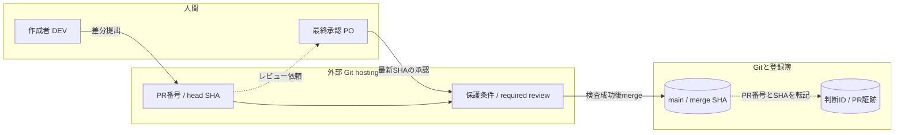
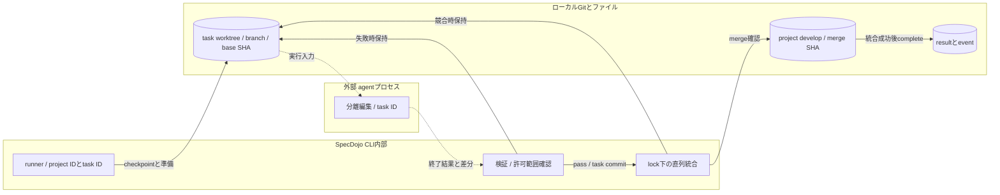
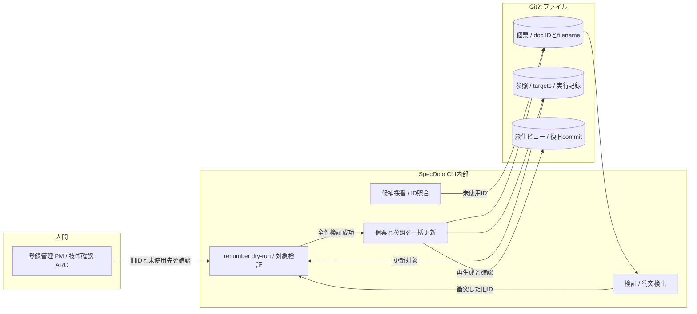
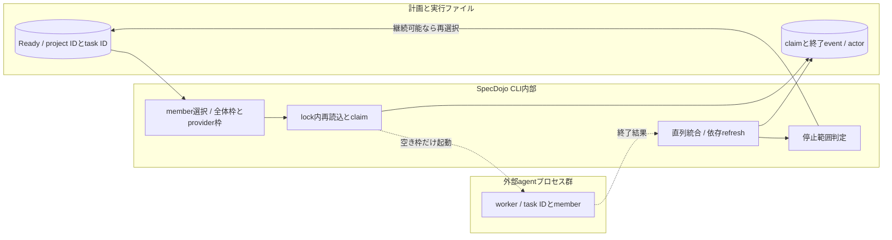
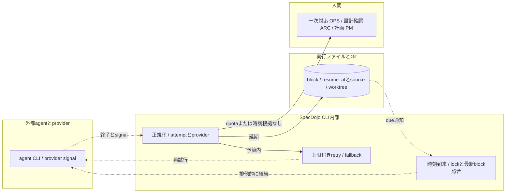

---
specdojo:
  id: sysd-critical-flows
  type: architecture
  status: draft
  owner: ARC
  rulebook: specdojo:sysd-critical-flows-rulebook
  part_of:
    - sysd-index
  based_on:
    - sysd-index
---

# SpecDojo システム設計重要フロー

## 1. 概要（対象・運用方針）

順序、排他、再実行、監査、人間承認を誤ると成果物・task 状態・参照整合性を損なう5フローを扱う。限られた参加者が判断と復旧を引き継げるよう、境界・永続化点・失敗時保持・再開条件を共有する。通常の単一 task の操作説明と provider 固有の設定値は対象外とし、追加時は既存との統合・削減を先に判断する。

実装・設定・schema・構文の正本は [[sysd-index|システム設計索引]] から辿る。本書の図と受入条件は設計要求であり、実装適合や運用開始の承認済み証跡ではない。plan の依存3文書（`prj-0001:cdfd-task-execution`、`prj-0001:cdfd-register-lifecycle`、`prj-0001:cdfd-multi-project`）は `archive/ja/product/trash/` にある `deprecated` 文書として確認した。既存設計の保持・再開条件との比較に用い、現行仕様への照合不足は CF-U01 で追跡する。

公開対象は本設計と一般化した検証条件であり、本文に個人情報・秘密値は含めない。PR の actor、raw provider signal、作業パス、実行証跡には個人情報・非公開情報が混入し得るため公開版へ転記しない。公開可能性の確認は OPS、構造整合は ARC、`ready` 昇格・外部公開の最終判断は人間の PO が担う。

状態用語の正本は [[prj-0001:stsd-task-execution|タスク実行状態遷移仕様]] とし、Ready は実行候補、成果物の `status: ready` は人間が確定する成熟度として区別する。claim、block、unblock、release の遷移と権限は同仕様へ委ね、resume は保持した試行を継続する実行操作を指す。

## 2. 重要フロー一覧（最大5件）

| Flow ID | フロー名                        | 事故論点                      | 利用者・運用者（Role code）                 | 放置時の業務影響                                     | 期待効果・通常処理より優先する理由                                       |
| ------- | ------------------------------- | ----------------------------- | ------------------------------------------- | ---------------------------------------------------- | ------------------------------------------------------------------------ |
| scf-001 | PRによる留保事項承認とmain昇格  | 職務分離・監査・誤昇格        | 作成者 DEV、承認者 PO、進行管理 PM          | 未承認の判断が共有され、利用側が誤った前提で着手する | 最新差分と人間承認を対応付ける。通常 commit より共有範囲が広い           |
| scf-002 | task worktreeの分離・統合・保持 | 変更競合・部分統合・変更消失  | task owner、設計確認 ARC、復旧 OPS、計画 PM | 完了表示と成果物が食い違い、引継ぎや再作業が増える   | 統合後の完了と失敗時保持を保証する。通常編集と異なり複数の保存境界を持つ |
| scf-003 | register ID採番と衝突復旧       | 一意性・参照整合性・再実行    | 登録利用者 BA、登録管理 PM、復旧 ARC        | 別の判断・作業へ誤接続し、履歴を追えなくなる         | 個票と参照を一貫して復旧する。単票編集より影響範囲が広い                 |
| scf-004 | agent worker poolの並列実行     | 排他・順序・重複claim         | 実行管理 PM、開発 DEV、運用 OPS             | 重複作業や依存順違反で参加者負荷と利用費用が増える   | 枠内の実行と直列統合を分ける。単発実行にはない競合がある                 |
| scf-005 | provider利用制限からの延期再開  | 外部障害・重複再開・無限retry | 実行利用者 DEV、運用 OPS、計画 PM           | 無駄な再試行と停止の見落としで費用・待機負荷が増える | 根拠のある時刻と排他条件で再開する。通常失敗と異なり外部制限が継続する   |

## 3. フロー詳細（IDごと）

図中の実線は同期の要求・結果確認、破線は非同期の実行・通知・後続照合を示す。subgraph は人間、外部サービス、CLI 内部、Git／ファイル保存の境界である。外部メッセージブローカーや常駐 API は置かない。

### 3.1. scf-001: PRによる留保事項承認とmain昇格

- **目的・起動**: 留保事項または project 昇格の候補差分がそろったとき、作成者と承認者を分離して共有する。
- **範囲・入出力**: 入力は対象判断 ID・head SHA・検証結果、出力は承認 review・merge SHA・個票の証跡。通常の agent commit は対象外。

- **永続化点・再実行**: review、merge commit、個票の承認節。新規 commit で旧承認を無効化し、同じ PR URL／SHA の証跡を重複登録しない設計とする。保護設定の実効性は CF-U02 の確認対象。
- **失敗・再開**: reviewer、検証、comment 解決が不足すれば merge しない。merge 後の証跡不足は統合済み状態を保持し、PM が転記を補う。誤 merge は履歴削除でなく是正差分を人間が確認する。
- **受入 AC-01**: PO が最新 head SHA と作成者以外の承認者を確認でき、承認不足なら昇格できない。PM が merge SHA から対象個票へ戻れる。

### 3.2. scf-002: task worktreeの分離・統合・保持

- **目的・起動**: worktree 経路の edit task が claim されたとき、変更を分離し、統合後に完了を記録する。
- **範囲・入出力**: 入力は project 修飾 task ID・checkpoint・許可対象、出力は task commit・統合結果・event。worker 選択は scf-004 へ委ねる。

- **永続化点・再実行**: checkpoint、task commit、result、merge commit、event。branch と path は project 修飾 task ID に対応させ、resume では保持環境と現在の claim を照合する。未統合差分を含む環境を新規実行の残骸として自動破棄しない。
- **失敗・再開**: 準備失敗では実行を始めず今回の claim を release する。検証失敗・許可範囲逸脱・競合では worktree／branch／未統合 commit を保持する。ARC が対象と統合先を確認し、人間の競合解消と再検証後に統合を再開する。
- **受入 AC-02**: task owner が成功時に成果物・result・merge SHA を確認できる。失敗時は complete がなく、OPS が保持パスと停止段階を特定できる。

### 3.3. scf-003: register ID採番と衝突復旧

- **目的・起動**: 個票追加または ID／命名衝突検出時に、同一言語・Unit 内の一意性と参照を守る。
- **範囲・入出力**: 入力は候補 ID・既存 ID・除外候補、復旧時は旧 ID・未使用先・参照元。出力は個票と参照の更新および派生ビュー。通常の業務内容の採否は対象外。

- **永続化点・再実行**: 個票 frontmatter とファイル名が正本、index は派生物。復旧 commit を完了境界とする。候補の再抽選と、既存個票の renumber を混同しない。
- **失敗・再開**: 未使用先・参照元・変更範囲の検証不合格なら書き込みを始めない。一括更新の途中失敗を部分成功と扱わず、保持差分を ARC が照合してから再開する。原子的な失敗復旧の実装適合は CF-U04 で確認する。
- **受入 AC-03**: BA／PM が dry-run の対象と更新後の個票 ID・参照を照合できる。衝突が残れば派生生成・統合を成功扱いせず、生成 index の手修正で解消しない。

### 3.4. scf-004: agent worker poolの並列実行

- **目的・起動**: `exec run --auto` の並列実行要求で、Ready と member の実行条件を満たす task を投入する。
- **範囲・入出力**: 入力は Ready・依存・member・並列制約、出力は claim・実行結果・直列統合・再計算済み候補。worktree 内部は scf-002、利用制限は scf-005 に分ける。

- **永続化点・再実行**: claim／終了 event、result、evidence、統合 commit。lock 内で最新状態を再読込し、重複 claim と provider 上限超過を防ぐ。全体枠・provider 枠・排他の実効条件は CF-U03 で照合する。
- **grade 境界**: review 前の評価結果は主の作業ツリーで確定して plan／checkpoint へ含める。既存設計の `grade run --isolate-pipeline-state` による再試行状態の分離は維持し、適合確認を CF-U04 に含める。パス・構造の詳細は設計索引の Grade 正本へ委ねる。
- **失敗・再開**: runner が該当 task の block と理由を記録し、依存を再計算する。独立 task は継続できるが、クリティカルパス上の実行・利用制限・統合失敗では新規投入を止め、実行中 task の終了を待つ。PM が再計画し、OPS が保持環境を確認する。
- **受入 AC-04**: PM／DEV が重複 claim の拒否、枠内実行、統合の直列化、終了後の依存再計算を確認できる。停止条件では新規投入が増えない。

### 3.5. scf-005: provider利用制限からの延期再開

- **目的・起動**: agent CLI が利用制限・一時障害を返したとき、有限の retry と延期・人間判断へ接続する。
- **範囲・入出力**: 入力は provider signal・attempt・候補、出力は正規化 kind・保持記録・再開根拠・結果。quota の購入や権限変更は対象外。

- **永続化点・再実行**: signal、kind、attempt、`resume_at` と source、block／unblock event、保持 worktree。raw signal は非公開とし、調査用原本と公開要約を分ける。reset、retry-after、明示 cooldown 以外から時刻を推定しない。
- **失敗・再開**: retry 枯渇で runner が block を記録する。quota exhausted・再開時刻不明は自動再開しない。最新 event が対象 block のままで、一つの再開処理が確保した場合だけ保持環境で継続する。再制限は新しい block 情報へ接続する。上限・backoff・時刻解釈の実効性は CF-U03 で確認する。
- **受入 AC-05**: OPS／DEV が停止理由と次の手を確認でき、時刻不明・quota では待機を自動解除しない。同一 block の二重再開がなく、同じ worktree と試行へ戻る。

## 4. 観測性と運用連携

### 4.1. 検知と責任

全フローの設計上の必須記録は `flow_id`、対象 ID、actor、timestamp、result。分散 trace の採用は未確認であり、以下の相関キーを使って人間・外部 CLI・保存記録を照合する。外部 hosting／provider へ内部 trace を伝搬できるとは仮定しない。

| Flow ID | 相関キーと追跡範囲                                     | 検知条件（設計要求）                               | 実装動作と人間の対応・照会先                                              |
| ------- | ------------------------------------------------------ | -------------------------------------------------- | ------------------------------------------------------------------------- |
| scf-001 | 判断 ID → PR番号 → head／merge SHA → 個票              | 承認・検証・証跡の不足を一件でも検出               | merge前は停止、merge後は証跡補完。PM が差分を整理し PO へ判断依頼         |
| scf-002 | project／task ID → branch／base SHA → merge SHA／event | 検証不合格・未統合差分・競合を一件でも検出         | runner が保持。OPS がパスと停止段階を確認し ARC へ競合解消方針を照会      |
| scf-003 | old／new ID → 個票パス → 更新参照 → 復旧commit         | 重複・命名不整合・部分更新・参照切れを一件でも検出 | 検証・生成を停止。PM が対象を確定し ARC へ復旧を依頼                      |
| scf-004 | project／task ID → member／provider／slot → 統合順     | 重複claim・枠超過・統合失敗を一件でも検出          | runner が当該 task を停止、停止範囲を判定。OPS → ARC、PM が後続投入を調整 |
| scf-005 | task ID → provider／attempt → block → 再開結果         | retry 枯渇・quota・時刻不明・重複再開を検出        | runner が block。OPS → ARC へ再開根拠を照会し PM が待機・代替の影響を管理 |

上表はイベントに対する介入条件であり、時間・滞留数による監視閾値や通知先の承認済み設定ではない。定量閾値・通知経路・期限は CF-U05 が未解消のため未確定とし、無通知で運用可能とは判断しない。

### 4.2. 管理記録への引渡し

本節は PJR の自動作成や状態変更を指示しない。OPS／ARC は対象 ID・停止段階・保持情報・影響・再開条件を PM へ渡す。PM が [[prj-0001:pjr-index|登録簿]] で次の種別へ記録し、必要な判断を人間へ依頼する。

| 発生条件・対象                                                           | 種別           | 担当Role codeと対応方針                                     | 報告・判断先                                  |
| ------------------------------------------------------------------------ | -------------- | ----------------------------------------------------------- | --------------------------------------------- |
| 承認不足、証跡欠落、競合、重複ID／claim、上限違反、retry枯渇（全フロー） | issue          | PM が実害と停止範囲を記録、ARC／DEV が技術的な是正を担当    | OPS が検知情報を報告、承認の不足は PO へ      |
| OPR未整備、上限・通知未確定、外部制限による遅延（scf-002〜005）          | risk           | PM が依存 task と Schedule 影響、OPS が暫定検知の限界を記録 | PO が留保の可否を判断                         |
| 保護設定、枠、retry、通知経路の変更が必要（scf-001／004／005）           | change-request | ARC／OPS が選択肢・影響・検証条件を提示、PM が計画化        | 人間の PO が変更可否を判断                    |
| 留保範囲、再開方針、公開可否の人間判断（全フロー）                       | decision       | PO の結論・根拠・対象差分と PM の計画への反映を保存         | [[prj-0001:pm-decision-log\|決定ログ]] へ接続 |

## 5. 関連ドキュメント導線（SDI/テスト/運用/DEC）

### 5.1. 正本と変更影響

以下は設計索引が指定する正本への入口をフロー別に絞ったもの。列挙した実装・テストのパスは所在を確認した。コード・設定との実装適合は CF-U03／04 の確認結果へ接続する。

| Flow ID | 実装・設定の確認入口                                                                        | 変更時に追従する契約・生成物・互換性                                                                                                                           | 運用・判断への導線                                          |
| ------- | ------------------------------------------------------------------------------------------- | -------------------------------------------------------------------------------------------------------------------------------------------------------------- | ----------------------------------------------------------- |
| scf-001 | [[specdojo:git-branching-standard\|Gitブランチ標準]]、hosting の保護設定（CF-U02）          | [[specdojo:command-reference\|コマンド参照]]、個票承認節、PR review条件。旧承認を使った昇格可否を確認                                                          | [[specdojo:register-operation-guide\|登録簿運用]]、CF-U02   |
| scf-002 | `src/exec/worktree.ts`、`src/exec/worktree-ops-commit.ts`、`src/exec/worktree-ops-merge.ts` | `docs/specdojo/schemas/v1/exec-evidence.schema.yaml`、result／event、[[clis-exec-commands\|exec CLI仕様]]。保持環境を既存試行として再利用できること            | [[specdojo:exec-worktree-guide\|worktree運用]]、CF-U04／05  |
| scf-003 | `src/register/register.ts`、`src/register/renumber.ts`                                      | 個票 ID・ファイル名、wikilink、`targets`、plan／result、登録簿派生ビュー。旧IDの参照残存を確認                                                                 | [[specdojo:register-operation-guide\|登録簿運用]]、CF-U04   |
| scf-004 | `src/exec/run/run.ts`、`src/exec/run/lock.ts`、`.specdojo/exec-defaults.yaml`               | `docs/specdojo/schemas/v1/pipeline-state.schema.yaml`、実行状態・Ready、grade結果と分離試行状態、exec CLI。既存eventから再計算可能なこと                       | [[specdojo:exec-operation-guide\|実行運用]]、CF-U03／04／05 |
| scf-005 | `src/exec/limit.ts`、`.specdojo/exec-defaults.yaml`、[[sysd-agent-settings\|agent共通設計]] | `docs/specdojo/schemas/v1/exec-evidence.schema.yaml`、block／unblock記録、[[ifx-cmd-ai-provider-cli\|外部CLI契約]]。時刻根拠欠落時の旧記録も自動再開しないこと | [[specdojo:exec-operation-guide\|実行運用]]、CF-U03／05     |

全体枠、provider 別上限、retry 上限・backoff は、設定の単なるファイル名だけでは一意に判定できない。CF-U03 でキー・適用値・優先順位・確認手順を設定正本または一意な設計節へ接続するまで、具体値を本書で補わない。claim 排他は上表の lock 実装と V-04、監視条件は「検知と責任」と CF-U05 を照合する。

### 5.2. 検証への引渡し

リポジトリルートで実行する将来の検証条件であり、本編集でのフロー動作の検証済み証跡ではない。既存 suite の網羅性は CF-U04 に残し、不足は QE／DEV がシナリオを追加する。自動テストは終了コード0と期待結果の両方を pass 条件とし、ケース欠落・重複処理・保持消失・先行完了は fail とする。

| 検証ID / フロー | 実在する確認先・実行方法                                                                                                  | 対象条件と期待結果                                                                                              |
| --------------- | ------------------------------------------------------------------------------------------------------------------------- | --------------------------------------------------------------------------------------------------------------- |
| V-01 / scf-001  | hosting の PR review／保護設定を人間が確認（CF-U02）                                                                      | 承認なし・古いSHAの承認で昇格不可。最新SHAの独立承認と検査後にmergeでき、個票から証跡を辿れる                   |
| V-02 / scf-002  | `npm run test:integration -- tests/src/exec/worktree.integration.test.ts tests/src/exec/worktree-ops.integration.test.ts` | 正常統合後だけcomplete。検証不合格・競合時は未統合commitとworktreeを保持し、resumeで同じ試行を継続              |
| V-03 / scf-003  | `npm run test:unit -- tests/src/register/register.test.ts`                                                                | ID衝突・使用済み再採番先を拒否。dry-runは無変更、成功後は個票・参照を一貫更新。途中失敗の部分適用なし           |
| V-04 / scf-004  | `npm run test:unit -- tests/src/exec/run/worker-pool.test.ts tests/src/exec/run/lock.test.ts`                             | 同一taskへの競合claim、全体／provider枠の境界、統合失敗を投入し、重複なし・枠超過なし・直列統合・停止範囲を確認 |
| V-05 / scf-005  | `npm run test:unit -- tests/src/exec/limit.test.ts tests/src/exec/run/resume.test.ts`                                     | retry予算の内外、時刻あり／なし、quota、同時due再開を入力し、有限retry・根拠付き延期・単一再開・保持継続を確認  |

### 5.3. 未決事項と後続作業

CF-U は本書内の追跡 ID であり、採番済み PJR ではない。下表は引渡し条件で、Schedule の作業・期限・担当を確定するものではない。PM は受入前に登録簿へ移し、実 ID と依存 task を本表へ戻す。

| ID / 対象             | 未充足事項・依存とScheduleへの影響                                                                                             | 作業単位・依存順・担当Role code                                                                                      | 完了条件・判断時期・登録先                                                                                                                                  |
| --------------------- | ------------------------------------------------------------------------------------------------------------------------------ | -------------------------------------------------------------------------------------------------------------------- | ----------------------------------------------------------------------------------------------------------------------------------------------------------- |
| CF-U01 / 全フロー     | _TODO_: 旧CDFDは廃止済み。現行仕様への適合を確定できない                                                                       | ARC／BA が索引の現行CDFD・状態仕様と比較 → PM がカタログ依存の変更を計画。適合確認が受入に先行                       | 現行IDと境界・用語を照合し、旧依存の扱いを確定。本書受入前に issue として [[prj-0001:pm-issue-log\|課題ログ]] へ接続                                        |
| CF-U02 / scf-001      | _TODO_: hosting の保護条件・承認者割当・証跡転記の実効性は未確認。昇格受入を保留                                               | OPS／DEV が V-01 → ARC が設計条件と照合 → PO が採否判断                                                              | 最新SHA・職務分離・検査・個票証跡を確認。昇格前に issue／必要なら change-request を登録簿へ                                                                 |
| CF-U03 / scf-004／005 | _TODO_: 全体／provider枠、claim排他、retry／backoffのキー・値・優先順位は根拠未確認。並列・自動再開の受入を保留                | DEV／ARC が設定・実装と入力／出力制約を特定 → QE が境界条件 V-04／05を確認 → OPS が運用条件を提示                    | 正本の一意な節・キー・有効値と確認手順がそろい、PO が運用条件を判断。自動運転前に risk、変更が必要なら change-request を登録簿へ                            |
| CF-U04 / scf-002〜005 | _TODO_: V-02〜05のsuite所在のみ確認。原子的更新・grade分離を含む網羅性／実行結果は未確認。検証作業が受入に先行                 | CF-U01／03の条件確定 → QE がケース差分を整理 → DEV が不足を実装／テスト → QE が結果を判定                            | AC-02〜05とgrade分離の証跡を対応付ける。受入前に issue として課題ログへ接続し PM が依存を計画                                                               |
| CF-U05 / 全フロー     | _UNDECIDED_: 定量閾値・通知・応答期限、未作成 `opr-incident-response`／`opd-index`／`opr-index` の扱い。運用開始の前提が未充足 | OPS が監視・一次対応・照会経路と復旧手順を整備 → QE が異常時の到達性確認 → PM が運用作業を計画 → PO が留保可否を判断 | 実在OPRへ接続し復旧・再開条件を確認、または代替と限界を人間が承認。運用開始前に risk として [[prj-0001:pm-risk-register\|リスク登録簿]] へ、採否は decision |

### 5.4. 承認対象と公開前条件

| 判断対象 | 確認担当と合意する内容                                              | 人間の承認責任・確定条件                              |
| -------- | ------------------------------------------------------------------- | ----------------------------------------------------- |
| scf-001  | DEV／OPS／PM が AC-01、V-01 と CF-U02の証跡を提示、ARC が境界を確認 | PO が留保事項・最新差分・職務分離・昇格条件を承認     |
| scf-002  | task owner／OPS／ARC が AC-02、V-02、CF-U01／04／05を照合           | PO が統合後完了・失敗時保持・人間による復旧条件を承認 |
| scf-003  | BA／PM／ARC が AC-03、V-03、CF-U01／04を照合                        | PO が参照復旧の影響と再採番の適用条件を承認           |
| scf-004  | PM／DEV／OPS／ARC が AC-04、V-04、CF-U01／03／04／05を照合          | PO が枠・停止範囲・人間の介入責任を承認               |
| scf-005  | DEV／OPS／ARC が AC-05、V-05、CF-U01／03／04／05を照合              | PO がretry・延期・自動再開の許容範囲を承認            |

`done_criteria` の境界・永続化点・再実行性・失敗時挙動は各フロー詳細、業務影響は一覧、承認入力は本表、テスト設計入力は AC／V、実装理解は図と正本の対応で確認する。実装・運用への適合を未確認のまま達成済みとは扱わず、CF-U の解消証跡へ接続する。

公開／`ready` 昇格前に ARC が参照・構造、QE が検証結果、OPS が非公開情報の除外と運用導線、PM が PJR／Schedule の接続を確認する。PO は CF-U の解消または明示した留保範囲と影響を判断し、対象差分に対する人間の承認を残す。承認までは `draft` を維持する。
