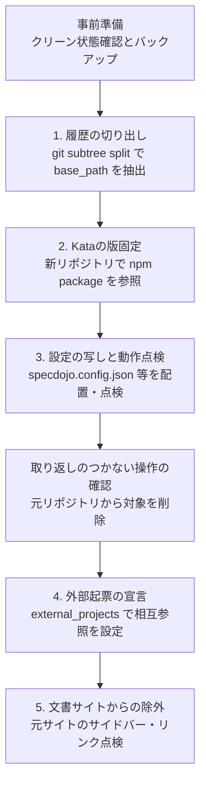

---
specdojo:
  id: specdojo:project-move-guide
  type: guide
  status: draft
  based_on:
    - specdojo:specdojo-overview-guide
    - specdojo:specdojo-config-reference
    - specdojo:branch-workflow-guide
    - specdojo:id-and-file-naming-standard
---

# プロジェクト移行ガイド

Project Move Guide

同一リポジトリで管理していた SpecDojo プロジェクト（`prj-xxxx`）を、独立した管理用リポジトリ（別リポジトリ構成）へ安全に切り出して移す手順を説明します。

**対象読者**

- 同一リポジトリで運用していた project を、独立した管理用リポジトリ（別リポジトリ構成）へ切り出したい開発者、リポジトリ管理者、運用者

**この文書で分かること**

- `git subtree split` による履歴の切り出し、Kata の npm パッケージ版固定、設定の移行と元リポジトリからの削除、`external_projects` による相互起票連携、文書サイトからの除外手順、および取り返しのつかない操作の前の確認ポイントと戻し方

**次に読む文書**

- 設定項目の詳細は [[specdojo:specdojo-config-reference|SpecDojo設定リファレンス]] を参照してください。
- ブランチ構成や Git 操作の標準は [[specdojo:branch-workflow-guide|ブランチワークフローガイド]] を参照してください。
- プロジェクトとプロダクトの構成原則は [[specdojo:specdojo-overview-guide|全体概要ガイド]] を参照してください。

## 1. 移行の概要と基本方針

### 1.1. 背景と目的

SpecDojo では、同一リポジトリ内でプロダクトコードと複数のプロジェクト（`prj-xxxx`）を管理する同一リポジトリ構成と、プロジェクト管理文書（登録簿・計画・実行記録）を独立した専用リポジトリに置く別リポジトリ構成を選択できます。

初期段階では手軽な同一リポジトリ構成で開始しても、プロジェクトの成長に伴い「プロダクトの変更履歴と管理作業の記帳 commit を分離したい」「管理リポジトリを独立させて権限や CI 実行環境を切り離したい」という要求が生じます。

本ガイドでは、同一リポジトリ内の `prj-0002`（例: LP 管理）を別リポジトリ（例: `../specdojo-lp-specdojo`）へ移すシナリオを例として、安全に段階的に移行する標準手順を示します。説明中のパスやリポジトリ名は例示であり、実際のリポジトリは変更しません。

### 1.2. 移行の全体フロー

移行は以下の 5 つのステップで進めます。



### 1.3. ID と commit Refs の継続性

SpecDojo のドキュメント ID、登録簿項目 ID（`PJR-xxxx`）、コミットメッセージ末尾の `Refs: <project-id>:<ID>` は、プロジェクト ID（`prj-0002`）を変更しなければ、別リポジトリへ移した後もそのまま使い続けられます。

移行時はプロジェクト ID を維持します。ただし、`git subtree split` が作るコミットの SHA は元のコミットと異なります。SHA を直接指すリンクの参照先として元リポジトリを残し、移行元の先端 SHA と切り出した先端 SHA を移行記録に残してください。

### 1.4. 安全原則と取り返しのつかない操作の防止

- **共有履歴の書き換え禁止**: 元リポジトリの共有ブランチ（`main` や `develop`）の履歴を改変する操作（`git filter-branch` や強制プッシュを伴う履歴改変）は行いません。`git subtree split` を用いて対象ディレクトリの履歴だけを新ブランチとして抽出します。
- **削除前の確実な点検**: 元リポジトリから `base_path` や設定を削除する操作は元に戻すのに労力を要します。必ず新リポジトリ側での動作確認を完了してから削除を実行します。

## 2. 手順1: 履歴の切り出し (`git subtree split`)

対象プロジェクトの `base_path`（例: `docs/ja/projects/prj-0002`）のコミット履歴だけを抽出し、新リポジトリの初期履歴として取り込みます。

### 2.1. 前提

- 元リポジトリの作業ツリーがクリーンであること（`git status --short` が空）。
- 移行対象ブランチ（例: `main`）に、移行対象のすべてのコミットがマージされていること。
- 対象 project の実行中・waiting の登録項目、doing の schedule タスク、exec の worktree・ブランチを確認し、実行や定期起動を止め、未統合の変更を取り込んでいること。`git worktree list` と `git branch --list 'exec/prj-0002-*'` で残存を確認します。
- 以下のシェル例は Bash で実行し、`../specdojo` が元リポジトリを指す配置であること。新リポジトリのディレクトリと `split-prj-0002` ブランチがまだ存在しないこと。
- 万一に備え、元リポジトリで移行前の状態にバックアップタグを作成していること。

```bash
git tag backup-prj-0002-before-move
git rev-parse HEAD
```

### 2.2. 実行するコマンド

#### 2.2.1. 元リポジトリで履歴を切り出す

対象 `base_path` の履歴を新しい一時ブランチ（`split-prj-0002`）へ抽出します。

```bash
git subtree split --prefix=docs/ja/projects/prj-0002 -b split-prj-0002
git rev-parse split-prj-0002
```

#### 2.2.2. 新しい管理用リポジトリを作る

```bash
mkdir ../specdojo-lp-specdojo
cd ../specdojo-lp-specdojo
git init -b main
```

#### 2.2.3. 切り出した履歴を取り込む

```bash
git fetch ../specdojo split-prj-0002
git merge --ff-only FETCH_HEAD
```

#### 2.2.4. 元と同じディレクトリ構造へ再配置する

抽出直後は旧 `base_path` のファイル群がルートに展開されています。ルートに `move-prj-0002` が存在しないことを確認し、一時ディレクトリを経由して移します。追跡ファイル名は NUL 区切りで読み、空白やドットで始まる名前も保持します。

```bash
mapfile -d '' -t project_files < <(git ls-tree -z --name-only HEAD)
mkdir move-prj-0002
git mv -- "${project_files[@]}" move-prj-0002/
mkdir -p docs/ja/projects
git mv move-prj-0002 docs/ja/projects/prj-0002
git diff --cached --stat
git commit -m "chore(prj-0002): relocate project root under docs/ja/projects/prj-0002"
```

### 2.3. 確かめ方

- 新リポジトリ側で `git log --oneline` を実行し、`prj-0002` に関連するコミット履歴だけが正しく引き継がれていることを確認します。
- 元リポジトリで `git rev-parse backup-prj-0002-before-move:docs/ja/projects/prj-0002`、新リポジトリで `git rev-parse HEAD:docs/ja/projects/prj-0002` を実行し、ツリーの SHA が一致することを確認します。
- 元リポジトリ側で `git status` および `git log` を確認し、既存のブランチ履歴が一切変更されていないことを確認します。

### 2.4. 戻し方

- 元リポジトリの共有履歴は変わりません。新リポジトリへの追加作業がなければ、移行用に作成したディレクトリを退避してやり直せます。
- 一時ブランチは点検が終わるまで残します。削除する場合は対象名と、他の作業で使われていないことを確認します。

## 3. 手順2: Kata の版の固定 (npm パッケージ参照)

新リポジトリでは Kata（型）の文書群をリポジトリ内に複製せず、npm パッケージ `specdojo` から参照してバージョンを固定します。

### 3.1. 前提

- Node.js（`>=22.13`）および npm が利用可能な環境であること。
- 新リポジトリで手順 1 の取り込みが完了していること。

### 3.2. 実行するコマンド

#### 3.2.1. 新リポジトリのルートで npm を初期化する

手順 1 の終了位置（新リポジトリのルート）で実行します。

```bash
npm init -y
```

#### 3.2.2. SpecDojo の版を固定する

移行元で利用している版を指定します。以下は `0.7.0` の例です。

```bash
npm install --save-dev --save-exact specdojo@0.7.0
```

`package.json` の値が `^` や `~` を含まないことを確認し、`package-lock.json` とともに管理します。以後の再現には `npm ci` を使います。`specdojo:` の Kata は npm パッケージから解決されるため、旧リポジトリの同梱 Kata をコピーしません。`npx specdojo kata list --kind rulebook` の `SOURCE` が `node_modules` を指すことと、`npx specdojo kata show specdojo:pjr-rulebook` で本文を取得できることを確認します。独自の Kata がある場合は別途移し、既存の authority と ID を維持します。

#### 3.2.3. CLI のスクリプトを追加する

`package.json` の既存キーを保持し、次のスクリプトを追加します。

```json
{
  "scripts": {
    "specdojo": "specdojo"
  }
}
```

### 3.3. 確かめ方

- `npx specdojo --version` を実行し、指定した固定バージョン（例: `0.7.0`）が出力されることを確認します。
- `npx specdojo help` で CLI コマンド一覧が正常に表示されることを確認します。

### 3.4. 戻し方

- インストールに関する変更だけを取り消します。既存の `package.json` がある場合はファイル全体を削除せず、移行前の依存定義へ戻して `npm ci` で復元します。

## 4. 手順3: 設定の写しと元からの削除

プロジェクト固有の設定ファイル（`specdojo.config.json`、名簿、`exec-defaults.yaml` 等）を新リポジトリへ配置し、手動点検を行った後、元リポジトリから対象プロジェクトを削除します。

### 4.1. 前提

- 手順 1 および手順 2 が正常に完了していること。
- 新リポジトリで `node_modules` の導入が完了していること。

### 4.2. 取り返しのつかない操作の前の確認

元リポジトリから `docs/ja/projects/prj-0002` や設定を削除する前に、必ず新リポジトリ側で設定の認識と登録簿の読み込みができることを点検します。

> [!IMPORTANT]
> 読むだけの点検機能（PJR-9XEG）は現在準備中であるため、用意されたら移行前後の点検に利用します。現時点では本章の「確かめ方」と手順 1 の実行・worktree の点検を手動で行います。

### 4.3. 実行するコマンド

#### 4.3.1. 設定を配置する

新リポジトリのルートで `.specdojo/` を作成します。

```bash
mkdir -p .specdojo
```

元の `.specdojo/specdojo.config.json` の `projects.prj-0002` を、新しい `.specdojo/specdojo.config.json` に写し、`current_project` を `prj-0002` にします。以下は構成例です。実際には移行元の任意キーを含めて保持してください。

```json
{
  "version": 1,
  "current_project": "prj-0002",
  "projects": {
    "prj-0002": {
      "base_path": "docs/ja/projects/prj-0002",
      "catalog_path": "010-deliverables-catalog",
      "schedule_path": "schedule",
      "execution_path": "execution",
      "members_path": "030-project-management/pm-members.yaml",
      "roles_path": "030-project-management/pm-roles.yaml",
      "viewpoints_path": "030-project-management/pm-review-viewpoints.yaml",
      "project_register_path": "controls/project-register",
      "routines_path": "routines",
      "jobs_path": "jobs",
      "project_context": ["prj-overview"],
      "run": {
        "register_date_timezone": "Asia/Tokyo",
        "exec_defaults": ".specdojo/exec-defaults.yaml"
      }
    }
  }
}
```

元リポジトリから、`agent_members_path`（既定 `.specdojo/agent-members.yaml`）、`run.exec_defaults` のファイル、Markdown の検査設定を写します。project 配下の人間の名簿は手順 1 に含まれます。agent の別名と owner の解決を確認し、`repos[].path`・`run.*` のリポジトリルート基準のパス、統合先ブランチ、provider のコマンド、親検証の npm scripts を新しい配置へ合わせます。元の設定をそのまま使って存在しない検査やパスを指さないようにしてください。

`node_modules/` と生成物を commit に含めないため、配置した設定を使って除外ルールを確認・補完します。

```bash
npx specdojo config init --dry-run
npx specdojo config init
git status --short
git add .specdojo package.json package-lock.json .gitignore
git commit -m "chore(prj-0002): configure specdojo settings and defaults"
```

検査設定や独自 Kata を移した場合は、それらも確認して個別に追加します。

#### 4.3.2. 点検後に元から外す

「4.4. 確かめ方」の新リポジトリ側の点検がすべて通ってから実施します。

元リポジトリ（`specdojo`）で:

- `.specdojo/specdojo.config.json` の `projects` から `prj-0002` の定義を削除します（もし `current_project` が `prj-0002` を指していれば残る project ID へ変更します）。
- 名簿や exec-defaults のうち、移行した project 専用で他に参照がない項目・ファイルを外します。他の project と共有する定義は残します。定期起動の設定も新しい管理先へ切り替えます。
- 元リポジトリの Git から `docs/ja/projects/prj-0002` を削除してコミットします。

```bash
cd ../specdojo
git rm -r docs/ja/projects/prj-0002
git add .specdojo
git diff --cached --stat
git commit -m "chore(prj-0002): remove project files moved to separate repository"
```

### 4.4. 確かめ方

- 新リポジトリで `npx specdojo project list` を実行し、`prj-0002` の配置が正しく認識されることを確認します。
- `npx specdojo register history --project prj-0002 --limit 10` で既存 event を読めることを確認します。登録簿の個票・event の件数と ID、実行記録を元のコピーと照合します。
- `npx specdojo register build --project prj-0002` と `npx specdojo dashboard build --project prj-0002` を実行し、一覧とダッシュボードが生成されることを確認します。これらは生成物を書き込む検証です。
- 元から外した後、元リポジトリで `npx specdojo project list` と `git status` を確認し、残る project が認識され、削除対象が意図どおりであることを確認します。

### 4.5. 戻し方

- 両側の起動を止め、元リポジトリの削除と設定変更を含むコミットを特定して `git revert <削除コミットのSHA>` で打ち消します。新しい起票や実行がある場合は先に差分を保全・照合し、二重運用を避けます。

## 5. 手順4: 相互起票のための `external_projects` 宣言

リポジトリを分離した後も、元リポジトリから新リポジトリへ、また新リポジトリから元リポジトリへ相互に起票できるよう、双方の `specdojo.config.json` に `external_projects` を宣言します。

### 5.1. 前提

- 双方のリポジトリの相対パスが決まっていること（例: 同一階層の `../specdojo-lp-specdojo` と `../specdojo`）。
- 相手のリポジトリに SpecDojo 0.4.2 以上が導入されていること。

### 5.2. 実行するコマンド

#### 5.2.1. 元から新しい管理先を宣言する

元リポジトリの `.specdojo/specdojo.config.json` のトップレベルへ次のキーを追加します。以下の JSON は既存の `projects` を保持して追加する部分だけを示します。

```json
{
  "external_projects": {
    "specdojo-lp": {
      "path": "../specdojo-lp-specdojo",
      "project_id": "prj-0002"
    }
  }
}
```

#### 5.2.2. 新しい管理先から元を宣言する

新リポジトリの `.specdojo/specdojo.config.json` のトップレベルへ追加します。

```json
{
  "external_projects": {
    "specdojo-core": {
      "path": "../specdojo",
      "project_id": "prj-0001"
    }
  }
}
```

### 5.3. 確かめ方

設定の変更を各リポジトリで確認・commit し、双方の作業ツリーがクリーンで、project の統合先ブランチが存在することを確認します。元リポジトリ側で、書き込みをしない起票確認を行います。外部起票には `--commit` が必須ですが、`--dry-run` を併用すると書き込み・commit を行いません。

```bash
npx specdojo register add --project specdojo-lp --type note --title "外部起票の接続テスト" --topic external-move-check --commit --dry-run
```

新リポジトリ側でも `--project specdojo-core` で同じ確認を行います。出力の project ID と個票の配置先が相手を指し、双方の `git status --short` が変わらないことを確認します。`--dry-run` を外すと相手側で commit されるため、試験チケットの追加・削除を点検手段にしません。相手が SpecDojo 本体の場合は npm 依存の CLI がなくても `dist/specdojo.js` から起動できるため、元で `npm run build` を済ませます。

### 5.4. 戻し方

- 双方の `.specdojo/specdojo.config.json` の `external_projects` から追加した別名だけを削除します。

## 6. 手順5: 元のリポジトリの文書サイトから外す

元リポジトリのドキュメントサイト（VitePress）から移行したプロジェクトを除外し、リンク切れやビルド失敗を防ぎます。

### 6.1. 前提

- 元リポジトリから `docs/ja/projects/prj-0002` の削除が完了していること。

### 6.2. 実行するコマンドと確認

#### 6.2.1. サイドバーを確認する

このリポジトリの文書サイトは `docs/ja/projects/` 配下からサイドバーを生成するため、ディレクトリ削除で表示対象から外れます。固定メニュー（`sidebar-config.ts` や `config.mts`）、トップページ、生成済みページにも参照があれば取り除きます。

#### 6.2.2. 双方向のリンクを点検する

元の文書から `prj-0002` への参照と、移した文書から元に残った文書への参照の両方を点検します。`external_projects` の宣言だけでは wikilink は解決されません。

> [!NOTE]
> リポジトリをまたぐリンクの標準的な書き方（PJR-66ER）は現在準備中であるため、用意されたらその記法に従います。現時点では `rg` で検索し、移行で解決不能になる wikilink を、相手の文書への実在する完全 URL に置き換えます。URL が未確定なら文書 ID をインラインコードで残して移行記録へ記載し、切替前に参照先を確認します。

```bash
# 元リポジトリで実行（終了コード 1 は一致なし）
rg -n 'prj-0002:|/projects/prj-0002/' docs packages/docs-site
# 新リポジトリで実行（元に prj-0001 が残る例）
rg -n 'prj-0001:|/projects/prj-0001/' docs
```

#### 6.2.3. 文書サイトを検証する

元リポジトリで実行し、リンク切れエラーなく成功することを確認します。

```bash
npm run docs:build
```

### 6.3. 確かめ方

- `npm run docs:dev` でローカルサーバーを起動し、ブラウザでサイドバーから `prj-0002` が除外されていることを確認します。
- `npm run docs:build` がエラー終了せず正常に完了することを確認します。

### 6.4. 戻し方

- サイドバー設定やリンクの変更を取り消し、必要に応じて元ファイルを復元します。
