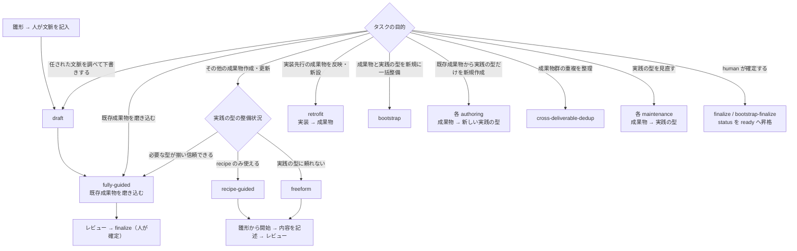
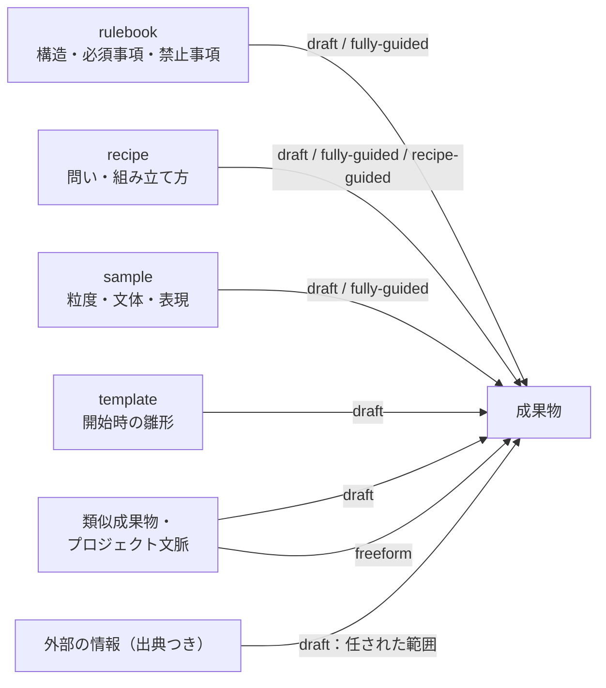
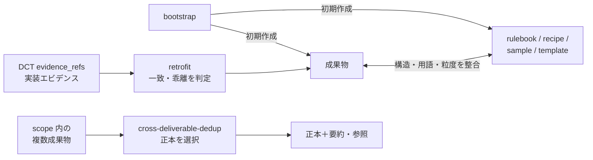
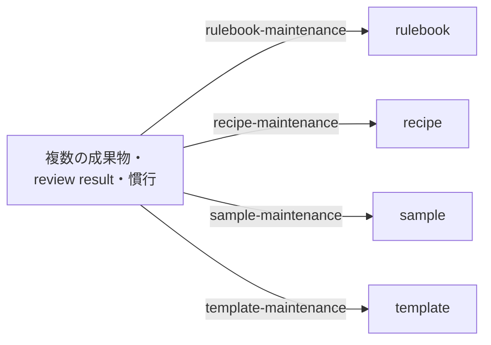
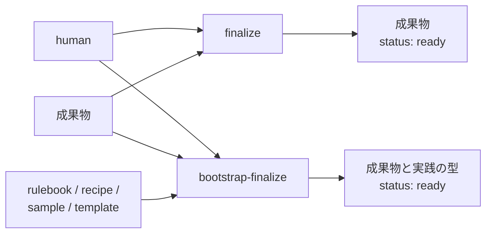

---
specdojo:
  id: specdojo:ryu-guide
  type: guide
  status: draft
---

# 実践の進め方ガイド

Ryu Guide

タスクの目的と実践の型（rulebook / recipe / sample / template）の整備状況に応じて、成果物の作成・更新・レビューをどの進め方（`approach`）で進めるかを説明します。

SpecDojo は道場のメタファーとして、進め方（`approach`）を「Ryu（流）」と呼びます。「Ryu」は本ガイドで進め方を説明するための愛称・分類であり、`approach` フィールドの名称や値そのもの（`fully-guided` など）を変更するものではありません。実際のフィールド名・値は従来どおりです。

**対象読者**

- 成果物を作成・更新・レビューする人、エージェント

**この文書で分かること**

- `approach` の選び方と一覧、`draft` と `fully-guided` の使い分け、文脈の置き場所の使い分け、参照の共通原則、実践の型メンテナンスの進め方、review への適用

**次に読む文書**

- 実践の型そのものの役割と使い分けは [実践の型活用ガイド](kata-guide.md) を参照してください。
- `approach` をタスクに設定し schedule で実行する方法は [Schedule設計ガイド](schedule-design-guide.md) を参照してください。

## 1. 整備状況に応じた進め方（approach）

`approach`（進め方）は、タスクの目的と、対象成果物の rulebook / recipe / sample / template がどれだけ整備されているかに応じて選ぶプロファイルです。判断は次のように分担します。手作業でも schedule 実行でも考え方は同じです。

| 判断                                                       | 正本・担当                             | 根拠・出力                        |
| ---------------------------------------------------------- | -------------------------------------- | --------------------------------- |
| タスク目的                                                 | strategy の `approach_rules`           | 成果物ごとの `intent`             |
| 内容が作成・更新基準として信頼できるか                     | `specdojo grade`                       | grade result の `verdict`         |
| 実在・要否宣言・参照切れ・実装エビデンスと approach の導出 | コード（`schedule strategy generate`） | 生成 strategy の phase `approach` |

実行時は strategy から生成された `approach` に従います。導出規則は [Schedule設計ガイド](schedule-design-guide.md) の `intent 宣言と approach の決定論的導出` を参照してください。

実践の型そのものの役割と使い分けは [実践の型活用ガイド](kata-guide.md) を参照してください。本ガイドは、それらを `approach` に応じてどこまで基準にするかという進め方を扱います。

### 1.1. approach の選び方

進め方は、まずタスクの目的で分かれ、文脈で任された範囲を調べて下書きする場合は `draft`、既存成果物を磨き込む場合は `fully-guided` を選びます。その他の成果物作成・更新では実践の型の整備状況でさらに分かれます。`fully-guided` / `recipe-guided` / `freeform` は実践の型をどこまで基準にするかを表します。`retrofit` は実装先行時の現在動作調査、`bootstrap` / `cross-deliverable-dedup`・各 `*-authoring`・各 `*-maintenance`・`finalize` 系は、それぞれの目的に応じて選ぶ進め方です。



`draft` は文脈で任された調査・下書きのための段であり、型の件数からは自動選択しません。整備状況で分岐するのは成果物の作成・更新（`fully-guided` / `recipe-guided` / `freeform`）だけです。`bootstrap` / `retrofit` / `cross-deliverable-dedup` / 各 `*-maintenance` / `finalize` 系は目的別のフェーズであり、実践の型が何件そろっているかだけでは選びません。とくに `bootstrap` は「実践の型が1件でも欠ける」ことを理由に選ばず、`undecided` の型を含めてどの型が必要かを作成条件に照らして判断し、成果物と必要な型を一式で初期整備する場合に限って選びます。不要な recipe / sample / template は rulebook frontmatter へ `not-needed` と宣言し、作成対象へ含めません。基準にできる実践の型が無くても、初期整備の対象でなければ `freeform` です。

### 1.2. approach 一覧

`approach` は、目的に応じて「成果物の作成・更新」「初期整備・実装反映・横断整理」「実践の型の新規作成」「実践の型のメンテナンス」「human による確定」の5種に分けられます。以下の表にある edit / review は plan テンプレート、result は実行記録のテンプレートです。テンプレートには各 `approach` で行う具体的な手順が定義されています。mode や execution に対応する専用テンプレートがない場合のフォールバック規則は [plan/resultライフサイクルガイド](plan-result-lifecycle-guide.md) を参照してください。

#### 1.2.1. 成果物の作成・更新

`draft` は下書き、`fully-guided` は磨き込みを担います。基本の流れは、雛形 → 人が文脈を記入 → `draft` → `fully-guided` → `finalize`（人）です。`recipe-guided` / `freeform` は実践の型をどこまで基準にするかを切り替えます。

`draft` を除く三つの流は、型との関係を表す守破離に対応します。「守」は型をそのまま守り、「破」は型を基準にしながら工夫し、「離」は型から離れて完了条件と根拠から組み立てます。守破離は品質の序列ではなく、タスクの目的と実践の型の整備状況に応じて進め方を選ぶための名前です。



| `approach`      | 流の名前 | 参照方針と進め方                                                                                                                                                                                                           | 対応テンプレート                                                                                                    |
| --------------- | -------- | -------------------------------------------------------------------------------------------------------------------------------------------------------------------------------------------------------------------------- | ------------------------------------------------------------------------------------------------------------------- |
| `draft`         | 下書き   | 文脈で任された範囲を調べて下書きする。型・依存成果物・`based_on`・`project_context`・個票の `入力`・カタログの `brief`・成果物内の文脈・出典つき外部情報を参照する。選定値を提案として示し、出典と選定理由を result に残す | `xep-draft-template.md`（edit）                                                                                     |
| `fully-guided`  | 守       | 既存成果物の磨き込み専用。宣言された rulebook / recipe / sample、`depends_on`、`based_on`、`project_context`、個票の `入力`、カタログの `brief` だけを参照する。template は読み込まない                                    | [edit](../exec-templates/xep-fully-guided-template.md) / [review](../exec-templates/xrp-fully-guided-template.md)   |
| `recipe-guided` | 破       | recipe が示す構成・問い・観点を主基準にする。rulebook / sample / template が存在しても、構造・文体の基準にはしない                                                                                                         | [edit](../exec-templates/xep-recipe-guided-template.md) / [review](../exec-templates/xrp-recipe-guided-template.md) |
| `freeform`      | 離       | 実践の型に頼れないため、カタログの `done_criteria`、対応 schema、既存の類似成果物を根拠に構成と内容を決める。参照した根拠と未決事項を result に残す                                                                        | [edit](../exec-templates/xep-freeform-template.md) / [review](../exec-templates/xrp-freeform-template.md)           |

##### draft と fully-guided の使い分け

`draft` と `fully-guided` は、未作成または下書き段階の成果物を段階的に仕上げるために組み合わせて使います。

| 観点                    | `draft`（下書き）                                                              | `fully-guided`（磨き込み）                                                 |
| ----------------------- | ------------------------------------------------------------------------------ | -------------------------------------------------------------------------- |
| 目的                    | 文脈で任された調査・技術選定を行い、下書きを作成する                           | 既存の草案を実践の型に適合させ、構造・用語・整合性を磨き込む               |
| 根拠のない具体化        | **任された範囲に限り解除**。外部情報（Web や公式資料）を調べて値を決めてよい   | **厳格に禁止**。宣言された文書で裏付けが取れる範囲のみ修正・補完する       |
| 外部調査・選定          | 行う。選定した値は成果物内で「提案」として示し、出典と選定理由を result に残す | 行わない。新たな外部探索や独自選定はせず、既存記述を整理する               |
| template の参照         | 参照する（雛形から章構成や初期記述を起こす）                                   | 参照しない（既に草案があるため型のみ参照）                                 |
| 文脈の目印 `_CONTEXT_:` | 指示を本文へ反映したら目印を削除し、元の指示と選定内容を result に写す         | 反映・削除しない。残存している指示は未決論点（_TODO_）として result に残す |
| 主な適用タイミング      | 成果物の新規作成時、技術スタックや方式の調査・選定を agent に委任する段        | `draft` による草案作成後、または既存成果物の改訂・品質向上を行う段         |

##### 文脈の置き場所の使い分け

文脈（前提・制約・調査委任の指示）を agent に渡す場所には、成果物内の `_CONTEXT_:`、個票の `入力`（`--input`）、カタログの `brief` の 3 つがあります。それぞれの特徴と適した用途に応じて使い分けます。

| 置き場所                   | 指定方法                                                                                       | 特徴と適した用途                                                                                                                                            | ライフサイクル・反映先                                                                                     |
| -------------------------- | ---------------------------------------------------------------------------------------------- | ----------------------------------------------------------------------------------------------------------------------------------------------------------- | ---------------------------------------------------------------------------------------------------------- |
| 成果物内の `_CONTEXT_:`    | 成果物の対象段落の先頭に `_CONTEXT_:` と記述（文書全体なら先頭章、特定項目なら該当見出し直下） | 特定の章や構成に局所化した指示、雛形を確認しながらその場で書き込みたい前提・調査指示                                                                        | `draft` が本文反映後に削除して result に記録。`finalize` 時や `status: ready` で残っていれば lint で error |
| 個票の `入力`（`--input`） | `register add` / `register update` の `--input <text>` で指定                                  | オーケストレーターや人との対話から得た前提、単発の制約、調査・選定の委任範囲。成果物ファイルを開かずに起票時に渡したい文脈                                  | 個票の「入力」節に記録され、register 経由の plan に前提として展開される                                    |
| カタログの `brief`         | カタログ（`dct-*.yaml`）の成果物定義に `brief: \|` で記述                                      | プロジェクトや成果物群全体で継続して渡したい共通前提（採用技術スタック、基盤条件など）。複数成果物で YAML アンカー（`&anchor` / `*anchor`）による共有が可能 | カタログに保持され、schedule と register の両経路の plan に一貫して前提として展開される                    |

##### 文脈を渡して作成する具体例（TSD の技術選定）

たとえば、技術スタック詳細定義（TSD）を「静的サイトで主流の技術スタックで書く」と指示して作成する場合、文脈の置き場所によって次のように渡します。

- **カタログの `brief` で渡す場合（プロジェクト共通の前提）**:
  Web サイト構築プロジェクトで、サイト全体の技術方針として静的サイト構成を採用することがあらかじめ決まっている場合、カタログの成果物エントリに `brief` として定義します。

  ```yaml
  specdojo:
    id: prj-0001:cxd-specdojo
    # ...
    deliverables:
      - id: tsd-frontend-site
        name: "フロントエンド技術スタック詳細定義"
        rulebook: specdojo:tsd-rulebook
        brief: |
          静的サイト構成を採用する。主流の技術スタック（Astro 等）を基本とし、ビルド性能と拡張性を重視する。
  ```

- **個票の `入力`（`--input`）で渡す場合（対話からの委任指示）**:
  対話を通じて「静的サイトで主流の技術スタックを調べて下書きしてほしい」と決まった場合、成果物ファイルを開かずに起票コマンドで前提を渡します。

  ```bash
  specdojo register add \
    --project prj-0001 \
    --type todo \
    --title "フロントエンドTSDの下書き" \
    --approach draft \
    --target prj-0001:tsd-frontend-site \
    --input "静的サイトで主流の技術スタック（Astro 等）を調査し、選定理由と構成を下書きする"
  ```

- **成果物内の `_CONTEXT_:` で渡す場合（章ごとの局所的な指示）**:
  まず `deliverable scaffold` で成果物の雛形を作成します。カタログにある成果物は `--target` で 1 件だけ指定して作成でき、カタログにない成果物は `--target-path` と `--target-rulebook` を添えて作成します（template のない rulebook でも `deliverable_type` を引き継いだ最小雛形が生成されます）。

  ```bash
  # カタログにある成果物を 1 件だけ指定して作成する場合
  specdojo deliverable scaffold \
    --project prj-0001 \
    --target prj-0001:tsd-frontend-site

  # カタログにない成果物を雛形にする場合
  specdojo deliverable scaffold \
    --project prj-0001 \
    --target prj-0001:tsd-custom-tool \
    --target-path docs/ja/projects/prj-0001/architecture/tsd-custom-tool.md \
    --target-rulebook specdojo:tsd-rulebook
  ```

  雛形を作成した後、特定の章（「採用技術・設定」章など）に直接指示を置きたい場合に記述します。

  ```markdown
  ## 4. 採用技術・設定

  _CONTEXT_: 静的サイトで主流の技術スタック（Astro 等）を調査し、選定したフレームワークやライブラリの採用値・選定理由・反映方法を提案として表にまとめてください。
  ```

  `draft` はこの指示を読んで外部情報を調査し、選定値を「提案」として記述した上で `_CONTEXT_:` を削除し、result に出典・選定理由と元の指示を記録します。続く `fully-guided` が、その草案を tsd の型に合わせて磨き込みます。

#### 1.2.2. 初期整備・実装反映・横断整理

成果物と実践の型を一式で立ち上げる場合、既存実装から成果物を補正する場合、または複数成果物の重複を整理する場合に使います。



| `approach`                | 流の名前 | 参照方針と進め方                                                                                                                                                           | 対応テンプレート                                                                                                                        |
| ------------------------- | -------- | -------------------------------------------------------------------------------------------------------------------------------------------------------------------------- | --------------------------------------------------------------------------------------------------------------------------------------- |
| `bootstrap`               | 型起こし | 作成条件から型の要否を判断し、成果物と必要な rulebook / recipe / sample / template を同じタスクで初期作成する。不要な3種は rulebook frontmatter へ `not-needed` と宣言する | [edit](../exec-templates/xep-bootstrap-template.md)                                                                                     |
| `retrofit`                | 見取り   | DCT の `evidence_refs` を読み、現在動作・意図された仕様・`done_criteria` を照合して、成果物の維持・部分反映・作り直し・新設を判断する                                      | [edit](../exec-templates/xep-retrofit-template.md) / [review](../exec-templates/xrp-retrofit-template.md)                               |
| `cross-deliverable-dedup` | 型寄せ   | scope 内の成果物から正本を選び、他文書の重複を要約・参照へ置き換える。実践の型は変更せず、各成果物の必須情報と追跡性を維持する                                             | [edit](../exec-templates/xep-cross-deliverable-dedup-template.md) / [result](../exec-templates/xer-cross-deliverable-dedup-template.md) |

`retrofit` では、実装を現在動作（AS-IS）の根拠、既存成果物・決定記録・プロジェクトコンテキストを意図された仕様の根拠、`done_criteria` を成果物が満たすべき目的として扱います。三者が一致すれば成果物へ反映し、実装が意図された仕様と異なる場合は実装へ無条件に合わせず、乖離と修正対象候補を result に記録します。実装から確認できない目的・業務判断・将来方針は推測しません。

#### 1.2.3. 実践の型の新規作成

既存成果物を読み取り専用の手本として、指定した種類の kata だけを新規作成します。`--target` の先頭は新しい kata ID、後続は任意の手本成果物です。

| `approach`           | 作る対象 | 対応テンプレート                                             |
| -------------------- | -------- | ------------------------------------------------------------ |
| `rulebook-authoring` | rulebook | [edit](../exec-templates/xep-rulebook-authoring-template.md) |
| `recipe-authoring`   | recipe   | [edit](../exec-templates/xep-recipe-authoring-template.md)   |
| `sample-authoring`   | sample   | [edit](../exec-templates/xep-sample-authoring-template.md)   |
| `template-authoring` | template | [edit](../exec-templates/xep-template-authoring-template.md) |

authoring は register 専用です。Schedule の成果物単位の target では新しい kata ID と複数の手本を区別できないため、strategy profile は用意しません。

#### 1.2.4. 実践の型のメンテナンス

通常の成果物作業とは参照の向きを逆にし、成果物や review result を根拠として対象の実践の型を見直します。



| `approach`             | 流の名前 | 見直す対象 | 対応テンプレート                                                                                                                  |
| ---------------------- | -------- | ---------- | --------------------------------------------------------------------------------------------------------------------------------- |
| `rulebook-maintenance` | 手入れ   | rulebook   | [edit](../exec-templates/xep-rulebook-maintenance-template.md) / [review](../exec-templates/xrp-rulebook-maintenance-template.md) |
| `recipe-maintenance`   | 手入れ   | recipe     | [edit](../exec-templates/xep-recipe-maintenance-template.md) / [review](../exec-templates/xrp-recipe-maintenance-template.md)     |
| `sample-maintenance`   | 手入れ   | sample     | [edit](../exec-templates/xep-sample-maintenance-template.md) / [review](../exec-templates/xrp-sample-maintenance-template.md)     |
| `template-maintenance` | 手入れ   | template   | [edit](../exec-templates/xep-template-maintenance-template.md) / [review](../exec-templates/xrp-template-maintenance-template.md) |

rulebook frontmatter で `not-needed` と宣言された型はメンテナンス対象ではなく、strategy へ対応する `*-maintenance` フェーズを生成しません。作成が必要になった場合は、先に要否判断の根拠と rulebook frontmatter の宣言を更新します。

#### 1.2.5. human による確定

`execution: human` と組み合わせ、確認対象の `status` を `ready` へ昇格する確定プロファイルです。`ready` への昇格は human のみが行えます。



| `approach`           | 流の名前 | 確定対象と進め方                                                                                                               | 対応テンプレート                                                     |
| -------------------- | -------- | ------------------------------------------------------------------------------------------------------------------------------ | -------------------------------------------------------------------- |
| `finalize`           | 免許     | human が `done_criteria` を確認し、必要なら最小限の修正を加え、成果物のみを `ready` へ昇格する                                 | [result](../exec-templates/xer-human-finalize-template.md)           |
| `bootstrap-finalize` | 皆伝     | `bootstrap` と対になり、human が成果物と rulebook / recipe / sample / template をまとめて確認し、それぞれを `ready` へ昇格する | [result](../exec-templates/xer-human-bootstrap-finalize-template.md) |

`approach` を指定しない場合は、存在するすべての実践の型をそれぞれの役割に沿って活用します。schedule で `approach` をどこで設定し `exec refresh` でどう解決するかは [Schedule設計ガイド](schedule-design-guide.md) を参照してください。

これらの `approach` に沿って作業する plan は、`specdojo exec plan` または `specdojo exec run` で生成できます。plan・result の生成規則は [plan/resultライフサイクルガイド](plan-result-lifecycle-guide.md)、実行手順は [exec運用ガイド](exec-operation-guide.md) を参照してください。

### 1.3. 参照の共通原則

`approach` にかかわらず適用する原則です。

- 矛盾時の優先: `draft` / `fully-guided` は rulebook（規約）を優先し、template の章構成が食い違っても rulebook を正とします。`recipe-guided` は rulebook を参照範囲に含めないため recipe を優先します。
- 参照範囲: `fully-guided` は宣言された文書だけを参照します。対象成果物、rulebook / 併せて適用する rulebook / recipe / sample、`depends_on` 成果物、対象成果物 frontmatter の `based_on`、`project_context`、個票の `入力`、カタログの `brief` を含み、未宣言の文書や外部の情報は探索しません。`入力` と `brief` は未指定なら plan に載りません。`draft` はこれらに template・成果物内の文脈・任された調査に必要な出典つき外部情報を加えます。`recipe-guided` および未指定では、対象成果物に紐づく実践の型・`depends_on` 成果物・プロジェクトコンテキスト（→ [遂行の技活用ガイド](waza-guide.md)）に限定し、他のプロジェクト文書を独自に探索しません。`freeform` は類似実例やプロジェクト文脈を参照するため対象外です。
- 既存記述の尊重: `fully-guided` / `recipe-guided` および未指定では既存記述を尊重し、`depends_on` の最新の決定と矛盾する箇所、および参照範囲に含む実践の型に適合しない箇所（rulebook を参照範囲に含む `fully-guided` / 未指定では、rulebook の必須要素の欠落・禁止事項への抵触・章構成の不適合）のみ最小限を修正し、不足は加筆・補強します。実践の型への適合は内容の全面書き換えではなく、既存記述を保持したままの章立ての移し替えと必須要素の補完として行います。あわせて、同一成果物内で重複している記述は正本を1箇所に定めて統合し、参照範囲に含む実践の型の必須要素にも `done_criteria` にも寄与しない記述は削除します（rulebook を参照範囲に含む `fully-guided` / 未指定では rulebook の必須要素が基準）。統合・削除は既存記述の尊重の例外であり、判断根拠を result に記録することで担保します。`freeform` は対象外です。上記のいずれにも該当しない場合（完成度・整合性・読みやすさの向上など）は、それだけを理由に修正しません。rulebook が複数の構成を許容している場合（例: 領域単位・グループ単位のいずれの粒度も認める場合）、他章との見た目の整合を理由により詳細な構成へ書き換えません。
- 根拠のない具体化の禁止: `freeform` と `draft` の文脈で任された範囲を除き、ファイルパス・コマンド・設定値など実装や設定の実態を示す記述を新たに書き加える場合、参照範囲の文書（rulebook / recipe / `depends_on` 成果物・プロジェクトコンテキスト、`fully-guided` ではさらに `based_on`・個票の `入力`・カタログの `brief`、`retrofit` では `evidence_refs`）で裏付けが取れる場合に限ります。既存記述が曖昧・不完全でも、裏付けが無ければ完成度を上げる目的だけで断定的に具体化しません。`draft` では任された範囲に限って調べて値を決め、成果物に「提案」と示し、出典と選定理由を result に残します。任されていない範囲や裏付けの無い箇所は _TODO_ / _ASSUMPTION_ として論点を残します。品質上の根拠不足は grade が該当 viewpoint の level と finding で評価し、review はその評価を付け直しません。
- 判断根拠の記録: 参照した文書・しなかった文書とその理由を成果物または result に残します（特に `recipe-guided` / `freeform`）。後から実践の型を整備する材料になります。
- 判定基準の優先: `done_criteria` と grade 結果が判定基準を示す場合はそれらを優先します。本原則は、判定基準だけでは読み取れない「どこまで参照に照らすか」を補います。
- 前提・概要・判定基準の使い分け: カタログの `overview`（成果物の目的を1文で表す概要）、`brief`（成果物の外から継続して渡す技術スタックや制約などの前提）、`done_criteria`（成果物が満たすべき検証可能な完了条件）を明確に区別します。`brief` は schedule / register 両経路の plan に前提として展開され、未指定なら plan に載りません。複数の成果物で前提を共有する場合は YAML アンカー（`&anchor` / `*anchor`）を活用できます。前提を完了条件に混同せず、検証可能な基準だけを `done_criteria` に記載します。

### 1.4. 成果物カタログなしで進める

register からの `draft`・`fully-guided`・`recipe-guided`・`freeform`・`retrofit`・`bootstrap`・`finalize`・`bootstrap-finalize` は、カタログなしでも使えます。既存成果物は `--target <doc-id>` を文書索引で引き、frontmatter の `specdojo.rulebook` を起点に kata を辿ります。新規成果物は `register add`・`register update` の `--target-path` と `--target-rulebook` にパスと rulebook ID を明示します。個票へ保存する名前は `target_path` と `target_rulebook` です。既存文書と指定が矛盾した場合は停止します。

カタログの `done_criteria` はないため、個票の完了条件と rulebook を完了基準にします。`fully-guided` には `not-needed` を除く kata 一式、`recipe-guided` には recipe が必要で、不足すると起票時に停止します。`retrofit` では調べる実装のパスを個票に明記します。

`bootstrap` は kata の不足を許容し、パスと新規 rulebook ID、設定の `kata_authority` を必須とします。既存 rulebook は拒否します。rulebook ID の `-rulebook` より前の部分を共通の名前にして recipe・sample・template の ID を導出し、`docs/ja/specdojo/<kind>s/<kata_authority>/` の未作成候補を plan に載せます。作成した rulebook は成果物の `specdojo.rulebook` に記入します。

`finalize` と `bootstrap-finalize` の対象は既存文書だけです。個票の完了条件をチェック表にし、`finalize` は成果物、`bootstrap-finalize` は成果物と frontmatter から辿る kata 一式を人が確定します。

`cross-deliverable-dedup` はカタログの成果物群を対象にするため、引き続きカタログが必要です。カタログ設定済みの対象は従来の宣言を優先し、未登録の対象に限りパスと rulebook を両方明示した場合だけ上記の解決を使います。具体的な起票例は [[specdojo:quick-start-guide]]、オプションは [[specdojo:command-reference]] を参照してください。

## 2. 実践の型メンテナンスの進め方

`rulebook-maintenance` / `recipe-maintenance` / `sample-maintenance` / `template-maintenance` は、通常の成果物作業とは参照の向きが逆になる進め方です。作成・更新かレビューかを `mode`（`edit` / `review`）で表す点は他の `approach` と同じです。

メンテナンスのタスクでは、対象の実践の型を「見直す対象」として扱い、複数の成果物・review result・対象領域の慣行を根拠に、次の観点で妥当性を見直します。対象の実践の型に finding がある場合は、finding の message と同じ viewpoint の判定根拠から指摘の根拠となる規範を特定し、紐づく rulebook / recipe / sample / template や執筆標準も必要な根拠として読みます。たとえば rulebook との構成不整合を指摘する finding では、成果物の有無にかかわらず rulebook を正として照合します。

| `approach`             | 見直す対象 | 主な見直し観点                                                   |
| ---------------------- | ---------- | ---------------------------------------------------------------- |
| `rulebook-maintenance` | rulebook   | 章構成、必須項目、禁止事項、判定基準                             |
| `recipe-maintenance`   | recipe     | 問い、観点、深掘り手順、レビュー観点                             |
| `sample-maintenance`   | sample     | 粒度、文体、表の書き方、完成例としての妥当性                     |
| `template-maintenance` | template   | 章構成の骨組み、プレースホルダの配置・網羅性、雛形としての妥当性 |

根拠の種別を一律に必須化せず、finding ごとに指摘の解消を判定できる資料を使います。成果物または review result がないことだけを理由に根拠不足とは判定しません。finding の message と判定根拠、対象の実践の型から辿れる関連文書、該当する執筆標準、利用可能な成果物・review result・対象領域の慣行を確認しても修正内容を確定できない場合に限り、根拠不足として見送ります。見送る場合は、確認した資料、判断できなかった理由、不足している根拠、次のアクションを result に記録します。

実践の型メンテナンスは自動で差し込まれません。schedule で実行する場合は、`approach: rulebook-maintenance` のように対象を指定した phase / phase_set を `sch-strategy-<track>.yaml` に明示的に記述します（[Schedule設計ガイド](schedule-design-guide.md)）。

## 3. review への適用

review でも「整備状況に応じた進め方（approach）」を使います。ただし、review は grade が行った成果物の品質評価を繰り返しません。approach は、変更内容・plan・実行記録・完了条件を照合するときに参照する文書の範囲として、次のように読み替えます。

通常の成果物編集では観点別の自己レビューを行わず、`done_criteria` を「完了の狙い」として扱います。多観点での品質評価と証跡は grade が担い、独立した review は grade 結果を事実としてタスクの完了可否を判断します。以下の `approach` ごとの参照方針は、編集時の記述と review の照合範囲に適用します。

- `draft`: 文脈で任された範囲の下書き、提案の表示、出典と選定理由・元の指示の記録をタスクの完了条件と照合します。
- `fully-guided`: 宣言された参照と、edit plan に展開された既存成果物の磨き込み範囲を照合します。品質上の適合性は grade 結果を使い、review が新しい level や finding を付けません。
- `recipe-guided`: recipe と edit plan に限定して作業範囲を照合し、rulebook / sample / template を新たな判定基準として持ち込みません。
- `freeform`: カタログの `done_criteria`、対応 schema、edit plan が示した既存の類似成果物やプロジェクト文脈を、完了条件の照合資料として使います。
- `rulebook-maintenance` / `recipe-maintenance` / `sample-maintenance` / `template-maintenance`: 「実践の型メンテナンスの進め方」に従い、対象の実践の型と edit plan の完了条件を照合します。実践の型そのものの品質評価は、review 前段の kata grade を使います。
- `approach` に関わらず、判断根拠は対象成果物・実践の型・plan・実行記録を実際に読んで得た具体的な観察に限ります。実行 agent（executor）の最終メッセージや result の自己申告を、そのまま、または言い換えて根拠として扱いません。対象成果物の内容と executor の報告が一致しない場合は、対象成果物側を優先して未充足事項・改善指示に記録します。
- 判断の根拠をレビュー結果に残します。

## 4. 関連ドキュメント

- [実践の型活用ガイド](kata-guide.md): rulebook / recipe / sample / template それぞれの役割と使い分け
- [型の構成ガイド](practice-system-composition-guide.md): 実践の型を含む型（Kata）の種別と役割
- [Schedule設計ガイド](schedule-design-guide.md): `approach` をタスクに設定し schedule で実行する方法
- [plan/resultライフサイクルガイド](plan-result-lifecycle-guide.md): `exec plan` / `exec run` による plan・result の生成・命名・再実行
- [exec運用ガイド](exec-operation-guide.md): exec plan を使った実行フロー
- [レビューガイド](review-guide.md): レビューの進め方と、実践の型の活用方法
- [遂行の技活用ガイド](waza-guide.md): プロジェクトコンテキストなど plan 生成時に渡す設定
