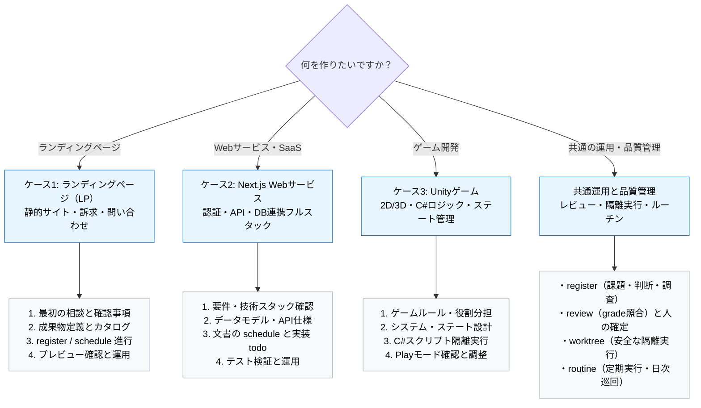

---
specdojo:
  id: specdojo:use-case-guide
  type: guide
  status: ready
  based_on:
    - specdojo:specdojo-overview-guide
    - specdojo:quick-start-guide
---

# ユースケース別ガイド

Use Case Guide

「作りたいプロダクト」に合わせて、SpecDojo とオーケストレーターを活用した開発の進め方を示すガイドです。ランディングページ（LP）、Next.js の Web サービス、Unity のゲームという 3 つの代表的なプロダクトを入口とし、相談から仕様策定、AI による成果物作成・検証、変更・運用までの対話フローを具体的に案内します。

**対象読者**

- [[specdojo:quick-start-guide|Quick Start ガイド]] を終え、自分の作りたいプロダクト（LP、Web サービス、ゲーム等）に応じた実践的な開発フローを知りたい開発者・プロジェクト管理者

**この文書で分かること**

- LP・Next.js Web サービス・Unity ゲームの各ケースにおける完成イメージと前提条件
- オーケストレーターとの具体的な相談・確認・提案・承認・実行の対話フロー
- 必要な成果物（仕様書・設計書・カタログ）の作成順序と register / schedule による進行
- 各ケースでの完成確認・テスト・運用ルーチンの流れ
- プロダクト開発全般に共通する品質管理・レビュー・隔離実行・ブランチ運用

**次に読む文書**

- 共通の初期設定と基本操作の一巡体験は [[specdojo:quick-start-guide|Quick Start ガイド]] を参照してください。
- オーケストレーターの詳しい動作原理や安全設計は [[specdojo:orchestrator-operation-guide|オーケストレーター運用ガイド]] を参照してください。
- トピックからどの文書かを引く索引は [[specdojo:specdojo-overview-guide|全体概要ガイド]] の `目的別の次の読み物`、コマンドとオプションの詳細は [[specdojo:command-reference|CLI コマンドリファレンス]] を参照してください。

## 1. このガイドの使い方とケースの選び方

[[specdojo:quick-start-guide|Quick Start ガイド]] が共通操作を一巡する入門体験であるのに対し、本ガイドは「作りたいプロダクトの種類」に応じた仕様定義・成果物構成・対話の進め方に焦点を当てます。

開発者はオーケストレーターと対話しながら進めます。オーケストレーターは担当者・期限・技術採択などの重要事項を勝手に確定せず、不足事項の確認、選択肢の提案、利用者の承認を経てから登録・実行します。

以下の対話に登場する担当者（alice、bob、carol）、期限、技術採択は、流れを説明するための架空の合意例です。実際のプロジェクトでは確認した内容に置き換え、未確定の事項は質問や調査項目として残します。

次の早見図とリンクから、該当するプロダクトのケースへ進んでください。

- [LP を作る](#case-lp)
- [Next.js の Web サービスを作る](#case-nextjs)
- [Unity のゲームを作る](#case-unity)
- [共通運用と品質管理を確認する](#common-operations)



<a id="common-setup"></a>

### 1.1. 各ケースに共通する準備

共通の導入は [[specdojo:quick-start-guide|Quick Start ガイド]] の「準備」とプロダクト接続の手順を使います。以下は、その準備を終えた後の対話です。

- プロダクトは既存リポジトリ、または各フレームワークの公式生成ツールや Unity Hub で作ります。生成時のバージョンと追加設定を記録します。
- 両方のリポジトリに初期 commit があり、SpecDojo 側は作業用の `develop` ブランチ、プロダクト側は合意した統合先ブランチが存在することを確認します。
- プロダクトの接続先・統合方法・worktree の準備方法を合意し、利用者が承認した設定を SpecDojo 側の `develop` へ commit してから exec を開始します。設定を変更する手順は Quick Start と [[specdojo:specdojo-config-reference|設定リファレンス]] に従います。
- 利用する agent と、プロダクトで実行できる検証・依存導入・ビルド手順を確認します。未導入のテストや CI は、準備作業を合意してから追加します。

本ガイドの project ID `prj-0001` は例です。利用者の project ID に置き換えてください。コマンドは SpecDojo 側のリポジトリで実行し、`<…>` は作成済みの ID 等に置き換えます。

<details>
<summary>プロダクト接続の設定差分の例</summary>

既存の `projects.prj-0001` に以下の `repos` を追加する例です。設定全体を置き換えません。配列の各要素に `name` と `path` を宣言します。パスは実在するプロダクトリポジトリを指す必要があります。

```json
{
  "repos": [
    {
      "name": "lp-site",
      "path": "../lp-site",
      "integration_branch": "develop",
      "integration_strategy": "ff",
      "branch_template": "feature/{topic}",
      "setup": { "install": true, "build": false }
    }
  ]
}
```

これは LP の合意例です。Next.js では `saas-app` / `../saas-app`、Unity では `unity-game` / `../unity-game` のように変更し、統合方法と `setup` も個別に判断します。`install: true` は追跡済みの `package-lock.json` に対する `npm ci` です。Unity では LFS とエディタ・テスト環境の準備を別に確認し、Node.js の依存導入が不要なら `install: false` とします。詳しくは [[specdojo:exec-worktree-guide|exec worktree 運用ガイド]] を参照してください。

</details>

<a id="document-and-product-flow"></a>

### 1.2. 文書の計画とプロダクトの実装をつなぐ

各ケースでは、まず register に相談から生じた判断・調査・文書作成を記録します。継続的に管理する文書が増えたら、成果物カタログ（`dct-*.yaml`）に文書の ID・パス・完了条件を宣言し、strategy から schedule に展開します。仕様書が `ready` になっただけでは、Hero や API の実装タスクは生成されません。

- **文書作成の経路**: カタログと `sch-strategy-<track>.yaml` を準備し、`schedule build` で文書の作成・レビュー・確定を計画します。既に register で作成した文書の todo と同じ作業を重複して実行しないよう、対象と進捗を整理します。
- **実装の経路**: 確定した文書を入力に、宣言済みのプロダクトリポジトリの変更範囲・完了条件・検証方法を持つ todo を register に起票し、その採番結果を指定して実行します。

成果物文書の ID は各文書の frontmatter を正本とします。`dct-*.yaml` はカタログのファイル名であり、UI 仕様書やデータモデル仕様書そのものの ID ではありません。以下に挙げる未作成文書の名前は作成候補です。

起票後は、個票の完了条件に対象パス、受け入れ条件、実行する検証を具体化し、文書の参照先と担当・期限を確認してから実行します。依存する判断や準備が未完了なら先に解消します。

<details>
<summary>文書の schedule を作成・実行する例</summary>

`lp` track のカタログ、strategy、担当と依存関係、agent 設定が準備済みの場合の例です。Next.js や Unity では、実際に定義した track を指定します。

```bash
npx specdojo schedule build --project prj-0001 --track lp --dry-run
# 生成内容を確認してから書き込む
npx specdojo schedule build --project prj-0001 --track lp
npx specdojo exec refresh --project prj-0001
npx specdojo exec status --project prj-0001 --state todo
# refresh の出力と execution/generated/ready.json で Ready を確認した agent タスクを指定
npx specdojo exec run --project prj-0001 --task "<生成済みのtask ID>" --worktree
```

human の確定タスクは [共通のレビュー手順](#review-and-finalize)に従います。設計は [[specdojo:schedule-design-guide|Schedule 設計ガイド]]、実行は [[specdojo:schedule-operation-guide|Schedule 実行運用ガイド]] を参照してください。

</details>

<a id="case-lp"></a>

## 2. ケース1: ランディングページ（LP）の作成

### 2.1. 完成イメージと前提

- **完成イメージ**: サービスや製品の価値を分かりやすく伝え、問い合わせや事前登録の獲得を目的とした高速・レスポンシブなランディングページ。
- **前提**:
  - プロダクトリポジトリ（例: `../lp-site`）と SpecDojo プロジェクトリポジトリ（例: `../lp-specdojo`）を並べた Detached Unit 構成。
  - 採用する生成ツールが要求する Node.js 環境と、[共通の準備](#common-setup)が整っていること。

### 2.2. 最初の相談と確認・判断事項

利用者がオーケストレーターに LP 作成の相談を開始します。オーケストレーターは必要な情報をヒアリングし、利用者の承認を得て進めます。

**利用者**:

> 新サービスの告知用ランディングページを作りたいです。どんな構成で進めればよいでしょうか？

**オーケストレーター**:

> ランディングページの作成ですね。仕様を整理し、スムーズに AI へ実装を委譲できるように進めましょう。
>
> まず、以下の点についてご希望や前提を確認させてください:
>
> 1. **主なセクション**: Hero（トップ訴求）、特徴・強み、料金プラン、FAQ、問い合わせ/事前登録フォームなどを想定しますが、含めたい内容はありますか？
> 2. **技術スタック**: 高速な静的生成に向く Astro + Tailwind CSS、Next.js、シンプルな HTML/CSS などの選択肢があります。ご希望はありますか？
> 3. **公開先（ホスティング）**: Cloudflare Pages、GitHub Pages、Vercel などの候補があります。
> 4. **担当者と目標期限**: プロジェクト管理の記録（個票）に残す担当者ニックネームと目標期日をお知らせください。
>
> ご回答をもとに、技術選定の判断（decision）とプロジェクト定義（todo）の起票案を作成してご提示します。

**利用者**:

> 1. セクションは Hero、特徴3つ、料金プラン表、FAQ、問い合わせフォームでお願いします。
> 2. 技術は Astro + Tailwind CSS で進めたいです。
> 3. 公開先は Cloudflare Pages を想定しています。
> 4. 担当は alice、期限は 2026-12-15 でお願いします。

**オーケストレーター**:

> 承知しました。以下の内容で登録簿へ起票してよろしいでしょうか？
>
> - **decision**: `Astro + Tailwind CSS と Cloudflare Pages による LP 構成の採択`（担当: alice, 期限: 2026-12-15）
> - **todo**: `プロジェクト定義書と LP 画面仕様書の作成`（担当: alice, 期限: 2026-12-15）
>
> 承認いただければ、起票コマンドを実行します。

**利用者**:

> はい、承認します。実行してください。

### 2.3. 必要な成果物と作成順序

LP 作成で推奨される成果物と作成順序は次のとおりです。

1. **プロジェクト定義・スコープ（`prj-scope` / `prj-charter`）**: 目的、ターゲット層、コンバージョン目標（CVR）の定義。
2. **UI 仕様書**: 各セクションのワイヤーフレーム、文言案、レスポンシブ表示（PC/スマホ）仕様。
3. **システム設計・デプロイ仕様**: Astro プロジェクト構成、Tailwind 設定、Cloudflare Pages デプロイ手順。
4. **成果物カタログ（`dct-*.yaml`）**: 管理する文書の ID・パス・完了条件を宣言し、文書の schedule に接続する定義。

### 2.4. register・schedule による進行

[文書と実装の進行経路](#document-and-product-flow)に沿って、UI 仕様書等を register または文書の schedule で作成・レビューします。フォームは送信先、個人情報の扱い、成功・失敗時の表示を確認し、未決なら question / decision に残します。

**利用者**:

> 画面仕様書を確定しました。コンポーネントの実装を進めてください。

**オーケストレーター**:

> 確定した仕様書と、接続済みの `lp-site` を確認します。まず Hero の文言と PC・スマホ表示を実装する todo を提案します。対象は Hero のコンポーネントと関連スタイル、完了条件は仕様どおりの表示と合意済みの検証の成功です。フォームは送信方式の決定後に別の todo にします。担当 alice、期限 2026-12-15 を引き継いでよいですか？

**利用者**:

> はい。その範囲で起票し、worktree で実行してください。

**オーケストレーター**:

> 起票結果の PJR-ID を指定して実行します。executor が実装・検証結果を報告し、runner が設定済みの親検証と commit・統合を担当します。統合先は承認済み設定に従います。完了後に差分・検証記録とプレビューを確認していただきます。

#### 2.4.1. 実行後の確認対話

**オーケストレーター**:

> Hero の差分と検証記録を提示します。PC・スマホ表示と文言を確認し、受け入れ可能か判断してください。フォームの送信確認は後続 todo の範囲です。

**利用者**:

> スマホでは見出しが長すぎます。文言を短くしてから、残りのセクションへ進めてください。

**オーケストレーター**:

> 文言の修正案と対象仕様書への反映を提案し、合意した変更を記録して再検証します。受け入れ確認後に次の todo へ進みます。

### 2.5. 完成確認と変更・運用への流れ

- **手元での確認**: プロダクトで用意したプレビュー手順（`dev` script があれば `npm run dev`）で PC・スマートフォンの表示、フォームの入力検証・送信結果を確認します。公開は利用者が内容と公開先を確認してから行います。
- **変更の管理**: コピー文言の変更やデザイン調整の要望が出た場合は、勝手にコードを直さず `register add --type todo` で起票して履歴を残します。
- **運用の自動化**: デッドリンクの検査やライブラリのセキュリティ更新は、[[specdojo:routine-operation-guide|routine 運用ガイド]] に従って必要な検査ジョブと外部スケジューラを用意します。共通の変更管理・レビューは [第 5 章](#common-operations)を参照してください。

### 2.6. コマンドと設定差分（折りたたみ）

<details>
<summary>LP プロジェクトのコマンドと設定例を展開する</summary>

[共通の準備](#common-setup)を終えた後、2.2 の合意を記録する例です。

```bash
npx specdojo register add --project prj-0001 --type decision \
  --title "LP の構成と公開先を決める" --topic lp-stack \
  --description "Astro と Tailwind CSS、Cloudflare Pages を使う構成の採否と理由を記録する" \
  --input "Hero、特徴3つ、料金、FAQ、問い合わせを掲載する。送信方式は別途確認する" \
  --owner alice --due 2026-12-15 --by specdojo-orchestrator --commit
npx specdojo register add --project prj-0001 --type todo \
  --title "LP 画面仕様書とスコープを作る" --topic lp-ui-spec \
  --description "対象読者、訴求、PC・スマホの画面構成と受け入れ条件を文書化する" \
  --input "合意した LP 構成を前提にする。フォーム送信先と個人情報の扱いは確認して記録する" \
  --owner alice --due 2026-12-15 --by specdojo-orchestrator --commit
```

decision は起票だけで採択済みになりません。承認者・判断理由を個票に記録して状態を進めます。文書の完成後、2.4 の合意に基づき実装用の別 todo を作ります。入力に書く文書パスは、作成済みの実際のパスに置き換えます。

```bash
npx specdojo register add --project prj-0001 --type todo \
  --title "Hero セクションを実装する" --topic lp-hero \
  --description "lp-site の Hero と関連スタイルを変更し、確定仕様どおりの文言と PC・スマホ表示を検証する" \
  --input "確定仕様書: <作成済みのLP画面仕様書のパス>。変更対象は lp-site。実行できる検証は個票の完了条件に列挙する" \
  --owner alice --due 2026-12-15 --by specdojo-orchestrator --commit
# 起票された個票の完了条件・対象パス・検証方法を確認してから実行する
npx specdojo exec run --project prj-0001 --register "<Heroの起票結果のPJR-ID>" --worktree
```

</details>

### 2.7. 用途別ひな型について

LP 向けの用途別ひな型を先に整備する方針です。本ガイドは、利用可能なスターターを前提とせず、公式生成ツールで作ったプロダクトと SpecDojo を接続する手順を示しています。ひな型の公開後に実物を確認し、複製・初期化・対話開始・動作確認の手順を追記します。

<a id="case-nextjs"></a>

## 3. ケース2: Next.js の Web サービスの作成

### 3.1. 完成イメージと前提

- **完成イメージ**: ユーザー認証、ダッシュボード、データベース連携、CRUD API を備えたフルスタックの Web サービス（SaaS や業務アプリ）。
- **前提**:
  - プロダクトリポジトリ（例: `../saas-app`）と SpecDojo リポジトリ（例: `../saas-specdojo`）の Detached Unit 構成。
  - 採用する Next.js 等のバージョンが要求する Node.js 環境、合意した DB の開発環境、および [共通の準備](#common-setup)。

### 3.2. 最初の相談と確認・判断事項

**利用者**:

> Next.js でユーザー認証とデータ管理機能がある Web サービスを開発したいです。仕様決めから実装までの流れを案内してください。

**オーケストレーター**:

> フルスタック Web サービスの構築ですね。セキュリティやデータ整合性が重要になりますので、段階を踏んで仕様を固めましょう。
>
> 以下の事項について、現時点の想定をお聞かせいただけますか？
>
> 1. **主要な機能要件**: ユーザー登録・ログイン、ダッシュボード表示、データの一覧・登録・編集・削除などを想定していますが、他に必要な機能はありますか？
> 2. **認証と DB の技術スタック**: NextAuth (Auth.js) / Supabase / Clerk などの認証方式や、Prisma / Drizzle などの ORM、DB（PostgreSQL / SQLite 等）のご希望はありますか？
> 3. **デプロイ先環境**: Vercel、Cloudflare（OpenNext）、AWS などの想定はありますか？
> 4. **担当者と期限**: プロジェクト管理上の担当者ニックネームと目標完了日をお知らせください。
>
> ご提示いただいた条件をもとに、アーキテクチャ検討の decision と要件定義の todo を提案します。

**利用者**:

> 1. 機能はユーザー登録・ログイン、プロジェクト一覧と作成、アイテムの CRUD 管理です。
> 2. 認証は NextAuth.js、ORM は Prisma、DB は PostgreSQL を使いたいです。
> 3. デプロイ先は Vercel を予定しています。
> 4. 担当は bob、期限は 2026-12-31 でお願いします。

**オーケストレーター**:

> ありがとうございます。内容を整理しました。
>
> 以下の起票を行ってよろしいでしょうか？
>
> - **decision**: `NextAuth.js + Prisma (PostgreSQL) による認証・DB 基盤の採択`（担当: bob, 期限: 2026-12-31）
> - **todo**: `データモデル設計書（CCD/CDSD）と API インターフェース仕様書の作成`（担当: bob, 期限: 2026-12-31）
>
> 承認をいただければ起票します。

**利用者**:

> はい、承認します。

### 3.3. 必要な成果物と作成順序

Next.js アプリケーションでは、フロントエンドとバックエンドの境界を明確にするため、以下の順序で成果物を作成します。

1. **システム要件・スコープ定義（`prj-scope`）**: 機能要件、ユーザーロール（一般・管理者など）、権限設計。
2. **データモデル仕様書（CCD / CDSD）**: エンティティ（User, Account, Item 等）の関連、テーブル定義、インデックス。
3. **外部インターフェース・API 仕様書**: Route Handlers / Server Actions の入出力型、エラーハンドリング。
4. **UI 仕様書**: 画面遷移図、各ページのコンポーネント構造、フォームバリデーション。
5. **非機能要件・セキュリティ設計書**: CSRF/CORS 対策、セッション管理、レート制限。

### 3.4. register・schedule による進行

文書は [共通の経路](#document-and-product-flow)で作成します。カタログと strategy に文書間の依存関係を定義し、実装では以下の順序を候補に todo を分けます。

- **Phase 1（基盤構築）**: Prisma スキーマ作成、DB マイグレーションスクリプト、NextAuth 認証設定。
- **Phase 2（バックエンド・API 実装）**: データアクセス層、Server Actions / API ルートの実装、単体テスト。
- **Phase 3（フロントエンド実装）**: 画面コンポーネント、フォームバリデーション、データ取得フック。

**利用者**:

> データモデルと API 仕様を確定しました。最初はプロジェクト一覧 API の実装をお願いします。

**オーケストレーター**:

> `saas-app` の接続、認証基盤と開発 DB の準備を確認します。今回の todo は一覧 API と権限検査、関連テストを対象にします。bob、2026-12-31 のまま進めてよいですか？ 本番 DB の変更は別途判断します。

**利用者**:

> はい。その範囲で起票して実行してください。

**オーケストレーター**:

> 採番された todo を `exec run --register` の対象にし、worktree で実行します。`typecheck` やテストは、プロダクト側に script・依存関係・DB 等が用意され、実行設定に組み込まれているものを実行します。未準備の検証は完了扱いにせず、準備方法を記録します。

### 3.5. 完成確認と変更・運用への流れ

- **結合テストと検証**: 合意した開発 DB とテストデータを用意し、ログイン、データ作成、他ユーザーのデータへのアクセス拒否、ログアウトを確認します。E2E テストが準備済みなら実行し、利用者が受け入れと公開可否を判断します。
- **セキュリティチェック**: 依存関係・静的解析・秘密情報の検査を候補に、公開先や契約条件に合う手段を選びます。CI やリポジトリ設定の変更案は利用者に提示し、承認された手段を準備します。
- **不具合や改善のトリアージ**: 開発中に発生した不具合は `register add --type issue` で起票し、AI に原因調査と修正を行わせます。詳細は [[specdojo:register-operation-guide|登録簿運用ガイド]] と [第 5 章](#common-operations)を参照してください。

### 3.6. コマンドと設定差分（折りたたみ）

<details>
<summary>Next.js プロジェクトのコマンドと設定例を展開する</summary>

3.2 の合意を一度だけ起票する例です。Next.js 等の生成と追加パッケージの導入は、採用バージョンの公式手順で行い、[共通の準備](#common-setup)を済ませておきます。

```bash
npx specdojo register add --project prj-0001 --type decision \
  --title "Web サービスの認証と DB 基盤を決める" --topic saas-auth-db \
  --description "NextAuth.js、Prisma と PostgreSQL、Vercel の採否・構成と選定理由を記録する" \
  --input "ユーザー登録、プロジェクト一覧・作成、アイテム CRUD を提供するという合意例" \
  --owner bob --due 2026-12-31 --by specdojo-orchestrator --commit
npx specdojo register add --project prj-0001 --type todo \
  --title "データモデルと API の仕様書を作る" --topic saas-data-api-spec \
  --description "エンティティ、所有権・権限、API の入出力と失敗時の挙動を文書化する" \
  --input "3.2 で合意した機能を対象に、未決事項を確認する。UI と非機能仕様の後続作業も整理する" \
  --owner bob --due 2026-12-31 --by specdojo-orchestrator --commit
```

文書の確認後、3.4 の合意範囲を実装 todo に記録します。

```bash
npx specdojo register add --project prj-0001 --type todo \
  --title "プロジェクト一覧 API を実装する" --topic saas-project-list-api \
  --description "saas-app の一覧 API と権限検査を実装し、準備済みの開発 DB で正常系とアクセス拒否を検証する" \
  --input "確定仕様書: <作成済みのデータモデルとAPI仕様書のパス>。本番 DB は変更しない。実行する検証と対象パスを完了条件に明記する" \
  --owner bob --due 2026-12-31 --by specdojo-orchestrator --commit
npx specdojo exec run --project prj-0001 --register "<APIの起票結果のPJR-ID>" --worktree
```

</details>

### 3.7. 用途別ひな型について

用途別ひな型は LP に続いて Next.js + Cloudflare を整備する方針です。3.2 の Vercel は利用者が選んだ架空の合意例であり、ひな型の提供方針とは分けて考えます。現在の手順は公式生成ツールと個別設定を使います。ひな型の公開後に、実際の生成・追加設定・SpecDojo 設定を確認し、複製・初期化と動作確認を追記します。

<a id="case-unity"></a>

## 4. ケース3: Unity のゲーム開発

### 4.1. 完成イメージと前提

- **完成イメージ**: プレイヤー操作、敵キャラクター、ステート管理、スコア表示、シーン遷移を備えた 2D/3D アクションゲーム。
- **前提**:
  - プロダクトリポジトリ（Unity プロジェクト `../unity-game`）に **Git LFS**（Large File Storage）が導入されていること。
  - SpecDojo プロジェクトリポジトリ（`../unity-game-specdojo`）との Detached Unit 構成。
  - Unity Hub と採用バージョンのエディタ・ビルド環境、および [共通の準備](#common-setup)が整っていること。

### 4.2. 最初の相談と確認・判断事項

ゲーム開発では、アセットやバイナリの扱い、エディタでの手作業と AI が行うスクリプト実装の分担を最初に明確にする必要があります。

**利用者**:

> Unity で 2D アクションゲームを制作したいです。仕様設計を行い、C# スクリプトの実装を AI に任せながら進めたいです。

**オーケストレーター**:

> Unity ゲームの開発ですね。エディタでの Scene/Prefab 構築と、AI が担当する C# スクリプトやデータ設計の役割分担を整理して進めましょう。
>
> 以下の事項について確認させてください:
>
> 1. **ゲームのコアルール**: ジャンル、基本アクション（移動・ジャンプ・攻撃等）、クリア・ゲームオーバー条件を教えてください。
> 2. **AI の担当範囲**: AI に任せるのは C# ロジック（プレイヤー操作、敵ステートマシン、スコア管理など）とパラメータ定義（ScriptableObject）でしょうか？ Scene への Prefab 配置やスプライト描画は人間が担当する想定で合っていますか？
> 3. **バージョンとパッケージ**: Unity バージョン（例: 2022.3 LTS）や、新しい Input System パッケージの使用有無を教えてください。
> 4. **担当者と期限**: 記録に残す担当者ニックネームと目標マイルストーン期限をお知らせください。
>
> ご確認いただければ、役割分担と基本アーキテクチャの decision、およびゲーム仕様設計の todo を起票します。

**利用者**:

> 1. 2D 横スクロールアクションで、移動・ジャンプと敵の踏みつけ、コイン収集でゴールを目指します。
> 2. はい、AI には C# スクリプトと ScriptableObject の作成を任せ、Scene 配置やアニメーション設定、Sprite の配置は私がエディタで行います。
> 3. Unity 2022.3 LTS で、Input System パッケージを使用します。
> 4. 担当は carol、プロトタイプ完成期限は 2027-01-31 でお願いします。

**オーケストレーター**:

> 方針を把握しました。エディタ作業と AI スクリプト生成の境界を明確にした上で、以下を起票してよろしいでしょうか？
>
> - **decision**: `Input System 採用と AI・人間作業境界の合意`（担当: carol, 期限: 2027-01-31）
> - **todo**: `ゲームシステム設計書（ステートマシン・パラメータ定義）の作成`（担当: carol, 期限: 2027-01-31）
>
> 承認いただければ実行します。

**利用者**:

> 承認します。起票してください。

### 4.3. 必要な成果物と作成順序

Unity 開発では、ロジックとエディタ設定が乖離しないよう、以下の成果物を順に整備します。

1. **ゲーム概要・スコープ（`prj-overview` / `prj-scope`）**: ゲームコンセプト、ルール、対象プラットフォーム（PC / モバイル等）。
2. **システム設計・ステート遷移仕様**: プレイヤー状態（Idle, Run, Jump, Fall）、敵ステートマシン（Patrol, Chase, Attack）、ゲームループ（Title, Playing, GameOver, StageClear）。
3. **データモデル・パラメータ仕様**: 移動速度、ジャンプ力、敵 HP などを管理する ScriptableObject の型定義とデフォルト値。
4. **外部インターフェース・入力仕様**: Input Actions のマッピング（Move, Jump, Pause 等）。
5. **テスト仕様書**: Unity Test Framework（UTF）の EditMode / PlayMode テスト観点。

### 4.4. register・schedule による進行

仕様書は [文書の schedule](#document-and-product-flow)で作成・レビューし、実装は `unity-game` の変更を行う register の todo として分けます。候補は次のとおりです。

- **Player Controller 実装**: Input System からの入力を受け取り、Rigidbody2D を制御するスクリプト。
- **Enemy State Machine 実装**: 状態遷移パターンに基づき、検知範囲内のプレイヤーを追従するスクリプト。
- **Game Manager & UI 連動**: イベント駆動でコイン取得数やライフ残量を更新する仕組み。

**利用者**:

> 入力仕様とプレイヤーの状態遷移を確定しました。移動とジャンプから実装してください。

**オーケストレーター**:

> `unity-game` の Player Controller と関連テストを対象にした todo を提案します。Scene、Prefab、入力アセットとの接続は carol さんが行う合意とし、担当 carol、期限 2027-01-31 を引き継いでよいですか？

**利用者**:

> はい。スクリプトの実装を起票して実行してください。エディタで接続して確認します。

**オーケストレーター**:

> 採番された todo を指定して worktree で実行します。executor は C# と関連テストを編集し、用意された検証を実行します。Unity のライセンスやバッチ実行環境が必要な検査、Play モードの操作確認は実行可能な環境で行い、未確認の項目を結果に残します。runner が commit と承認済み設定に沿った統合を行います。

### 4.5. 完成確認と変更・運用への流れ

- **Unity エディタでの結合確認**: AI が作成した C# スクリプトを Prefab や GameObject にアタッチし、エディタの Play モードで操作感や当たり判定を確認します。
- **単体テストの実行**: ロジック部分（ステート遷移やダメージ計算）は、Unity Test Framework と実行環境を準備した上で EditMode / PlayMode テストを実行します。人が Play モードで操作感・クリア条件を確認し、受け入れと配布可否を判断します。
- **パラメータ調整とバグ報告**: ジャンプ力や移動速度の微調整は ScriptableObject 上で行います。挙動の不具合が見つかった場合は `register add --type issue` でログや期待値を添えて起票し、合意した範囲で修正と再確認を行います。共通の運用は [第 5 章](#common-operations)を参照してください。

### 4.6. コマンドと設定差分（折りたたみ）

<details>
<summary>Unity プロジェクトの Git LFS とリポジトリ設定例を展開する</summary>

Unity Hub で作成したプロジェクトに `.gitignore` と必要な LFS 対象を設定し、アセットと `.meta` の管理方針を決めます。初期 commit と統合先ブランチを用意した上で、[共通の準備](#common-setup)に従って接続します。Unity のライセンス・LFS・テストの準備は利用環境で確認します。

```bash
npx specdojo register add --project prj-0001 --type decision \
  --title "入力方式と AI・人間の作業境界を決める" --topic unity-input-roles \
  --description "Input System 採用と、C#・データ定義を AI、Scene 等のエディタ作業を人が担う分担を記録する" \
  --input "Unity 2022.3 LTS で 2D 横スクロールの移動・ジャンプ・踏みつけ・コイン収集を試作するという合意例" \
  --owner carol --due 2027-01-31 --by specdojo-orchestrator --commit
npx specdojo register add --project prj-0001 --type todo \
  --title "ゲームシステム設計書を作る" --topic unity-system-spec \
  --description "状態遷移、パラメータ、入力との接続、テスト観点とエディタ確認手順を文書化する" \
  --input "AI とエディタ作業の境界は 4.2 の合意に従う。未決のルールは確認する" \
  --owner carol --due 2027-01-31 --by specdojo-orchestrator --commit
```

4.4 の合意後に、スクリプト実装用の todo を起票します。

```bash
npx specdojo register add --project prj-0001 --type todo \
  --title "プレイヤーの移動とジャンプを実装する" --topic unity-player-controller \
  --description "unity-game の Player Controller と関連テストを作り、確定仕様に沿った状態遷移を検証する" \
  --input "確定仕様書: <作成済みの入力・状態遷移仕様書のパス>。Scene と Prefab の接続は carol が確認する。対象パスと検証方法を完了条件に記載する" \
  --owner carol --due 2027-01-31 --by specdojo-orchestrator --commit
npx specdojo exec run --project prj-0001 --register "<Player Controllerの起票結果のPJR-ID>" --worktree
```

</details>

### 4.7. 用途別ひな型について

Unity スターターの採用・提供は確定していません。本ケースは Unity Hub で作成した通常のプロジェクトを使います。用途別ひな型が利用可能になった場合も、Git LFS、アセット管理、エディタとの役割分担を実物で確認してから手順に取り入れます。

<a id="common-operations"></a>

## 5. プロダクト開発に共通する運用と品質管理

どのプロダクトを作る場合でも、SpecDojo における課題管理、品質保証、隔離実行、ブランチ運用の原則は共通です。各ケースの詳細と併せて以下のガイドを参照してください。

### 5.1. 計画外の課題・判断・調査を管理する（register）

開発中に発生する不具合、技術的な迷い、計画外のタスクは、コードに直接手を入れる前に register へ登録します。

| 種別 (`type`) | 用途                                     | 例                                             |
| ------------- | ---------------------------------------- | ---------------------------------------------- |
| `issue`       | 発生した不具合や課題の調査・修正         | スマホ表示でメニューが閉じない、DB接続エラー   |
| `decision`    | 技術スタック・アーキテクチャの採択・決定 | 認証ライブラリの比較選定、ホスティング先の決定 |
| `todo`        | 単発の作業・ドキュメント作成             | FAQ 項目の追加、ライセンス表記の更新           |
| `question`    | 仕様や前提に関する問い合わせ・確認       | サードパーティ API の利用規約・料金制限の確認  |

詳しい状態遷移や起票手順は [[specdojo:register-operation-guide|登録簿運用ガイド]] を参照してください。

<a id="review-and-finalize"></a>

### 5.2. レビューを回して成果物を ready に確定する

成果物（仕様書や設計書）の品質は、AI による `grade` 評価と、人間による最終確認を組み合わせて担保します。

1. **品質評価（grade）**: 対象の rulebook と評価観点に従って品質を評価します。構文・リンク等の機械検証も別途行います。
2. **レビュータスク（mode: review）**: grade の結果を事実として参照し、変更内容や完了条件が満たされているかを確認します。
3. **人間による確定（finalize）**: `ready` 化の条件を確認し、最終承認と公開可否を人が判断します。通常の編集 executor は独自に `ready` へ昇格させません。human タスクは result を入口に確認・確定します。[[specdojo:exec-operation-guide|exec 運用ガイド]] には、登録済み agent を `--by` で明示して human タスクを実行する経路もありますが、操作を委ねることと人の最終判断を区別します。

詳細は [[specdojo:review-guide|レビューガイド]] を参照してください。

### 5.3. worktree で作業を安全に隔離・統合する

AI エージェントに実装作業を委譲する際は、作業中の手元環境を汚さないために Git worktree を使った隔離実行（`--worktree`）を基本とします。

- タスクごとに専用のブランチと独立したディレクトリが作成されます。
- executor は成果物の編集・検証を担当し、runner が設定済みの親検証と commit・統合を行います。実行できる検証は、各リポジトリに script・依存関係・実行環境が準備されたものに限ります。
- 統合先と方法は承認済みの設定に従います。`branch-only` なら作業ブランチを保持し、PR レビューへ渡します。失敗時は結果と残された worktree を確認して修正・再開します。

詳細は [[specdojo:exec-worktree-guide|exec worktree運用ガイド]] を参照してください。

### 5.4. routine による定期実行と日次巡回

定期的な運用作業（日次スイープ、依存関係の脆弱性検査、期限切れタスクの確認）は routine 機能で自動化します。

- `rtn-*.yaml` に実行対象のジョブを定義します。
- GitHub Actions や cron などの外部スケジューラから `npx specdojo routine run --due` を定期的に呼び出します。

詳細は [[specdojo:routine-operation-guide|routine運用ガイド]] を参照してください。

### 5.5. 複数プロジェクト・ブランチの並行運用

複数のプロジェクト（例: `prj-0001` と `prj-0002`）や、複数の機能開発ブランチを同時に進める場合は、ブランチ運用のルールを統一します。

- **統合軸の分離**: SpecDojo 側の project の統合軸と、`repos` に宣言した各プロダクトの統合先を区別し、タスクごとの作業ブランチを隔離します。
- **競合の防止**: 共有ファイル（CHANGELOG や設定ファイル）の衝突を避けるため、実行の列（キュー）を整えて順次マージします。

詳細は [[specdojo:branch-workflow-guide|ブランチワークフローガイド]] を参照してください。
