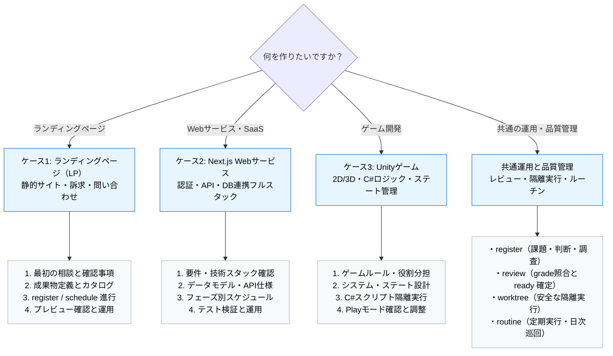

---
specdojo:
  id: specdojo:use-case-guide
  type: guide
  status: ready
  based_on:
    - specdojo:specdojo-overview-guide
    - specdojo:quick-start-guide
---

# ユースケース別ガイド

Use Case Guide

「作りたいプロダクト」に合わせて、SpecDojo とオーケストレーターを活用した開発の進め方を示すガイドです。ランディングページ（LP）、Next.js の Web サービス、Unity のゲームという 3 つの代表的なプロダクトを入口とし、相談から仕様策定、AI による成果物作成・検証、変更・運用までの対話フローを具体的に案内します。

**対象読者**

- [[specdojo:quick-start-guide|Quick Start ガイド]] を終え、自分の作りたいプロダクト（LP、Web サービス、ゲーム等）に応じた実践的な開発フローを知りたい開発者・プロジェクト管理者

**この文書で分かること**

- LP・Next.js Web サービス・Unity ゲームの各ケースにおける完成イメージと前提条件
- オーケストレーターとの具体的な相談・確認・提案・承認・実行の対話フロー
- 必要な成果物（仕様書・設計書・カタログ）の作成順序と register / schedule による進行
- 各ケースでの完成確認・テスト・運用ルーチンの流れ
- プロダクト開発全般に共通する品質管理・レビュー・隔離実行・ブランチ運用

**次に読む文書**

- 共通の初期設定と基本操作の一巡体験は [[specdojo:quick-start-guide|Quick Start ガイド]] を参照してください。
- オーケストレーターの詳しい動作原理や安全設計は [[specdojo:orchestrator-operation-guide|オーケストレーター運用ガイド]] を参照してください。
- トピックからどの文書かを引く索引は [[specdojo:specdojo-overview-guide|全体概要ガイド]] の `目的別の次の読み物`、コマンドとオプションの詳細は [[specdojo:command-reference|CLI コマンドリファレンス]] を参照してください。

## 1. このガイドの使い方とケースの選び方

[[specdojo:quick-start-guide|Quick Start ガイド]] が共通操作を一巡する入門体験であるのに対し、本ガイドは「作りたいプロダクトの種類」に応じた仕様定義・成果物構成・対話の進め方に焦点を当てます。

開発者はオーケストレーターと対話しながら進めます。オーケストレーターは担当者・期限・技術採択などの重要事項を勝手に確定せず、不足事項の確認、選択肢の提案、利用者の承認を経てから登録・実行します。

次の早見図から、該当するプロダクトのケースへ進んでください。



## 2. ケース1: ランディングページ（LP）の作成

### 2.1. 完成イメージと前提

- **完成イメージ**: サービスや製品の価値を分かりやすく伝え、問い合わせや事前登録の獲得を目的とした高速・レスポンシブなランディングページ。
- **前提**:
  - プロダクトリポジトリ（例: `../lp-site`）と SpecDojo プロジェクトリポジトリ（例: `../lp-specdojo`）を並べた Detached Unit 構成。
  - Node.js 環境が導入済みであること。

### 2.2. 最初の相談と確認・判断事項

利用者がオーケストレーターに LP 作成の相談を開始します。オーケストレーターは必要な情報をヒアリングし、利用者の承認を得て進めます。

**利用者**:

> 新サービスの告知用ランディングページを作りたいです。どんな構成で進めればよいでしょうか？

**オーケストレーター**:

> ランディングページの作成ですね。仕様を整理し、スムーズに AI へ実装を委譲できるように進めましょう。
>
> まず、以下の点についてご希望や前提を確認させてください:
>
> 1. **主なセクション**: Hero（トップ訴求）、特徴・強み、料金プラン、FAQ、問い合わせ/事前登録フォームなどを想定しますが、含めたい内容はありますか？
> 2. **技術スタック**: 高速な静的生成に向く Astro + Tailwind CSS、Next.js、シンプルな HTML/CSS などの選択肢があります。ご希望はありますか？
> 3. **公開先（ホスティング）**: Cloudflare Pages、GitHub Pages、Vercel などの候補があります。
> 4. **担当者と目標期限**: プロジェクト管理の記録（個票）に残す担当者ニックネームと目標期日をお知らせください。
>
> ご回答をもとに、技術選定の判断（decision）とプロジェクト定義（todo）の起票案を作成してご提示します。

**利用者**:

> 1. セクションは Hero、特徴3つ、料金プラン表、FAQ、問い合わせフォームでお願いします。
> 2. 技術は Astro + Tailwind CSS で進めたいです。
> 3. 公開先は Cloudflare Pages を想定しています。
> 4. 担当は alice、期限は 2026-12-15 でお願いします。

**オーケストレーター**:

> 承知しました。以下の内容で登録簿へ起票してよろしいでしょうか？
>
> - **decision**: `Astro + Tailwind CSS と Cloudflare Pages による LP 構成の採択`（担当: alice, 期限: 2026-12-15）
> - **todo**: `プロジェクト定義書と LP 画面仕様書の作成`（担当: alice, 期限: 2026-12-15）
>
> 承認いただければ、起票コマンドを実行します。

**利用者**:

> はい、承認します。実行してください。

### 2.3. 必要な成果物と作成順序

LP 作成で推奨される成果物と作成順序は次のとおりです。

1. **プロジェクト定義・スコープ（`prj-scope` / `prj-charter`）**: 目的、ターゲット層、コンバージョン目標（CVR）の定義。
2. **UI 仕様書（`dct-user-interface-model`）**: 各セクションのワイヤーフレーム、文言案、レスポンシブ表示（PC/スマホ）仕様。
3. **システム設計・デプロイ仕様（`dct-system-design`）**: Astro プロジェクト構成、Tailwind 設定、Cloudflare Pages デプロイ手順。
4. **成果物カタログ（`dct-*.yaml`）**: 各仕様書と実装タスクを紐付けるカタログ定義。

### 2.4. register・schedule による進行

設計が固まったら、成果物カタログから schedule をビルドし、実装タスクを順次実行します。

**利用者**:

> 画面仕様書が ready になりました。コンポーネント実装のタスクを進めてください。

**オーケストレーター**:

> 仕様書を確認しました。Hero、Features、Pricing、FAQ、ContactForm の各コンポーネント実装タスクを schedule に沿って実行します。
>
> 次のタスクを実行してよろしいでしょうか？
>
> - タスク: `TSK-LP-01 Hero セクションの実装とレスポンシブ対応`
> - 実行方法: Git worktree による隔離実行
>
> 承認をいただければ実行を開始します。

**利用者**:

> 承認します。進めてください。

**オーケストレーター**:

> 隔離された worktree 上でコンポーネントを作成し、構文チェックとフォーマットが通過しました。差分をメインブランチへ統合しました。続いて次のコンポーネントへ進みます。

### 2.5. 完成確認と変更・運用への流れ

- **手元での確認**: ローカルサーバー（`npm run dev`）を立ち上げ、ブラウザで PC・スマートフォン両方のレスポンシブ表示とフォームのバリデーションを確認します。
- **変更の管理**: コピー文言の変更やデザイン調整の要望が出た場合は、勝手にコードを直さず `register add --type todo` で起票して履歴を残します。
- **運用の自動化**: デッドリンクの検査やライブラリのセキュリティ更新は、[[specdojo:routine-operation-guide|routine 運用ガイド]] に従って日次巡回ジョブを設定します。

### 2.6. コマンドと設定差分（折りたたみ）

<details>
<summary>LP プロジェクトのコマンドと設定例を展開する</summary>

```bash
# 1. 管理対象リポジトリの準備（プロダクト側）
mkdir -p lp-workspace/lp-site
cd lp-workspace/lp-site
npm create astro@latest . -- --template minimal --no-install --no-git
git init
git add .
git commit -m "chore: initial astro template"

# 2. SpecDojo プロジェクト側の初期化
cd ../
mkdir lp-specdojo
cd lp-specdojo
git init
npm init -y
npm install --save-dev specdojo
npx specdojo init

# 3. リポジトリ設定（.specdojo/specdojo.config.json）に lp-site を追加
# repos: { "lp-site": { "path": "../lp-site", "integration_branch": "main" } }

# 4. register の起票
npx specdojo register add --type decision --title "Astro + Tailwind CSS の採択" --owner alice --due 2026-12-15
npx specdojo register add --type todo --title "LP画面仕様書の作成" --owner alice --due 2026-12-15

# 5. schedule のビルドとタスク実行
npx specdojo schedule build --project prj-0001
npx specdojo exec run --worktree --project prj-0001
```

</details>

### 2.7. 用途別ひな型（PJR-RTD5）について

[[prj-0001:pjr-rtd5-starter-templates|PJR-RTD5]] の決定に従い、LP 向けの用途別スターター（GitHub の template repository）が提供される予定です。
ひな型が提供されると、リポジトリの複製と初期化コマンドのみで SpecDojo と LP 構成が整います。現時点では未提供のため、上記のように公式の生成ツール（`npm create astro`）と `specdojo init` を組み合わせた手順で進めてください。ひな型提供後に実物の使い方を追記します。

## 3. ケース2: Next.js の Web サービスの作成

### 3.1. 完成イメージと前提

- **完成イメージ**: ユーザー認証、ダッシュボード、データベース連携、CRUD API を備えたフルスタックの Web サービス（SaaS や業務アプリ）。
- **前提**:
  - プロダクトリポジトリ（例: `../saas-app`）と SpecDojo リポジトリ（例: `../saas-specdojo`）の Detached Unit 構成。
  - Node.js 22 以上、PostgreSQL などのデータベース環境。

### 3.2. 最初の相談と確認・判断事項

**利用者**:

> Next.js でユーザー認証とデータ管理機能がある Web サービスを開発したいです。仕様決めから実装までの流れを案内してください。

**オーケストレーター**:

> フルスタック Web サービスの構築ですね。セキュリティやデータ整合性が重要になりますので、段階を踏んで仕様を固めましょう。
>
> 以下の事項について、現時点の想定をお聞かせいただけますか？
>
> 1. **主要な機能要件**: ユーザー登録・ログイン、ダッシュボード表示、データの一覧・登録・編集・削除などを想定していますが、他に必要な機能はありますか？
> 2. **認証と DB の技術スタック**: NextAuth (Auth.js) / Supabase / Clerk などの認証方式や、Prisma / Drizzle などの ORM、DB（PostgreSQL / SQLite 等）のご希望はありますか？
> 3. **デプロイ先環境**: Vercel、Cloudflare（OpenNext）、AWS などの想定はありますか？
> 4. **担当者と期限**: プロジェクト管理上の担当者ニックネームと目標完了日をお知らせください。
>
> ご提示いただいた条件をもとに、アーキテクチャ検討の decision と要件定義の todo を提案します。

**利用者**:

> 1. 機能はユーザー登録・ログイン、プロジェクト一覧と作成、アイテムの CRUD 管理です。
> 2. 認証は NextAuth.js、ORM は Prisma、DB は PostgreSQL を使いたいです。
> 3. デプロイ先は Vercel を予定しています。
> 4. 担当は bob、期限は 2026-12-31 でお願いします。

**オーケストレーター**:

> ありがとうございます。内容を整理しました。
>
> 以下の起票を行ってよろしいでしょうか？
>
> - **decision**: `NextAuth.js + Prisma (PostgreSQL) による認証・DB 基盤の採択`（担当: bob, 期限: 2026-12-31）
> - **todo**: `データモデル設計書（CCD/CDSD）と API インターフェース仕様書の作成`（担当: bob, 期限: 2026-12-31）
>
> 承認をいただければ起票します。

**利用者**:

> はい、承認します。

### 3.3. 必要な成果物と作成順序

Next.js アプリケーションでは、フロントエンドとバックエンドの境界を明確にするため、以下の順序で成果物を作成します。

1. **システム要件・スコープ定義（`prj-scope`）**: 機能要件、ユーザーロール（一般・管理者など）、権限設計。
2. **データモデル仕様書（`dct-data-model-ccd` / `cdsd`）**: エンティティ（User, Account, Item 等）の関連、テーブル定義、インデックス。
3. **外部インターフェース・API 仕様書（`dct-external-interface-specs`）**: Route Handlers / Server Actions の入出力型、エラーハンドリング。
4. **UI 仕様書（`dct-user-interface-model`）**: 画面遷移図、各ページのコンポーネント構造、フォームバリデーション。
5. **非機能要件・セキュリティ設計書（`dct-non-functional-requirements`）**: CSRF/CORS 対策、セッション管理、レート制限。

### 3.4. register・schedule による進行

設計が確定したら、依存関係に沿って schedule を構成し、AI エージェントにタスクを実行させます。

- **Phase 1（基盤構築）**: Prisma スキーマ作成、DB マイグレーションスクリプト、NextAuth 認証設定。
- **Phase 2（バックエンド・API 実装）**: データアクセス層、Server Actions / API ルートの実装、単体テスト。
- **Phase 3（フロントエンド実装）**: 画面コンポーネント、フォームバリデーション、データ取得フック。

各タスクは `exec run --worktree` で隔離実行され、TypeScript の型チェック（`typecheck`）やテスト（`test-unit`）が自動実行されます。

### 3.5. 完成確認と変更・運用への流れ

- **結合テストと検証**: ローカル DB コンテナを起動し、ユーザー登録からデータ作成・ログアウトまでの一連のシナリオを E2E テストで検証します。
- **セキュリティチェック**: Dependabot、CodeQL、秘密情報漏洩防止（gitleaks / secret scanning）を CI に組み込みます。
- **不具合や改善のトリアージ**: 開発中に発生した不具合は `register add --type issue` で起票し、AI に原因調査と修正を行わせます。詳細は [[specdojo:register-operation-guide|登録簿運用ガイド]] を参照してください。

### 3.6. コマンドと設定差分（折りたたみ）

<details>
<summary>Next.js プロジェクトのコマンドと設定例を展開する</summary>

```bash
# 1. Next.js アプリケーションの作成（プロダクトリポジトリ）
mkdir -p saas-workspace/saas-app
cd saas-workspace/saas-app
npx create-next-app@latest . --typescript --tailwind --eslint --app --src-dir --no-import-alias
npm install @prisma/client next-auth
npm install --save-dev prisma
npx prisma init
git init
git add .
git commit -m "chore: initial next.js setup with prisma and next-auth"

# 2. SpecDojo プロジェクトの初期化
cd ../
mkdir saas-specdojo
cd saas-specdojo
git init
npm init -y
npm install --save-dev specdojo
npx specdojo init

# 3. 起票と作業の開始
npx specdojo register add --type decision --title "NextAuthとPrismaの採用" --owner bob --due 2026-12-31
npx specdojo register add --type todo --title "データモデル設計書の作成" --owner bob --due 2026-12-31
```

</details>

### 3.7. 用途別ひな型（PJR-RTD5）について

[[prj-0001:pjr-rtd5-starter-templates|PJR-RTD5]] では、LP の次に「Next.js と Cloudflare」のスターターテンプレートが提供される予定です。
公式生成ツール（`create-next-app`）と追加設定（Wrangler / OpenNext、セキュリティチェック）がセットになった template repository が提供される見込みです。現在は未提供のため、公式ツールと個別の設定で構築を進めてください。提供後に使い方を追記します。

## 4. ケース3: Unity のゲーム開発

### 4.1. 完成イメージと前提

- **完成イメージ**: プレイヤー操作、敵キャラクター、ステート管理、スコア表示、シーン遷移を備えた 2D/3D アクションゲーム。
- **前提**:
  - プロダクトリポジトリ（Unity プロジェクト `../unity-game`）に **Git LFS**（Large File Storage）が導入されていること。
  - SpecDojo プロジェクトリポジトリ（`../unity-game-specdojo`）との Detached Unit 構成。
  - Unity Hub および Unity 2022 LTS または Unity 6 が導入済みであること。

### 4.2. 最初の相談と確認・判断事項

ゲーム開発では、アセットやバイナリの扱い、エディタでの手作業と AI が行うスクリプト実装の分担を最初に明確にする必要があります。

**利用者**:

> Unity で 2D アクションゲームを制作したいです。仕様設計を行い、C# スクリプトの実装を AI に任せながら進めたいです。

**オーケストレーター**:

> Unity ゲームの開発ですね。エディタでの Scene/Prefab 構築と、AI が担当する C# スクリプトやデータ設計の役割分担を整理して進めましょう。
>
> 以下の事項について確認させてください:
>
> 1. **ゲームのコアルール**: ジャンル、基本アクション（移動・ジャンプ・攻撃等）、クリア・ゲームオーバー条件を教えてください。
> 2. **AI の担当範囲**: AI に任せるのは C# ロジック（プレイヤー操作、敵ステートマシン、スコア管理など）とパラメータ定義（ScriptableObject）でしょうか？ Scene への Prefab 配置やスプライト描画は人間が担当する想定で合っていますか？
> 3. **バージョンとパッケージ**: Unity バージョン（例: 2022.3 LTS）や、新しい Input System パッケージの使用有無を教えてください。
> 4. **担当者と期限**: 記録に残す担当者ニックネームと目標マイルストーン期限をお知らせください。
>
> ご確認いただければ、役割分担と基本アーキテクチャの decision、およびゲーム仕様設計の todo を起票します。

**利用者**:

> 1. 2D 横スクロールアクションで、移動・ジャンプと敵の踏みつけ、コイン収集でゴールを目指します。
> 2. はい、AI には C# スクリプトと ScriptableObject の作成を任せ、Scene 配置やアニメーション設定、Sprite の配置は私がエディタで行います。
> 3. Unity 2022.3 LTS で、Input System パッケージを使用します。
> 4. 担当は carol、プロトタイプ完成期限は 2027-01-31 でお願いします。

**オーケストレーター**:

> 方針を把握しました。エディタ作業と AI スクリプト生成の境界を明確にした上で、以下を起票してよろしいでしょうか？
>
> - **decision**: `Input System 採用と AI・人間作業境界の合意`（担当: carol, 期限: 2027-01-31）
> - **todo**: `ゲームシステム設計書（ステートマシン・パラメータ定義）の作成`（担当: carol, 期限: 2027-01-31）
>
> 承認いただければ実行します。

**利用者**:

> 承認します。起票してください。

### 4.3. 必要な成果物と作成順序

Unity 開発では、ロジックとエディタ設定が乖離しないよう、以下の成果物を順に整備します。

1. **ゲーム概要・スコープ（`prj-overview` / `prj-scope`）**: ゲームコンセプト、ルール、対象プラットフォーム（PC / モバイル等）。
2. **システム設計・ステート遷移仕様（`dct-system-design`）**: プレイヤー状態（Idle, Run, Jump, Fall）、敵ステートマシン（Patrol, Chase, Attack）、ゲームループ（Title, Playing, GameOver, StageClear）。
3. **データモデル・パラメータ仕様（`dct-data-model-ccd`）**: 移動速度、ジャンプ力、敵 HP などを管理する ScriptableObject の型定義とデフォルト値。
4. **外部インターフェース・入力仕様（`dct-external-interface-specs`）**: Input Actions のマッピング（Move, Jump, Pause 等）。
5. **テスト仕様書（`dct-test-specs`）**: Unity Test Framework（UTF）の EditMode / PlayMode テスト観点。

### 4.4. register・schedule による進行

設計書が整ったら、C# スクリプトの実装を schedule に乗せます。

- **Player Controller 実装**: Input System からの入力を受け取り、Rigidbody2D を制御するスクリプト。
- **Enemy State Machine 実装**: 状態遷移パターンに基づき、検知範囲内のプレイヤーを追従するスクリプト。
- **Game Manager & UI 連動**: イベント駆動でコイン取得数やライフ残量を更新する仕組み。

AI エージェントは Git worktree 上で C# スクリプトを編集し、静的検証（フォーマットや構文）を確認してコミットします。

### 4.5. 完成確認と変更・運用への流れ

- **Unity エディタでの結合確認**: AI が作成した C# スクリプトを Prefab や GameObject にアタッチし、エディタの Play モードで操作感や当たり判定を確認します。
- **単体テストの実行**: ロジック部分（ステート遷移やダメージ計算）は Unity Test Framework の EditMode テストで自動検証します。
- **パラメータ調整とバグ報告**: ジャンプ力や移動速度の微調整は ScriptableObject 上で行います。挙動の不具合が見つかった場合は `register add --type issue` でログや期待値を添えて起票し、AI に修正させます。

### 4.6. コマンドと設定差分（折りたたみ）

<details>
<summary>Unity プロジェクトの Git LFS とリポジトリ設定例を展開する</summary>

```bash
# 1. Unity プロジェクト側で Git LFS と .gitignore を設定
mkdir -p unity-workspace/unity-game
cd unity-workspace/unity-game
git init
git lfs install
# Unity 公式の .gitignore と .gitattributes（LFS 用）を配置
git add .
git commit -m "chore: initial unity project setup with git lfs"

# 2. SpecDojo プロジェクトの初期化
cd ../
mkdir unity-specdojo
cd unity-specdojo
git init
npm init -y
npm install --save-dev specdojo
npx specdojo init

# 3. 起票と作業
npx specdojo register add --type decision --title "Input SystemとAI作業範囲の決定" --owner carol --due 2027-01-31
npx specdojo register add --type todo --title "ステートマシン設計書の作成" --owner carol --due 2027-01-31
```

</details>

### 4.7. 用途別ひな型（PJR-RTD5）について

Unity 向けの用途別スターターは、Git LFS やアセット管理の特性を考慮したテンプレートとして将来的な検討課題となっています。
現時点では未提供のため、Unity Hub から作成した標準プロジェクトに Git LFS と `.gitignore` を設定し、SpecDojo を連携させて進めてください。

## 5. プロダクト開発に共通する運用と品質管理

どのプロダクトを作る場合でも、SpecDojo における課題管理、品質保証、隔離実行、ブランチ運用の原則は共通です。各ケースの詳細と併せて以下のガイドを参照してください。

### 5.1. 計画外の課題・判断・調査を管理する（register）

開発中に発生する不具合、技術的な迷い、計画外のタスクは、コードに直接手を入れる前に register へ登録します。

| 種別 (`type`) | 用途                                     | 例                                             |
| ------------- | ---------------------------------------- | ---------------------------------------------- |
| `issue`       | 発生した不具合や課題の調査・修正         | スマホ表示でメニューが閉じない、DB接続エラー   |
| `decision`    | 技術スタック・アーキテクチャの採択・決定 | 認証ライブラリの比較選定、ホスティング先の決定 |
| `todo`        | 単発の作業・ドキュメント作成             | FAQ 項目の追加、ライセンス表記の更新           |
| `question`    | 仕様や前提に関する問い合わせ・確認       | サードパーティ API の利用規約・料金制限の確認  |

詳しい状態遷移や起票手順は [[specdojo:register-operation-guide|登録簿運用ガイド]] を参照してください。

### 5.2. レビューを回して成果物を ready に確定する

成果物（仕様書や設計書）の品質は、AI による `grade` 評価と、人間による最終確認を組み合わせて担保します。

1. **品質の客観評価（grade）**: 構文、リンク整合性、記述の網羅性を grade が判定します。
2. **レビュータスク（mode: review）**: grade の結果を事実として参照し、変更内容や完了条件が満たされているかを確認します。
3. **人間による確定（finalize）**: 成果物を `status: ready` へ昇格させる操作は、必ず人間が判断して行います（AI による直接の ready 昇格は防止されています）。

詳細は [[specdojo:review-guide|レビューガイド]] を参照してください。

### 5.3. worktree で作業を安全に隔離・統合する

AI エージェントに実装作業を委譲する際は、作業中の手元環境を汚さないために Git worktree を使った隔離実行（`--worktree`）を基本とします。

- タスクごとに専用のブランチと独立したディレクトリが作成されます。
- 静的検証（lint、typecheck、テスト）がすべてパスした場合にのみ、統合先ブランチ（`develop` や `main`）へマージされます。
- 検証が失敗した場合はメインブランチを壊さずに安全に調査・やり直しが可能です。

詳細は [[specdojo:exec-worktree-guide|exec worktree運用ガイド]] を参照してください。

### 5.4. routine による定期実行と日次巡回

定期的な運用作業（日次スイープ、依存関係の脆弱性検査、期限切れタスクの確認）は routine 機能で自動化します。

- `rtn-*.yaml` に実行対象のジョブを定義します。
- GitHub Actions や cron などの外部スケジューラから `npx specdojo routine run --due` を定期的に呼び出します。

詳細は [[specdojo:routine-operation-guide|routine運用ガイド]] を参照してください。

### 5.5. 複数プロジェクト・ブランチの並行運用

複数のプロジェクト（例: `prj-0001` と `prj-0002`）や、複数の機能開発ブランチを同時に進める場合は、ブランチ運用のルールを統一します。

- **統合軸の分離**: プロダクトの `develop` または `main` を軸とし、タスクごとの feature ブランチを隔離します。
- **競合の防止**: 共有ファイル（CHANGELOG や設定ファイル）の衝突を避けるため、実行の列（キュー）を整えて順次マージします。

詳細は [[specdojo:branch-workflow-guide|ブランチワークフローガイド]] を参照してください。
