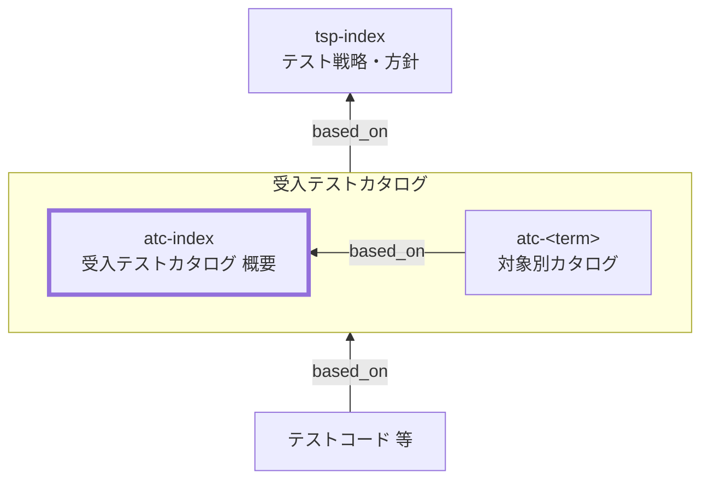

---
specdojo:
  id: specdojo:atc-index-rulebook
  type: rulebook
  deliverable_type: test
  status: draft
  recipe: undecided
  sample: specdojo:atc-index-sample
  template: undecided
---

# 受入テストカタログ 概要 作成ルール

Acceptance Test Catalog (ATC) Index Documentation Rules

TSP に基づき、受入テストカタログの全体概要 `atc-index` に記述する共通方針・合格基準・証跡の要件を定めます。対象別カタログは [[specdojo:atc-rulebook|受入テストカタログ 対象別 作成ルール]] に従います。

## 1. 全体方針

- `atc-index` は受入判断の対象単位・共通定義・方針の正本とし、個別の観点・条件・ケースは `atc-<term>`、実施の詳細は実施記録・レポート・証跡に置きます。
- 顧客・利用部門が合意できる粒度で、対象外、受入全体の合格基準、判定の流れを明示します。
- `tsp-index` を根拠に、対象の分割、観点と条件の採用、環境前提、証跡を定義します。
- **共通の運用**: 役割の割り当ては適用先のメンバー定義に、`status`・承認・改訂と廃止・未決事項の登録簿への引き継ぎは [[specdojo:document-metadata-standard|ドキュメントメタ情報標準]] に従います。文書の整形・lint はリポジトリの検証で扱い、業務の受入確認に含めません。

## 2. 位置づけ（他ドキュメントとの関係）



## 3. ファイル命名・ID規則

- ファイル名は `atc-index.md`、対象別は `atc-<term>.md` を基本とし、配置は成果物カタログと一致させます。
- 文書 ID はプロジェクト固有なら `<project-id>:atc-index`、プロダクト仕様なら `atc-index` とし、カタログの宣言に合わせます。対象別も同じ修飾方針で `atc-<term>` とします。
- `<term>` は用語集（GL）の論理名キー（英小文字 kebab-case）とし、日本語の表示名は本文の H1 に記載します。

## 4. 推奨 Frontmatter 項目

許可項目・必須性・型制約は [[specdojo:document-metadata-standard|ドキュメントメタ情報標準]] と `docs/specdojo/schemas/v1/deliverable-frontmatter.schema.yaml` を正本とし、メタ情報は `specdojo:` 配下に置きます。

- `type` は `test`、`rulebook` は `specdojo:atc-index-rulebook` とします。
- `based_on` には直接の根拠とした `tsp-index` の文書 ID を含めます。BAC/NFR/BR/AC 等は方針判断に直接使ったものに限ります。成果物カタログに `depends_on` がある場合はその推移閉包内の作成済み文書に限定します。

## 5. 本文要件

次の章名・順序・必須区分を用い、本文の見出しは `## 1. 本ドキュメントの目的と適用対象` のように番号を付けます。各章の記述条件は「記述ガイド」に従います。

| 番号 | 見出し                                          | 必須 |
| ---- | ----------------------------------------------- | ---- |
| 1    | 本ドキュメントの目的と適用対象                  | ○    |
| 2    | 受入テスト対象の括り方と分割基準                | ○    |
| 3    | 対象外・除外理由（共通）                        | ○    |
| 4    | 受入観点の立て方（共通）                        | ○    |
| 5    | 条件の立て方（共通）                            | ○    |
| 6    | 観点/条件の採用基準と対象別への分配方針（共通） | ○    |
| 7    | 受入テストの環境/データ/外部依存の扱い（共通）  | ○    |
| 8    | ケース表の共通カラム                            | ○    |
| 9    | メモ / 将来課題                                 | 任意 |

「本ドキュメントの目的と適用対象」には、受入全体の合格基準と合否判定の流れも必須で記載します。

## 6. 記述ガイド

### 6.1. 本ドキュメントの目的と適用対象

- 対象業務・利用場面と、対象別カタログに共通化する受入判断の範囲を示します。
- 全体概要は共通方針、対象別カタログは個別ケース、実施記録は合否の裏付けという分担を示します。
- **合格基準**: P0/P1/P2 の意味と優先度別の集計条件を定めます。例は「P0 は全件 pass、P1/P2 の fail は業務影響と回避策を確認し条件付き受入の可否を判断」です。未実施・判定保留を pass に数えず、fail を許容する条件、再試験と再判定の条件を明示します。
- **判定の流れ**: 実施結果の集計 → 証跡と期待値の照合 → 残存不具合・未決事項の影響確認 → 判定者による受入可・条件付き受入・保留・受入不可の判断と記録、の手順と各段階の完了条件を定めます。判定者が実施者・証跡確認者とその記録を辿れるようにします。

### 6.2. 受入テスト対象の括り方と分割基準

- `<term>` はユーザ価値・業務成果のまとまり（主要業務フロー、重要ユースケース群、運用シナリオ）とします。
- 分割は、受入判断の単位 → 業務成果の開始・完了条件 → 関係者合意の責任境界 → 重大障害・監査・金銭影響等のリスク境界の順で検討します。
- 1〜2 ケースだけの単位は原則統合します。50 ケース以上、または別の業務成果が混在する単位は分割候補とします。

### 6.3. 対象外・除外理由（共通）

AT 共通の責務分界（UT/IT/ET/ST/AT/NFR/運用）を次の列で示します。対象固有の除外は対象別カタログに置きます。

| 列                     | 記述条件                                                           |
| ---------------------- | ------------------------------------------------------------------ |
| 対象外（やらないこと） | 例: 内部例外分岐の全網羅、全組合せ、性能の厳密測定、全端末の互換性 |
| 除外理由               | 受入判断の目的に照らして除外する理由                               |
| 代替レベル/代替手段    | ST/NFR/互換試験/運用等、どこで担保するか                           |
| 例外（ATで扱う条件）   | 例外の判断基準。例外がなければ `なし`                              |

### 6.4. 受入観点の立て方（共通）

- 業務成果の成立、重要分岐（代表失敗・やり直し・取消・再実行）、契約（通知・帳票・監査ログ・権限・データ整合）、運用可能性（復旧・観測・問い合わせの証跡）、AT で扱う非機能の順に検討します。
- 観点名は「名詞＋成立/保証/整合」（例: `注文確定の成立`、`通知の保証`）とし、対象別カタログの見出しに使います。
- 複数条件を持てる粒度にまとめます。受入判断に結びつかない抽象観点は再定義します。

### 6.5. 条件の立て方（共通）

条件は前提・入力・環境の差分とし、代表性とリスクで絞ります。

- **入力**: 代表入力、空・最大・形式不正のうち業務影響がある境界。
- **状態**: 代表ユーザ・権限・データ・ステータス。
- **環境**: 代表端末・ブラウザ・設定、外部依存の正常と代表失敗。
- **経路**: 代表経路、失敗からの復帰、再試行、取消、二重実行防止。

ケースは代表（P0: 業務成果が成立する最短経路）→ 重要分岐（P0/P1）→ 重大リスク（P0: 不正権限・金銭・監査・データ破壊）の順で追加します。全組合せは原則作らず、必要な場合は理由・範囲・管理方法を示します。

### 6.6. 観点/条件の採用基準と対象別への分配方針（共通）

- 1 観点は 1 合否命題、1 条件は 1 差分（入力/状態/環境/経路）とします。
- 採用根拠は、業務停止・監査不備等の業務影響、境界・例外・状態遷移の欠落リスク、BAC/NFR/BR/AC 等の明示要求のいずれかで示します。「重要そうだから」は根拠にしません。
- 責務を持つ対象別カタログを主担当 1 つとし、複数対象に跨る場合は従担当から参照します。分配は「受入テスト対象の括り方と分割基準」に従い、ケース表とトレース列で追跡可能にします。

分配表を使う場合の列順は次のとおりです。

`観点/条件` / `採用理由` / `主担当 atc-<term>` / `従担当（任意）` / `備考`

### 6.7. 受入テストの環境/データ/外部依存の扱い（共通）

- **環境**: staging/uat 等の受入環境・主要ブラウザ/端末を示し、リリース候補版（ビルド番号/タグ）と実施期間の紐づけ方を定めます。
- **データ**: 準備・初期化・後始末（namespace/テナント/清掃手順）を共通化し、個々の値の列挙はデータセット ID の参照へ寄せます。
- **外部依存**: sandbox/疑似/検証用接続で本番影響を排除し、依存先ごとに画面・ログ・受信箱等の検証方法を定めます。
- **証跡**: 実施者・日時・版・ケース別結果（pass/fail 等）、画面録画等のキー・ログ相関 ID・必要な外部 ID を記録します。受入全体の判定記録から、証跡確認者、判定責任者（人間）、判定結果・理由・承認日、条件付き受入の条件を追跡できるようにします。

### 6.8. ケース表の共通カラム

全対象で次の列順を共通化します。必須 4 列に続き、推奨列（受入テストの運用では必須）を配置します。

| 区分 | 列                     | 記述条件                                                                                                  |
| ---- | ---------------------- | --------------------------------------------------------------------------------------------------------- |
| 必須 | `case_id`              | 対象別で一意かつ不変。推奨は `at-<term>-<perspective_key>-<nnn>`。キーは kebab-case、番号は 3 桁・10 刻み |
| 必須 | 条件                   | 入力/状態/環境/経路の必要な要素                                                                           |
| 必須 | 手順（最小）           | 操作の意図が分かる高位の手順                                                                              |
| 必須 | 期待値                 | 観測して判定できる合格条件                                                                                |
| 推奨 | 観測点（アサーション） | 画面・帳票・ログ相関 ID・外部 ID 等                                                                       |
| 推奨 | 環境/依存              | 代表構成と sandbox/疑似の前提                                                                             |
| 推奨 | トレース               | 要求・受入条件・契約の ID（`trace_key` 参照も可）                                                         |
| 推奨 | 優先度                 | 「本ドキュメントの目的と適用対象」で定義する P0/P1/P2                                                     |
| 推奨 | 実施形態               | manual/assisted/automated                                                                                 |
| 推奨 | 証跡                   | 実施記録・レポート・録画・ログ等の参照先                                                                  |

- 1 行は 1 受入シナリオ（条件×期待値が一意）とし、詳細は実施記録・テストスクリプトに寄せます。
- 共通列を変える場合は、全 `atc-<term>`、実施記録・レポート、集計・自動実行処理の利用箇所を特定し、列と値の対応を更新します。既存の `case_id` と `perspective_key` は維持し、ケースからトレース・証跡へ辿れることと集計結果を再確認します。

### 6.9. メモ / 将来課題

未決事項がある場合、論点と受入判断への影響（当面の扱い、決定時に変わる方針）を記録します。例は証跡の保存形式、代表構成の見直し、自動化の範囲です。

## 7. 禁止事項

| 項目                                                                         | 理由                                   |
| ---------------------------------------------------------------------------- | -------------------------------------- |
| `atc-index` に個別の条件・手順・期待値をケースとして記載する（形式例を除く） | 個別ケースは対象別カタログが正本のため |
| 受入環境・データ前提を対象ごとに無根拠に変更する                             | 公平性と再現性が崩れるため             |
| ケースの手順をクリック位置・ボタン名・画面要素の全操作列挙にする             | 業務上の操作意図を確認できなくなるため |
| 期待値を「問題がないこと」「使えること」だけで済ませる                       | 合否の観測点を特定できないため         |
| 参照済みの `case_id` を変更する                                              | トレースと証跡の参照が壊れるため       |
| 共通の除外方針に反するケースを根拠と例外条件なしで採用する                   | 受入判断の責任境界が崩れるため         |

## 8. サンプル（最小）

以下は全必須章の輪郭を示す形式例です。

```markdown
---
specdojo:
  id: prj-example:atc-index
  type: test
  status: draft
  rulebook: specdojo:atc-index-rulebook
  based_on: [prj-example:tsp-index]
---

# 受入テストカタログ 概要（販売管理）

## 1. 本ドキュメントの目的と適用対象

会計の受入判断に適用する。P0 は必須の代表・重大リスク、P1 は重要分岐、P2 は補助確認とする。P0 は全件 pass、P1/P2 の fail は回避策を実施でき業務継続に支障がない場合だけ条件付き受入とする。未実施・保留は pass に数えない。
実施結果の集計、証跡照合、残存不具合の影響確認を経て、判定者が受入可否を記録する。

## 2. 受入テスト対象の括り方と分割基準

会計完了を 1 つの受入単位とし、業務成果とリスク境界で分割する。

## 3. 対象外・除外理由（共通）

内部例外分岐の全網羅は受入判断の対象外とし、UT/IT で担保する。AT で扱う例外はない。

## 4. 受入観点の立て方（共通）

業務成果・重要分岐・契約・運用可能性から、合否命題を持つ観点を立てる。

## 5. 条件の立て方（共通）

入力・状態・環境・経路を分け、代表、重要分岐、重大リスクの順に採用する。

## 6. 観点/条件の採用基準と対象別への分配方針（共通）

業務影響または明示要求を根拠に、責務を持つ対象別カタログを主担当とする。

## 7. 受入テストの環境/データ/外部依存の扱い（共通）

代表構成と候補版を固定し、受入用データを初期化する。決済は sandbox で確認する。実施・証跡確認の記録と、判定者・結果・理由・承認日を関連付ける。

## 8. ケース表の共通カラム

必須は `case_id` / 条件 / 手順（最小）/ 期待値。推奨は観測点（アサーション）/ 環境/依存 / トレース / 優先度 / 実施形態 / 証跡。
```
