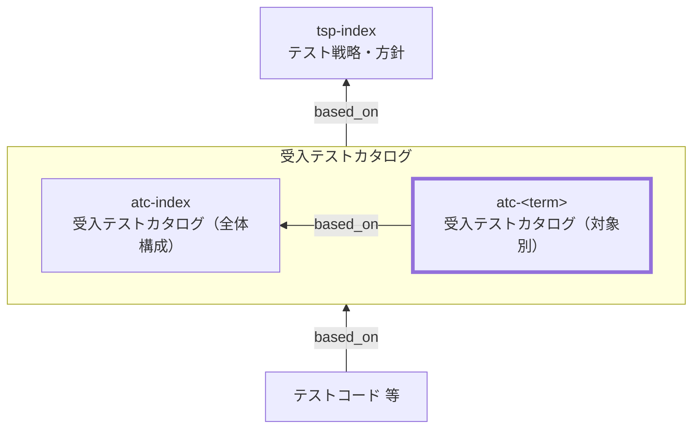

---
specdojo:
  id: specdojo:atc-rulebook
  type: rulebook
  deliverable_type: test
  status: draft
  recipe: undecided
  sample: specdojo:atc-sample
  template: undecided
---

# 受入テストカタログ 対象別 作成ルール

Acceptance Test Catalog (ATC) Documentation Rules

受入テストカタログの対象別文書 `atc-<term>` を、対象ごとの受入判断の範囲（責務・境界・観点とケース・トレース・証跡）が分かる統一形式で記述するためのルールです。

## 1. 全体方針

- `atc-<term>` は `atc-index` を前提とする受入テストの正本であり、対象固有の情報だけを書く。共通の方針は `atc-index` を参照し、言い直さない。
- 目的は関係者が受け入れ可否を判断できることであり、内部実装の網羅や詳細な分岐の確認は扱わない（必要なら別のテストレベルへ送る）。
- ケースは表の 1 行を 1 受入シナリオとし、手順と期待値を合否判定できる粒度で簡潔に書く。クリック列挙や大量データは実施手順書・実施記録へ寄せ、証跡から参照する。
- すべての観点とケースを、根拠仕様（トレース）と証跡（実施記録・レポート・ログ）へ接続する。
- 環境・データ・外部依存の前提は合否の再現性に直結するため、対象固有の差分を必ず書く。
- 共通の運用: 役割の割り当ては適用先のメンバー定義に、`status` の昇格と承認、改訂と廃止、未決事項の登録簿への引き継ぎは [[specdojo:document-metadata-standard|ドキュメントメタ情報標準]] に従い、本書と成果物で言い直さない。文書の整形・lint はリポジトリの検証で扱い、業務の受入確認に含めない。

## 2. 位置づけ



## 3. ファイル命名・ID規則

- `id` は `atc-<term>`（kebab-case。例: `atc-checkout`）とする。
- ファイル名は `atc-<term>.md` 等とし、成果物カタログの宣言と一致させる。
- `<term>` は用語集（GL）の論理名キー（英小文字 kebab-case）を用いる。日本語の表示名は H1 に書く（例: `# 受入テストカタログ: 会計確定`）。

## 4. 推奨 Frontmatter 項目

許可キー・必須項目・型制約は [[specdojo:document-metadata-standard|ドキュメントメタ情報標準]] と `docs/specdojo/schemas/v1/deliverable-frontmatter.schema.yaml` を正本とする。

- `specdojo.type` は `test`、`specdojo.rulebook` は `specdojo:atc-rulebook` とする。
- `specdojo.based_on` は原則 `tsp-index` と `atc-index` とし、実際に読んで直接の根拠とした作成済み文書だけを加える。
- 検証する上流の受入条件（`bac-*`・`ac-*` 等）は `specdojo.relations.verifies` に宣言する。本文「トレース」の `TR-xx` は項目単位の対応で、`relations.verifies` の ID を含むこと。上流の受入条件が変わったときは、`relations.verifies` から影響する ATC を特定し、該当する `TR-xx` を参照するケースを見直す。
- 分割した場合は `part_of` で集約文書に所属させ、置き換える場合は `supersedes` を用いる。

```yaml
---
specdojo:
  id: atc-checkout
  type: test
  status: draft
  rulebook: specdojo:atc-rulebook
  based_on: [tsp-index, atc-index]
  relations:
    verifies: [bac-checkout]
---
```

## 5. 本文要件

本文は次の章を順序固定で置く。すべて必須とする。

| 章                          | 内容・受入条件                                                                                                 |
| --------------------------- | -------------------------------------------------------------------------------------------------------------- |
| 概要（`<term>`）            | 対象が何で、誰がどの受入判断に使うか、`atc-index` の分割基準に沿った対象の粒度が分かる                         |
| 受入の責務（成果/完了条件） | 受入で保証する成果を 3〜7 個程度、観測できる成果とともに示す。正常系に加え代表的な失敗・復帰・やり直しを含める |
| 対象外                      | 除外する事項を理由と代替手段（ST・NFR・運用検証等）とともに示し、`atc-index` の共通の対象外と矛盾しない        |
| 環境/データ/外部依存        | 対象固有の環境・データセット・初期化・外部依存の確認手段と、外部依存が不安定なときの判定保留条件を示す         |
| トレース                    | 根拠仕様を `trace_key`（`TR-xx`）付きの表で示す。トレースの正本はこの章とする                                  |
| 受入観点とケース            | 観点ごとに `### 6.n. 観点：<観点名>`、その下に `#### 6.n.1. 意図` と `#### 6.n.2. 条件・ケース表` を置く       |

### 5.1. トレース表の列

| 列          | 必須 | 内容                                                           |
| ----------- | ---- | -------------------------------------------------------------- |
| `trace_key` | ○    | `TR-01` からの追加順の連番。並べ替え・削除しても番号を変えない |
| 仕様ID      | ○    | 根拠とする受入条件・業務ルール・仕様の ID                      |
| 要点        | ○    | 受入判断に使ったポイントを 1 行で書く                          |
| 備考        | 任意 | 補足                                                           |

### 5.2. 条件・ケース表の列

次の列をこの順序で置く。

| 列                     | 必須 | 内容                                                                           |
| ---------------------- | ---- | ------------------------------------------------------------------------------ |
| `case_id`              | ○    | `at-<term>-<perspective_key>-<nnn>`。`nnn` は 3 桁 10 刻み。変更・再利用しない |
| 条件                   | ○    | 入力・状態・環境・経路のうち必要な要素                                         |
| 手順（最小）           | ○    | 操作の意図が分かる高位の手順                                                   |
| 期待値                 | ○    | 観測点で合否を判定できる結果                                                   |
| 観測点（アサーション） | ○    | 画面・帳票・通知・ログ相関 ID など誰が見ても判定できる確認先                   |
| 環境/依存              | 任意 | 「環境/データ/外部依存」の章と異なる前提があるときだけ書く                     |
| トレース               | ○    | 「トレース」の章の `TR-xx`。仕様 ID を直書きしない                             |
| 優先度                 | ○    | `P0`: 不合格なら受入不可。`P1`: 重要な分岐で、不合格時は条件付き受入を判断する |
| 実施形態               | ○    | `manual`（人が実施して記録）または `automated`（自動テストの結果を証跡にする） |
| 証跡                   | ○    | 実施記録 ID・保存先・ログ相関 ID など実施記録とレポートへ辿れる参照            |

`perspective_key` は kebab-case とし、観点名を直しても変えない。

## 6. 記述ガイド

完成例は Frontmatter の `sample` で宣言された sample を参照する。各章は次の判断基準と例に従う。

### 6.1. 概要と受入の責務

- 判断基準: 責務は観点の上位概念で、成果が分かる動詞で書かれ、責務に含まれないものは「対象外」にあること。
- 良い例: 「確定後にレシートと取引 ID が参照できる」。
- 悪い例: 「会計処理が正しく動く」（観測できる成果がない）。

### 6.2. 対象外と環境/データ/外部依存

- 判断基準: 対象外に理由と代替があり、前提データがデータセット ID 等で参照でき、外部依存の確認手段と判定保留条件が分かること。
- 良い例: 「対象外: 決済ゲートウェイの内部ロジック（理由: 外部責務、代替: 提供者の仕様・監査）」「外部依存: 決済は sandbox。応答がない場合は判定保留とし再実施する」。
- 悪い例: 「外部連携は適宜確認する」（確認手段も保留条件もない）。

### 6.3. 受入観点とケース

- 判断基準: 観点は `atc-index` の観点の立て方に従い、条件が複数ぶら下がる粒度にまとめ、意図を 1〜2 行で書くこと。ケースは代表（`P0`）、重要な分岐（`P0`・`P1`）、重大なリスク（`P0`）の順に増やし、直積を避けること。
- 良い例: 「期待値: 会計が確定し、取引 ID・帳票・通知が確認できる」（行の全体は「サンプル（最小）」を参照）。
- 悪い例: 「期待値: 問題がないこと」（合否判定できず証跡にならない）。

## 7. 禁止事項

| 禁止事項                                                                 | 理由                                                     |
| ------------------------------------------------------------------------ | -------------------------------------------------------- |
| `atc-index` の共通方針を `atc-<term>` 側で上書きする                     | 受入判断の一貫性が崩れ、合意と追跡が困難になるため       |
| ケース表に UI のクリック手順や画面要素の細部を列挙する                   | 変更に弱く、受入の意図が読めなくなるため                 |
| 期待値を曖昧に書く（例: 「問題がないこと」「使えること」）               | 合否判定できず証跡にならないため                         |
| `case_id` を変更・再利用する、`perspective_key` を観点名に合わせて変える | トレースと証跡の参照が壊れるため                         |
| 理由・範囲を書かずに直積のケースを作る                                   | ケースが爆発して運用できなくなるため                     |
| トレースや証跡のないケースを期限・条件なしで残す                         | 受入の根拠として成立しないため                           |
| 判定保留条件を定めずに不安定な外部依存のまま合否を判定する               | 受入判断が揺れて合意が崩れるため                         |
| ケース表の `トレース` 列に仕様 ID を直書きする                           | トレースの正本が二重になり、上流の変更に追従できないため |

## 8. サンプル（最小）

完成例を sample へ外出しするまでの経過措置として、本文の輪郭だけを示す。

```markdown
## 5. トレース

| trace_key | 仕様ID        | 要点                     | 備考 |
| --------- | ------------- | ------------------------ | ---- |
| TR-01     | ac-checkout-1 | 支払い成功時に確定できる |      |

## 6. 受入観点とケース

### 6.1. 観点：会計確定の成立

#### 6.1.1. 意図

代表シナリオで、支払いから会計確定までが成立することを保証する。

#### 6.1.2. 条件・ケース表

| case_id                          | 条件                       | 手順（最小）          | 期待値                                     | 観測点（アサーション）    | 環境/依存 | トレース | 優先度 | 実施形態 | 証跡            |
| -------------------------------- | -------------------------- | --------------------- | ------------------------------------------ | ------------------------- | --------- | -------- | ------ | -------- | --------------- |
| at-checkout-checkout-success-010 | 状態: 正常顧客、経路: 成功 | 商品を選び支払い→確定 | 会計が確定し取引ID・帳票・通知が確認できる | 取引ID、帳票PDF、通知件名 |           | TR-01    | P0     | manual   | 実施記録#A-1001 |
```
