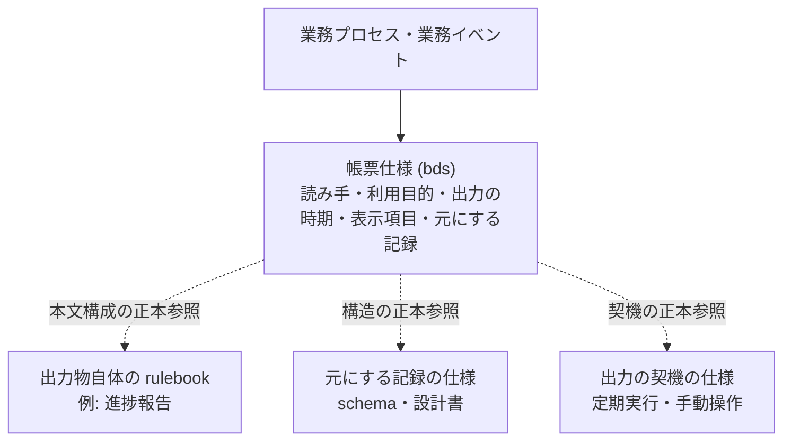

---
specdojo:
  id: specdojo:bds-rulebook
  type: rulebook
  deliverable_type: ui
  status: ready
  target_format: markdown
  recipe: not-needed
  sample: specdojo:bds-sample
  template: not-needed
  based_on:
    - specdojo:rulebook-authoring-standard
---

# 帳票仕様（BDS）作成ルール

Business Document Specification (BDS) Authoring Rule

業務で使う出力物（報告書、一覧、集計表、ファイル出力など）の利用目的、読み手、出力の時期、表示項目、元にする記録と算出規則を、業務用語で定義する基準を定めます。

## 1. 全体方針

- 1 ファイルは 1 帳票とします。同じ読み手・目的・時期で出力する出力物を 1 帳票にまとめ、読み手や時期が異なれば分けます。
- 読み手が帳票から下す判断を先に定め、表示項目はその判断に要るものに絞ります。
- 各表示項目は、元にする記録と算出規則まで追えるようにします。下書きでは出所・確かめ方の未確定を明記できますが、業務の受入確認までに解消します。
- 出力物自体の本文構成を定める rulebook や、記録・ファイルの schema があれば正本とし、帳票仕様は項目の意味・出所・判断用途を持ちます。
- 共通事項は上位の索引を正本とし、個別仕様では差分と参照先を示します。
- **共通の運用**: 役割の割り当ては適用先のメンバー定義に、`status`・承認・改訂と廃止・未決事項の引き継ぎは [[specdojo:document-metadata-standard|ドキュメントメタ情報標準]] に従います。文書の整形・lint はリポジトリの検証で扱い、業務の受入確認に含めません。

## 2. 位置づけ

帳票仕様は業務仕様の `user-interface-model` に属し、業務プロセスや業務イベントを受けて、出力物の読み手と出力側の境界を定めます。成果物としての位置づけは [[specdojo:deliverables-reference|成果物リファレンス]] を正本とします。

- 画面仕様（`uis`）と同じ `ui` 種別ですが、画面仕様は利用者が操作して業務を進める対話を、帳票仕様は操作を伴わずに受け取る出力物とその値の出所を扱います。
- 画面上に表示するだけの一覧でも、定期的に作られて後から読み返す出力物であれば帳票仕様に、利用者の操作・遷移を伴う画面であれば画面仕様に書き、片方から他方を参照します。

## 3. ファイル命名・ID規則

命名の共通原則は [[specdojo:docs-structure-guide|ドキュメント構成ガイド]] に従います。

- ファイル名は `bds-<帳票名の kebab-case>.md` とします。例: `bds-progress-report.md`。
- プロダクト文書の ID は `bds-<kebab-case>`、プロジェクト文書は `<project-id>:bds-<kebab-case>` とします。
- 帳票名は本文先頭の H1 に記述し、「対象 + 観点 + 粒度」で識別できる名前にします。例: 「週次進捗報告」「日次売上サマリ」。

## 4. 推奨 Frontmatter 項目

共通の必須・任意項目と値・型の制約は [[specdojo:document-metadata-standard|ドキュメントメタ情報標準]] および `docs/specdojo/schemas/v1/deliverable-frontmatter.schema.yaml` を正本とします。BDS 固有の指定は次のとおりです。

- `type` は本 rulebook の `deliverable_type` に対応する `ui`、`rulebook` は `specdojo:bds-rulebook` とします。
- `part_of` は所属する索引、`based_on` は根拠とした業務プロセス・業務イベント・設計書を示します。
- 未作成の索引や接続できない根拠は「メモ / 将来課題」へ記録します。

## 5. 本文要件

次の順に構成します。

| 章                     | 必須・任意 | 目的と内容要件                                                                                         |
| ---------------------- | ---------- | ------------------------------------------------------------------------------------------------------ |
| 概要                   | 必須       | 帳票が何を示し、読み手が何を判断できるかを 1〜3 文で示す                                               |
| 読み手と利用目的       | 必須       | 読み手ごとの利用目的と判断、対象外の用途と引き渡し先を示す                                             |
| 出力の時期と契機       | 必須       | 出力の契機、対象期間の区切り方、取りこぼし・再出力の扱い、時刻の基準を示す                             |
| 出力形式と提供方法     | 必須       | 媒体・形式、保存先または配布先、1 回の出力で作る単位、出力物自体の本文構成の正本を示す                 |
| 対象範囲と元にする記録 | 必須       | 対象と対象外、元にする記録ごとの用途と正本、記録が欠けるときの扱いを示す                               |
| 表示項目               | 必須       | 項目ごとの意味、元にする記録、記録からの確かめ方を表で示す                                             |
| 集計・算出ルール       | 必須       | 期間への割り当て、件数・合計・差分の算出、重複と端数の扱いを示す。算出がない帳票は該当なしと理由を書く |
| 例外と注意事項         | 必須       | 対象 0 件、記録の欠落、再出力、出力の失敗などで読み手と作成者が取る対応を示す                          |
| メモ / 将来課題        | 任意       | 未作成の参照先、未確認の動作、未決事項の論点と影響・当面の扱いを示す。該当事項があれば省略しない       |

## 6. 記述ガイド

各章の判断基準と対比例を示します。完成例は frontmatter で宣言した sample を正本とします。

### 6.1. 概要

- 判断基準: 帳票が示す対象・期間・観点と、読み手がそれで何を判断できるかが分かること。作成処理の説明は含めません。
- 良い例: 「1 週間分の作業の完了・進行・課題・翌週予定をまとめ、PM と PO が次週の優先度を判断する報告。」
- 悪い例: 「定期処理が作る週次ファイル。」読み手と判断が分かりません。

### 6.2. 読み手と利用目的

- 判断基準: 読み手ごとに利用目的と判断が対応していること。
- 対象外の用途（監査、会計、評価など）がある場合は、引き渡し先を示します。
- 推奨列は「読み手」「利用目的」「帳票から判断すること」です。
- 良い例: 「PO: 完了と未完了の差から、翌週に優先する成果物を判断する。」
- 悪い例: 「関係者全員が状況を把握する。」読み手と判断が特定できません。

### 6.3. 出力の時期と契機

- 判断基準: いつ、何を契機に、どの期間を対象に作るかが一意に読めること。時刻とタイムゾーンの基準、期間の始点・終点を含めます。
- 停止中に過ぎた回の扱い、同じ期間の再出力、手動出力の可否を区別します。契機の設定値の正本は定義ファイルや設計書を参照し、値を全文転載しません。
- 良い例: 「毎週金曜 17 時（日本時間）に当該 ISO 週を対象に作る。停止中に過ぎた週も 1 週ずつ作り、同じ週の再出力は新しい報告を増やさない。」
- 悪い例: 「週 1 回出力する。」曜日・時刻・期間の区切り・再出力が判断できません。

### 6.4. 出力形式と提供方法

- 判断基準: 読み手がどこで何を受け取るか、1 回の出力で何件できるかが分かること。
- 形式（文書、CSV、印刷、画面など）、保存先または配布先、ファイル単位を示します。CSV など機械可読な形式では、文字コード・見出し行・区切り文字の要否を業務上の前提として示します。
- 良い例: 「Markdown 文書として報告保存先へ 1 期間 1 件で保存する。本文の章立ては進捗報告の rulebook に従う。」
- 悪い例: 「ファイルで出す。」保存先・単位・構成の正本が分かりません。

### 6.5. 対象範囲と元にする記録

- 判断基準: 帳票に含める記録と含めない記録を区別でき、各記録の正本と用途が分かること。
- 対象範囲は期間、対象組織・プロジェクト、状態、除外条件で示します。取消・差し戻しなどを含めるかを明記します。
- 元にする記録は「記録」「用途」「正本」「欠けるときの扱い」で示します。端末内だけに残る記録など、作成者が参照できない記録は区別します。
- 良い例: 「作業の完了は実行の状態記録から期間内に完了したものを数える。記録が読めない場合は報告を保留し、推測で補わない。」
- 悪い例: 「システムのデータを使う。」記録の種類、正本、欠落時の扱いが分かりません。

### 6.6. 表示項目

- 判断基準: 各項目の意味と出所が分かり、記録から値を再現して確かめられること。
- 推奨列は次のとおりです。区分が不要な帳票では「区分」を省略できます。

| 列                 | 記述する内容                                           |
| ------------------ | ------------------------------------------------------ |
| No                 | 項目の通し番号                                         |
| 区分               | 見出し、明細、集計、注記など                           |
| 項目名             | 帳票上の名前。用語集があれば用語集の表記に合わせる     |
| 意味・定義         | 項目が表す内容と単位・書式                             |
| 元にする記録       | 「対象範囲と元にする記録」の記録名。複数あれば列挙する |
| 記録からの確かめ方 | 値を記録から再現する手順、または照合する条件           |

- 良い例: 「完了事項: 期間内に完了したタスク ID。元にする記録は実行の状態記録。期間内に完了へ遷移したタスクと一致することを照合する。」
- 悪い例: 「完了事項: 完了したもの。」期間の判定と照合先がありません。

### 6.7. 集計・算出ルール

- 判断基準: 同じ記録から誰が算出しても同じ値になること。
- 記録を期間へ割り当てる時刻の基準、集計単位、件数・合計・差分の式、重複の除き方、端数処理を示します。
- 割合や進捗率を出す場合は分母・分子を定義します。
- 良い例: 「完了件数 = 期間内に完了へ遷移したタスクの件数。同じタスクが再度完了した場合は 1 件と数える。」
- 悪い例: 「進捗率を表示する。」分母・分子と判定時点が分かりません。

### 6.8. 例外と注意事項

- 判断基準: 通常と異なる状況で、帳票を作るか、何を表示するか、誰が何をするかが分かること。
- 対象 0 件、記録の欠落・不整合、停止中に過ぎた回、同じ期間の再出力、出力の失敗、締め前後の違いのうち該当するものを扱います。
- 良い例: 「対象期間に完了がない場合も報告を作り、完了事項に該当なしと書く。」
- 悪い例: 「エラー時は適切に対応する。」作成可否と対応者が分かりません。

### 6.9. メモ / 将来課題

- 判断基準: 確定した仕様と未確定事項を区別でき、影響する項目や境界、当面の扱いが分かること。
- 推奨列は「項目」「未整備事項と影響」です。
- 良い例: 「期間の終点が未確定。決まるまでは週末の記録の扱いを受入対象外とする。」
- 悪い例: 「今後検討する。」論点と影響が分かりません。

## 7. 禁止事項

| 禁止する記述                                                               | 理由                                           |
| -------------------------------------------------------------------------- | ---------------------------------------------- |
| レイアウト・座標・フォントなどの見た目の指定                               | 要求の段階で過剰であり、表示項目の判断を妨げる |
| 元にする記録や確かめ方の未確定を明記せず、表示項目を確定仕様として扱うこと | 値の正しさを判定できないまま受入へ進むため     |
| 出力物の本文構成・記録の構造・契機の設定値の正本の再掲                     | 二重管理になり、片方が取り残される             |
| 根拠のない割合・進捗率、「正しく出る」などの曖昧な表現                     | 検証できない                                   |

## 8. 運用ルール

業務の受入確認は次の手順で行います。

1. 必須章の要件に照らし、読み手の判断に要る項目・出力の時期・提供方法が揃うことを確認します。
2. 各表示項目を元にする記録と算出規則から再現し、「表示項目」の確かめ方で照合します。すべて一致し、出所・確かめ方に未確定がないことを合格条件とします。
3. 期間境界、対象 0 件、記録欠落、再出力・失敗のうち該当する場面を照合し、作成可否・表示・対応が「例外と注意事項」と一致することを確認します。未決の境界は「メモ / 将来課題」で受入対象からの除外と影響を明示します。
