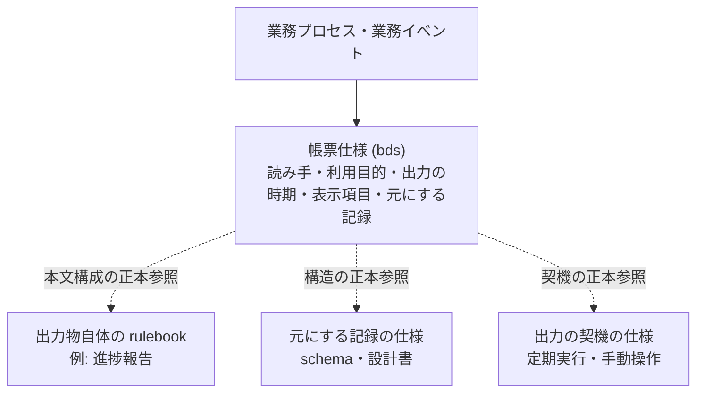

---
specdojo:
  id: specdojo:bds-rulebook
  type: rulebook
  deliverable_type: ui
  status: ready
  target_format: markdown
  recipe: not-needed
  sample: specdojo:bds-sample
  template: not-needed
  based_on:
    - specdojo:rulebook-authoring-standard
---

# 帳票仕様（BDS）作成ルール

Business Document Specification (BDS) Authoring Rule

業務で使う出力物（報告書、一覧、集計表、ファイル出力など）について、読み手が何のためにいつ受け取り、何を確かめられるかを業務用語でレビューできる仕様の記述規約を定めます。出力物の本文構成や記録の構造は各正本を参照し、本書では利用目的、読み手、出力の時期、表示項目、元にする記録と算出の規則を扱います。

## 1. 全体方針

- 1 ファイルは 1 帳票とします。同じ読み手・目的・時期で出力する出力物を 1 帳票にまとめ、読み手や時期が異なれば分けます。
- 読み手が帳票から下す判断を先に定め、表示項目はその判断に要るものに絞ります。
- 各表示項目は、元にする記録と算出の規則まで追えるようにします。記録から値を再現できない項目は、確かめ方が未確定であることを明記します。
- 出力物自体の本文構成を定める rulebook や、記録・ファイルの schema があれば正本とし、帳票仕様は項目の意味・出所・判断用途を持ちます。
- 共通事項は上位の索引を正本とし、個別仕様では差分と参照先を示します。索引が未作成なら未作成と記録します。
- 物理名・SQL・実装クラス・帳票ツールなどの実装詳細は記載しません。

### 1.1. 対象者と確認する内容

| 対象者                                      | 解決する課題                             | 確認する内容                                             |
| ------------------------------------------- | ---------------------------------------- | -------------------------------------------------------- |
| 業務分析担当（BA）                          | 出力物が業務の判断に足りるか分からない   | 読み手、利用目的、表示項目、出力の時期が対応している     |
| プロダクトオーナー（PO）                    | 報告・出力の範囲を承認できない           | 対象範囲、対象外、未確定の判断が区別されている           |
| アーキテクト（ARC）・開発者（DEV）          | 出力の契機と記録の出所が実装と食い違う   | 出力の契機、元にする記録、算出規則と正本の所在           |
| 品質保証担当（QE）                          | 出力内容の正しさを判定できない           | 各項目を記録から再現する方法、境界条件、例外時の期待結果 |
| UX / Documentation Designer（UX）・読み手側 | 必要な情報へたどり着けない、用語が揺れる | 項目名と用語、並び順、次に見る文書                       |

## 2. 位置づけと用語定義

帳票仕様は業務仕様の `user-interface-model` に属し、業務プロセスや業務イベントを受けて、出力物の読み手と出力側の境界を定めます。成果物としての位置づけは [[specdojo:deliverables-reference|成果物リファレンス]] を正本とします。

- 画面仕様（`uis`）と同じ `ui` 種別ですが、画面仕様は利用者が操作して業務を進める対話を、帳票仕様は操作を伴わずに受け取る出力物とその値の出所を扱います。
- 画面上に表示するだけの一覧でも、定期的に作られて後から読み返す出力物であれば帳票仕様に、利用者の操作・遷移を伴う画面であれば画面仕様に書き、片方から他方を参照します。

| 用語         | この文書での意味                                                                       |
| ------------ | -------------------------------------------------------------------------------------- |
| 帳票         | 業務で利用する出力物。文書、一覧、集計表、ファイル出力、画面上の出力を含む             |
| 元にする記録 | 帳票の値を得るために読む業務記録。実行記録、状態の変化、前回の帳票などを含む           |
| 対象範囲     | 元にする記録のうち帳票に含める範囲。期間、対象組織・プロジェクト、状態、除外条件で示す |
| 出力の時期   | 帳票を作る契機と、対象期間の区切り方の組み合わせ                                       |
| 表示項目     | 帳票に出力される項目。見出し情報、明細、集計値、注記を含む                             |

## 3. ファイル命名・ID規則

命名の共通原則は [[specdojo:docs-structure-guide|ドキュメント構成ガイド]] に従います。

- ファイル名は `bds-<帳票名の kebab-case>.md` とします。例: `bds-progress-report.md`。
- プロダクト文書の ID は `bds-<kebab-case>`、プロジェクト文書は `<project-id>:bds-<kebab-case>` とします。同梱の完成例は成果物と衝突しない `specdojo:` の ID を使います。
- 帳票名は本文先頭の H1 に記述し、「対象 + 観点 + 粒度」で識別できる名前にします。例: 「週次進捗報告」「日次売上サマリ」。

## 4. 推奨 Frontmatter 項目

共通の必須・任意項目と値・型の制約は [[specdojo:document-metadata-standard|ドキュメントメタ情報標準]] および `docs/specdojo/schemas/v1/deliverable-frontmatter.schema.yaml` を正本とします。BDS 固有の指定は次のとおりです。

- `type` は本 rulebook の `deliverable_type` に対応する `ui`、`rulebook` は `specdojo:bds-rulebook` とします。
- `part_of` は所属する索引、`based_on` は実際に根拠とした業務プロセス・業務イベント・設計書を示します。未作成の文書を作成済みとして登録しません。
- 接続できない依存先や根拠は「メモ / 将来課題」へ記録します。空の `based_on` を埋めるために無関係な ID を追加しません。

## 5. 本文要件

次の順に構成します。Markdown の `##`〜`####` には階層ごとの連番と末尾の `.` を付け、章への参照は章タイトルで示します。

| 章                     | 必須・任意 | 目的と内容要件                                                                                         |
| ---------------------- | ---------- | ------------------------------------------------------------------------------------------------------ |
| 概要                   | 必須       | 帳票が何を示し、読み手が何を判断できるかを 1〜3 文で示す                                               |
| 読み手と利用目的       | 必須       | 読み手ごとの利用目的と判断、作成・確認・承認の役割、対象外の用途と引き渡し先を示す                     |
| 出力の時期と契機       | 必須       | 出力の契機、対象期間の区切り方、取りこぼし・再出力の扱い、時刻の基準を示す                             |
| 出力形式と提供方法     | 必須       | 媒体・形式、保存先または配布先、1 回の出力で作る単位、出力物自体の本文構成の正本を示す                 |
| 対象範囲と元にする記録 | 必須       | 対象と対象外、元にする記録ごとの用途と正本、記録が欠けるときの扱いを示す                               |
| 表示項目               | 必須       | 項目ごとの意味、元にする記録、記録からの確かめ方を表で示す                                             |
| 集計・算出ルール       | 必須       | 期間への割り当て、件数・合計・差分の算出、重複と端数の扱いを示す。算出がない帳票は該当なしと理由を書く |
| 例外と注意事項         | 必須       | 対象 0 件、記録の欠落、再出力、出力の失敗などで読み手と作成者が取る対応を示す                          |
| メモ / 将来課題        | 任意       | 未作成の参照先、未確認の動作、未決事項の影響・担当・解消条件を示す。該当事項があれば省略しない         |

## 6. 記述ガイド

各章は次の判断基準で記述します。完成例は frontmatter で宣言した sample を正本とし、ここには判断に必要な短い対比例だけを置きます。

### 6.1. 概要

- 判断基準: 帳票が示す対象・期間・観点と、読み手がそれで何を判断できるかが分かること。作成処理の説明は含めません。
- 良い例: 「1 週間分の作業の完了・進行・課題・翌週予定をまとめ、PM と PO が次週の優先度を判断する報告。」
- 悪い例: 「定期処理が作る週次ファイル。」読み手と判断が分かりません。

### 6.2. 読み手と利用目的

- 判断基準: 読み手ごとに利用目的と判断が対応し、作成・確認・承認を担う役割が分かること。責務は Role code、読み手の表示は役割名で示します。
- 対象外の用途（監査、会計、評価など）がある場合は、引き渡し先を示します。
- 推奨列は「読み手」「利用目的」「帳票から判断すること」です。
- 良い例: 「PO: 完了と未完了の差から、翌週に優先する成果物を判断する。」
- 悪い例: 「関係者全員が状況を把握する。」読み手と判断が特定できません。

### 6.3. 出力の時期と契機

- 判断基準: いつ、何を契機に、どの期間を対象に作るかが一意に読めること。時刻とタイムゾーンの基準、期間の始点・終点を含めます。
- 停止中に過ぎた回の扱い、同じ期間の再出力、手動出力の可否を区別します。契機の設定値の正本は定義ファイルや設計書を参照し、値を全文転載しません。
- 良い例: 「毎週金曜 17 時（日本時間）に当該 ISO 週を対象に作る。停止中に過ぎた週も 1 週ずつ作り、同じ週の再出力は新しい報告を増やさない。」
- 悪い例: 「週 1 回出力する。」曜日・時刻・期間の区切り・再出力が判断できません。

### 6.4. 出力形式と提供方法

- 判断基準: 読み手がどこで何を受け取るか、1 回の出力で何件できるかが分かること。
- 形式（文書、CSV、印刷、画面など）、保存先または配布先、ファイル単位を示します。CSV など機械可読な形式では、文字コード・見出し行・区切り文字の要否を業務上の前提として示します。
- 出力物自体の本文構成を定める rulebook があれば正本として参照し、章立てを再掲しません。
- 良い例: 「Markdown 文書として報告保存先へ 1 期間 1 件で保存する。本文の章立ては進捗報告の rulebook に従う。」
- 悪い例: 「ファイルで出す。」保存先・単位・構成の正本が分かりません。

### 6.5. 対象範囲と元にする記録

- 判断基準: 帳票に含める記録と含めない記録を区別でき、各記録の正本と用途が分かること。
- 対象範囲は期間、対象組織・プロジェクト、状態、除外条件で示します。取消・差し戻しなどを含めるかを明記します。
- 元にする記録は「記録」「用途」「正本」「欠けるときの扱い」で示します。端末内だけに残る記録など、作成者が参照できない記録は区別します。
- 良い例: 「作業の完了は実行の状態記録から期間内に完了したものを数える。記録が読めない場合は報告を保留し、推測で補わない。」
- 悪い例: 「システムのデータを使う。」記録の種類、正本、欠落時の扱いが分かりません。

### 6.6. 表示項目

- 判断基準: 各項目の意味と出所が分かり、記録から値を再現して確かめられること。レイアウトは指定せず、何が出力されるかを示します。
- 推奨列は次のとおりです。区分が不要な帳票では「区分」を省略できます。

| 列                 | 記述する内容                                           |
| ------------------ | ------------------------------------------------------ |
| No                 | 項目の通し番号                                         |
| 区分               | 見出し、明細、集計、注記など                           |
| 項目名             | 帳票上の名前。用語集があれば用語集の表記に合わせる     |
| 意味・定義         | 項目が表す内容と単位・書式                             |
| 元にする記録       | 「対象範囲と元にする記録」の記録名。複数あれば列挙する |
| 記録からの確かめ方 | 値を記録から再現する手順、または照合する条件           |

- 良い例: 「完了事項: 期間内に完了したタスク ID。元にする記録は実行の状態記録。期間内に完了へ遷移したタスクと一致することを照合する。」
- 悪い例: 「完了事項: 完了したもの。」期間の判定と照合先がありません。

### 6.7. 集計・算出ルール

- 判断基準: 同じ記録から誰が算出しても同じ値になること。
- 記録を期間へ割り当てる時刻の基準、集計単位、件数・合計・差分の式、重複の除き方、端数処理を示します。
- 割合や進捗率を出す場合は分母・分子を定義します。根拠のない割合は出しません。
- 良い例: 「完了件数 = 期間内に完了へ遷移したタスクの件数。同じタスクが再度完了した場合は 1 件と数える。」
- 悪い例: 「進捗率を表示する。」分母・分子と判定時点が分かりません。

### 6.8. 例外と注意事項

- 判断基準: 通常と異なる状況で、帳票を作るか、何を表示するか、誰が何をするかが分かること。
- 対象 0 件、記録の欠落・不整合、停止中に過ぎた回、同じ期間の再出力、出力の失敗、締め前後の違いのうち該当するものを扱います。
- 良い例: 「対象期間に完了がない場合も報告を作り、完了事項に該当なしと書く。」
- 悪い例: 「エラー時は適切に対応する。」作成可否と対応者が分かりません。

### 6.9. メモ / 将来課題

- 判断基準: 確定した仕様と未確定事項が区別され、誰が何を確かめれば解消するかが分かること。恒久的な課題は登録簿へ担当と参照先を付けて引き継ぎます。
- 推奨列は「項目」「未整備事項と影響」「担当・解消条件」です。
- 良い例: 「期間の終点が未確定。PO が決め、QE が境界の期待結果を確かめるまで、週末の記録の扱いを受入対象外とする。」
- 悪い例: 「今後検討する。」影響・担当・解消条件が分かりません。

## 7. 禁止事項

| 禁止する記述                                                   | 理由                                           |
| -------------------------------------------------------------- | ---------------------------------------------- |
| 物理テーブル名・物理カラム名・SQL 全文・実装クラス名・ツール名 | 概念レベルを逸脱し、実装変更に弱くなる         |
| レイアウト・座標・フォントなどの見た目の指定                   | 要求の段階で過剰であり、表示項目の判断を妨げる |
| 元にする記録や確かめ方のない表示項目                           | 値の正しさを判定できない                       |
| 出力物の本文構成・記録の構造・契機の設定値の正本の再掲         | 二重管理になり、片方が取り残される             |
| 根拠のない割合・進捗率、「正しく出る」などの曖昧な表現         | 検証できない                                   |
| 本文への sample・recipe・template のリンク章や wikilink の設置 | 対応関係は frontmatter で宣言する              |

## 8. 運用ルール

- 表示項目・元にする記録・出力の時期・算出規則が変わる場合は帳票仕様を改訂します。出力物の本文構成や記録の構造だけの変更は各正本へ反映し、参照先を確認します。
- 改訂・廃止は [[specdojo:document-metadata-standard|ドキュメントメタ情報標準]] の「文書の改訂・廃止とライフサイクル変更管理」に従います。BA は索引・業務プロセス、ARC と DEV は契機・記録・実装、QE はテストへの影響を確認し、PM が追従作業を管理、PO が置き換え・廃止を判断します。
- 未確定の期間境界や未確認の出力経路は担当と解消条件を記録し、人が文書の確定可否を判断します。
- 確定の前提は、必須章がすべて記述され、各表示項目に元にする記録と確かめ方があり、「メモ / 将来課題」の未決事項に担当と解消条件が付いていることです。BA が読み手と利用目的、QE が確かめ方と例外時の期待結果を確認し、PO が `status` を `ready` にするかを判断します。
- 作成・改訂後は、利用リポジトリの package・hook 設定から適用する文書検査（Markdown 整形と lint、Frontmatter・参照の検査など）を確認して実行し、すべてエラーなく終了することを確かめます。検査の合格は表示項目の値の正しさの確認には代わりません。
