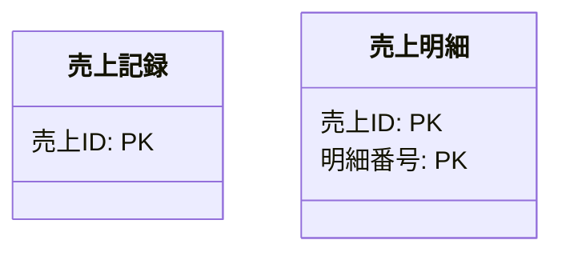
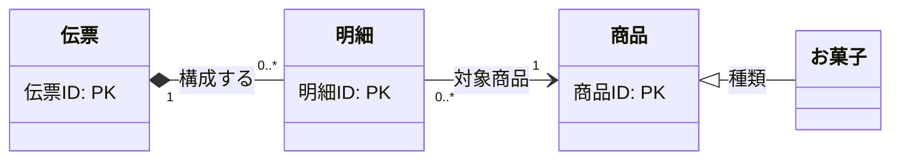

---
specdojo:
  id: specdojo:ccd-mermaid-rulebook
  type: rulebook
  deliverable_type: data
  status: draft
  target_format: markdown
  recipe: not-needed
  sample: specdojo:ccd-sample
  template: not-needed
  based_on:
    - specdojo:rulebook-authoring-standard
---

# Mermaid を用いた概念クラス図（CCD）作成ルール

Conceptual Class Diagram (CCD) Rules using Mermaid

本ドキュメントは、業務分析・要求定義のために **概念クラス図を Mermaid の `classDiagram` で記述する標準ルール** です。
属性は主キーのみを記述し、そのほかの属性は業務データ辞書（bdd）を参照します。
図と本文は関連の意味・多重度・役割名に絞り、実装と切り離した概念モデルとして整理します。

## 1. 全体方針

- Mermaid の **`classDiagram` 構文** を利用して業務概念間の関係を視覚化します。
- あくまで「概念レベル」のモデルであり、**実装に関わる要素（型、可視性、メソッド、制御構文など）は記述しません**。
- クラスの属性は **主キー（PK）のみ** とし、そのほかの属性は業務データ辞書（bdd）を参照します。
- 図と本文は、**関係の種類（継承・親子・参照）・多重度・関連の意味（役割名）** に絞ります。
- 関連ごとに、業務上なぜその多重度になるかの根拠を本文に明記します。
- 規範語の体系は **必須**・**任意**・**禁止** で統一し、曖昧な表現（「原則」「推奨（必須）」など）は使用しません。

### 1.1. 対象者と期待効果

| 対象者                                  | CCD 適用によって解決する課題                                                                 | 確認可能な期待効果                                                                                                |
| --------------------------------------- | -------------------------------------------------------------------------------------------- | ----------------------------------------------------------------------------------------------------------------- |
| ビジネスアナリスト（BA）・業務担当者    | 実装詳細や過剰な属性定義に惑わされ、業務エンティティ間の関係やルールの合意形成が進まない問題 | 主キーと関連（意味・多重度）に集中することで、業務ルールに基づいた関係性を正確に把握・合意できる                  |
| ソフトウェアアーキテクト（ARC）・設計者 | 概念モデルと物理実装（型・メソッド・DBカラム）が混同され、抽象度の一貫性が崩れる問題         | 属性詳細を bdd に委ね、エンティティの構造的まとまり（親子）や依存関係（参照）を明確に把握して後続設計へ接続できる |
| 開発者（DEV）                           | テーブル設計やクラス設計の前提となる概念境界や識別キーが曖昧な問題                           | 主キーと関連関係が整理されているため、ER図やデータモデル実装の安定した基盤として参照できる                        |
| 品質保証担当者（QE）                    | 多重度やエンティティ関連の制約理由が仕様書から読み取れず、境界値テストが設計しづらい問題     | 多重度ごとの業務上の根拠が記載されているため、関連整合性テストやテストデータの境界条件を的確に導出できる          |
| プロダクトオーナー（PO）                | 業務スコープ内の全体的な概念構造や用語の妥当性を迅速に判断できない問題                       | 図と要約された関連根拠により、ドメイン概念の整合性と網羅性を短時間で判断・承認できる                              |

## 2. 位置づけと用語定義

### 2.1. 成果物としての位置づけ

概念クラス図（CCD）は、業務仕様ドメイン（`data-model`）における概念モデルの成果物です。
業務データ辞書（`bdd-<term>`）と相互に補完し合い、bdd が「各エンティティの属性詳細・業務的意味」を定義するのに対し、CCD は「エンティティ間の構造・関連・多重度」を定義します。

### 2.2. 用語定義

| 用語                       | 定義                                                                                 |
| -------------------------- | ------------------------------------------------------------------------------------ |
| エンティティ（概念クラス） | 業務上管理すべき独立した概念のまとまり。CCD ではクラスとして表現する                 |
| 主キー（PK）               | エンティティの各インスタンスを一意に識別する属性。CCD に記載する唯一の属性           |
| 継承関係（is-a）           | 上位概念（汎化）と下位概念（特化）の階層関係。下位は上位の性質を引き継ぐ             |
| 親子関係（part-of）        | 所有・構造を表すまとまり。親のライフサイクルに子が従い、子は親なしでは存在しない関係 |
| 参照関係（reference）      | 互いに独立したライフサイクルを持つ概念同士の緩やかな参照・依存関係                   |
| 役割名（関係名）           | 接続線が表す業務上の関係の意味（例: `構成する`、`参照する`、`種類`）                 |
| 多重度                     | 関連するエンティティのインスタンス数の制約（例: `1`、`0..1`、`1..*`、`0..*`）        |

## 3. ファイル命名・ID規則

- ファイル名: `ccd-<term>.md`
  - `<term>` は対象業務領域の略称（kebab-case、例: `ccd-project-planning.md`、`ccd-task-execution.md`）。
- 文書 ID: `ccd-<term>`
  - プロジェクト修飾時は `<project-id>:ccd-<term>` とする。
- カタログでの種別: `deliverable_type: data`、`kind: work`。

## 4. 推奨 Frontmatter 項目

CCD の Markdown 成果物は以下の Frontmatter を持ちます。

| 項目       | 必須 | 説明                                                                                  |
| ---------- | ---- | ------------------------------------------------------------------------------------- |
| id         | 必須 | 成果物の一意 ID（例: `prj-0001:ccd-project-planning`）                                |
| type       | 必須 | `data` 固定                                                                           |
| status     | 必須 | `draft` / `ready` / `deprecated`（作成時は `draft`）                                  |
| rulebook   | 必須 | `specdojo:ccd-mermaid-rulebook`                                                       |
| depends_on | 必須 | 参照する業務データ辞書 ID の配列（例: `[bdd-project-config, bdd-operations-config]`） |

記述例:

```yaml
---
specdojo:
  id: prj-0001:ccd-sales-management
  type: data
  status: draft
  rulebook: specdojo:ccd-mermaid-rulebook
  depends_on:
    - bdd-sales
    - bdd-product
---
```

## 5. 本文要件

CCD 成果物（`ccd-<term>.md`）は以下の章構成を標準とします。

| 章番号 | 章タイトル             | 必須 | 内容・受入条件                                                                                                     |
| ------ | ---------------------- | ---- | ------------------------------------------------------------------------------------------------------------------ |
| 1      | 目的と適用範囲         | 必須 | 対象とする業務領域、図の対象範囲、作成目的を簡潔に記載していること                                                 |
| 2      | 概念クラス図           | 必須 | Mermaid `classDiagram` を配置し、主キーのみを持つクラスと、必須の役割名・多重度を持つ関係線で描画されていること    |
| 3      | 関連定義と多重度の根拠 | 必須 | 図中の全関連について、関係種別・多重度・役割名と、「業務上なぜその多重度になるか」の根拠を表形式で網羅していること |
| 4      | 参照業務データ辞書     | 必須 | 図中の各エンティティについて、主キー以外の属性詳細を定義している業務データ辞書（bdd）への参照先を明記していること  |
| 5      | 未解決事項             | 任意 | 現時点で未決定のドメイン概念や検討中の関連がある場合のみ記載すること（なければ省略可）                             |

## 6. 記述ガイド

### 6.1. クラス（エンティティ）と主キーの記述

- クラス名は **日本語の単数形** を基本とします。
- クラス内に記載する属性は **主キー（PK）のみ** です。主キー属性の末尾に `: PK` を付けます。
- **主キー以外の属性（名称、金額、日付など）は記述しません。** それらの定義は業務データ辞書（bdd）を参照します。
- 主キーを自身で持たない下位クラス（継承先）などは、属性ブロックを空（`class お菓子 {}`）にします。
- 型（`string`, `int` など）や可視性（`+`, `-`, `#`）、セミコロンは記述しません。
- 複合主キーの場合は複数行で `: PK` を記述します。



### 6.2. 関係（リレーション）の記述

概念クラス図で扱う関係は以下の 3 種類です。全関係線に役割名と多重度（継承を除く）を記述します。

| 関係種別 | Mermaid 記法                           | 多重度           | 役割名 | 意味・適用条件                                                                     |
| -------- | -------------------------------------- | ---------------- | ------ | ---------------------------------------------------------------------------------- |
| 継承関係 | `親 <\|-- 子 : 役割名`                 | なし（記述禁止） | 必須   | is-a 関係（一般化・特化）。親が上位概念、子が下位概念。白抜き三角 `<\|` が親を指す |
| 親子関係 | `親 "多重度" *-- "多重度" 子 : 役割名` | 必須             | 必須   | part-of 関係（所有・構造）。子が親のライフサイクルに従い、子単独では存在しない関係 |
| 参照関係 | `A "多重度" --> "多重度" B : 役割名`   | 必須             | 必須   | reference 関係（緩やかな依存）。互いに独立して生成・削除される関係                 |

#### 親子と参照の判断基準

- **親子（`*--`）を選ぶ条件**: 親が削除されたら子も同時に削除される（共存共死）、子単独では業務上の意味が成立しない（例: 伝票と伝票明細）。
- **参照（`-->`）を選ぶ条件**: 双方が独立したライフサイクルを持ち、一方が削除されても他方は残る、または複数の親・文脈から参照される（例: 明細と商品、注文と顧客）。

### 6.3. 関係線ラベル（役割名）の記述

- すべての関係線に `: 関係の意味（役割名）` を付与することを **必須** とします。省略は禁止です。
- ラベルは業務の意味が直感的に伝わる短い日本語（名詞句または短い動詞句）にします。
- 推奨ラベルの例:
  - 継承: `種類`、`分類`、`区分`
  - 親子: `構成する`、`保有する`、`含む`、`内訳`
  - 参照: `参照する`、`対象商品`、`請求先`、`元伝票`、`担当者`
- 禁止ラベル: 業務上の意味を持たない抽象語（`関連`、`関係`、`リンク`、`データ` など）。

### 6.4. 多重度の記述と業務根拠の記述

#### 多重度の記法

多重度は親子関係および参照関係において **必須** です。Mermaid では関係線の両端に引用符付きで記述します。

| 多重度表記            | 意味              | 業務上の典型例                                |
| --------------------- | ----------------- | --------------------------------------------- |
| `"1"`                 | 必ず1つ           | 明細行から見た対象商品は常に1点               |
| `"0..1"`              | 0または1（任意）  | 注文における適用クーポン（ない場合もある）    |
| `"1..*"`              | 1以上（最低1つ）  | 確定済み伝票には最低1行の明細が必要           |
| `"0..*"` または `"*"` | 0以上（制約なし） | 顧客から見た過去の注文履歴（0件の場合もある） |

#### 本文における「業務上なぜその多重度になるか」の記述

CCD 本文の「3. 関連定義と多重度の根拠」章には、図中の全関連について以下の表形式で根拠を記述します。

| 関連（起点 - 先） | 関係種別 | 多重度     | 役割名   | 業務上の理由・根拠                                                                            |
| ----------------- | -------- | ---------- | -------- | --------------------------------------------------------------------------------------------- |
| 伝票 - 明細       | 親子     | 1 対 0..\* | 構成する | 伝票起票時点では明細行が0件の一時保存を許容し、商品追加に伴い1件以上の明細が紐づくため        |
| 明細 - 商品       | 参照     | 0..\* 対 1 | 対象商品 | 明細1行は必ず1つの商品を指す必要がある。商品は一度も販売されていない状態があり得るため0件以上 |
| 商品 - お菓子     | 継承     | -          | 種類     | お菓子は商品の特殊化（is-a）であり、共通の販売属性を引き継ぐため                              |

### 6.5. 検証手順

CCD 成果物の作成・編集後は、以下のコマンドで静的検証を実行します。

- `npm run lint:md`: Markdown の構文および表組みの検証
- `npm run lint:mermaid`: Mermaid コードブロックの構文検証（クラス定義、矢印記法、多重度のパース確認）

エラーが発生した場合は、主キー以外の属性が混入していないか、矢印記法や多重度引用符（`"..."`）が欠落していないかを確認・修正します。

## 7. 禁止事項

以下の記述は概念クラス図のルールに反するため **禁止** します。

- **主キー以外の属性の記述**: 名称・金額・日付・状態などの一般属性を含めること（業務データ辞書 bdd を参照すること）。
- **メソッドの記述**: `calculateTotal()`、`updateStatus()` などの操作・メソッド定義を含めること（例外なく全面禁止）。
- **型・可視性の記述**: `+`, `-`, `#` や `string`, `number` などの言語・実装依存の型定義。
- **実装・技術的要素の記述**: `created_at`、`updated_at`、`is_deleted` 等のシステム管理カラムや DTO のクラス化。
- **関係線ラベルの省略・曖昧語**: ラベル未記載、または「関係」「リンク」などの意味不明なラベル。
- **多重度の省略**: 親子関係・参照関係において多重度を記載しないこと。
- **継承関係への多重度付与**: 継承関係（is-a）に多重度を付けること。
- **継承記法の配置逆転**: `親 <|-- 子` の方向を誤り、子を親として描画すること。
- **過剰な継承階層**: 3 階層以上の過度な継承関係を作ること。

## 8. サンプル

本 rulebook には形式の輪郭が伝わる最小限の例のみを掲載します。詳細な完成例の正本は [[specdojo:ccd-sample|概念クラス図サンプル]] を参照してください。



## 9. 運用ルール

### 9.1. 作成・レビュー手順

CCD の作成から完了判定までの作業単位・順序・担当ロールは次のとおりです。

| 順序 | 作業単位               | 担当 Role | 完了条件                                                                                                                 |
| ---- | ---------------------- | --------- | ------------------------------------------------------------------------------------------------------------------------ |
| 1    | 入力確認               | BA        | 要求仕様、業務データ辞書（bdd）、業務フロー等の入力文書が揃い、対象業務範囲が特定されていること                          |
| 2    | 概念抽出とクラス定義   | BA / DEV  | スコープ内の概念をクラスとして抽出し、主キー属性（PK）のみが定義されていること                                           |
| 3    | 関連・多重度の定義     | BA / ARC  | 3種の関係（継承・親子・参照）が選択され、全線に役割名と多重度、および業務上の理由が整理されていること                    |
| 4    | 作図と本文作成         | BA / DEV  | Mermaid `classDiagram` と本文要件に従った章構成が記述されていること                                                      |
| 5    | 静的検証               | DEV / QE  | `npm run lint:md` および `npm run lint:mermaid` がエラーなく通過すること                                                 |
| 6    | 整合性レビュー         | ARC / QE  | 観点 `vp-arc-technical-constraints`, `vp-qe-verifiability` に基づき、記法・多重度・bdd 整合性が確認されていること        |
| 7    | 業務レビュー・完了合意 | PO / BA   | 観点 `vp-po-purpose-alignment`, `vp-ba-requirements-completeness` に基づき、業務モデルとしての妥当性が合意されていること |

### 9.2. 公開（ready 移行）の条件と承認

- CCD 成果物および本 rulebook を `status: draft` から `status: ready` へ移行して公開する判断は、**人間のプロダクトオーナー（PO）** が最終判断を担います。agent が自律的に `ready` へ昇格させることは禁止します。
- 公開前の必須条件:
  1. Mermaid コードが構文エラーなく描画できること。
  2. クラス内に主キー以外の属性が含まれず、全関連の多重度根拠が本文に記載されていること。
  3. 対応する完成例サンプル（`specdojo:ccd-sample`）との整合性が保たれていること。
  4. 規則間の矛盾や未決定事項がないこと。

### 9.3. 改訂時の同期・移行手順

- 本 rulebook の記法や本文要件を変更した場合は、以下の成果物を追従確認します。
  1. `specdojo:ccd-sample`: 本 rulebook の改訂内容に合わせた完成例への即時同期。
  2. 既存の CCD 成果物（`docs/ja/product/**/ccd-*.md`）: 変更に伴う不整合の有無を確認し、手入れ計画を立案。
  3. カタログテンプレート（`dct-data-model-ccd-template.yaml`）および成果物カタログ: 完了条件や依存関係の整合性確認。
- 記法変更時は後方互換性を考慮し、既存図が急激に破壊されない移行方針を計画します。

### 9.4. 未決定事項・規則矛盾の管理

- 本 rulebook や CCD 作成において、規則間の矛盾や業務要件上の未決定事項（_UNDECIDED_）が生じた場合は、放置せず直ちにプロジェクト登録簿（PJR）の課題（issue）または変更要求として起票します。
- 課題の管理・判断責任は **プロジェクトマネージャー（PM）** および **プロダクトオーナー（PO）** が担います。
