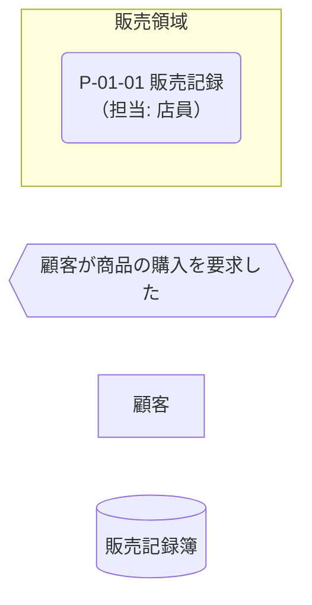
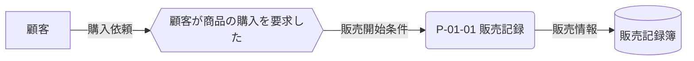

---
specdojo:
  id: specdojo:cdfd-mermaid-rulebook
  type: rulebook
  deliverable_type: flow
  status: draft
  target_format: markdown
  recipe: not-needed
  sample: not-needed
  template: not-needed
  based_on:
    - specdojo:rulebook-authoring-standard
---

# Mermaid を用いた概念データフロー図 作成ルール

Conceptual Data Flow Diagram Notation Rulebook for Mermaid

Mermaid の `flowchart` で CDFD のプロセス・イベント・データストア・外部主体・受け渡しを表す記法ルールです。全体概要・プロセスグループ別・ユースケース別 CDFD の主 rulebook の `includes` から適用します。プロダクト固有の割り当ては全体概要の「凡例（本プロダクト共通）」、共通凡例がなければ本書の既定凡例を使います。

## 1. 全体方針

- Mermaid の `flowchart` を使用し、方向は全体概要・プロセスグループ別・ユースケース別 CDFD を問わず `LR` を基本とします。CDFD の矢印は情報・物・実行要求の受け渡しを表し、ユースケース別など包含元が明示した場合だけ業務上の順序も表します。`TB` は、対象が階層構造（組織・分類など）を表す場合にだけ使用します。以下では、プロセスグループ別とユースケース別を合わせて「詳細 CDFD」と呼びます。
- 一画面で関係を追いにくい場合は「凡例と可読性」に従って分割します。分割単位とノード数の目安は包含元が定めます。
- 一つの記号へ一つの意味を割り当て、ノード形状だけでプロセス、イベント、データストア、外部主体を区別できるようにします。
- 情報の流れと物の流れは線種で区別し、すべてのエッジへ内容を表す名詞形のラベルを付けます。
- 業務上の合意に必要な概念を形状で区別し、色は「見栄えを整える最小限スタイル」に従う補助表現とします。物理名や詳細な操作は使いません。
- **共通の運用**: 役割は適用先のメンバー定義に、`status`・承認・改訂と廃止・未決事項の引き継ぎは [[specdojo:document-metadata-standard|ドキュメントメタ情報標準]] に従います。コードブロックは `npm run lint:mermaid` が終了コード 0 になることで確かめ、業務の受入確認に含めません。

| 概念                 | Mermaid 表現                                                                         | 表示例                                           |
| -------------------- | ------------------------------------------------------------------------------------ | ------------------------------------------------ |
| プロセス             | 角丸長方形 `("...")`                                                                 | `販売記録("P-01-01 販売記録<br>（担当: 店員）")` |
| プロセスグループ     | 角丸長方形 `("...")`（全体概要・ユースケース別 CDFD の代表ノード）                   | `販売("販売<br>P-01〜P-02")`                     |
| サブグラフ           | `subgraph ... end`（関連プロセスを囲む視覚上のまとまり。グループの表現には使わない） | `subgraph 販売領域["販売領域"]`                  |
| データストア         | 円柱 `[(...)]`                                                                       | `販売記録簿[("販売記録簿")]`                     |
| 物理保管             | スタジアム形 `(["..."])`（現物の保管先。トランザクションデータと同じ色を使う）       | `売場棚(["売場棚"])`                             |
| 外部主体             | 四角 `[...]`                                                                         | `顧客["顧客"]`                                   |
| イベント             | 六角形 `{{...}}`                                                                     | `購入要求{{"顧客が商品の購入を要求した"}}`       |
| 情報・実行要求の流れ | ラベル付き `-->\|"..."\|`                                                            | `販売記録 -->\|"販売情報"\| 販売記録簿`          |
| 物の流れ             | ラベル付き `==>\|"..."\|`                                                            | `売場棚 ==>\|"商品"\| 販売記録`                  |

## 2. 位置づけと用語定義

コード内で要素を参照するノード ID と、図上に見せる表示ラベルを区別します。表示ラベルは業務用語に必要な領域 ID を併記し、エッジラベルは渡す情報・物・起動条件の名称とします。

- ノード ID と表示ラベルは同じ名称を基本とし、空白、記号、補足を含む表示が必要な場合だけ分けます。
- 担当を表示する場合は、プロセスの表示ラベル末尾へ `<br>（担当: ロール）` を付けます。
- イベントは「〜された」「〜が到来した」「〜を要求した」など、発生を判断できる短い文にします。

## 3. ファイル命名・ID規則

- 本 rulebook は独立した成果物を生成せず、`cdfd-*.md` 内の Mermaid コードブロックへ適用します。
- Mermaid コードブロックに独立した文書 ID は付けず、包含する CDFD の ID とプロセス ID で追跡します。
- ノード ID は短い日本語または英数字で、ブロック内で一意にし、同じ対象には表と図で同じ領域 ID または名称を使用します。
- 複数図に分ける場合は、包含する CDFD 本文の見出しで図の観点を識別します。

## 4. 推奨 Frontmatter 項目

成果物の `rulebook` は図種別を定める主 CDFD rulebook とし、本記法を重複記載しません。記法単独では適用しません。プロセスグループ別なら `rulebook: specdojo:cdfd-rulebook` とします。

## 5. 本文構成（標準テンプレ）

コードは次表の順を基本とします。全体概要はグループ代表・データストア・情報の流れ、プロセスグループ別は個別プロセス・イベント・データストア・情報／物の流れを必須とします。外部主体・物理保管は存在する場合だけ置き、全図に直後の注記を付けます。ユースケース別のイベントも必須です。

| 順序 | 区分           | 必須     | 内容                                                                                                   |
| ---- | -------------- | -------- | ------------------------------------------------------------------------------------------------------ |
| 1    | flowchart 宣言 | ○        | `flowchart LR` または `flowchart TB`                                                                   |
| 2    | プロセスノード | ○        | 全体概要・ユースケース別はグループ代表ノード、プロセスグループ別は個々のプロセス                       |
| 3    | イベント       | 条件付き | プロセスグループ別では開始契機、ユースケース別では開始・引き渡し・終了条件。全体概要では描かない       |
| 4    | 外部主体       | 任意     | 対象範囲外の入力元・出力先                                                                             |
| 5    | データストア   | 条件付き | 読み書きする主要な情報の保管先。ユースケース別では引き渡し条件の判定に必要なものだけ置く               |
| 6    | 物理保管       | 条件付き | 現物の保管先が情報・物の受け渡しまたは境界の理解に必要な場合だけ置く                                   |
| 7    | 情報・物の流れ | ○        | ラベル付きエッジ                                                                                       |
| 8    | 図直後の注記   | ○        | 共通凡例がある場合はその参照、ない場合は本 rulebook の既定凡例に従う旨、使用線種、省略事項、共有ノード |

## 6. 記述ガイド

### 6.1. ノード

- プロセスは角丸長方形、外部主体は四角、イベントは六角形、データストアは円柱で表します。現物の保管先を図へ置く場合は物理保管としてスタジアム形を使い、プロセス、外部主体、データストアの代替にはしません。
- プロセス名は「販売記録」「計画展開」のように、何を扱う処理か分かる短い名詞句にします。
- 全体概要では一プロセスグループを一つの代表ノードとして表し、表示ラベルにグループ名と含む領域 ID の範囲を記載します。グループ内の領域や処理を別ノードとして追加しません。
- プロセスグループ別 CDFD ではグループ内の主要プロセスを個別ノードにし、全体概要の代表ノードをプロセスとして重複配置しません。
- ユースケース別 CDFD では参加する各プロセスグループを一つの代表ノードにし、正常系の通過順に配置します。内部プロセスは描かず、引き渡し条件をイベントノードで示します。
- `subgraph` はプロセスグループ別 CDFD で関連プロセスを視覚的にまとめる場合にだけ使用できます。プロセスグループの表現や代表ノードの代替には使いません。



### 6.2. 絵文字アイコン（任意）

表示差・幅崩れを考慮し、絵文字は任意とします。表示ラベルの先頭に一つまで付け、名称のテキストを併記します。ノード ID には付けません。


禁止例（絵文字がノード ID に付いている、または表示ラベルに無い）:

```text
flowchart LR
📋販売記録("販売記録")
```

### 6.3. エッジ

- 情報は `-->`、物は `==>` を使用します。イベントからプロセスへのエッジも `-->|"起動条件"|` のようにラベルを付けます。
- エッジラベルは「販売情報」「在庫数量」「実行結果」のような名詞形にし、「処理する」など動作だけの語を使用しません。
- 一つのエッジに異なる責務の情報を詰め込まず、受け手が別ならエッジを分けます。



### 6.4. 凡例と可読性

- 図直後に、共通凡例の参照先、使用線種、省略した入出力と理由、別図と共有するノードを示します。共通凡例がなければ「ノード形状・線種・色・絵文字は `specdojo:cdfd-mermaid-rulebook` の既定凡例に従う」と書きます。
- 共通凡例の割り当てを再掲せず、未定義の割り当ても使いません。共通凡例がなければ本書の対応表と「見栄えを整える最小限スタイル」を使い、図ごとの独自割り当ては追加しません。
- 物の流れを使わない場合は「`-->` は情報・実行要求の流れ。本図は物の流れを対象外とする」と記述します。
- 図を分ける観点とノード数の目安は包含元の rulebook に従います。分けた図の間で同じプロセス ID・名称または引き渡し ID を維持します。
- 表示ラベルは一行あたり全角20字（半角40字）程度、長ければ `<br>` で二行程度に収めます。LR では行の長さがノード幅になるため、イベント・データストアの長文を避けます。エッジラベルは改行せず短い名詞句にします。

### 6.5. 見栄えを整える最小限スタイル（任意）

- 形状で意味を読めれば色は不要です。色を付ける場合は `classDef` に限り、ノード単位の `style` 指定はしません。
- プロセス／イベント／データストア／外部主体ごとに色相を統一し、大分類間で混同しません。
- 大分類内は、変更頻度・更新契機・参照側／更新側などの業務上の区別を説明できる場合だけ、同系統色の濃淡・彩度で分けられます。サブ分類名と色は共通凡例に定義します。


大分類「データストア」の中でマスタ・構成データとトランザクションデータを同系統色（緑系の濃淡）で塗り分ける例:


この例の凡例では形状に加え、薄い緑（`#e8f5e9` / `#43a047`）をマスタ・構成データ、中間の緑（`#c8e6c9` / `#2e7d32`）をトランザクションデータ、同色のスタジアム形を物理保管と定義します。

## 7. 禁止事項

- ラベルのないエッジ、同じ線種へ情報と物の両方の意味を持たせたエッジを記載しません。
- プロセスとデータストア、イベントと外部主体など、異なる概念へ同じノード形状を使用しません。
- 全体概要にプロセスグループ内の領域や処理を複数ノードで展開したり、プロセスグループを `subgraph` で表したり、プロセスグループ別 CDFD に他グループの内部処理を作り込んだりしません。
- 物理テーブル、物理カラム、実装クラス、関数、詳細 API、コマンドオプションをノードやエッジへ記載しません。
- 独自形状、根拠のないノード単位の色付け、大分類間での色相の混同、区別基準のないサブ分類を追加しません。スタイルは「見栄えを整える最小限スタイル」に従います。
- 起点も到達先も説明できないノード、自己ループだけで完結するプロセス、読み手が解釈できない略語を残しません。
