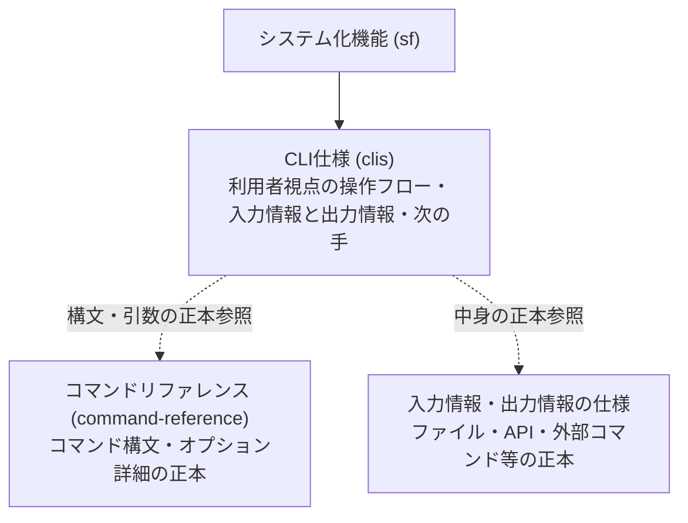

---
specdojo:
  id: specdojo:clis-rulebook
  type: rulebook
  deliverable_type: ui
  status: draft
  target_format: markdown
  recipe: not-needed
  sample: specdojo:clis-sample
  template: not-needed
  based_on:
    - specdojo:rulebook-authoring-standard
---

# CLI仕様（CLIS）作成ルール

Command Line Interface Specification (CLIS) Authoring Rule

本ドキュメントは、システム自身が提供するコマンドラインインターフェース（CLI）について、利用者視点での仕様（Command Line Interface Specification: CLIS）を統一形式で記述するための標準ルールです。
システムが呼び出す外部コマンド連携仕様（`ifx-cmd`）とは明確に区別し、引数・オプションの詳細な構文は正本であるコマンドリファレンスを参照したうえで、利用目的、操作の流れ、入力と出力の要点、終了コード、エラー表示、および利用者の次の手に絞って記述します。

## 1. 全体方針

- CLI仕様は、**コマンドラインを利用する人間（オペレーター・開発者・業務ユーザー）の視点** で、CLI コマンド群の利用目的・操作の流れ・入力情報・出力情報・終了コード・エラー表示・回復手順を明確に記述します。
- システム自身が提供するコマンド群を対象とし、**システムが外部コマンドを子プロセス等として呼び出す連携仕様（`ifx-cmd`）とは明確に区別**します（clis は利用者がシステムを操作する側、ifx-cmd はシステムが外部を呼ぶ側）。
- 引数やオプション・フラグの詳細な構文仕様・網羅的なパラメータ一覧は記載せず、**正本となるコマンドリファレンスを参照**します。コマンド仕様の二重管理を防止し、業務コンテキストや利用者の意思決定・操作手順に集中させます。
- GUI 画面仕様（UIS）のような**画面レイアウト、ワイヤーフレーム、ピクセル座標、画面遷移、GUI コンポーネント等の概念は持ち込みません**。
- 実装詳細（物理テーブル名、物理カラム名、SQL、内部クラス/関数名、内部データ構造）は記載しません。
- 原則として 1 ファイル = 1 つの業務目的または機能領域を担う CLI コマンド群（例: `clis-sales-commands.md`, `clis-exec-commands.md`）。
- 規範語の体系は **必須**・**任意**・**禁止** で統一し、曖昧な表現（「原則」「推奨（必須）」など）は使用しません。

### 1.1. 対象者と期待効果

| 対象者                          | CLI仕様（CLIS）適用によって解決する課題                                                        | 確認可能な期待効果                                                                                                 |
| ------------------------------- | ---------------------------------------------------------------------------------------------- | ------------------------------------------------------------------------------------------------------------------ |
| 業務担当者・運用者（OPS）       | コマンド引数の技術詳細に埋もれて、業務手順や例外時の対処方針が読み取れない問題                 | コマンドの流れ、出力要点、エラー時の「利用者の次の手」が明文化され、安全かつ迅速に手順を遂行・合意できる           |
| ソフトウェアアーキテクト（ARC） | CLI と内部機能・ファイル・API・状態の責務境界が曖昧で、データ連携や永続化の設計がぶれる問題    | 入力情報や出力情報、終了コード、コマンド間の引き渡しデータが明確になり、データ連携や終了状態設計へ的確に接続できる |
| 開発者（DEV）                   | オプションやフラグの変更ごとに仕様書修正が発生し、リファレンスとの二重管理・陳腐化が起きる問題 | コマンド構文はリファレンスを参照するため、二重管理なく一貫した CLI ロジックの実装に専念できる                      |
| 品質保証担当者（QE）            | 異常終了時のエラーメッセージや終了コード、復旧シナリオの期待値が不明確でテスト設計が漏れる問題 | 終了コード別のエラー表示要点と回復手順が定義されるため、例外系・境界条件の検証シナリオを網羅的に設計できる         |
| プロダクトオーナー（PO）        | 利用者がどのような一連の対話で目的を達成し、途中で失敗したときに回復できるかが把握しづらい問題 | 一連の操作フローと状態変化が俯瞰でき、CLI の使いやすさと目的達成性を客観的に評価・承認できる                       |

## 2. 位置づけと用語定義

### 2.1. 成果物としての位置づけ

CLI仕様（CLIS）は、インターフェースモデルにおける成果物です。
業務プロセス仕様（`bps`）やシステム化機能（`sf`）から導出され、利用者がコマンドラインを介してシステムと対話する境界を定義します。

CLI 関連文書および外部連携仕様との役割分担は以下のとおりです。



- **CLI仕様（clis）**: システム自身が提供し、利用者が直接操作する CLI コマンド群の利用目的・操作の流れ・入力情報と出力情報・エラー回復を定義する（利用者がシステムを操作する側）。
- **コマンドリファレンス（command-reference）**: コマンド構文、全引数、全オプション、型、既定値、環境変数を網羅する技術的かつ機械的な正本（構文・引数の正本）。
- **入力情報・出力情報の仕様**: コマンドが入出力するデータや連携先の中身の正本（ファイル仕様やスキーマ、外部 API 仕様、自システム API 定義、外部コマンド連携仕様など）。
- **外部コマンド連携仕様（ifx-cmd）との違い**: clis は利用者がシステムを操作する側であり、ifx-cmd はシステムが外部を呼ぶ側（外部コマンドを子プロセス等として起動する連携契約）である。CLI が外部コマンドを起動する場合、渡すものは出力情報、受け取る結果は入力情報として扱い、中身の正本として [[specdojo:ifx-cmd-rulebook]] に従う文書を参照する。

### 2.2. 用語定義

| 用語                       | 定義                                                                                                     |
| -------------------------- | -------------------------------------------------------------------------------------------------------- |
| CLI仕様                    | システム自身が提供する CLI コマンド群を、利用者視点での操作単位・業務達成単位として記述した仕様書        |
| 操作の流れ                 | 利用目的を達成するために、どのコマンドからどのコマンドへ進むかの順序と状態変化の進行                     |
| コマンド参照               | 引数・オプションの詳細を持たず、コマンドの利用目的と正本リファレンスへの参照を明記すること               |
| 入力情報                   | コマンド実行時に受け取る情報（ファイル、標準入力、環境変数、対話での入力、API の応答等）の要点           |
| 出力情報                   | コマンド実行に伴って外へ送り出す情報（標準出力、標準エラー、作る／変えるファイル、API への送信等）の要点 |
| 終了コード                 | プロセス終了時に返されるステータスコード（正常: 0、異常: 1 以上）の区分と意味                            |
| エラー表示と利用者の次の手 | 異常や制約違反時に出力されるメッセージ要点と、利用者が状況を回復するために次に取るべき具体的なアクション |

## 3. ファイル命名・ID規則

- ファイル名:
  - `clis-<機能名またはコマンド群名>.md`（例: `clis-sales-commands.md`, `clis-exec-commands.md`）
- Frontmatter ID:
  - 同梱（コア）: `specdojo:clis-<kebab-case>`（例: `specdojo:clis-exec-commands`）
  - 利用者作成（プロジェクト）: `<authority>:clis-<kebab-case>` または `clis-<kebab-case>`（例: `prj-0001:clis-sales-commands`）
- ドキュメント名（H1）:
  - 本文先頭の H1 に記述します（Frontmatter の `title` プロパティは使用しません）。

## 4. 推奨 Frontmatter 項目

Frontmatter は共通スキーマ（`docs/specdojo/schemas/v1/deliverable-frontmatter.schema.yaml`）および [[specdojo:document-metadata-standard|ドキュメントメタ情報標準]] に従い、`specdojo:` 名前空間配下に置きます。

| 項目       | 説明                                                           | 必須 |
| ---------- | -------------------------------------------------------------- | ---- |
| id         | CLI仕様ID（小文字ハイフン）                                    | ○    |
| type       | `ui` 固定（ユーザーインターフェースモデル分類）                | ○    |
| status     | `draft` / `ready` / `deprecated`                               | ○    |
| rulebook   | 準拠する rulebook ID（`specdojo:clis-rulebook`）               | ○    |
| `part_of`  | 所属する親・集約ドキュメントID（ID配列。未指定は `[]`）        | 任意 |
| `based_on` | 根拠となる仕様ID（業務フロー・機能定義等。未指定時は `[]`）    | 任意 |
| supersedes | 置き換え対象のドキュメントID（ID配列。未指定時は `[]`）        | 任意 |
| relations  | 型付き参照（`satisfies`, `verifies`, `implements` の連想配列） | 任意 |

### 4.1. NG/OK例

- **NG例**:
  - `type: cli`（未定義の type は不可。`ui` を指定する）
  - `id: CLIS_SalesCommands`（大文字・アンダースコアは不可）
  - `title: 販売管理CLI仕様`（Frontmatter への `title` の記述は不可。本文 H1 に記述する）
  - `rulebook: clis-rulebook`（authority 接頭辞の欠落）
- **OK例**:

```yaml
---
specdojo:
  id: clis-sales-commands
  type: ui
  status: draft
  rulebook: specdojo:clis-rulebook
  part_of: []
  based_on: []
---
```

## 5. 本文要件

各 CLI 仕様ファイルは、以下の見出しを順番に並べます。

1. 概要
2. 利用目的と対象ユーザー
3. 操作の流れ
4. 操作とコマンド参照
5. 入力と出力の要点
   - 5.1. 入力情報
   - 5.2. 出力情報
6. 終了コードとエラー表示・利用者の次の手
7. メモ / 将来課題

各章の目的・記述規約は以下のとおりです。

| 章見出し                               | 必須/任意 | 目的と記述規約                                                                                                                                                             |
| -------------------------------------- | --------- | -------------------------------------------------------------------------------------------------------------------------------------------------------------------------- |
| 概要                                   | 必須      | コマンド群が何を達成するかを、利用者視点の言葉で 1〜2 文で簡潔に記述します。                                                                                               |
| 利用目的と対象ユーザー                 | 必須      | 想定する対象ユーザー（業務ロール・利用者）と、そのコマンド群を利用して達成する具体的な業務目的を箇条書きで記述します。                                                     |
| 操作の流れ                             | 必須      | 業務目的を達成するための標準的なコマンド実行順序（どのコマンドからどのコマンドへ進むか）と状態変化の進行を、順序付きリストまたは Mermaid で記述します。                    |
| 操作とコマンド参照                     | 必須      | 利用者が実行する各コマンドの役割と意味を列挙します。**引数・オプションの表は持たず、正本となるコマンドリファレンスを参照**します。                                         |
| 入力と出力の要点                       | 必須      | コマンドが受け取る入力情報（小節「入力情報」）と外へ送り出す出力情報（小節「出力情報」）の要点を、2 つの小節に分けて記述します。標準出力の表示要点も出力情報にまとめます。 |
| 終了コードとエラー表示・利用者の次の手 | 必須      | コマンドの終了コード体系、代表的なエラーメッセージ要点、および利用者が状況を回復するために次に取るべき具体的なアクション（次の手）を記述します。                           |
| メモ / 将来課題                        | 任意      | 将来の拡張構文、性能上の留意点、外部連携の検討事項などを記述します。不要な場合は省略可能です。                                                                             |

## 6. 記述ガイド

### 6.1. 概要

コマンド群の全体像と役割を、利用者視点で 1〜2 文で記述します。

- 良い例: 「店頭で来店客が購入する駄菓子を読み取り、合計金額の計算・会計完了・釣銭提示および販売実績ファイルの記録を行うための CLI 操作群。」
- 悪い例: 「`kinuya sales` CLI の引数パース、サブコマンドルーティング、および sqlite3 接続処理の仕様。」（実装詳細・内部構造に言及している）

### 6.2. 利用目的と対象ユーザー

- 対象ユーザー: コマンドを実行するロール（例: 店頭店員、システム運用者、CI 自動化スクリプト）
- 利用目的: 業務上の達成ゴール（例: 販売取引を開始し、複数明細を追加した後に合計を確認して会計を完了する）

### 6.3. 操作の流れ

業務目的を完了するまでの典型的なコマンド実行の順序を示します。
「どのコマンドを実行して開始し、どのコマンドを経て完了に至るか」、また分岐や中断の扱いを明記します。

推奨形式（順序付きリスト例）:

1. `sales start`: 販売取引セッションを開始し、取引番号を発行して一時セッションファイルを作成する。
2. `sales add`: 商品コードと数量を指定して明細を追加する（商品点数分繰り返す）。
3. `sales total`: 現在の小計・消費税・合計請求金額を確認し、来店客へ提示する。
4. `sales complete`: 預かり金を入力して会計を確定し、釣銭金額を出力して販売記録ファイルを確定する。
5. （例外）`sales cancel`: 取引を中断し、セッションファイルを破棄して初期状態へ戻る。

※フローが分岐する場合や状態の往復がある場合は、Mermaid のフローチャートや状態遷移図を併用することを推奨します。

### 6.4. 操作とコマンド参照

各コマンドの役割、利用目的・操作の意味、および正本リファレンスへの参照を明記します。
**引数・オプション・フラグの詳細表はここには作成せず、コマンドリファレンスを参照します。**

推奨表フォーマット:

| 操作名   | 対象コマンド     | 利用目的・操作の意味                           | 正本リファレンス                                                        |
| -------- | ---------------- | ---------------------------------------------- | ----------------------------------------------------------------------- |
| 販売開始 | `sales start`    | 新規の販売取引セッションを開始する             | `[[command-reference#sales-start\|CLIリファレンス: sales start]]`       |
| 明細追加 | `sales add`      | 取引に商品コードと数量を追加する               | `[[command-reference#sales-add\|CLIリファレンス: sales add]]`           |
| 合計確認 | `sales total`    | 現在の明細一覧と合計・税額を確認する           | `[[command-reference#sales-total\|CLIリファレンス: sales total]]`       |
| 会計完了 | `sales complete` | 預かり金を登録し、釣銭計算と販売記録を確定する | `[[command-reference#sales-complete\|CLIリファレンス: sales complete]]` |
| 取引取消 | `sales cancel`   | 進行中の販売取引を破棄し、初期状態へ戻す       | `[[command-reference#sales-cancel\|CLIリファレンス: sales cancel]]`     |

### 6.5. 入力と出力の要点

コマンドが動作時に受け取る入力情報（ファイル・標準入力・環境変数・対話での入力・API の応答・自システム API の応答・外部コマンドの実行結果等）の要点、および実行結果として外へ送り出す出力情報（標準出力・標準エラー・作る／変えるファイル・API への送信・自システム API への送信・外部コマンドの起動等）の要点を記述します。

小節は「5.1. 入力情報」と「5.2. 出力情報」の 2 つに分け、標準出力の要点は出力情報にまとめます。

記述にあたっては、次の規則に従います。

- **入力情報の表構成**: 入力情報の表は、種類（ファイル・標準入力・環境変数・対話での入力・API の応答・自システム API の応答・外部コマンドの実行結果）・対象・役割・正本の参照・ない／壊れている／届かないときの扱い、を持ちます。
- **出力情報の表構成**: 出力情報の表は、種類（標準出力・標準エラー・作る／変えるファイル・API への送信・自システム API への送信・外部コマンドの起動）・対象・役割・正本の参照、を持ちます。
- **中身の重複排除と参照する正本**: 入出力情報の中身（データ項目やペイロード詳細、引数）は CLIS 本文には書かず、種類ごとに次の正本を参照します。CLIS にはどのコマンドが何をなぜ呼び出すか・渡すかと失敗時の扱いだけを書きます。
  - ファイル: その rulebook か schema
  - 外部システムの API: [[specdojo:ifx-api-rulebook]] に従う文書
  - 自システムの API: システム設計の索引（[[specdojo:sysd-index-rulebook]] に従う文書）が案内する内部 API の定義。まだない段階では API の名前と用途だけを書く
  - CLI が起動する外部コマンド: [[specdojo:ifx-cmd-rulebook]] に従う文書。渡すものは出力情報、受け取る結果は入力情報に挙げる
- **失敗時の扱いとエラー表との接続**: API の失敗（つながらない・時間切れ・拒否）や外部コマンドの実行失敗を含む入力情報の失敗（ない・壊れている・届かない）を、後続の「終了コードとエラー表示・利用者の次の手」の章の表につなげます。
- **認証情報の保護**: 認証情報（API キーなど）は環境変数などの名前と用途だけを書き、値は書かないこととします。
- **取得と更新を兼ねる API 呼び出し**: 取得と更新の両方を行う API の呼び出しは、入力情報（API の応答等）と出力情報（API への送信等）の両方に挙げます。

推奨表フォーマット:

#### 6.5.1. 入力情報

| コマンド                      | 種類                   | 対象                                             | 役割                                   | 正本参照                                                          | ない／壊れている／届かないときの扱い | 対応エラー事象                                    |
| ----------------------------- | ---------------------- | ------------------------------------------------ | -------------------------------------- | ----------------------------------------------------------------- | ------------------------------------ | ------------------------------------------------- |
| `sales start`, `sales add`    | ファイル               | `config/store-config.yaml`                       | 店舗設定                               | `store-config-schema`                                             | 既定設定で進む                       | 店舗設定ファイル破損                              |
| `sales start`                 | 自システム API の応答  | 店舗端末認証 API (`GET /internal/v1/auth`)       | 端末の稼働認可状態確認                 | `[[sysd-index#terminal-auth\|内部API定義: 端末認証]]`             | エラーで停止                         | 店舗端末未認可                                    |
| `sales add`                   | API の応答             | 商品マスタ取得 API (`GET /api/v1/products/{id}`) | 最新の商品単価・品名取得               | `[[ifx-api-product-master\|外部API仕様: 商品マスタ]]`             | エラーで停止                         | 商品マスタ API 接続失敗 / 商品マスタ API 認証拒否 |
| `sales add`, `sales complete` | ファイル               | `.session/current-tx.json`                       | 進行中セッション                       | `tx-session-schema`                                               | エラーで停止                         | 取引セッション未開始 / セッションファイル破損     |
| `sales complete`              | 対話での入力           | 預かり金額プロンプト                             | 会計時の預かり金額受領                 | なし                                                              | 再入力を促す                         | 預かり金額不正                                    |
| `sales complete`              | 環境変数               | `STORE_API_KEY`                                  | 本部 API 認証トークン                  | なし（用途のみ記載、値は書かない）                                | エラーで停止                         | 店舗 API キー未設定                               |
| `sales complete`              | API の応答             | 売上登録 API 応答 (`POST /api/v1/sales`)         | 売上登録確定結果・受付番号の受領       | `[[ifx-api-sales\|外部API仕様: 売上登録]]`                        | エラーで停止（未送信データを保持）   | 売上登録 API タイムアウト / 売上登録 API 拒否     |
| `sales complete`              | 外部コマンドの実行結果 | レシート印刷コマンド (`receipt-print`)           | レシート印刷の実行結果ステータスの受領 | `[[ifx-cmd-receipt-printer\|外部コマンド連携仕様: レシート印刷]]` | 警告を表示して完了                   | レシート印刷コマンド実行失敗                      |

#### 6.5.2. 出力情報

| コマンド         | 種類                    | 対象                                       | 役割                                                       | 正本参照                                                          | 備考                                 |
| ---------------- | ----------------------- | ------------------------------------------ | ---------------------------------------------------------- | ----------------------------------------------------------------- | ------------------------------------ |
| `sales add`      | 標準出力                | 追加明細                                   | 商品名、単価、数量、明細小計、現在の累計合計額の要約表示   | なし                                                              | 1行サマリー表示                      |
| `sales total`    | 標準出力                | 会計サマリー                               | 明細点数、小計、消費税額、合計請求金額の確認表示           | なし                                                              | 支払い前の確認用                     |
| `sales complete` | 標準出力                | 会計結果                                   | 取引番号、合計金額、預かり金、釣銭金額、完了状態           | なし                                                              | レジ締め情報                         |
| `sales complete` | 標準エラー              | エラーメッセージ                           | 異常終了時に入力不正や通信失敗の原因と回復手順を通知       | なし                                                              | 異常終了時に出力                     |
| `sales start`    | 作る／変えるファイル    | `.session/current-tx.json`                 | 進行中セッションの一時状態保存                             | `tx-session-schema`                                               | 取引完了または取消時に消去           |
| `sales start`    | 自システム API への送信 | 店舗端末認証 API (`GET /internal/v1/auth`) | 端末識別子の送信                                           | `[[sysd-index#terminal-auth\|内部API定義: 端末認証]]`             | 端末未認可時の検知用                 |
| `sales add`      | 作る／変えるファイル    | `.session/current-tx.json`                 | 追加された明細と現在小計の追記                             | `tx-session-schema`                                               | 明細追加ごとに更新                   |
| `sales complete` | 作る／変えるファイル    | `data/sales/TX-<id>.json`                  | 取引日時、明細一覧、金額、決済結果の完全レコード           | `sales-record-schema`                                             | 販売実績正本（永続保存）             |
| `sales complete` | API への送信            | 売上登録 API (`POST /api/v1/sales`)        | 確定した販売実績データの送信（外部本部システムの状態更新） | `[[ifx-api-sales\|外部API仕様: 売上登録]]`                        | 取得と更新を行うため入力情報にも記載 |
| `sales complete` | 外部コマンドの起動      | レシート印刷コマンド (`receipt-print`)     | レシート印字データを渡して印刷プロセス起動                 | `[[ifx-cmd-receipt-printer\|外部コマンド連携仕様: レシート印刷]]` | 渡すデータを出力情報として定義       |

### 6.6. 終了コードとエラー表示・利用者の次の手

コマンドが返す終了コード（Exit Code）の意味と、エラー発生時のメッセージ要点、および利用者が回復するために次に取るべき具体的なアクション（次の手）を記述します。

推奨表フォーマット:

| エラー事象              | 終了コード | 表示要点                                                 | 原因                                                    | 利用者の次の手（回復アクション）                                                 |
| ----------------------- | ---------- | -------------------------------------------------------- | ------------------------------------------------------- | -------------------------------------------------------------------------------- |
| 未登録商品コード        | 1          | `エラー: 商品コード [XXXX] は登録されていません`         | 商品マスタに存在しないコードを指定した                  | コードの打ち間違いを確認するか、商品一覧コマンドで正式コードを確認して再入力する |
| 数量不正                | 1          | `エラー: 数量は 1 以上の整数を指定してください`          | 0以下の数値や小数を指定した                             | 1以上の正しい販売数量を指定して再実行する                                        |
| 預かり金不足            | 1          | `エラー: 預かり金が不足しています (不足: N円)`           | 請求合計金額未満の預かり金を入力した                    | 来店客から不足分の代金を追加で受領し、正しい預かり金額を入力して再実行する       |
| セッション未開始        | 2          | `エラー: 販売取引が開始されていません`                   | `sales start` を実行せずに操作コマンドを実行した        | 先に `sales start` コマンドを実行して販売取引セッションを開始する                |
| セッション二重開始      | 2          | `エラー: 進行中の取引があります (取引番号: TX-XXXX)`     | 前の取引が完了していない状態で `sales start` を実行した | 進行中の取引を `sales complete` で完了させるか、`sales cancel` で中断する        |
| データ保存先 I/O エラー | 3          | `致命的エラー: 販売記録ファイルの書き込みに失敗しました` | ディスク満杯または書き込み権限不足                      | ディスク空き容量および保存先ディレクトリの書き込み権限を確認し、再実行する       |

### 6.7. メモ / 将来課題

将来の拡張要件、外部決済端末との連携方針、バッチ処理での利用シナリオなどを記載します。

## 7. 禁止事項

| 項目                                                                                   | 理由                                                                                                                                                                |
| -------------------------------------------------------------------------------------- | ------------------------------------------------------------------------------------------------------------------------------------------------------------------- |
| コマンド引数・オプション詳細表の再掲                                                   | コマンドリファレンスと二重管理になり、不整合や陳腐化を招くため                                                                                                      |
| 外部コマンド連携仕様（`ifx-cmd`）との混同                                              | 自身が提供する CLI と、システムが外部ツールを呼ぶ約束では責務と設計観点が異なるため                                                                                 |
| 画面レイアウトや GUI 要素の持ち込み                                                    | CLI 仕様に不要な画面遷移・ピクセル配置・ボタン操作等を持ち込むと可読性と保守性が低下するため                                                                        |
| 入力情報・出力情報の中身（項目や形式・API ペイロード・外部コマンド引数等）の詳細な再掲 | ファイル仕様（schema）、API 仕様（[[specdojo:ifx-api-rulebook]] 等）、外部コマンド連携仕様（[[specdojo:ifx-cmd-rulebook]]）等の正本と二重管理になり陳腐化を招くため |
| 入力情報と出力情報の混同・未分離                                                       | 前提入力と実行結果の因果関係が曖昧になり、テストケース設計や運用回復手順に支障をきたすため                                                                          |
| 認証情報（API キー、トークン等）の値の記載                                             | 漏洩リスクを防止し、仕様書には環境変数などの名前と用途のみを記載するため                                                                                            |
| 利用者の次の手を伴わないエラー表示の羅列                                               | 障害・制約違反発生時に利用者がどう復旧すべきかが判断できず、運用上の実効性を失うため                                                                                |
| 物理テーブル名・物理カラム名・SQLの混入                                                | 実装詳細と密結合し、データベース構造やライブラリの改修時に仕様書が陳腐化するため                                                                                    |
| Frontmatter への `type: cli` などの未定義値の指定                                      | メタ情報スキーマ違反（`ui` 固定）となり機械検証で失敗するため                                                                                                       |
| 本文中への sample / recipe / template へのリンク章の設置                               | 実践の型の解決は Frontmatter を正本とし、本文リンクは参照手段として機能しないため                                                                                   |

## 8. 運用ルール

- **完成例の正本は sample**: 完成例は `docs/ja/specdojo/samples/clis-sample.md` を正本とし、rulebook 本文にはサンプルの章を置きません。
- **コマンドリファレンスとの疎結合の維持**: オプションの追加やフラグ名称の変更などコマンド構文の改修が発生しても、CLI仕様（CLIS）は改訂しません（正本参照を維持）。CLI仕様を改訂するのは、利用目的、操作の流れ、入力と出力の要点、終了コード、またはエラー時の回復アクションに変更が生じた場合のみとします。
- **スキーマ整合性の担保**: Frontmatter の `type` は常に `ui` を使用し、`rulebook` には `specdojo:clis-rulebook` を指定します。
