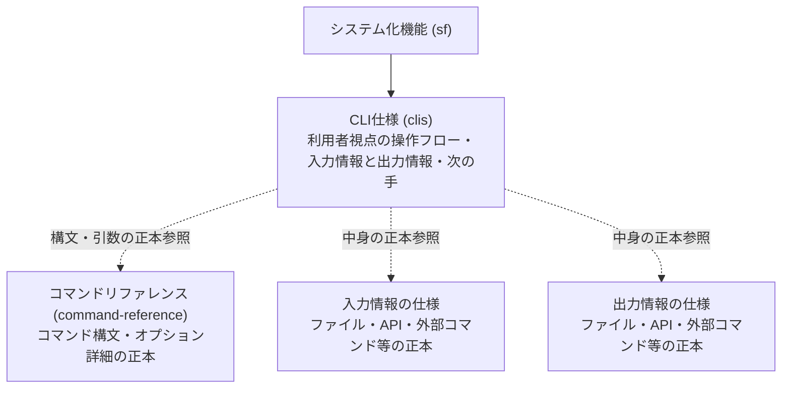

---
specdojo:
  id: specdojo:clis-rulebook
  type: rulebook
  deliverable_type: ui
  status: draft
  target_format: markdown
  recipe: not-needed
  sample: specdojo:clis-sample
  template: not-needed
  based_on:
    - specdojo:rulebook-authoring-standard
---

# CLI仕様（CLIS）作成ルール

Command Line Interface Specification (CLIS) Authoring Rule

システム自身が提供する CLI コマンド群について、利用者が目的を達成し、失敗時に次の操作を選べる仕様の記述規約を定めます。構文やデータ構造の詳細は正本を参照し、本書では利用目的、操作の流れ、入出力の要点、終了時の判断と回復を扱います。

## 1. 全体方針

- 1 ファイルは一つの業務目的または機能領域を担うコマンド群とします。利用者の課題と達成できる結果を対応付けます。
- 人が直接操作する場合と自動実行を設定・監視する場合について、対象者、開始条件、結果の確認方法を記述します。
- システムが外部コマンドを呼ぶ契約は `ifx-cmd` が扱います。CLIS は利用者がシステムを操作する側の仕様として記述します。
- 引数・オプションの構文や既定値はコマンドリファレンス、データの値・構文・構造はファイル仕様・schema・連携契約を正本とします。CLIS は操作の選択と結果の判断に必要な要点を持ちます。
- 共通事項は上位の索引を正本とし、個別仕様では差分と参照先を示します。索引が未作成なら未作成と記録し、個別仕様で定めた内容との照合を後続作業へ引き継ぎます。
- 必須・任意・禁止を区別します。推奨表は情報の配置例であり、必須情報を別列へまとめても構いません。

### 1.1. 対象者と確認する内容

| 対象者                                       | 解決する課題                           | 確認する内容                                                 |
| -------------------------------------------- | -------------------------------------- | ------------------------------------------------------------ |
| 業務担当者・運用者（OPS）                    | 開始・中断・回復時に操作を選べない     | 目的に合う経路、実行後の状態、次の手を判断できる             |
| 業務分析担当（BA）・プロダクトオーナー（PO） | 操作が業務目的に応えるか合意できない   | 対象範囲、達成結果、確認・合意を担う役割が分かる             |
| アーキテクト（ARC）・開発者（DEV）           | CLI とデータ・外部連携の責務が重複する | 正本の所在と入出力の方向、未確定の契約が分かる               |
| 品質保証担当（QE）                           | 完了・回復の合否を判定できない         | 条件、表示、終了状態、保持される成果から期待結果を確認できる |

## 2. 位置づけと用語定義

CLIS は業務プロセス仕様やシステム化機能を受け、利用者とシステムの操作境界を定めます。

| 用語                            | この文書での意味                                                                                           |
| ------------------------------- | ---------------------------------------------------------------------------------------------------------- |
| 入力情報                        | CLI が受け取るもの。ファイル、標準入力、環境変数、対話入力、API 応答、外部コマンドの実行結果を含む         |
| 出力情報                        | CLI が外へ送り出すもの。標準出力・標準エラー、ファイルの作成・更新、API への送信、外部コマンドの起動を含む |
| 外部コマンド連携仕様（ifx-cmd） | システムが外部コマンドを呼ぶ契約。利用者が自システムを操作する CLIS とは責務が異なる                       |

## 3. ファイル命名・ID規則

命名の共通原則は [[specdojo:docs-structure-guide|ドキュメント構成ガイド]] に従います。

- ファイル名は `clis-<機能名またはコマンド群名>.md` とします。例: `clis-exec-commands.md`。
- プロダクト文書の ID は `clis-<kebab-case>`、プロジェクト文書は `<project-id>:clis-<kebab-case>` とします。同梱の完成例は成果物と衝突しない `specdojo:` の ID を使います。
- 文書名は本文先頭の H1 に記述します。CLI のコマンド名だけでなく、対象の機能領域を識別できる名前にします。

## 4. 推奨 Frontmatter 項目

共通の必須・任意項目と値・型の制約は [[specdojo:document-metadata-standard|ドキュメントメタ情報標準]] および `docs/specdojo/schemas/v1/deliverable-frontmatter.schema.yaml` を正本とします。CLIS 固有の指定と根拠の選び方は次のとおりです。

- `type` は本 rulebook の `deliverable_type` に対応する `ui`、`rulebook` は `specdojo:clis-rulebook` とします。
- `part_of` は所属する索引、`based_on` は実際に根拠とした業務プロセス・システム化機能等を示します。カタログ管理下では依存関係と照合し、未作成の文書を作成済みとして登録しません。
- 未作成の依存先や根拠を接続できない理由は「メモ / 将来課題」へ記録します。空の `based_on` を埋めるために無関係な ID を追加しません。

## 5. 本文要件

次の順に構成します。「入力と出力の要点」は「入力情報」「出力情報」に分けます。Markdown の `##`〜`####` には階層ごとの連番と末尾の `.` を付け、章への参照は章タイトルで示します。

| 章                                     | 必須・任意 | 目的と内容要件                                                                                             |
| -------------------------------------- | ---------- | ---------------------------------------------------------------------------------------------------------- |
| 概要                                   | 必須       | コマンド群で達成する結果と対象範囲を 1〜2 文で示す                                                         |
| 利用目的と対象ユーザー                 | 必須       | 誰のどの課題に応えるか、対象外の操作とその引き渡し先、手順や完了判断を確認する役割を示す                   |
| 操作の流れ                             | 必須       | 開始条件、標準経路、選択が必要な分岐、中断・再開、完了時に確認する結果を示す                               |
| 操作とコマンド参照                     | 必須       | 操作と対象コマンドを対応付け、構文の正本へ案内する。意味がフローから分かる場合、説明列は任意とする         |
| 入力と出力の要点                       | 必須       | 受け取るものと送り出すものを分離し、対象・役割・正本と入力失敗時の扱いを示す                               |
| 終了コードとエラー表示・利用者の次の手 | 必須       | 正常・警告・異常の判断、表示要点、回復の条件と操作を示す。該当なしや処理のスキップがあり得る場合も扱う     |
| メモ / 将来課題                        | 任意       | 未作成の参照先、未確認の動作、未決事項の影響・担当・解消条件・引き継ぎ先を示す。該当事項があれば省略しない |

## 6. 記述ガイド

各章は次の判断基準で記述します。完成例は frontmatter で宣言した sample を正本とし、ここには判断に必要な短い対比例だけを置きます。

### 6.1. 概要

- 判断基準: 利用者が何を達成でき、何を引き継げるかを読み取れること。内部処理の説明は含めません。
- 良い例: 「作業指示の準備から実行・進捗確認・再開をつなぎ、結果と判断を次の担当者へ引き継ぐコマンド群。」
- 悪い例: 「引数を解析し、内部関数を呼び出す CLI。」利用者が得る結果を判断できません。

### 6.2. 利用目的と対象ユーザー

- 判断基準: 対象者と達成結果が対応し、操作する人と結果を確認・合意する人の役割が分かること。自動実行は設定・監視する人も示します。
- 良い例: 「運用者は停止した作業の状態と残存成果を確認して再開する。レビュー担当は記録から完了条件の充足を確認する。」
- 悪い例: 「対象は全ユーザー。目的はコマンドの実行。」課題、達成結果、確認者が特定できません。

### 6.3. 操作の流れ

- 判断基準: 開始前の確認から結果の確認へ進め、分岐の選択条件が分かること。中断時は同じ試行の再開と新規のやり直しを区別し、保持する成果と再開先を示します。
- 表現は順序付きリストまたは Mermaid を使います。両方使う場合、図は分岐、本文は選択条件など情報を分担し、同じ手順を繰り返しません。状態や実行主体の固有語は初出で定義または正本へ案内します。
- 良い例: 「状況確認 → 対象を選んで実行 → 記録と差分で結果を確認。中断時は保存済みの試行と成果を確認して該当段から再開する。」
- 悪い例: 「実行後は常に完了。失敗したら最初から実行。」業務上の完了確認と既存成果の扱いが欠けます。

### 6.4. 操作とコマンド参照

- 判断基準: 各操作から実行するコマンドと構文の正本を特定できること。参照先に該当する小節があればそこへ接続し、なければ章へ案内します。
- 推奨列は「操作」「対象コマンド」「正本リファレンス」です。複数コマンドをまとめても、用途が異なり選べなくなる場合は行を分けます。フローにない操作の意味はこの章で補います。
- 良い例: 「状況確認 → `exec status` → [[specdojo:command-reference#7-exec|CLIコマンドリファレンス: exec]]」。操作の意味はフローと重複させません。
- 悪い例: 全フラグの型・既定値・組合せを表へ転載する。構文の変更を二重管理することになります。

### 6.5. 入力と出力の要点

判断基準は、CLI を境界とした情報の方向、利用する操作、目的、中身の正本を追えることです。入力・出力はそれぞれ以下の必須情報を持つ表で示し、利用する操作は専用列または対象欄で識別します。同じ扱いの操作はまとめ、全種類を埋めるための該当なし行は作りません。

#### 6.5.1. 入力情報

- 必須情報は「種類」「対象」「役割」「正本の参照」「ない／壊れている／届かないときの扱い」です。標準入力、対話、環境変数、API 応答、外部処理の結果も確認対象とします。
- 失敗時は停止・代替・再入力・警告継続を区別し、対応する事象名または参照でエラー章につなげます。欠落と破損で扱いが異なれば分けて示します。
- 良い例: 「設定ファイルを実行条件の解決に使う。中身は schema を参照し、欠落時は既定設定、破損時は『設定不正』として停止する。」
- 悪い例: 「設定を読む。なければ適切に処理する。」停止するか続行するかを判断できません。

#### 6.5.2. 出力情報

- 必須情報は「種類」「対象」「役割」「正本の参照」です。標準出力の要点はこの小節にまとめ、作成・更新するファイルと外部への送信・起動も扱います。
- 表示先は実際の契約に合わせます。エラーを標準エラーだけと決め付けず、標準出力に診断が出る場合も区別します。表示要点は利用者が確認する内容に絞り、全文を再掲しません。
- 良い例: 「実行記録を保存し、次の担当が結果と再開段を確認する。項目と形式は記録の schema を参照する。」
- 悪い例: 保存する JSON の全フィールドや API のペイロードを列挙する。中身の正本と重複します。

#### 6.5.3. 正本の選び方と参照の境界

| 対象           | 中身を委ねる正本                                                                               | CLIS に残す判断情報                                          |
| -------------- | ---------------------------------------------------------------------------------------------- | ------------------------------------------------------------ |
| ファイル       | 対象の rulebook または schema                                                                  | どの操作で読み書きするか、用途、欠落・破損時の扱い           |
| 外部 API       | [[specdojo:ifx-api-rulebook\|外部API仕様作成ルール]] に従う契約                                | 呼ぶ目的、送信と応答の方向、接続不能・時間切れ・拒否時の扱い |
| 自システム API | [[specdojo:sysd-index-rulebook\|システム設計索引作成ルール]] に従う索引が案内する内部 API 定義 | 名前と用途。定義が未作成なら詳細を仮定しない                 |
| 外部コマンド   | [[specdojo:ifx-cmd-rulebook\|外部コマンド連携仕様作成ルール]] に従う契約                       | 起動する目的、渡すもの、受け取る結果、失敗時の扱い           |

- API への送信は出力、応答は入力です。取得と更新を兼ねる呼出しは両方に挙げます。外部コマンドも起動を出力、実行結果を入力に挙げます。
- 正本が未作成なら文書 ID またはファイル名をインラインコードで示し、未作成であることと影響を記録します。独立した正本が不要な対話表示などは、その理由を添えて参照なしとします。
- 認証情報は名前と用途だけを記述し、値を記載しません。

### 6.6. 終了コードとエラー表示・利用者の次の手

- 判断基準: 事象の発生条件、終了コードの意味、表示要点、次の確認・操作から、完了または回復を判定できること。原因は表示要点から分からない場合に補います。
- 終了コードの値と伝播条件は対象コマンドの正本に従います。外部処理のコードを CLI 全体へ一律に当てはめません。警告継続、対象なし、処理のスキップなどは、正常終了でも未実施・未完了になり得るかを明記します。
- 再試行の前に確認する状態・保持成果・担当を示します。再実行で二重処理や成果の消失が起こり得る場合は、回避条件を記述します。
- 良い例: 「対象なしの正常終了は新規作業の完了を意味しない。運用者は依存関係と対象条件を確認してから選択をやり直す。」
- 悪い例: 「非ゼロなら再実行する。」原因の解消、残存成果、再開先が判断できません。

推奨表の列は次のとおりです。入出力章では表示先・役割、この表では事象ごとの判断と回復を記述します。

| 列             | 記述する内容                                                           |
| -------------- | ---------------------------------------------------------------------- |
| 事象・条件     | 正常、警告、異常を分ける条件。入力章の事象名と対応させる               |
| 終了コード     | 正本で定義された値または参照。経路で異なる場合は適用条件を付ける       |
| 表示要点       | 利用者が事象を識別する情報。出力先が分かれる場合はその区別             |
| 利用者の次の手 | 担当者、確認対象、再開・再入力・引き継ぎ等の操作と回復を確認できる結果 |

### 6.7. メモ / 将来課題

- 判断基準: 現行の確定仕様と未確定事項が区別され、誰が何を確かめれば解消できるかが分かること。恒久的な課題は登録簿へ担当と参照先を付けて引き継ぎます。
- 良い例: 「外部 agent 契約は未作成。ARC が終了状態と再開条件を確定し、DEV が連携定義へ接続、QE が異常時の期待結果を照合する。それまでは当該経路の受入判断を保留する。」
- 悪い例: 「今後検討する。」影響する経路、確認者、解消条件が分かりません。

## 7. 禁止事項

| 禁止する記述                                                   | 理由                                                     |
| -------------------------------------------------------------- | -------------------------------------------------------- |
| 構文・値・構造・実装詳細の正本の再掲                           | 引数表、ペイロード、内部クラス、SQL 等の二重管理を避ける |
| 外部コマンド連携契約や GUI レイアウトの混入                    | 利用者の CLI 操作という責務を保つ                        |
| 入力と出力の混同、正本未作成を隠したリンク                     | 情報の方向と仕様の確定範囲を誤認させる                   |
| 次の手を伴わないエラー列挙、一律の再実行指示                   | 回復条件を判断できず、二重処理や成果消失につながる       |
| 認証情報の値の記載                                             | 仕様には名前と用途のみが必要である                       |
| フロー・表・図での同じ説明の繰り返し                           | 利用者の判断を増やさず保守箇所だけを増やす               |
| 本文への sample・recipe・template のリンク章や wikilink の設置 | 対応関係は frontmatter で宣言する                        |

## 8. 運用ルール

- コマンド構文だけの変更は正本へ反映し、参照先を確認します。利用目的、操作の流れ、入出力の要点、終了時の判断、回復条件が変わる場合は CLIS も改訂します。
- 改訂・廃止は [[specdojo:document-metadata-standard|ドキュメントメタ情報標準]] の「文書の改訂・廃止とライフサイクル変更管理」に従います。BA は索引・カタログ・業務フロー、ARC は API・外部コマンド契約、DEV は実装・schema、QE は受入・テストへの影響を確認し、PM が追従作業を管理、PO が置き換え・廃止を判断します。
- BA と利用者側の確認者は目的・範囲・経路を、OPS は回復操作と保持成果を、QE は正常・警告・異常時の観測結果を照合します。未確認の経路は担当と解消条件を記録し、人が文書の確定可否を判断します。作業の完了状態と成果物の確定状態を同一視しません。
