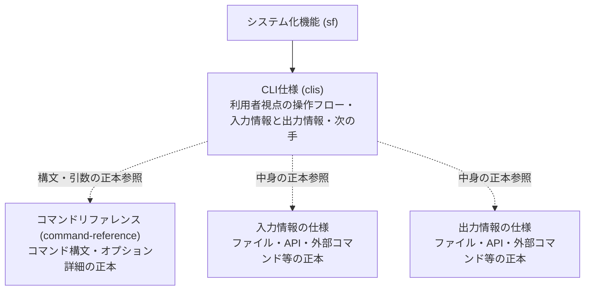

---
specdojo:
  id: specdojo:clis-rulebook
  type: rulebook
  deliverable_type: ui
  status: draft
  target_format: markdown
  recipe: not-needed
  sample: specdojo:clis-sample
  template: not-needed
  based_on:
    - specdojo:rulebook-authoring-standard
---

# CLI仕様（CLIS）作成ルール

Command Line Interface Specification (CLIS) Authoring Rule

システム自身が提供する CLI コマンド群について、利用目的、操作の流れ、入出力の要点、終了時の判断と回復を定義する基準を定めます。

## 1. 全体方針

- 1 ファイルは一つの業務目的または機能領域のコマンド群とし、利用者の課題と達成結果を対応付けます。
- 人の直接操作と自動実行の設定・監視について、対象者、開始条件、結果の確認方法を記述します。
- CLIS は利用者側の操作仕様として `ui`、システムが外部コマンドを呼ぶ契約は `ifx-cmd` として `api` に分類します。
- 構文・引数・既定値はコマンドリファレンス、データの値・構造はファイル仕様・schema・連携契約を正本とし、操作の選択と結果の判断に必要な要点を残します。
- 共通事項は上位の索引、個別仕様は差分と参照先を示します。索引が未作成なら、その旨と作成後の照合対象を記録します。
- 推奨表の列は必須情報を保って統合できます。
- **共通の運用**: 役割の割り当ては適用先のメンバー定義に、`status` の昇格と承認、改訂と廃止、未決事項の引き継ぎは [[specdojo:document-metadata-standard|ドキュメントメタ情報標準]] に従います。文書の整形・lint はリポジトリの検証で扱い、業務の受入確認に含めません。

## 2. 位置づけ

CLIS は業務プロセス仕様やシステム化機能を受け、利用者とシステムの操作境界を定めます。

## 3. ファイル命名・ID規則

命名の共通原則は [[specdojo:docs-structure-guide|ドキュメント構成ガイド]] に従います。

- ファイル名は `clis-<機能名またはコマンド群名>.md` とします。例: `clis-exec-commands.md`。
- ID はプロダクト文書が `clis-<kebab-case>`、プロジェクト文書が `<project-id>:clis-<kebab-case>`、同梱の完成例が `specdojo:` 付きとします。
- H1 はコマンド名だけでなく、対象の機能領域を識別できる名前にします。

## 4. 推奨 Frontmatter 項目

共通項目と制約は [[specdojo:document-metadata-standard|ドキュメントメタ情報標準]] に従います。

- `type` は本 rulebook の `deliverable_type` に対応する `ui`、`rulebook` は `specdojo:clis-rulebook` とします。
- `part_of` は所属する索引、`based_on` は根拠とした業務プロセス・システム化機能等を示し、カタログの依存関係と照合します。
- 未作成の依存先や根拠を接続できない理由は「メモ / 将来課題」へ記録します。

## 5. 本文要件

次の順に構成し、「入力と出力の要点」は「入力情報」「出力情報」に分けます。

| 章                                     | 必須・任意 | 目的と内容要件                                                                                   |
| -------------------------------------- | ---------- | ------------------------------------------------------------------------------------------------ |
| 概要                                   | 必須       | コマンド群で達成する結果と対象範囲を 1〜2 文で示す                                               |
| 利用目的と対象ユーザー                 | 必須       | 対象者の課題、対象外の操作と引き渡し先、手順・完了判断の確認者を示す                             |
| 操作の流れ                             | 必須       | 開始条件、標準経路、分岐、中断・再開、完了時の確認結果を示す                                     |
| 操作とコマンド参照                     | 必須       | 操作・コマンドと構文の正本を対応付ける。フローで意味が分かれば説明列は任意                       |
| 入力と出力の要点                       | 必須       | 受け取るものと送り出すものを分離し、対象・役割・正本と入力失敗時の扱いを示す                     |
| 終了コードとエラー表示・利用者の次の手 | 必須       | 正常・警告・異常の判断、表示要点、回復条件と操作。対象なし・スキップも扱う                       |
| メモ / 将来課題                        | 任意       | 未作成の参照先、未確認の動作、未決事項の論点と影響・当面の扱いを示す。該当事項があれば省略しない |

## 6. 記述ガイド

完成例は frontmatter の `sample` を参照します。

### 6.1. 概要

- 判断基準: 達成結果と引き継ぐものが分かること。内部処理は含めません。
- 良い例: 「作業指示の準備から実行・進捗確認・再開をつなぎ、結果と判断を次の担当者へ引き継ぐコマンド群。」
- 悪い例: 「引数を解析し、内部関数を呼び出す CLI。」利用者が得る結果を判断できません。

### 6.2. 利用目的と対象ユーザー

- 判断基準: 対象者と達成結果が対応し、操作・結果確認・合意の役割が分かること。自動実行は設定・監視する人も示します。
- 良い例: 「運用者は停止した作業の状態と残存成果を確認して再開する。レビュー担当は記録から完了条件の充足を確認する。」
- 悪い例: 「対象は全ユーザー。目的はコマンドの実行。」課題、達成結果、確認者が特定できません。

### 6.3. 操作の流れ

- 判断基準: 開始前から結果確認まで進め、分岐を選べること。中断時は同じ試行の再開と新規のやり直しを区別し、保持成果と再開先を示します。
- 順序付きリストまたは Mermaid を使い、併用時は分岐と選択条件などを分担します。状態や実行主体の固有語は初出で定義または正本へ案内します。
- 良い例: 「状況確認 → 対象を選んで実行 → 記録と差分で結果を確認。中断時は保存済みの試行と成果を確認して該当段から再開する。」
- 悪い例: 「実行後は常に完了。失敗したら最初から実行。」業務上の完了確認と既存成果の扱いが欠けます。

### 6.4. 操作とコマンド参照

- 判断基準: 操作からコマンドと構文の正本を特定できること。該当する小節があればそこへ、なければ章へ接続します。
- 推奨列は「操作」「対象コマンド」「正本リファレンス」。用途を選べなくなるコマンドは行を分け、フローにない操作の意味はここで補います。
- 良い例: 「状況確認 → `exec status` → [[specdojo:command-reference#7-exec|CLIコマンドリファレンス: exec]]」。
- 悪い例: 全フラグの型・既定値・組合せを表へ転載する。構文の変更を二重管理することになります。

### 6.5. 入力と出力の要点

判断基準は、情報の方向、利用する操作、目的、中身の正本を追えることです。入力・出力を表に分け、操作は専用列か対象欄で識別します。同じ扱いの操作はまとめ、該当なし行は作りません。

#### 6.5.1. 入力情報

- 入力は CLI が受け取るもの。必須情報は「種類」「対象」「役割」「正本の参照」「ない／壊れている／届かないときの扱い」。ファイル、標準入力、対話、環境変数、API 応答、外部処理の結果を確認します。
- 失敗時は停止・代替・再入力・警告継続を区別し、対応する事象名または参照でエラー章につなげます。欠落と破損で扱いが異なれば分けて示します。
- 良い例: 「設定ファイルを実行条件の解決に使う。中身は schema を参照し、欠落時は既定設定、破損時は『設定不正』として停止する。」
- 悪い例: 「設定を読む。なければ適切に処理する。」停止するか続行するかを判断できません。

#### 6.5.2. 出力情報

- 出力は CLI が外へ送り出すもの。必須情報は「種類」「対象」「役割」「正本の参照」。標準出力・標準エラー、ファイルの作成・更新、外部への送信・起動を扱います。
- 表示先は契約に合わせ、標準出力に診断が出る場合も区別します。表示要点は利用者が確認する内容に絞ります。
- 良い例: 「実行記録を保存し、次の担当が結果と再開段を確認する。項目と形式は記録の schema を参照する。」
- 悪い例: 保存する JSON の全フィールドや API のペイロードを列挙する。中身の正本と重複します。

#### 6.5.3. 正本の選び方と参照の境界

| 対象           | 中身を委ねる正本                                                                               | CLIS に残す判断情報                                          |
| -------------- | ---------------------------------------------------------------------------------------------- | ------------------------------------------------------------ |
| ファイル       | 対象の rulebook または schema                                                                  | どの操作で読み書きするか、用途、欠落・破損時の扱い           |
| 外部 API       | [[specdojo:ifx-api-rulebook\|外部API仕様作成ルール]] に従う契約                                | 呼ぶ目的、送信と応答の方向、接続不能・時間切れ・拒否時の扱い |
| 自システム API | [[specdojo:sysd-index-rulebook\|システム設計索引作成ルール]] に従う索引が案内する内部 API 定義 | 名前と用途。定義が未作成なら詳細を仮定しない                 |
| 外部コマンド   | [[specdojo:ifx-cmd-rulebook\|外部コマンド連携仕様作成ルール]] に従う契約                       | 起動する目的、渡すもの、受け取る結果、失敗時の扱い           |

- API への送信は出力、応答は入力です。取得と更新を兼ねる呼出しは両方に挙げます。外部コマンドも起動を出力、実行結果を入力に挙げます。
- 未作成の正本は ID かファイル名をインラインコードで示し、その旨と影響を記録します。独立した正本が不要な対話表示などは、理由を添えて参照なしとします。
- 成果物本文では別の型の sample を契約例として参照できます。学習例と実案件を区別し、対象操作と用途を示します。本型の sample・recipe・template の対応宣言とは別です。

### 6.6. 終了コードとエラー表示・利用者の次の手

- 判断基準: 発生条件、終了コードの意味、表示要点、次の確認・操作から完了・回復を判定できること。表示から分からない原因は補います。
- 終了コードの値と伝播は対象コマンドの正本に従い、外部処理のコードを CLI 全体へ一律に当てはめません。警告継続・対象なし・スキップは、正常終了でも未実施・未完了になり得るかを示します。
- 再試行の前に確認する状態・保持成果・担当を示します。再実行で二重処理や成果の消失が起こり得る場合は、回避条件を記述します。
- 良い例: 「対象なしの正常終了は新規作業の完了を意味しない。運用者は依存関係と対象条件を確認してから選択をやり直す。」
- 悪い例: 「非ゼロなら再実行する。」原因の解消、残存成果、再開先が判断できません。

入出力章は表示先・役割、次の推奨表は事象ごとの判断と回復を扱います。

| 列             | 記述する内容                                                           |
| -------------- | ---------------------------------------------------------------------- |
| 事象・条件     | 正常、警告、異常を分ける条件。入力章の事象名と対応させる               |
| 終了コード     | 正本で定義された値または参照。経路で異なる場合は適用条件を付ける       |
| 表示要点       | 利用者が事象を識別する情報。出力先が分かれる場合はその区別             |
| 利用者の次の手 | 担当者、確認対象、再開・再入力・引き継ぎ等の操作と回復を確認できる結果 |

### 6.7. メモ / 将来課題

- 判断基準: 確定仕様と未確定事項を区別し、影響する操作・回復経路と当面の扱いが分かること。
- 良い例: 「外部 agent 契約は未作成。終了状態と再開条件が決まるまで、当該経路の受入判断を保留する。」
- 悪い例: 「今後検討する。」論点と影響する経路が分かりません。

## 7. 禁止事項

| 禁止する記述                                 | 理由                                                     |
| -------------------------------------------- | -------------------------------------------------------- |
| 構文・値・構造・実装詳細の正本の再掲         | 引数表、ペイロード、内部クラス、SQL 等の二重管理を避ける |
| 外部コマンド連携契約や GUI レイアウトの混入  | 利用者の CLI 操作という責務を保つ                        |
| 入力と出力の混同、正本未作成を隠したリンク   | 情報の方向と仕様の確定範囲を誤認させる                   |
| 次の手を伴わないエラー列挙、一律の再実行指示 | 回復条件を判断できず、二重処理や成果消失につながる       |

## 8. 運用ルール

- コマンド構文だけの変更は正本へ反映し、参照先を確認します。利用目的、操作の流れ、入出力の要点、終了時の判断、回復条件が変わる場合は CLIS も改訂します。
- 受入確認では標準経路・分岐と入力失敗・警告・異常をたどり、表示・終了コード・保持成果・次の操作を正本と照合します。
- 完了・回復が期待結果と一致し、二重処理・成果消失を避ける再試行条件を確認できれば合格とします。
