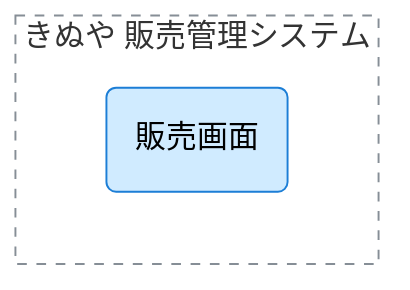

---
specdojo:
  id: specdojo:cnd-mermaid-rulebook
  type: rulebook
  deliverable_type: architecture
  status: draft
  target_format: markdown
  recipe: undecided
  sample: specdojo:cnd-sample
  template: undecided
  based_on:
    - specdojo:rulebook-authoring-standard
---

# Mermaid を用いたC4コンテナ図 作成ルール

C4 Container Diagram (CND) Documentation Rules using Mermaid

C4 コンテナ図を Mermaid の `flowchart` で表す記法を定めます。文書の命名・メタ情報・本文要件と要素の選定は [[specdojo:cnd-rulebook|C4コンテナ図作成ルール]] に従い、完成例は対応 sample に委ねます。

## 1. 全体方針

- 一つの図には一つの対象システムを置き、コンポーネント・クラスなどの内部構造は描きません。
- 図は詳細の量より、境界・接続の解釈が割れないことを優先します。
- 要素名は主 rulebook の Person・Container・Data Store・External Software System・Relationship に揃えます。
- 構文の妥当性は `npm run lint:mermaid` で確認し、描画結果の判読は主 rulebook の「検証・承認前の確認」で扱います。
- **共通の運用**: `status`・改訂と廃止・未決事項の引き継ぎは [[specdojo:document-metadata-standard|ドキュメントメタ情報標準]] に従います。

## 2. C4要素と Mermaid 記号の対応

| C4要素                   | 形状                    | 表示ラベル                                                 | 表現例                                     |
| ------------------------ | ----------------------- | ---------------------------------------------------------- | ------------------------------------------ |
| Person                   | 四角 `[]`               | `👤` と半角空白に続けて業務ロール・主体を短い日本語で書く  | `店主代表["👤 店主代表"]`                  |
| Container                | 角丸 `()`               | コンテナ名。技術区分・役割の補足は ` ` の後に括弧で書く | `販売画面("販売画面 （ブラウザ）")`     |
| Data Store               | 円柱 `[(...)]`          | 保持する記録の論理名。DB 製品に限らない                    | `販売記録[("販売記録ストア")]`             |
| External Software System | 四角 `[]`               | 外部システムの一般名。`👤` は付けない                      | `印刷基盤["レシート印刷基盤"]`             |
| システム境界             | `subgraph ... end`      | 対象システムの具体的な名称                                 | `subgraph 境界["きぬや 販売管理システム"]` |
| Relationship             | 実線 `-->`・点線 `-.->` | 短い名詞句または動詞句。条件付きは括弧で条件を添える       | `販売画面 -->\|"販売記録依頼"\| 販売処理`  |

- 境界のラベルを「対象システム」などの汎用名にしません。境界内に置く要素の選定は主 rulebook に従います。
- ノード ID は記号・空白を避けた短い識別子とし、同じ要素の名称を図の中で揺らしません。

## 3. エッジ（関係）のルール

- すべてのエッジにラベルを付けます。長い場合は ` ` で改行してよい。
- 向きは主たる依頼・利用・送信の向きに揃え、応答は同じ関係に含めます。
- 常時成立する関係は `-->`、構築時だけ成立する関係や機能選択時だけ必要な外部依存は `-.->` とし、ラベルに条件を括弧で添えます。
  - 良い例: `サイト -.->|"公開対象文書の参照（構築時）"| 文書ストア`
  - 悪い例: `サイト -->|"連携"| 文書ストア`。常時接続か構築時だけかを判断できません。

## 4. 色分け

色分けは推奨です。適用する場合は次の定義をそのまま使い、図ごとに配色を変えません。

- 適用する場合は、Person に `person`、境界内の Container・Data Store に `system`、External Software System に `external` を付け、境界は実際の subgraph ID に `style` を指定します。一部のノードだけに付けません。
- 凡例は、図の利用者が C4 の記号に不慣れな場合などに置き、同じ形状と上記の定義を使います。
- 配色を変える場合は、対応 sample と、配色を揃える他の C4 記法の rulebook（`cxd-mermaid-rulebook`・`cpd-mermaid-rulebook`）を同時に見直します。

## 5. 禁止事項

| 項目                                                        | 理由                            |
| ----------------------------------------------------------- | ------------------------------- |
| 物理テーブル名・物理カラム名・SQL 全文                      | コンテナ図の粒度を超える        |
| API エンドポイント・HTTP メソッド・リクエスト JSON 等の詳細 | IF 仕様に記述する               |
| 実装クラス・関数名、内部モジュールの列挙                    | 変更に弱い                      |
| 画面遷移やクリック手順の逐語列挙                            | UI 変更に弱い・図の目的から逸脱 |
| 矢印ラベルのない関係、条件付きの関係を実線で描くこと        | 接続の前提を判断できない        |
