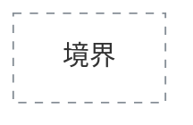
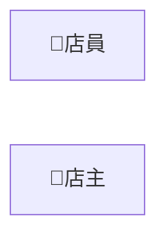
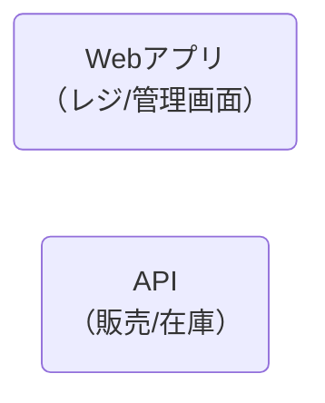
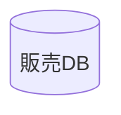
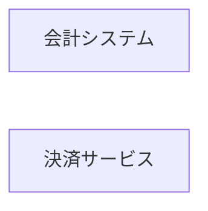
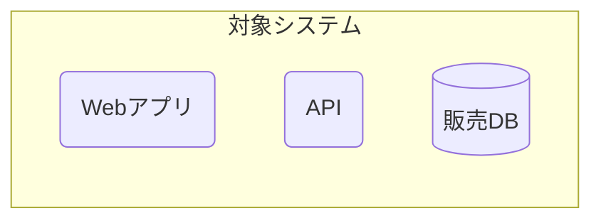
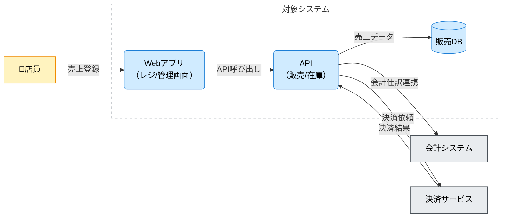
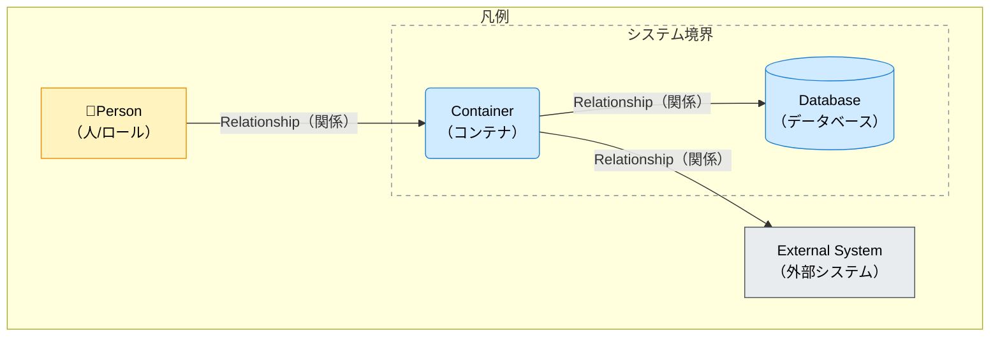

---
specdojo:
  id: specdojo:cnd-mermaid-rulebook
  type: rulebook
  deliverable_type: architecture
  status: draft
  target_format: markdown
  recipe: undecided
  sample: specdojo:cnd-sample
  template: undecided
  based_on:
    - specdojo:rulebook-authoring-standard
---

# Mermaid を用いたC4コンテナ図 作成ルール

C4 Container Diagram (CND) Documentation Rules using Mermaid

C4 コンテナ図を Mermaid の `flowchart` で表す記法を定めます。文書の命名・メタ情報・本文要件と要素の選定は [[specdojo:cnd-rulebook|C4コンテナ図作成ルール]] に従います。

## 1. 全体方針

- 一つの図には一つの対象システムを置き、コンポーネント・クラスなどの内部構造は描きません。
- 図は詳細の量より、境界・接続の解釈が割れないことを優先します。
- **共通の運用**: 役割は適用先のメンバー定義に、`status`・承認・改訂と廃止・未決事項の引き継ぎは [[specdojo:document-metadata-standard|ドキュメントメタ情報標準]] に従います。文書の整形・lint はリポジトリの検証で扱います。

## 2. C4要素と Mermaid 記号の対応

| C4要素                                   | Mermaid での表現例                      |
| ---------------------------------------- | --------------------------------------- |
| Person（人/ロール）                      | `店員["店員"]`                          |
| Container（コンテナ）                    | `Webアプリ("Webアプリ （React）")`   |
| Database（データベース）                 | `販売DB[("販売DB")]`                    |
| External Software System（外部システム） | `会計システム["会計システム"]`          |
| System Boundary（境界）                  | `subgraph 境界["対象システム"] ... end` |
| Relationship（関係）                     | `店員 -->\|"売上登録"\| Webアプリ`      |

### 2.1. 標準の色分け（推奨）

色は任意で、次の区分を推奨します。

- Person（人/ロール）: 暖色系
- 対象システム内（Container / Database）: 寒色系（主役）
- 外部システム（External System）: 無彩色系（脇役）
- 境界（System Boundary）: 破線枠

#### 2.1.1. 標準スタイル定義（コピーして利用）

#### 2.1.2. 適用ルール

- Personノードには `person` クラスを付ける
- 対象システム内の Container / Database には `system` クラスを付ける
- 外部システムノードには `external` クラスを付ける
- 境界は `subgraph 境界[...]` として、`style 境界 ...` で枠線を指定する。`境界` は実際のサブグラフ ID に合わせる

## 3. ノードのルール

以下の例は形状とラベルを示します。色の適用は「標準の色分け（推奨）」に従います。

### 3.1. Person（人/ロール）

- **四角 `[]`** を使用する。
- 表示ラベルは業務ロール/主体を短い日本語で表す。

例:

### 3.2. Container（コンテナ）

- **角丸長方形 `()`** を使用する。
- 表示ラベルは「コンテナ名（＋必要なら技術/役割の短い補足）」とする。
- 改行は ` ` を使用してよい（長文化防止）。

例:

### 3.3. Database（データベース）

- **円柱ノード `[(...)]`** を使用する。
- DBの論理名を短く書く。

例:

### 3.4. External Software System（外部システム）

- **四角 `[]`** を使用する。
- 表示ラベルは外部システムの一般名とする。

例:

### 3.5. System Boundary（境界）

- 対象システムは **サブグラフ `subgraph ... end`** で囲う。
- 境界内に置く要素の選定基準は主 rulebook に従う。

例:

## 4. エッジ（関係）のルール

### 4.1. 方向

- `A --> B` を基本とする。
- 方向は「主たる依存/利用/送信の向き」が分かるように統一する。
  - 例: 人がシステムを利用する: `人 -->|"利用"| 対象システム内のコンテナ`
  - 例: コンテナ間の呼び出し: `Webアプリ -->|"API呼び出し"| API`
  - 例: DBへの入出力: `API -->|"売上データ"| 販売DB`

### 4.2. ラベル

- すべてのエッジにラベルを付ける。
- ラベルは **短い名詞句**または **短い動詞句**で書く。
  - 例: `売上登録` / `在庫照会` / `会計仕訳連携` / `決済結果を受信`
- 長い場合は ` ` で改行してよい。

## 5. 命名・表記ルール

- ノードIDは日本語でもよいが、記号や空白は避け、短い識別子にする。
- 表示ラベルは `"..."` で囲ってよい。
- 同じ主体/システム/コンテナ/DBは、図の中で名称を揺らさない。

## 6. 禁止事項

| 項目                                                  | 理由                            |
| ----------------------------------------------------- | ------------------------------- |
| 物理テーブル名・物理カラム名・SQL全文                 | コンテナ図の粒度を超える        |
| APIエンドポイント/HTTPメソッド/リクエストJSON等の詳細 | IF仕様に記述する                |
| 実装クラス/関数名、内部モジュールの列挙               | 変更に弱い                      |
| 画面遷移やクリック手順の逐語列挙                      | UI変更に弱い・図の目的から逸脱  |
| コンポーネント/クラス等の内部構造の詳細               | コンポーネント図/実装設計で表す |
| 矢印ラベルなしの関係                                  | 合意が取れない                  |

## 7. サンプル（最小）

## 8. 凡例（推奨）

必要な場合に置きます。

