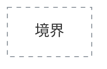
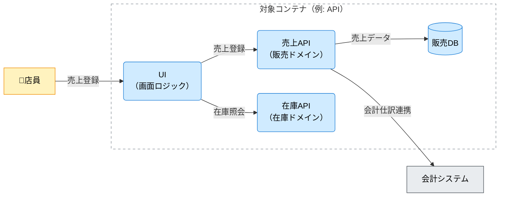
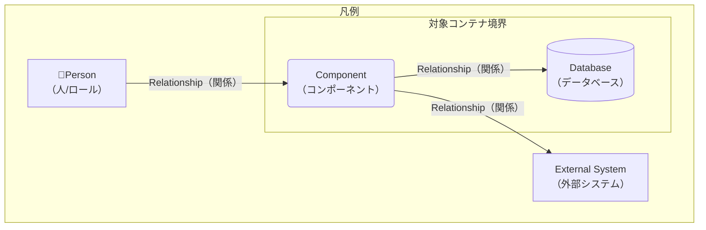

---
specdojo:
  id: specdojo:cpd-mermaid-rulebook
  type: rulebook
  deliverable_type: architecture
  status: draft
  target_format: markdown
  recipe: undecided
  sample: specdojo:cpd-sample
  template: undecided
  based_on:
    - specdojo:rulebook-authoring-standard
---

# Mermaid を用いたC4コンポーネント図 作成ルール

C4 Component Diagram (CPD) Documentation Rules using Mermaid

Mermaid の `flowchart` で、一つのコンテナ内部の責務と境界外への依存を描く記法を定めます。分割・授受情報・受入条件は [[specdojo:cpd-rulebook|CPD 作成ルール]] に従います。

## 1. 全体方針

- Mermaid の `flowchart` を使い、形状・境界・ラベルで要素と関係を識別できるようにする。
- 対象は「対象コンテナ内の主要コンポーネント」と「境界外（人/外部システム/外部データストア等）との関係」であり、クラス/関数等の実装詳細は含めない。
- 全呼び出しの網羅ではなく、責務と依存方向を判断できる主要経路を描く。
- 1つの図には **対象コンテナを1つ**だけ置く（複数対象は図を分ける）。
- **共通の運用**: 役割の割り当ては適用先のメンバー定義に、`status` の昇格と承認、改訂と廃止、未決事項の登録簿への引き継ぎは [[specdojo:document-metadata-standard|ドキュメントメタ情報標準]] に従う。文書の整形・lint はリポジトリの検証で扱い、業務の受入確認に含めない。

## 2. C4要素と Mermaid 記号の対応

| C4要素                                   | 意味                                    | Mermaid での表現例                                                   |
| ---------------------------------------- | --------------------------------------- | -------------------------------------------------------------------- |
| Person（人/ロール）                      | 利用者・関係者                          | `店員["店員"]`                                                       |
| Component（コンポーネント）              | 責務のまとまり（モジュール/サービス等） | `売上API("売上API （販売ドメイン）")`                             |
| Database（データベース）                 | 永続データストア                        | `販売DB[("販売DB")]`                                                 |
| External Software System（外部システム） | 連携先システム                          | `会計システム["会計システム"]`                                       |
| Container Boundary（対象コンテナ境界）   | 対象コンテナの範囲                      | `subgraph 境界["対象コンテナ"] ... end`                              |
| Relationship（関係）                     | 利用・連携・参照・データ入出力概念      | `UI -->\|"売上登録"\| 売上API`/`売上API --> \|"売上データ"\| 販売DB` |

### 2.1. 標準の色分け（推奨）

色は任意とし、人・内部要素・外部依存の識別を補助するために使う。`classDef` と `class` で色、`style` で境界の破線枠を指定する。

#### 2.1.1. 標準スタイル定義（コピーして利用）

CXD・CND と共通の配色を使う。

#### 2.1.2. 適用ルール

- Person は暖色の `person` クラスを付ける
- 対象コンテナ内の Component / Database は寒色の `system` クラスを付ける
- 外部システムは無彩色の `external` クラスを付ける。境界外のストアも外部依存として扱う
- 境界は `subgraph 境界[...]` として、`style 境界 ...` で枠線を指定する

## 3. ノードのルール

### 3.1. Person（人/ロール）

四角 `[]` を使い、業務ロール・主体を短い日本語で表示する（例: `店員["👤店員"]`）。

### 3.2. Component（コンポーネント）

角丸長方形 `()` を使う。表示はコンポーネント名と必要な責務の補足に絞り、長いラベルは ` ` で改行してよい（例: `売上API("売上API （販売ドメイン）")`）。

### 3.3. Database（データベース）

円柱 `[(...)]` を使い、DB の論理名を表示する（例: `販売DB[("販売DB")]`）。

### 3.4. External Software System（外部システム）

四角 `[]` を使い、連携先の一般名を表示する（例: `会計システム["会計システム"]`）。

### 3.5. Container Boundary（対象コンテナ境界）

対象コンテナは `subgraph ... end` で囲う。内部には主要コンポーネント（5〜15 個程度を目安）と、上位図で内部と定義されたストアだけを置く。詳細化は実装設計へ委ねる。境界の `style` は subgraph の ID に合わせる。

## 4. エッジ（関係）のルール

### 4.1. 方向

- `A --> B` を基本とする。
- 方向は「主たる依存/利用/送信の向き」が分かるように統一する。
  - 例: 人が対象コンテナのUI/APIを利用する: `人 -->|"利用"| 対象コンテナ内のコンポーネント`
  - 例: コンポーネント間の呼び出し: `UI -->|"API呼び出し"| 売上API`
  - 例: DBへの入出力: `売上API -->|"売上データ"| 販売DB`

### 4.2. ラベル

- すべてのエッジにラベルを付ける（「何の関係か」を合意するため）。
- ラベルは **短い名詞句**または **短い動詞句**で書く。
  - 例: `売上登録` / `在庫照会` / `会計仕訳連携` / `決済結果を受信`
- 長い場合は ` ` で改行してよい。

## 5. 命名・表記ルール

- ノードIDは日本語でもよいが、記号や空白は避け、短い識別子にする（例: `売上API`, `在庫API`, `販売DB`, `会計システム`, `店員`）。
- 表示ラベルは `"..."` で囲ってよい（混乱を避けるため、必要に応じて統一）。
- 同じ主体/コンポーネント/DB/外部システムは、図の中で名称を揺らさない。

## 6. 禁止事項

| 項目                                                  | 理由                                    |
| ----------------------------------------------------- | --------------------------------------- |
| 物理テーブル名・物理カラム名・SQL全文                 | コンポーネント図の粒度を超える          |
| APIエンドポイント/HTTPメソッド/リクエストJSON等の詳細 | IF仕様に記述する                        |
| 実装クラス/関数名、ソースコード上のファイル一覧       | 変更に弱く、粒度が細かすぎる            |
| 画面遷移やクリック手順の逐語列挙                      | UI変更に弱い・図の目的から逸脱          |
| 矢印ラベルなしの関係                                  | 合意が取れない                          |
| 依存の網羅を目的とした大量の矢印（スパゲッティ化）    | 読めない/合意できない（図を分割すべき） |

## 7. サンプル（最小）

## 8. 凡例（推奨）

必要な場合のみ、使った形状と境界を次のように示す。

配色を使う場合は「標準スタイル定義」と「適用ルール」を凡例にも適用する。
