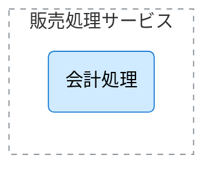

---
specdojo:
  id: specdojo:cpd-mermaid-rulebook
  type: rulebook
  deliverable_type: architecture
  status: draft
  target_format: markdown
  recipe: undecided
  sample: specdojo:cpd-sample
  template: undecided
  based_on:
    - specdojo:rulebook-authoring-standard
---

# Mermaid を用いたC4コンポーネント図 作成ルール

C4 Component Diagram (CPD) Documentation Rules using Mermaid

C4 コンポーネント図を Mermaid の `flowchart` で表す記法を定めます。文書の命名・メタ情報・本文要件とコンポーネントの分割は [[specdojo:cpd-rulebook|CPD 作成ルール]] に従い、完成例は対応 sample に委ねます。

## 1. 全体方針

- 一つの図には一つの対象コンテナを置き、クラス・関数などの実装詳細は描きません。
- 全呼び出しの網羅ではなく、責務と依存方向を判断できる主要経路を描きます。
- 要素名は主 rulebook の Person・Component・ストア・外部依存・関係に揃えます。
- 構文の妥当性は `npm run lint:mermaid` で確認し、描画結果の判読は主 rulebook の「検証と合意の判定」で扱います。
- **共通の運用**: `status`・改訂と廃止・未決事項の引き継ぎは [[specdojo:document-metadata-standard|ドキュメントメタ情報標準]] に従います。

## 2. C4要素と Mermaid 記号の対応

| C4要素                   | 形状               | 表示ラベル                                                   | 表現例                                     |
| ------------------------ | ------------------ | ------------------------------------------------------------ | ------------------------------------------ |
| Person                   | 四角 `[]`          | `👤` と半角空白に続けて業務ロール・主体を短い日本語で書く    | `店主代表["👤 店主代表"]`                  |
| Component                | 角丸 `()`          | コンポーネント名。責務の補足は ` ` の後に括弧で書く       | `会計("会計処理 （販売結果の組立て）")` |
| Data Store               | 円柱 `[(...)]`     | 保持する記録の論理名。DB 製品に限らない                      | `販売記録[("販売記録ストア")]`             |
| 境界外のコンテナ・外部系 | 四角 `[]`          | 上位図での名称。別コンテナは ` ` の後に括弧で区別を添える | `販売画面["販売画面 （別コンテナ）"]`   |
| コンテナ境界             | `subgraph ... end` | 上位図での対象コンテナ名                                     | `subgraph 境界["販売処理サービス"]`        |
| Relationship             | 実線 `-->`         | 関係 ID と短い名詞句または動詞句                             | `会計 -->\|"REL-05 販売結果の保存"\| 保存` |

- 境界内には主要コンポーネントと、上位図で対象コンテナの内部と定義されたストアだけを置きます。境界のラベルを「対象コンテナ」などの汎用名にしません。
- ノード ID は記号・空白を避けた短い識別子とし、表示ラベルは `"..."` で囲みます。同じ要素の名称を図の中で揺らしません。

## 3. エッジ（関係）のルール

- すべてのエッジにラベルを付け、主 rulebook の関係 ID を先頭に置きます。長い場合は ` ` で改行してよい。
- 向きは主たる依存・依頼の向きに揃え、応答は同じ関係に含めます。双方向矢印は使いません。
  - 良い例: `会計 -->|"REL-07 保存済み控えの印字依頼"| 印字`
  - 悪い例: `会計 <-->|"処理"| 共通`。依存の向きと受け渡す情報を判断できません。

## 4. 色分け

色分けは推奨です。適用する場合は次の定義をそのまま使い、図ごとに配色を変えません。

- 適用する場合は、Person に `person`、境界内の Component・Data Store に `system`、境界外のコンテナ・ストア・外部システムに `external` を付け、境界は実際の subgraph ID に `style` を指定します。一部のノードだけに付けません。
- 凡例は、図の利用者が C4 の記号に不慣れな場合などに置き、同じ形状と上記の定義を使います。
- 配色を変える場合は、対応 sample と、配色を揃える他の C4 記法の rulebook（`cxd-mermaid-rulebook`・`cnd-mermaid-rulebook`）を同時に見直します。

## 5. 禁止事項

| 項目                                                        | 理由                                     |
| ----------------------------------------------------------- | ---------------------------------------- |
| 物理テーブル名・物理カラム名・SQL 全文                      | コンポーネント図の粒度を超える           |
| API エンドポイント・HTTP メソッド・リクエスト JSON 等の詳細 | IF 仕様に記述する                        |
| 実装クラス・関数名、ソースコード上のファイル一覧            | 変更に弱く、粒度が細かすぎる             |
| ラベルや関係 ID のない関係、双方向矢印                      | 依存の向きと関係表との対応を判断できない |
| 依存の網羅を目的とした大量の矢印                            | 主要経路を判読できない（図を分割する）   |
