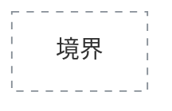

---
specdojo:
  id: specdojo:cxd-mermaid-rulebook
  type: rulebook
  deliverable_type: architecture
  status: draft
  target_format: markdown
  recipe: undecided
  sample: specdojo:cxd-sample
  template: undecided
  based_on:
    - specdojo:rulebook-authoring-standard
---

# Mermaid を用いたC4コンテキスト図 作成ルール

C4 Context Diagram (CXD) Documentation Rules using Mermaid

Mermaid の `flowchart` 構文で C4 コンテキスト図を描くための記法を定めます。要素の選定と責任分界は [[specdojo:cxd-rulebook|C4コンテキスト図（CXD）作成ルール]] に従います。

## 1. 全体方針

- `flowchart LR` を C4 コンテキスト図風に使い、システム境界の外側との関係だけを描きます。内部構造や実装詳細は含めません。
- 正確さ（過剰な詳細）よりも、解釈が割れないこと（合意）を優先します。
- 1 つの図に対象システムは 1 つだけ置きます。複数の対象は図を分けます。
- **共通の運用**: 役割の割り当ては適用先のメンバー定義に、`status`・承認・改訂と廃止・未決事項の引き継ぎは [[specdojo:document-metadata-standard|ドキュメントメタ情報標準]] に従います。構文の検査は [[specdojo:cxd-rulebook|C4コンテキスト図（CXD）作成ルール]] の運用ルールに従います。

## 2. C4要素と Mermaid 記号の対応

| C4要素                                   | 形状・記法                              | クラス     | 色（推奨）             |
| ---------------------------------------- | --------------------------------------- | ---------- | ---------------------- |
| Person（人/ロール）                      | 四角 `[]`。業務ロールを短い日本語で表す | `person`   | 暖色系                 |
| Software System（対象システム）          | 角丸 `()`。システム名＋必要なら短い補足 | `system`   | 寒色系（主役）         |
| External Software System（外部システム） | 四角 `[]`。外部システムの一般名で表す   | `external` | 無彩色系（脇役）       |
| System Boundary（境界）                  | `subgraph 境界["..."] ... end`          | `style`    | 破線枠・塗りつぶし無し |

- 境界内には対象システムのノード 1 つだけを置きます。
- 表示ラベルの改行には ` ` を使い、長文化を防ぎます。
- 色は必須ではありませんが、人・対象システム・外部システムを一目で区別できるよう、次の標準スタイルを図の末尾にコピーして使います。`style` の対象 ID は `subgraph` の ID に合わせます。

## 3. エッジ（関係）のルール

- `A --> B` を基本とし、矢印は主たる依存・利用・送信の向き（人 → 対象システム、対象システム → 外部システム）にそろえます。応答は同じ線に含め、独立した逆方向の起動だけを別線にします。
- すべてのエッジに短い名詞句または動詞句のラベルを付けます。長い場合は ` ` で改行します。
- 良い例: `店員 -->|"売上登録"| 販売管理システム`、`販売管理システム -->|"会計仕訳 連携"| 会計システム`。
- 悪い例: ラベルのない `販売管理システム --> 会計システム`、または `POST /api/v1/sales` のようなエンドポイントをラベルにする。

## 4. 命名・表記ルール

- ノード ID は日本語でもよいが、記号や空白を避けた短い識別子にします（例: `販売管理システム`、`店員`）。
- 表示ラベルは `"..."` で囲んで図内で統一し、同じ主体・システムの名称を揺らしません。
- 凡例は読み手が記号の意味を取り違えるおそれがある場合だけ置き、本図と同じクラスと境界スタイルを使います。

## 5. 禁止事項

| 項目                                                  | 理由                              |
| ----------------------------------------------------- | --------------------------------- |
| 物理テーブル名・物理カラム名・SQL全文                 | コンテキスト図の粒度を超える      |
| APIエンドポイント/HTTPメソッド/リクエストJSON等の詳細 | IF仕様に記述する                  |
| 実装クラス/関数名、具体的な技術スタックの列挙         | 変更に弱い                        |
| 対象システムの内部プロセス/内部データストアの詳細     | コンテナ図/コンポーネント図で表す |
| 矢印ラベルなしの関係                                  | 合意が取れない                    |
