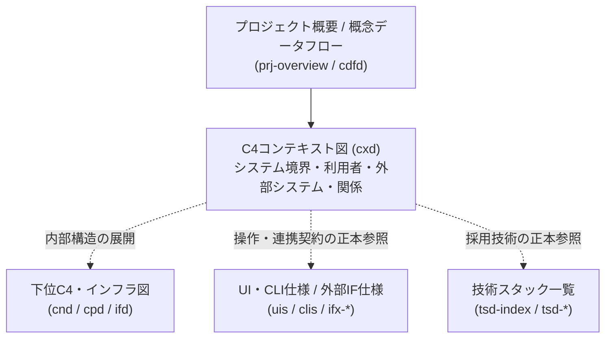

---
specdojo:
  id: specdojo:cxd-rulebook
  type: rulebook
  deliverable_type: architecture
  status: draft
  target_format: markdown
  includes:
    - specdojo:cxd-mermaid-rulebook
  recipe: specdojo:cxd-recipe
  sample: specdojo:cxd-sample
  template: specdojo:cxd-template
  based_on:
    - specdojo:rulebook-authoring-standard
---

# C4コンテキスト図（CXD）作成ルール

C4 Context Diagram (CXD) Authoring Rule

対象システム（Software System）を 1 つのブラックボックスとして捉え、システム境界の外側に位置する利用者（Person）および外部システム（External Software System）との関係・責任分界を俯瞰的に定義する規約を定めます。内部のコンテナ・コンポーネント構造や外部インターフェース構文・データ構造の詳細は各正本を参照し、本書ではシステム境界の合意、外部依存の識別、境界上の技術制約と検証観点の整理を扱います。

## 1. 全体方針

- 1 ファイルにつき 1 つの対象システム（または合意したシステム境界）を扱い、対象システムを内部構造に立ち入らない単一のブラックボックスとして定義します。
- 対象システムを取り巻く利用者（人・ロール）と外部システム、およびそれらの間の主たる利用・連携の関係を、図と対応表の両面から解釈が割れない粒度で記述します。
- 図の描画記法は `includes` で宣言した [[specdojo:cxd-mermaid-rulebook|Mermaid を用いたC4コンテキスト図 作成ルール]] に従います。図と本文の表で要素名・関係ラベルを一致させ、図の矢印を文章でそのままなぞる重複説明は行いません。
- 内部コンテナ分割は C4 コンテナ図（`cnd`）、内部コンポーネント構造は C4 コンポーネント図（`cpd`）、実行環境・ネットワーク配置はインフラ構成図（`ifd`）、採用技術一覧は技術スタック一覧（`tsd-index`）、外部連携や操作の詳細は外部インターフェース仕様（`ifx-*`）や CLI 仕様（`clis`）・画面仕様（`uis`）を正本とし、CXD には境界判断に必要な要点と参照先だけを残します。
- 必須・任意・禁止を区別します。未作成の参照先や未確定の境界論点がある場合は、確定仕様と混ぜずに「メモ / 将来課題」へ影響・担当ロール・解消条件・引き継ぎ先を記録します。

### 1.1. 対象者と確認する内容

| 対象者                                       | 解決する課題                                                           | 確認する内容                                                                                               |
| -------------------------------------------- | ---------------------------------------------------------------------- | ---------------------------------------------------------------------------------------------------------- |
| プロダクトオーナー（PO）・業務分析担当（BA） | システムの提供価値・対象範囲と業務上の利用者・外部連携の認識がずれる   | システム境界の内外、対象外責務の委譲先、利用者と外部システムの関係が業務観点で妥当かを確認・承認できる     |
| アーキテクト（ARC）・開発者（DEV）           | 下位設計や外部連携設計の前提となるシステム境界・技術制約が曖昧になる   | 外部システムとの依存方向、信頼・実行境界の制約、下位設計（`cnd`・`ifd`・`ifx-*` 等）への接続先を判断できる |
| 品質保証担当（QE）・運用担当（OPS）          | 境界上の契約や外部依存の障害・不在時に検証・監視すべき対象が分からない | 境界をまたぐ入出力の要点、外部システム異常時の扱い、結合テスト・スタブ検証の観点を識別できる               |

## 2. 位置づけと用語定義

CXD は利用目的と対象範囲を根拠として、アーキテクチャ設計の最上位でシステム全体の境界と外部関係を定義します。下図の入力文書は候補であり、実際の根拠は各タスクの参照範囲に従います。

| 用語                                     | この文書での意味                                                                                                       |
| ---------------------------------------- | ---------------------------------------------------------------------------------------------------------------------- |
| Person（人・ロール）                     | システム境界の外側から対象システムを直接利用・運用・管理する業務ロールまたは利用者区分。個人名ではなく役割で定義する   |
| Software System（対象システム）          | 本コンテキスト図の中心となるシステム。内部のコンテナやモジュール構造を展開せず、単一の責務単位として扱う               |
| System Boundary（システム境界）          | 対象システムが直接責務を持つ範囲と、外部の運用・外部システムへ委ねる範囲の分界線                                       |
| External Software System（外部システム） | 対象システムの境界外にあり、対象システムとデータや制御をやり取りする外部ソフトウェア・外部サービス・外部ツールチェーン |
| Relationship（関係）                     | Person または External Software System と対象システムの間の主たる利用・呼び出し・データ連携の関係                      |

## 3. ファイル命名・ID規則

命名と配置の共通原則は [[specdojo:docs-structure-guide|ドキュメント構成ガイド]] および [[specdojo:id-and-file-naming-standard|ID・ファイル命名標準]] に従います。

- 配置先は原則として `docs/<lang>/product/030-architecture/010-c4/` とします。
- ファイル名は `cxd-<context>.md` とします（例: `cxd-specdojo.md`）。`<context>` は対象システムまたは対象コンテキストを表す英小文字・数字・ハイフンのケバブケースとします。
- プロダクト文書の ID は `cxd-<context>`、プロジェクト文書は `<project-id>:cxd-<context>` とします。同梱の完成例は成果物と衝突しない `specdojo:` の ID を使います。
- 文書名は本文先頭の H1 に記述し、対象システム名と C4 コンテキスト図であることを明示します。

## 4. 推奨 Frontmatter 項目

共通の必須・任意項目と値・型の制約は [[specdojo:document-metadata-standard|ドキュメントメタ情報標準]] および `docs/specdojo/schemas/v1/deliverable-frontmatter.schema.yaml` を正本とします。CXD 固有の指定と根拠の選び方は次のとおりです。

- `type` は本 rulebook の `deliverable_type` に対応する `architecture`、`rulebook` は `specdojo:cxd-rulebook` とします。
- `part_of` は所属する上位アーキテクチャ文書や索引がある場合に記載し、`based_on` は成果物カタログの `depends_on` の推移閉包に含まれる直接の内容根拠だけを示します。プロジェクト共通文脈（`prj-overview` 等）が `depends_on` にない場合は `based_on` に含めず、本文中で参照します。
- 未作成の依存先や未確定の契約は「メモ / 将来課題」へ記録し、空の `based_on` を埋めるために無関係な ID を追加しません。
- 作成・編集時の `status` は `draft` とし、完了条件をすべて満たして承認者が合意した時点で `ready` へ昇格します。

## 5. 本文要件

見出し順・表・記入欄の骨組みは frontmatter で宣言した template を正本とし、本章は各内容の目的と必須性を定義します。Markdown の `##`〜`####` には階層ごとの連番と末尾の `.` を付け、章への参照は章タイトルで示します。

| 章                          | 必須・任意 | 目的と内容要件                                                                                                         |
| --------------------------- | ---------- | ---------------------------------------------------------------------------------------------------------------------- |
| 概要                        | 必須       | 対象システムの目的・提供価値、コンテキスト図の対象範囲と対象外、主要ステークホルダーと確認内容を 1〜3 文と表で示す     |
| C4コンテキスト図（Mermaid） | 必須       | `specdojo:cxd-mermaid-rulebook` に準拠したコンテキスト図と、図の読み取りに必要な補足注記（1〜3 文）を示す              |
| 要素と境界の定義            | 必須       | 対象システムとシステム境界、Person、External Software System、Relationship を表で定義し、詳細仕様の正本へ案内する      |
| 技術前提・制約と検証観点    | 必須       | システム境界における技術前提・制約（実行形態、信頼境界、外部依存の前提）と、境界・外部依存のテスト・検証観点を示す     |
| メモ / 将来課題             | 任意       | 未作成の参照先、未確定の境界論点、段階的拡張予定について、影響・担当・解消条件・引き継ぎ先を示す。該当事項があれば必須 |

## 6. 記述ガイド

各章は次の判断基準で記述します。共通のメタ情報・リンク・未確定事項の記法は上位のメタ情報標準を正本とし、ここには CXD 固有の判断と短い対比例を置きます。

### 6.1. 概要

- 判断基準: 対象システムが誰の何の課題を解決し、どこまでを本図の対象範囲とし、何を下位図や別仕様へ委ねるかを読み取れること。また、主要ステークホルダー（PO・BA・ARC・QE 等）が本図で確認・合意する観点が対応付けられていること。
- 良い例: 「本図は販売管理 CLI を単一のシステム境界として捉え、店舗スタッフ・管理者および外部の印刷・会計基盤との関係を定義する。コンテナ内部のモジュール構成は `cnd`、コマンド構文は `clis` を参照する。」
- 悪い例: 「本図はシステムの全体像を示すコンテキスト図である。」対象システムの責務範囲も対象外との分界も判断できません。

### 6.2. C4コンテキスト図（Mermaid）

- 判断基準: `includes` で宣言した記法に従い、対象システムが一つで、境界外の主体とすべての関係を識別できること。ノード形状・色・構文は記法ルールへ委ねます。外部システムや Person がない場合は、その理由を明記します。
- 図の直後には、矢印の向きの意味（主たる利用・起動・データ送信の方向）と図中で省略した詳細の参照先を 1〜3 文で補足します。図の矢印を 1 本ずつ文章で書き直す説明は置きません。
- 良い例: 境界内に対象システム 1 ノードのみを置き、Person と外部システムからの入出力・呼び出しを短い動詞句または名詞句ラベル（例: `売上登録・集計指示`、`AI実行起動・結果取得`）で表現する。
- 悪い例: 境界内に DB テーブルや内部モジュールを並べたり、ラベルなしの矢印やエンドポイント URL を図中に書き込んだりする。

### 6.3. 要素と境界の定義

判断基準は、図に登場するすべての要素と関係が漏れ・表記揺れなく表で定義され、境界内外の責任分界と詳細仕様の正本を追えることです。

#### 6.3.1. 対象システムとシステム境界

- 対象システムの「システム名」「提供する中核責務」「境界内に含める範囲」「境界外へ委ねる範囲（対象外と委譲先）」を表または項目で明記します。
- 良い例: 「境界内: 取引記録とレシート控えの保持。境界外: プリンタの物理制御（印刷基盤へ委譲）、現金授受（店番担当が実施）。」
- 悪い例: 「販売管理に関する機能一式を提供する。」どこまでが自システムの実装責務で、どこからが外部システムや手運用なのか判別できません。

#### 6.3.2. Person（人・ロール）

- 推奨列は「Person（図中ラベル）」「対応ロール」「利用目的・主な関わり」「境界上の接点・確認責務」です。プロジェクトのロール定義（`pm-roles` 等）や業務上の利用者区分と整合させ、個人名は記載しません。
- 良い例: 「店番担当: 現金販売を記録する。会計・印字の状態を確認し、保留取引を店舗責任者へ渡す。」業務上の利用者区分を用い、プロジェクトの役職を直接利用者として機械的に列挙しません。
- 悪い例: 「ユーザー: システムを使う人。」ロールごとの利用目的や境界上の確認責務が分かりません。

#### 6.3.3. External Software System（外部システム）

- 推奨列は「外部システム（図中ラベル）」「区分・位置づけ」「対象システムとの責任分界」「不在・障害時の影響と扱い」です。
- 確認できた連携相手を列挙し、必須の依存と機能を選んだ場合だけ使う依存を区別します。同じ端末で動く外部 CLI も責務が別なら境界外とし、未確認の接続経路や障害時の保証は仮定または論点として示します。
- 良い例: 「印刷基盤: 対象システムから控えを受け取って物理印字を担う。会計記録の管理は対象システムに残す。」境界と失敗時の影響を説明し、具体的な復旧保証は確認済みの連携契約に基づいて記述します。
- 悪い例: 「外部サービス: データを連携する。」何を外部に任せ、障害時に対象システムがどう振る舞うか判断できません。

#### 6.3.4. Relationship（関係・連携契約）

- 推奨列は「関係ID」「起点 → 終点」「図中ラベル」「やり取りする情報・制御の要点」「連携方式・境界」「正本・関連仕様」です。
- 図中のすべての矢印と 1 対 1 または明確な対応関係を持たせ、やり取りの方向（利用者が起動するのか、対象システムが外部システムを起動・参照するのか）と、詳細な仕様の正本（`clis`、`ifx-cmd`、`ifx-api`、`ifx-file` 等）を示します。
- 良い例: 「`REL-03`: 対象システム → 印刷基盤。印字依頼と結果をやり取りし、詳細は外部コマンド連携仕様を参照する。」目的・方向・詳細の更新先が分かります。
- 悪い例: 引数フラグの全一覧や JSON ペイロードの全フィールドを表に転載する。外部インターフェース仕様やコマンドリファレンスとの二重管理になります。

#### 6.3.5. 正本の選び方と参照の境界

| 対象                               | 中身を委ねる正本                                       | CXD に残す判断情報                                           |
| ---------------------------------- | ------------------------------------------------------ | ------------------------------------------------------------ |
| システム内部のコンテナ・モジュール | C4 コンテナ図（`cnd`）・C4 コンポーネント図（`cpd`）   | 対象システム全体としての責務と外部との境界                   |
| 実行環境・ネットワーク配置         | インフラ構成図（`ifd`）                                | 境界をまたぐ通信・実行形態の前提（ローカル実行、外部通信等） |
| 採用技術・ランタイム・バージョン   | 技術スタック一覧（`tsd-index`）・個別技術定義（`tsd`） | アーキテクチャ境界に影響する技術上の前提のみ                 |
| 利用者の画面操作・CLI 操作         | 画面仕様（`uis`）・CLI 仕様（`clis`）                  | 誰がどの目的で対象システムを操作するか                       |
| 外部システムとの連携契約           | 外部インターフェース仕様（`ifx-index` / `ifx-*`）      | 連携の目的、方向、渡す情報の概要、不在・失敗時の境界上の扱い |

- 正本が未作成の場合は、予定される文書 ID またはファイル名をインラインコード（例: `` `cnd-specdojo` ``）で示し、未作成である事実と引き継ぎ事項を「メモ / 将来課題」へ記録します。存在しない文書へリンクを張りません。
- 判断基準: CXD だけで境界を説明でき、値・構文・構造の詳細には固有の更新先があること。良い例は「連携目的を残して電文は IF 仕様へ委ねる」、悪い例は「正本へのリンクだけを置き、責任分界を省く」です。

### 6.4. 技術前提・制約と検証観点

- 判断基準: システム境界の成立に必要な技術的前提・制約（実行環境、ネットワーク到達性、認証・秘密情報の管理境界、人間による承認ゲート等）が明示され、かつ境界・外部依存に対する検証観点（QE・ARC・BA・PO が確認すべきテスト・受入観点）が識別できること。
- 「技術前提・制約」と「システム境界・外部依存の検証観点」の 2 つの小節（または表）に分けて記述します。
- 良い例: 「外部コマンドの時間切れ時に、会計結果と印字結果を区別できるか確認する。認証管理者と外部へ渡す情報は連携契約で確認する。」検証対象と確認済みの保証を区別します。
- 悪い例: 「セキュリティに配慮し、十分にテストを行う。」境界上の具体的な制約もテスト可能な検証観点も特定できません。

### 6.5. メモ / 将来課題

- 判断基準: 現時点の確定仕様と、未作成の下位文書・未確定の外部連携論点が明確に区別され、影響範囲・担当ロール（Role code）・解消条件・引き継ぎ先が分かること。
- 良い例: 「印字結果不明時の再印刷条件は未確定。ARC / DEV が印刷契約を整備し、QE が会計を再実行せず紙面を照合できることを確認する。」
- 悪い例: 「詳細は別途検討する。」誰がいつ何を基準に解消するか判断できません。

## 7. 禁止事項

| 禁止する記述                                                    | 理由                                                                |
| --------------------------------------------------------------- | ------------------------------------------------------------------- |
| 内部コンテナ・内部モジュール・物理 DB テーブルの図中への混入    | C4 コンテキスト図の粒度を超え、`cnd`・`cpd`・`dts` の責務と重なる   |
| コマンド引数・API エンドポイント・JSON ペイロード詳細の本文転載 | `clis`・`ifx-*`・リファレンス等の正本との二重管理を防ぐ（PJR-2GD6） |
| ラベルのない関係矢印、または図と表の間の要素名・ラベルの不一致  | ステークホルダー間でシステム境界と連携内容の合意が取れなくなる      |
| 個人名や認証情報・秘密鍵の具体値の記載                          | ロール定義およびセキュリティ原則に反する                            |
| 図の矢印をそのまま文章で列挙するだけの重複説明                  | 判断情報を増やさず文書の保守コストだけを増やす                      |
| 未作成の関連文書をあたかも存在するかのようにリンクする記述      | 仕様の確定範囲と参照整合性を損なう                                  |
| 本文への sample・recipe・template のリンク章や wikilink の設置  | 実践の型との対応関係は frontmatter で宣言する                       |

## 8. 運用ルール

- システム境界、対象ロール、外部システムの種類・連携方向、境界上の制約や検証観点が変わる場合は CXD を改訂します。外部コマンドのオプション追加や内部モジュール分割のみの変更は各正本（`clis`・`ifx-*`・`cnd` 等）へ反映し、CXD の境界定義に影響がないことを確認します。
- 改訂・廃止は [[specdojo:document-metadata-standard|ドキュメントメタ情報標準]] の「文書の改訂・廃止とライフサイクル変更管理」に従います。`PO` はシステム境界とステークホルダーの妥当性、`BA` は業務観点での利用者・外部システム関係の網羅性、`ARC` はアーキテクチャ全体構造と技術制約の整合、`QE` はシステム境界・外部依存の検証観点を照合し、`PM` が下位成果物への追従作業を管理します。
- 成果物の `status` を `ready` へ昇格させる判断は人間の承認者が行います。タスクの実行完了と成果物の確定（`ready`）を同一視しません。
