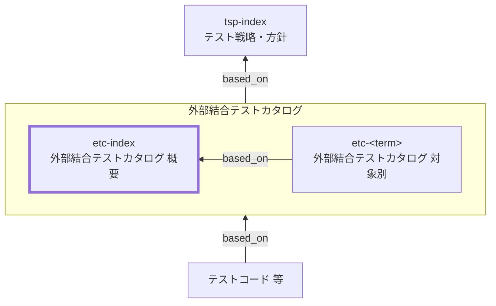

---
specdojo:
  id: specdojo:etc-index-rulebook
  type: rulebook
  deliverable_type: test
  status: draft
  recipe: undecided
  sample: specdojo:etc-index-sample
  template: undecided
---

# 外部結合テストカタログ概要 作成ルール

External Integration Test Catalog (ETC) Index Documentation Rules

本ドキュメントは、外部結合テストカタログ（ETC）の概要 `etc-index` を統一形式で記述するためのルールです。
テスト戦略・方針（`tsp-index`）に基づき、外部結合テストに共通する方針と定義を定めます。

対象別カタログ（`etc-<term>`）は [[specdojo:etc-rulebook|外部結合テストカタログ 対象別 作成ルール]] に従います。

## 1. 全体方針

`etc-index` は、対象別カタログ（`etc-<term>`）の品質と一貫性を担保する共通ルール（SSOT）とする。

- 外部結合テストの目的は、システム境界を跨ぐ結合（外部サービス・外部端末・外部環境）を含む振る舞いを、実運用に近い前提で検証することである。
- `etc-index` は考え方・共通方針・共通定義だけを記述し、個別の観点・条件・ケースは `etc-<term>` に、詳細はテストコード・CI 証跡に寄せる。
- `tsp-index` の方針を根拠に、分割基準・観点と条件の立て方・外部依存境界・合格基準・証跡を定義する。
- 対象外と例外を明示し、外部結合テストの責任境界を固定する。再現性・コスト・安全性の観点で実疎通を必須にしない領域は明確に除外する。
- **共通の運用**: 役割の割り当ては適用先のメンバー定義に、`status` の昇格と承認、改訂と廃止、未決事項の登録簿への引き継ぎは [[specdojo:document-metadata-standard|ドキュメントメタ情報標準]] に従います。文書の整形・lint はリポジトリの検証で扱い、業務の検証に含めません。

## 2. 位置づけ

## 3. ファイル命名・ID規則

- ファイル名は `etc-index.md`、対象別は `etc-<term>.md` とし、配置は成果物カタログ（`dct-*.yaml`）の `path` と一致させる。
- 成果物カタログの `local_id` は `etc-index` とする。文書 ID は [[specdojo:id-and-file-naming-standard|ID・ファイル命名標準]] に従い、プロジェクト文書は `<project-id>:etc-index`、プロダクト文書は `etc-index` とする。対象別も同じ区分で `etc-<term>` を使う。
- `<term>` は用語集（GL）の論理名キー（英小文字 kebab-case）とし、日本語の表示名は本文の H1 に記載する。

## 4. 推奨 Frontmatter 項目

許可キー・必須項目・型制約は [[specdojo:document-metadata-standard|ドキュメントメタ情報標準]] と `docs/specdojo/schemas/v1/deliverable-frontmatter.schema.yaml` を正本とします。

- `specdojo:` 配下に置き、`specdojo.id` は「ファイル命名・ID規則」の区分に従う。`specdojo.type` は `test`、`specdojo.rulebook` は `specdojo:etc-index-rulebook` とする。
- 文書名は H1 に「外部結合テストカタログ: 概要（対象システム名）」と記載する。
- `based_on` には最低限 `tsp-index` を含め、BAC・NFR・BR 等は外部依存境界・共通合格基準・環境前提の判断に直接使ったものだけを列挙する。

## 5. 本文構成（標準テンプレ）

`etc-index` は次の見出しを順序固定で配置し、`## 1. 本ドキュメントの目的と適用対象` から始めます。記述ガイドの各節は同名の章に対応します。

| 番号 | 見出し                                          | 必須 |
| ---- | ----------------------------------------------- | ---- |
| 1    | 本ドキュメントの目的と適用対象                  | ○    |
| 2    | テスト対象の括り方と分割基準                    | ○    |
| 3    | 対象外・除外理由（共通）                        | ○    |
| 4    | 観点の立て方（共通）                            | ○    |
| 5    | 条件の立て方（共通）                            | ○    |
| 6    | 観点/条件の採用基準と対象別への分配方針（共通） | ○    |
| 7    | 外部結合テスト共通の境界/依存/環境の扱い        | ○    |
| 8    | ケース表の共通カラム                            | ○    |
| 9    | メモ / 将来課題                                 | 任意 |

## 6. 記述ガイド

### 6.1. 本ドキュメントの目的と適用対象

- 目的：`etc-<term>` を同一基準で作成し、品質・粒度・責任範囲を揃えることを書く。
- 適用対象：外部結合テスト（ET）のカタログ群（`etc-index` / `etc-<term>`）とする。
- 非適用：同一システム内のコンポーネント・内部サービス・DB 等の結合は結合テスト（`itc-index`）、総合・受入は `stc-index` / `atc-index` で扱う。判定に迷う場合は「外部」の定義（テスト対象の括り方と分割基準）で決める。
- カタログを仕様の正本、テストコード・CI を実装と実行結果の証跡として使い分けることを示す。

### 6.2. テスト対象の括り方と分割基準

- `<term>` は外部境界を跨ぐ結合のまとまり（例：外部決済連携、外部 IdP 認証、外部通知、外部ファイル連携、端末機能連携）を単位とする。
- 「外部」はチーム境界の外（外部事業者）に加え、別運用ドメイン（別環境・別責任）も含める。同じチームが同じ環境で運用する構成要素どうしの結合は `itc-index` 側に置く。
- 分割基準は次の優先順で判断する。
  1. 境界・外部 I/F が同一か
  2. 失敗モード（タイムアウト・リトライ・認証失敗・レート制限）の性質が同一か
  3. 合格基準（SLO・復旧・再送の期待）が同一か
  4. 運用責任（監視・手順・担当）が概ね一致するか
- 1〜2 ケースしかない単位は原則統合する。観点が 15 以上、表が 50 行以上、または外部 I/F・環境前提（sandbox / 本番相当）が混在する場合は分割候補とする。

### 6.3. 対象外・除外理由（共通）

- 「対象外」「除外理由」「代替レベル/代替手段」「例外（ET で扱う条件）」の 4 列の表で書き、対象外はテストレベルの責務分界（ET / ST / AT / NFR）に紐づける。
- 例外を認める場合は、いつ・どの条件で扱うかの判断基準を書く。
- 本節は ET 共通に限定し、`etc-<term>` 固有の対象外は対象別に書く。
- 記載候補：長時間耐久・大規模負荷（NFR へ）、本番実アカウント・実データ（受入・本番リハへ）、端末・ブラウザ網羅（ST / AT・互換性試験へ）、外部サービス自体の品質・SLA（監視・ベンダ連携へ）。
- **良い例**: 「本番決済口座への実課金｜顧客残高を変動させるため｜決済 sandbox｜監査済みの限定リハを別計画で行う場合のみ」。**悪い例**: 「性能は対象外」（理由・代替・例外がなく、責務分界を判定できない）。

### 6.4. 観点の立て方（共通）

観点は「外部境界を跨いだときに何を保証するか」の切り口であり、`etc-<term>` の章立てに用います。

- 次の型を順に検討する：外部 I/F 契約の遵守、認証・認可、失敗モード（タイムアウト・レート制限・リトライ・部分失敗・冪等性）、データ整合性（欠損・重複・順序・再送）、監視・運用性、ET で扱う範囲の非機能（タイムアウト上限・リトライ回数・バックオフ）。
- 観点名は「名詞＋品質/振る舞い」とし、条件を複数持てる粒度にまとめる。同一対象内で同義の観点名を並べない。
- **良い例**: `外部認証の失効処理`、`再送と冪等性`。**悪い例**: `決済API`（何を保証するか不明）、`401応答`（条件の粒度で観点になっていない）。

### 6.5. 条件の立て方（共通）

条件は、観点を確認するための入力・状態・環境のバリエーションです。

- 入力：代表値・境界値・異常値（空、最大、形式不正、署名不正）。
- 状態：事前データ、トークンの有効・失効、冪等キーの有無、外部側（sandbox）の事前条件。
- 環境：外部 I/F の応答モード（成功・4xx・5xx・タイムアウト・レート制限）、ネットワーク制限、証明書、設定値。
- 代表（正常系）→ 境界（タイムアウト・リトライ・期限）→ 重大例外（課金・二重処理・取り消し不能）の順に追加し、全組合せは作らない。必要な場合は理由と管理方法（データセット参照等）を書く。

### 6.6. 観点/条件の採用基準と対象別への分配方針（共通）

- 1 観点＝1 合否命題、1 条件＝1 差分（入力・状態・環境のいずれか）で採用する。
- 採用には、業務影響が大きい（誤課金・通知漏れ・監査不備）、境界・失敗モードの欠落が不具合につながりやすい、上位仕様（BAC・NFR・BR）に明示要求がある、のいずれかの根拠を書く。根拠のない採用はしない。
- 観点・条件は責務を持つ `etc-<term>` に主担当を 1 つ割り当て、跨る場合は従担当（参照）で表す。分配は「境界・外部 I/F」「失敗モード」「運用責任」の順で決める。
- 分配表は「観点/条件」「採用理由」「主担当 `etc-<term>`」「従担当」「備考」の列で書き、`etc-<term>` 側のケース表とトレース列で追跡できるようにする。
- **良い例**: 「再送と冪等性／同一キーで再送｜二重課金の防止｜`etc-payment-gateway`｜なし｜課金件数を観測」。**悪い例**: 同じ観点を複数の `etc-<term>` に主担当として重複記載する。

### 6.7. 外部結合テスト共通の境界/依存/環境の扱い

実疎通と疑似化で担保する観点を分け、再現性と安全性を両立する方針を書きます。

- 外部サービス接続：sandbox / test environment で契約を検証する。sandbox がない・不安定な場合はスタブ・モックサーバを併用し、どの観点をどちらで担保するかを書く。
- 認証情報：CI の secret 管理に置きログ出力を禁止し、テスト用アカウントを使う。
- タイムアウト・リトライ・冪等性：規定値を明文化し、境界（上限・回数）と、冪等キー・重複送信・部分失敗からの再実行を観測可能にする。
- 環境分離と証跡：テストデータは namespace や prefix で分離して並列実行の衝突を防ぎ、外部リクエスト ID・トレース ID・ログ相関キーを CI から参照可能にする。
- **良い例**: 「応答待ち 2 秒・再送 1 回を上限とし、同じ冪等キーで再送して課金が 1 件に留まることを確認する」。**悪い例**: 「外部 API は実環境で疎通確認する」（再現性・安全性の扱いと観測点がない）。

### 6.8. ケース表の共通カラム

`etc-<term>` のケース表は、全 term で同一カラム順を採用します。

| カラム                 | 区分             | 記述規約                                                      |
| ---------------------- | ---------------- | ------------------------------------------------------------- |
| `case_id`              | 必須             | `et-<term>-<perspective_key>-<nnn>`。対象別に一意で変更しない |
| 条件                   | 必須             | 入力・状態・環境の要点（`入力:` `状態:` `環境:` の形を推奨）  |
| 手順（最小）           | 必須             | 抽象化した最小手順（クリック列挙禁止）                        |
| 期待値                 | 必須             | 観測点を含む判定可能な合格条件                                |
| 観測点（アサーション） | 推奨（運用必須） | レスポンス、外部 ID、DB 状態、イベント、ログ相関等            |
| 境界/依存              | 推奨（運用必須） | sandbox / スタブ、タイムアウト設定、リトライ設定等            |
| トレース               | 推奨（運用必須） | req / spec / ac / issue 等の ID                               |
| 優先度                 | 推奨（運用必須） | P0 / P1 / P2                                                  |
| 自動化                 | 推奨（運用必須） | manual / automated / mixed                                    |
| 証跡                   | 推奨（運用必須） | テストコード、CI run、外部リクエスト ID、ログ検索キー等       |

- `perspective_key` は `etc-<term>` の観点ごとに、観点名を表す英語の英小文字・数字・ハイフン（kebab-case）で決め、観点見出しの直下に宣言する。観点名を改めても `perspective_key` は原則変更しない。
- `nnn` は 3 桁・10 刻み（010, 020, 030…）を推奨する。
- **良い例**: `et-payment-gateway-retry-idempotency-010`（観点「再送と冪等性」）、期待値「同一冪等キーの再送で課金が 1 件、応答に同一の外部取引 ID」。**悪い例**: `et-payment-gateway-再送-1`（日本語・桁なし）、期待値「エラーにならないこと」。

### 6.9. メモ / 将来課題

- 未決事項の論点・外部結合テストへの影響・当面の扱いを記録し、決定済みの必須方針は対応する章へ反映する。
- 記載候補：sandbox 不安定時の擬似化方針、テストデータのクリーンアップ手順、監視へのリンク形式、外部依存を含むテストの実行時間上限。

## 7. 禁止事項

| 項目                                                                   | 理由                                                                         |
| ---------------------------------------------------------------------- | ---------------------------------------------------------------------------- |
| `etc-index` に個別ケース（条件・手順・期待値）を大量に列挙する         | `etc-index` は共通方針のSSOTであり、個別は `etc-<term>` に集約するため       |
| 外部サービス実疎通を無条件に必須化し、再現性・コスト・安全性を無視する | CI不安定・費用増・情報漏洩リスクになり、運用不能になるため（例外基準が必要） |
| 手順にUI操作のクリック列挙を書く（末端表でも過剰な操作手順を書く）     | ETの焦点が外部境界なのに、E2E/UIの責務と混ざり保守性が低下するため           |
| `case_id` を後から変更する（参照があるのに変更する）                   | トレース・証跡リンクが壊れ、履歴追跡が不能になるため                         |
| 対象外・除外理由（共通）と矛盾するケースを `etc-<term>` に記載する     | 責任境界が崩れるため（例外は根拠と条件を明記）                               |
| 内部の結合（`itc-index` の範囲）を `etc-<term>` に重複して載せる       | 結合テストとの責務境界が崩れ、同じケースを二重管理するため                   |
