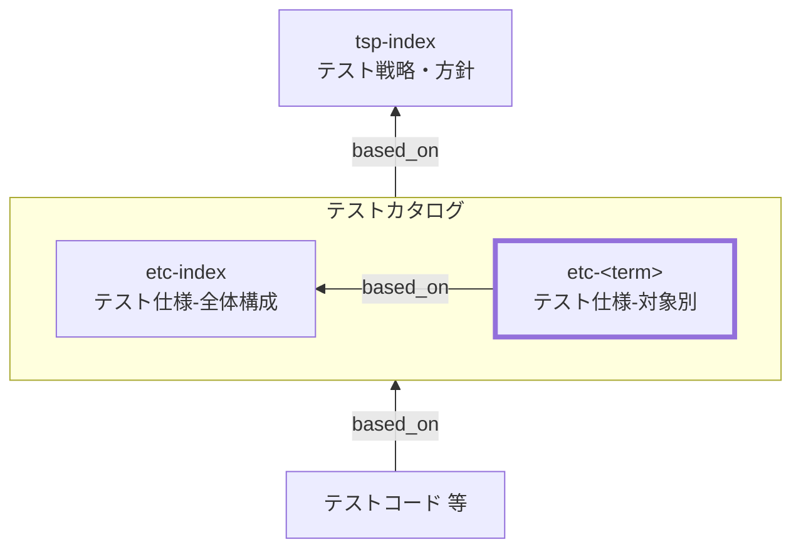

---
specdojo:
  id: specdojo:etc-rulebook
  type: rulebook
  deliverable_type: test
  status: draft
  recipe: undecided
  sample: specdojo:etc-sample
  template: undecided
---

# 外部結合テストカタログ 対象別 作成ルール

External Integration Test Catalog (ETC) Documentation Rules

対象別の外部結合テストカタログ `etc-<term>` について、結合責務・境界・環境、観点と条件から作るケース、トレース・証跡の記述基準を定めます。

## 1. 全体方針

- **正本と責務境界**: `etc-<term>` は対象固有の情報だけを記述し、共通方針は `etc-index` を参照する（重複記述しない）。
- **目的**: 外部境界を跨いだ結合の振る舞いを、実運用に近い前提で検証する。内部単体のロジック検証は UT/IT へ寄せる。
- **記載レベル**: ケースは代表→境界→重大例外の順で増やし、直積が必要な場合は理由・範囲を明記する。外部依存（sandbox/スタブ/モック）・テストデータ・秘密情報の扱いは、再現性と安全性を優先して固定する。
- **追跡性**: すべての観点・ケースを根拠仕様（`based_on` / トレース）と証跡（テストコード／CI／外部リクエストID／ログ相関キー等）に接続する。
- **共通の運用**: 役割の割り当ては適用先のメンバー定義に、`status` の昇格と承認、改訂と廃止、未決事項の登録簿への引き継ぎは [[specdojo:document-metadata-standard|ドキュメントメタ情報標準]] に従う。文書の整形・lint はリポジトリの検証で扱い、業務の検証に含めない。
- _UNDECIDED_: `recipe`・`template` の要否は未判断である（template は PJR-WYTX で扱う）。sample は「本文要件」の見出し構成・`trace_key`・条件・ケース表へ未整合であり、後続の sample の見直しで揃える。いずれも ready 化前に解消する。

## 2. 位置づけ（他ドキュメントとの関係）

## 3. ファイル命名・ID規則

- `id` は `etc-<term>`（kebab-case。例: `etc-payment-gateway`）。
- ファイル名は `etc-010-外部結合テストカタログ-<term>.md` 等（例: `etc-010-外部結合テストカタログ-決済ゲートウェイ.md`）。
- `<term>` は用語集(GL)の論理名キー（英小文字kebab-case）を用いる（表示名は本文の H1 / ファイル名で日本語を使用してよい）。

## 4. 推奨 Frontmatter 項目

### 4.1. 設定内容

許可キー・必須項目・型制約は [[specdojo:document-metadata-standard|ドキュメントメタ情報標準]] と `docs/specdojo/schemas/v1/deliverable-frontmatter.schema.yaml` を正本とする。

- メタ情報は `specdojo:` 配下に置き、`id: etc-<term>`、`type: test`、`rulebook: specdojo:etc-rulebook` を指定する。
- 文書名は本文の H1 に `外部結合テストカタログ: <対象名>` と記載する。

### 4.2. 推奨ルール

- `based_on` は原則 `[tsp-index, etc-index]` を最低限とし、対象固有の根拠（`br-*` / `bac-*` / `spec-*` / `nfr-*` 等）は本文「トレース」に集約します。
- 機械処理上の都合で `based_on` にも列挙する場合は、本文トレースと矛盾しないこと。
- 記述内容が多くなる場合は、ドキュメントを分割し、`part_of` で集約ドキュメントに所属させます。

## 5. 本文要件

個別 ETC（`etc-<term>`）は以下の見出し構成を **順序固定** で配置します。

| 番号 | 見出し             | 必須 |
| ---- | ------------------ | ---- |
| 1    | 概要（`<term>`）   | ○    |
| 2    | 責務               | ○    |
| 3    | 対象外             | ○    |
| 4    | 境界/依存/環境     | ○    |
| 5    | トレース           | ○    |
| 6    | テスト観点とケース | ○    |
| 7    | 実行運用メモ       | 任意 |

成果物は上表の番号・名称を `##` 見出しにする。「記述ガイド」の節番号は転記しない。「テスト観点とケース」の配下は `### 6.n. 観点: <観点>`、その直下の `perspective_key` 宣言行、`#### 6.n.1. 意図`、`#### 6.n.2. 条件・ケース表` の順とする。

## 6. 記述ガイド

共通方針は `etc-index` を正本とし、本書は対象別に固有の判断だけを定める。受入確認では次を順に照合する。

1. `etc-index` と責務・対象外・境界/依存/環境の扱いを照合し、例外に条件と根拠があることを確かめる。
2. 各責務に対応する観点・代表条件・境界条件・重大失敗モードと、トレース先の仕様が一致することを確かめる。
3. ケースの条件・手順・期待値・観測点をテストコードと照合し、外部依存の扱いを固定して同じ合否を再現でき、CI証跡と外部リクエストID等へ辿れることを確かめる。

### 6.1. 概要（`<term>`）

- 外部境界・連携対象・主たるユースケースが分かるように1〜3行で書き、レビューア・実装者・テスト実装者・運用者が前提を把握できるようにする。
- 粒度は `etc-index` の分割基準に従う。主要エンドポイント・イベント・Webhook 等の関連I/Fは任意で列挙してよい。長い背景は書かず、根拠はトレースで示す。
- 良い例: 「販売管理システムから決済ゲートウェイへ与信を依頼し、結果を Webhook で受け取る連携」。悪い例: 「決済関連の処理」（外部境界と連携対象が判断できない）。

### 6.2. 責務

- 保証すべき責務を3〜7個程度、動詞で始まる箇条書きにする（例: 外部I/F契約に従って送受信する／署名を検証する／再送時に冪等性を満たす／相関IDを出力する）。
- タイムアウト・レート制限・部分失敗・二重処理などの重大失敗モードを含め、外部レスポンス・外部ID・内部状態・イベント・ログ相関など観測可能な成果を可能なら併記する。責務に含めないものは「対象外」へ移す。
- 良い例: 「応答タイムアウト後に同じ冪等キーで再送し、与信を1件に留める」。悪い例: 「外部APIを適切に呼ぶ」（観測点がなく観点へ分解できない）。

### 6.3. 対象外

- `etc-index` の「対象外・除外理由（共通）」と重複させず、別の外部I/F・別termの責務など対象固有の除外だけを示す。
- 形式は「対象外: xxx（理由: yyy、代替: zzz）」を推奨し、代替レベル（IT/ST/AT/NFR等）を併記する。
- ETで扱う例外には条件・根拠・安全性・再現方法（sandbox/スタブ等）を書く。

### 6.4. 境界/依存/環境

- 境界は対象の入口／出口（API、Webhook、Queue、Batch、SDK、外部コール）を示す。
- 外部依存の扱いは `etc-index` の「外部結合テスト共通の境界/依存/環境の扱い」に従い、対象で使う依存ごとの扱い（sandbox/実/スタブ/モック）と観測点、認証、タイムアウト値、テストデータの namespace と後始末、時刻依存の固定方法だけを書く。
- 秘密情報はログ出力禁止・CI secret 管理・マスキング方針を書く。実疎通が不可・不安定などで共通方針から外れる場合は、理由と再現性・費用・安全性への影響を書く。

### 6.5. トレース

根拠仕様との対応は「トレース」の表を正本とし、観点・ケース表は `trace_key`（`TR-xx`）で参照する。

| 列名        | 内容・判断条件                              |
| ----------- | ------------------------------------------- |
| `trace_key` | 観点・ケースから参照する一意なキー          |
| 仕様ID      | 根拠仕様の文書ID                            |
| 要点        | ケース作成の判断に使ったポイントを1行で示す |
| 備考        | 補足がある場合に記載する                    |

- `trace_key` は文書内で一意とし、追加順に採番する（`TR-01` 始まりの2桁を推奨）。並べ替えや削除で振り直さず、欠番を詰めない。
- 観点・ケース表の `トレース` 列は仕様IDを直書きせず `TR-02` / `TR-01,TR-03` のように記載する。根拠の追加時は先にトレース表へ行を追加する。

### 6.6. テスト観点とケース

ケース表のカラム・`case_id` の形式（`et-<term>-<perspective_key>-<nnn>`）・付番は `etc-index` の「ケース表の共通カラム」に従う。本節は対象別に固有の判断だけを定める。

#### 6.6.1. 観点

- 観点は `etc-index` の「観点の立て方（共通）」に従って命名し、条件が複数ぶら下がる粒度にまとめる。
- 見出しは `観点: <観点>`（半角コロンと半角空白）とし、見出し直下の1行目に `perspective_key: <key>` の形で宣言する（例: `perspective_key: retry-idempotency`）。観点名は改善のため変更してよいが、`perspective_key` は変えない。
- 意図は観点ごとに「この観点で保証すること」を1〜2行で書く。

#### 6.6.2. 条件・ケース表

- 表の1行は1テストとし、条件は `入力:` `状態:` `環境:` の形で書く。
- 手順は API 呼び出し・ジョブ起動・Webhook 送信等の抽象手順で書き、期待値には観測点（外部レスポンス・外部ID・内部状態・イベント・ログ相関）を含める。
- 証跡はテストコードのパスと CI 実行結果へ辿れる形で書き、外部リクエストIDやログ相関キーを添える。
- 良い例: 条件「環境: 初回応答がタイムアウト」、期待値「同じ冪等キーの再送で与信が1件、内部状態は `authorized`」。悪い例: 期待値「正常に連携できること」（合否を判定できない）。

### 6.7. 実行運用メモ

- 任意の章とし、ケース表に書けない実行上の注意だけを置く。
- 記載候補: テストデータの作り方と削除手順、失敗時の外部側の後始末（取消・返金・無効化等）、実行制約（並列不可・回数制限・実行時間帯・レート制限）、外部サービスのメンテナンス時間。

## 7. 禁止事項

| 禁止事項                                                                           | 理由                                                          |
| ---------------------------------------------------------------------------------- | ------------------------------------------------------------- |
| `etc-index` の共通方針を `etc-<term>` 側で勝手に上書きする（境界/依存/対象外など） | ET全体の一貫性が崩れ、レビュー・保守が困難になるため          |
| 外部疎通を無条件に「実」必須にする（再現性・安全性・費用の判断なし）               | CI不安定化・費用増・情報漏洩リスクで運用不能になるため        |
| ケース表にUIクリック手順を大量に列挙する                                           | ETの焦点が外部境界なのにE2E責務と混ざり、保守性が低下するため |
| 期待値を曖昧に書く（例：「エラーにならないこと」「正常に動くこと」）               | 合否判定ができず証跡にならないため                            |
| `case_id` を変更する／再利用する                                                   | トレース・証跡リンクが破壊され、履歴追跡が不能になるため      |
| `perspective_key` を観点名の修正に合わせて変える                                   | ID体系が不安定になり参照が壊れるため                          |
| 直積（全組合せ）のケースを無条件に作る                                             | ケース爆発で運用不能になるため（必要時は理由・範囲を明記）    |
| トレースや証跡を持たないケースを恒久的に残す                                       | SSOTとして成立しないため（例外は暫定として明記）              |
