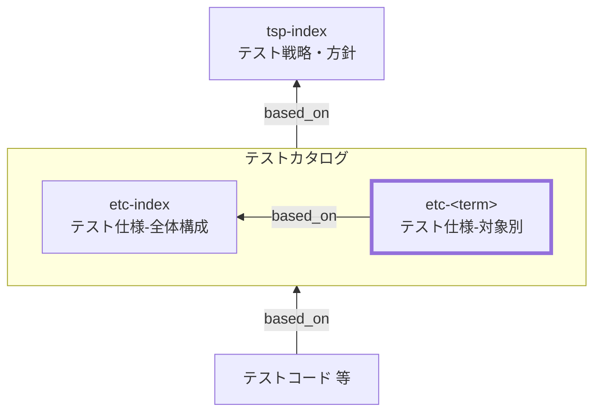

---
specdojo:
  id: specdojo:etc-rulebook
  type: rulebook
  deliverable_type: test
  status: draft
  recipe: undecided
  sample: specdojo:etc-sample
  template: undecided
---

# 外部結合テストカタログ 対象別 作成ルール

External Integration Test Catalog (ETC) Documentation Rules

対象別の外部結合テストカタログ `etc-<term>` について、結合責務・境界・環境、観点と条件から作るケース、トレース・証跡の記述基準を定めます。

## 1. 全体方針

- `etc-<term>` は **対象固有の情報のみ** を記述し、共通ルールは `etc-index` を参照する（重複記述しない）
- 外部結合テストの目的は「**外部境界を跨いだ結合の振る舞い**を、実運用に近い前提で検証すること」である
- ケースは代表→境界→重大例外の順で増やし、直積が必要な場合は理由・範囲を明記する
- 外部依存（sandbox/スタブ/モック）・テストデータ・秘密情報の扱いは、再現性と安全性を優先して固定する
- すべての観点・ケースは、根拠仕様（`based_on` / `トレース`）と、証跡（テストコード／CI／外部リクエストID／ログ相関キー等）に接続されていること
- **共通の運用**: 役割の割り当ては適用先のメンバー定義に、`status` の昇格と承認、改訂と廃止、未決事項の登録簿への引き継ぎは [[specdojo:document-metadata-standard|ドキュメントメタ情報標準]] に従う。文書の整形・lint はリポジトリの検証で扱い、業務の検証に含めない。

## 2. 位置づけ（他ドキュメントとの関係）



## 3. ファイル命名・ID規則

- `id` は `etc-<term>`（kebab-case。例: `etc-payment-gateway`）。
- ファイル名は `etc-010-外部結合テストカタログ-<term>.md` 等（例: `etc-010-外部結合テストカタログ-決済ゲートウェイ.md`）。
- `<term>` は用語集(GL)の論理名キー（英小文字kebab-case）を用いる（表示名は本文の H1 / ファイル名で日本語を使用してよい）。

## 4. 推奨 Frontmatter 項目

### 4.1. 設定内容

許可キー・必須項目・型制約は [[specdojo:document-metadata-standard|ドキュメントメタ情報標準]] と `docs/specdojo/schemas/v1/deliverable-frontmatter.schema.yaml` を正本とする。

- メタ情報は `specdojo:` 配下に置き、`id: etc-<term>`、`type: test`、`rulebook: specdojo:etc-rulebook` を指定する。
- 文書名は本文の H1 に「外部結合テストカタログ: <対象名>」と記載する。

### 4.2. 推奨ルール

- `based_on` は原則 `[tsp-index, etc-index]` を最低限とし、対象固有の根拠（`br-*` / `bac-*` / `spec-*` / `nfr-*` 等）は本文「トレース」に集約します。
- 機械処理上の都合で `based_on` にも列挙する場合は、本文トレースと矛盾しないこと。
- 記述内容が多くなる場合は、ドキュメントを分割し、`part_of` で集約ドキュメントに所属させます。

## 5. 本文構成（標準テンプレ）

個別 ETC（`etc-<term>`）は以下の見出し構成を **順序固定** で配置します。

| 番号 | 見出し                             | 必須 |
| ---- | ---------------------------------- | ---- |
| 1    | 概要（`<term>`）                   | ○    |
| 2    | 責務                               | ○    |
| 3    | 対象外                             | ○    |
| 4    | 境界/依存/環境                     | ○    |
| 5    | トレース                           | ○    |
| 6    | テスト観点とケース                 | ○    |
| 7    | 実行運用メモ（データ/後始末/制約） | 任意 |

記述ガイドの各節は上表の同名の章に対応する。成果物は `## 1. 概要（<term>）` から始め、「テスト観点とケース」の配下は `### 6.1. 観点:<観点>`、`#### 6.1.1. 意図`、`#### 6.1.2. 条件・ケース表` とする。

## 6. 記述ガイド

### 6.1. 概要（`<term>`）

- `<term>` の説明（1〜3行）：外部境界・連携対象・主たるユースケースが分かるように書く
- 期待する利用者：レビューア／実装者／テスト実装者／運用者が前提を把握できる内容にする
- 対象の粒度：`etc-index` の分割基準に従い、過分割／肥大化を避ける
- 関連I/F（任意）：主要エンドポイント、イベント、キュー、Webhook、SDK関数名などを列挙してよい
- 長い背景説明は書かない（根拠はトレースで示す）

### 6.2. 責務

- 箇条書きで 3〜7 個程度を目安に、**動詞で始まる**形で記述する
  - 例：外部I/F契約に従って送受信する／署名を検証する／再送時に冪等性を満たす／失敗時に再試行する／相関IDを出力する

- ETの責務は「結合の振る舞い」であり、内部単体のロジック検証はUT/ITへ寄せる（責務≠観点）
- 重大失敗モード（タイムアウト、レート制限、部分失敗、二重処理など）を含める
- 可能なら観測可能な成果（外部レスポンス、外部ID、内部状態、イベント、ログ相関）とセットで書く
- 責務に含まれないものは「対象外」へ移す

### 6.3. 対象外

`etc-index` の「対象外・除外理由（共通）」に従い、対象固有の除外を示します。

- 対象外は「なぜ除外するか（理由）」とセットで書く
- 可能なら「代替するレベル」（IT/ST/AT/NFR 等）も併記する
- 対象固有の対象外（例：別の外部I/F、別termの責務）を明確にする
- 例外としてETで扱う場合は、条件・根拠・安全性・再現方法（sandbox/スタブ等）を明記する

推奨フォーマット（簡易）：

- 対象外：xxx（理由：yyy、代替：zzz）

### 6.4. 境界/依存/環境

- 境界：対象の入口／出口（API、Webhook、Queue、Batch、SDK、外部コール）を明記する
- 外部依存はカテゴリごとに列挙し、「扱い（sandbox/実/スタブ/モック）」と「観測点」を決める
  - 外部API：sandbox/スタブ（成功/4xx/5xx/タイムアウト/レート制限）
  - 認証：テスト用アカウント、トークン更新/失効の扱い
  - ネットワーク：タイムアウト値、リトライ、DNS/TLS、プロキシ等
  - データ：テストデータのnamespace、クリーンアップ方針（削除/期限/再利用）
  - 時刻：時刻依存のあるI/F（署名期限、リクエスト有効期限）と固定/調整方法

- 秘密情報：ログ出力禁止、CI secret管理、マスキング方針を明記する
- 例外（実疎通が不可/不安定等）がある場合は、理由と影響（再現性・費用・安全性）を明記する

### 6.5. トレース

根拠仕様との対応の正本は「トレース」とし、観点・ケースは `trace_key`（`TR-xx`）で参照します。

#### 6.5.1. 記述ルール（`trace_key`）

- 各トレース項目に **`trace_key`（`TR-xx`）** を付与する（例：`TR-01`…）
- `trace_key` は **本ドキュメント内で一意**で、原則変更しない（削除しても欠番は詰めない）
- 観点・ケース表の `トレース` 列には **仕様IDを直書きせず** `TR-xx` を列挙する
- 新しい根拠が必要になった場合は、**先に本節の表へ追加**し、付与された `trace_key` をケース表で参照する

#### 6.5.2. トレース表（標準フォーマット）

| trace_key | 仕様ID  | 要点    | 備考 |
| --------- | ------- | ------- | ---- |
| TR-01     | br-...  | （1行） | 任意 |
| TR-02     | bac-... | （1行） | 任意 |

- `要点` は「ケース作成の判断に使ったポイント」を **1行**で書く（冗長な仕様説明はしない）

### 6.6. テスト観点とケース

観点（見出し）→ 意図 → 条件・ケース表の順で構成します。

#### 6.6.1. 観点:<観点>

- 観点は `etc-index` の「観点の立て方（共通）」に従って命名する
- 観点の粒度は「条件が複数ぶら下がる」程度にまとめる（細かすぎる観点の乱立を避ける）
- 観点名（見出し）は改善のため変更してよいが、`perspective_key` は原則変更しない

##### 6.6.1.1. 意図

- 観点ごとに「意図（この観点で保証すること）」を 1〜2 行で書く

##### 6.6.1.2. 条件・ケース表

- ケース表の 1 行は「1テスト」を表す（条件×期待値が一意）
- 必須カラムは `etc-index` の定義に従う
- `case_id` は以下を推奨し、変更しない
  - 形式：`<level>-<term>-<perspective_key>-<nnn>`
  - `level`：`et`
  - `perspective_key`：kebab-case のキー文字列（英小文字＋数字＋ハイフン）で、原則変更しない
  - `nnn`：3桁、10刻み（010,020,030…）を推奨

- 条件は「入力/状態/環境」で表現する（`入力:` `状態:` `環境:` を推奨）
- 手順は最小化し、クリック列挙を禁止する（API呼び出し／ジョブ起動／Webhook送信等の抽象手順で書く）
- 期待値は判定可能に書く（外部レスポンス、外部ID、内部状態、イベント、ログ相関など観測点を含める）
- 証跡はテストコードとCI実行結果へ接続できる形で書く（加えて外部リクエストIDやログ相関キー等を推奨）

### 6.7. 実行運用メモ（任意）

- テストデータの作り方／namespace／削除手順
- 失敗時のリトライ手順・外部側の後始末（取消、返金、無効化等）
- 実行制約（並列不可、回数制限、実行時間帯、レート制限）
- 外部サービスのメンテ時間や制限がある場合の注意

## 7. 禁止事項

| 禁止事項                                                                           | 理由                                                          |
| ---------------------------------------------------------------------------------- | ------------------------------------------------------------- |
| `etc-index` の共通方針を `etc-<term>` 側で勝手に上書きする（境界/依存/対象外など） | ET全体の一貫性が崩れ、レビュー・保守が困難になるため          |
| 外部疎通を無条件に「実」必須にする（再現性・安全性・費用の判断なし）               | CI不安定化・費用増・情報漏洩リスクで運用不能になるため        |
| ケース表にUIクリック手順を大量に列挙する                                           | ETの焦点が外部境界なのにE2E責務と混ざり、保守性が低下するため |
| 期待値を曖昧に書く（例：「エラーにならないこと」「正常に動くこと」）               | 合否判定ができず証跡にならないため                            |
| `case_id` を変更する／再利用する                                                   | トレース・証跡リンクが破壊され、履歴追跡が不能になるため      |
| 直積（全組合せ）のケースを無条件に作る                                             | ケース爆発で運用不能になるため（必要時は理由・範囲を明記）    |
| トレースや証跡を持たないケースを恒久的に残す                                       | SSOTとして成立しないため（例外は暫定として明記）              |

## 8. サンプル（最小）

形式の輪郭を示す最小例です。仕様ID・証跡のパスは例示用で、実案件では実在する根拠・実行結果に置き換えます。

```markdown
---
specdojo:
  id: etc-payment-gateway
  type: test
  status: draft
  rulebook: specdojo:etc-rulebook
  based_on: [tsp-index, etc-index]
---

# 外部結合テストカタログ: 決済ゲートウェイ

## 1. 概要（payment-gateway）

決済ゲートウェイとの与信連携を扱う。

## 2. 責務

- 外部I/F契約に従って与信リクエストを送受信する。
- タイムアウト後の再送で冪等性を満たす。
- 外部取引IDと相関IDで結果を追跡できるようにする。

## 3. 対象外

- 大規模負荷試験（測定条件設計が異なるため、NFRで扱う）。
- 多ブラウザ網羅（外部境界の検証外のため、ST/ATで扱う）。

## 4. 境界/依存/環境

- 境界：`POST /payments/authorize`。外部ゲートウェイはsandboxを使用し、タイムアウトを再現する。
- 認証：テスト用APIキーをCI secret管理から取得し、ログに出力しない。
- データ：`test-run-<runId>-*` で分離し、終了時に取消・削除する。
- 時刻：署名の許容窓を前後5分とし、テスト時計を固定する。

## 5. トレース

| trace_key | 仕様ID     | 要点                          | 備考   |
| --------- | ---------- | ----------------------------- | ------ |
| TR-01     | nfr-pay-03 | 同一キーで再送しても与信は1件 | 例示用 |

## 6. テスト観点とケース

### 6.1. 観点:再送と冪等性

#### 6.1.1. 意図

タイムアウト後の再送でも二重課金せず、最終的に与信成功へ収束させる。

#### 6.1.2. 条件・ケース表

| case_id                            | 条件              | 手順（最小）          | 期待値                 | 観測点（アサーション）              | 境界/依存        | トレース | 優先度 | 自動化    | 証跡                                                |
| ---------------------------------- | ----------------- | --------------------- | ---------------------- | ----------------------------------- | ---------------- | -------- | ------ | --------- | --------------------------------------------------- |
| et-payment-gateway-idempotency-010 | 環境: 初回timeout | 与信 → 同一キーで再送 | 与信成功、二重課金なし | 外部取引ID一意、内部状態=authorized | sandbox(timeout) | TR-01    | P0     | automated | tests/et/payment/idempotency.test.ts、CI run、reqId |
```
