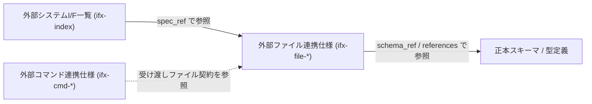

---
specdojo:
  id: specdojo:ifx-file-rulebook
  type: rulebook
  deliverable_type: api
  status: ready
  target_format: yaml
  recipe: not-needed
  sample: specdojo:ifx-file-sample
  template: not-needed
  based_on:
    - specdojo:rulebook-authoring-standard
---

# 外部ファイル連携仕様作成ルール

External File Exchange Specification Authoring Rulebook

外部システムや独立したサブシステム・プロセス間でファイルを授受する契約（配置場所・命名規則・データ形式・必須項目・書き手と読み手・受け渡し手段・失敗時の扱い）を YAML 形式で定義するための規約を定めます。実装コードや外部スキーマの詳細構造は正本を参照し、本書ではファイル受け渡し契約の必須構造と判断基準を規定します。

## 1. 全体方針

### 1.1. 目的と適用範囲

1. **目的**: システム間・プロセス間で授受されるデータファイルおよび状態ファイルの契約を YAML 1 ファイルで明確化し、書き手（送信元）と読み手（受信先）の認識齟齬および異常時の対応漏れを防ぎます。
2. **適用範囲**: CSV、TSV、JSON、XML 等のファイルを介して行われるバッチ連携、データ受け渡し、および実行パイプライン段間のエビデンス・状態ファイル連携仕様に適用します。
3. **共通の運用**: 役割の割り当ては適用先のメンバー定義に、`status` の昇格と承認、改訂と廃止、未決事項の登録簿への引き継ぎは [[specdojo:document-metadata-standard|ドキュメントメタ情報標準]] に従い、本書と成果物で言い直しません。文書の整形・lint はリポジトリの検証で扱い、業務の検証に含めません。

### 1.2. 記載原則と責務境界

1. **外部合意に必要な最小十分の記載**: 読み手・書き手間の契約合意と検証に必要な項目に集中し、DB 物理テーブル名や内部実装クラス名などの内部構造は記載しません。
2. **他の外部インターフェース仕様との境界**:
   - ネットワーク越しの同期 API 契約は [[specdojo:ifx-api-rulebook|外部API仕様作成ルール]]、外部 CLI プロセスの起動契約（引数・標準入出力・終了コード）は [[specdojo:ifx-cmd-rulebook|外部コマンド連携仕様作成ルール]] で扱います。
   - 外部コマンドやエージェントが生成・参照するファイル自体の永続化契約・必須項目・破損時の扱いを独立して合意・検証する必要がある場合は、本ルール（`ifx-file`）で定義します。
3. **正本の参照と二重管理の防止**: データ構造の完全な定義が外部スキーマ（JSON Schema、XSD 等）や実装コードの型定義に存在する場合は、`schema_ref` または `schema.references` で正本を参照し、全項目の再掲を避けます。

## 2. 位置づけ



1. **一覧からの詳細化**: 本仕様は [[specdojo:ifx-index-rulebook|外部システムI/F一覧作成ルール]] に従う `ifx-index` に登録されたファイル連携（`kind: ファイル`、または外部コマンド連携等で授受するファイル契約）の詳細仕様として位置づけます。
2. **ID の対応**: `ifx-index` 側の `spec_ref` に記載された文書 ID（例: `ifx-file-agent-evidence`）と、本仕様の `x-spec-meta.id` を一致させます。
3. **契約の主体とファイルの主体**: `source` / `target` は連携契約全体の送信元・受信先、`writer` / `reader` は個別ファイルを実際に書く・読む主体です。報告内容の作り手とファイルの書き手が異なる場合は、`writer` にファイルの書き手を書きます。

## 3. ファイル命名・ID規則

命名と配置の共通原則は [[specdojo:docs-structure-guide|ドキュメント構成ガイド]] に従います。

### 3.1. ファイル配置と命名規則

1. **配置先**: プロダクト文書は `docs/ja/product/020-external-interface-specs/`、プロジェクト文書は `docs/ja/projects/<project-id>/020-external-interface-specs/` に配置します。
2. **ファイル名**: `ifx-file-<対象データまたは連携名>.yaml`（英小文字・数字・ハイフンの kebab-case、例: `ifx-file-agent-evidence.yaml`）とします。
3. **1 ファイルの粒度**: 原則として 1 つのファイル連携契約（1 バッチ処理または 1 パイプライン受け渡し単位）につき 1 YAML ファイルを作成します。同一契約内で連動して生成・参照される複数ファイル（例: `evidence.json` と `pipeline-state.json`）は、`files` 配列を用いて 1 ファイルにまとめて定義できます。

### 3.2. 仕様 ID 規則

1. **仕様 ID**: 置き場所で決まります。プロダクト文書（`docs/ja/product/` の下）は名前空間なしの `ifx-file-<kebab-case>`、プロジェクト文書は `<project-id>:ifx-file-<kebab-case>` とします。
2. **一意性**: ファイル名の stem（拡張子を除いた部分）と ID のローカル部を一致させ、文書インデックス全体で一意にします。

## 4. 推奨 Frontmatter・メタ情報項目

共通メタ情報の原則は [[specdojo:document-metadata-standard|ドキュメントメタ情報標準]] を正本とします。

### 4.1. スキーマ宣言とメタ情報（x-spec-meta）の構成

YAML 成果物の先頭にはスキーマ検証用の modeline コメント（専用スキーマが未整備の場合は `# specdojo-schema: none reason=no-ifx-file-schema`）を記載し、ルートキー `x-spec-meta` 配下にメタ情報を定義します。`none` は構造の検証だけを省き、`x-spec-meta.type` と rulebook 宣言の照合はリポジトリの schema 検証で省かれません。

```yaml
# specdojo-schema: none reason=no-ifx-file-schema
x-spec-meta:
  id: ifx-file-agent-evidence
  type: api
  status: draft
  title: 外部ファイル連携仕様（agent の evidence）
  rulebook: specdojo:ifx-file-rulebook
  based_on:
    - ifx-index
```

### 4.2. メタ情報の各フィールド定義

| フィールド名 | 必須 | 型     | 説明                                                                                                         |
| ------------ | ---- | ------ | ------------------------------------------------------------------------------------------------------------ |
| `id`         | ○    | string | 仕様の一意な ID。ファイル名および `ifx-index` の `spec_ref` と対応させます。                                 |
| `type`       | ○    | string | `api` 固定。本 rulebook の `deliverable_type: api` と一致させます（`file` 等の別値を指定してはなりません）。 |
| `status`     | ○    | string | 文書のライフサイクル状態（`draft` / `ready` / `deprecated`）。                                               |
| `title`      | ○    | string | 対象ファイルまたは連携契約を識別できる日本語名称。                                                           |
| `rulebook`   | ○    | string | 準拠する rulebook ID（`specdojo:ifx-file-rulebook` 固定）。                                                  |
| `part_of`    | 任意 | array  | 所属する上位文書 ID の配列。                                                                                 |
| `based_on`   | 任意 | array  | 根拠となる上位文書 ID（`ifx-index` 等）の配列。未作成の文書や無関係な ID は記載しません。                    |
| `supersedes` | 任意 | array  | 置き換え元の旧仕様 ID の配列。                                                                               |

## 5. 本文要件

### 5.1. トップレベル構造

YAML のルートには以下のキーを配置します。

| キー名                | 必須 | 型             | 概要                                                                      |
| --------------------- | ---- | -------------- | ------------------------------------------------------------------------- |
| `x-spec-meta`         | ○    | object         | 仕様のメタ情報（第4章参照）。                                             |
| `file` または `files` | ○    | object / array | 単一ファイルの場合は `file`、複数ファイル群の場合は `files` で定義する。  |
| `source`              | ○    | string         | 送信元・生成元のシステムまたは主体。                                      |
| `target`              | ○    | string         | 受信先・利用先のシステムまたは主体。                                      |
| `direction`           | ○    | string         | 連携方向（`source_to_target` / `target_to_source` / `bidirectional`）。   |
| `format`              | ○    | string         | 代表データフォーマット（`CSV` / `TSV` / `JSON` / `XML` / `その他`）。     |
| `timing`              | ○    | string         | 連携が発生する契機・スケジュール・パイプライン段階。                      |
| `transport`           | ○    | object         | 受け渡し手段・配置エンドポイント・頻度・書き込み安全性。                  |
| `schema`              | ○    | object         | フォーマット別の構文設定と、フィールド定義または正本スキーマ参照。        |
| `error_handling`      | ○    | object         | 欠落（`missing`）・破損（`malformed`）・伝送失敗（`transport_failure`）。 |

### 5.2. ファイル基本情報（file / files）

単一ファイルの場合は `file` オブジェクト、同一契約内で複数のファイルを扱う場合は `files` 配列の各要素に以下の項目を定義します。

| 項目名            | 必須     | 型     | 説明                                                                                                                     |
| ----------------- | -------- | ------ | ------------------------------------------------------------------------------------------------------------------------ |
| `name`            | ○        | string | ファイルの基本名称（例: `orders.csv`、`evidence.json`）。                                                                |
| `naming_rule`     | ○        | string | 固定名または日時・連番・識別子を含む命名規則（例: `orders_YYYYMMDD.csv`、`evidence.json`）。                             |
| `location`        | ○        | string | 配置ディレクトリまたは論理パス。可変部は `<project-id>`、`<run-id>` 等のプレースホルダで示します。                       |
| `description`     | ○        | string | 当該ファイルが担う役割と格納データの要約。                                                                               |
| `writer`          | 条件付き | string | ファイルを生成・更新する主体と書き込み契機。`files` で複数ファイルを扱う場合や `bidirectional` 連携では必須とします。    |
| `reader`          | 条件付き | string | ファイルを読み取る主体と利用目的。`files` で複数ファイルを扱う場合や `bidirectional` 連携では必須とします。              |
| `format`          | 任意     | string | ファイル個別のフォーマット（`files` 内で形式や文字コードを確認・明示する場合に記載）。                                   |
| `encoding`        | 任意     | string | ファイル個別の文字エンコーディング（例: `UTF-8`）。                                                                      |
| `schema_ref`      | 任意     | string | 当該ファイルの構造正本（実装型定義やスキーマファイル）への参照パス（例: `src/exec/evidence.ts#ExecEvidence`）。          |
| `required_fields` | 任意     | array  | 正本参照時に読み手が必須として検証するトップレベル項目名の配列（例: `[schema_version, task_id, run_id, validations]`）。 |

### 5.3. 連携方向と参加者（source, target, direction）

1. `source` / `target`: システム名またはコンポーネント名で書きます。
2. `direction`: 段間遷移や状態ファイル更新など、双方が書き読みする授受は `bidirectional` とします。

### 5.4. フォーマットと連携契機（format, timing）

1. `timing`: 定期バッチの実行時刻（例: `毎週日曜日 21:30`、`毎日営業終了後 21:00`）またはイベント・状態遷移の契機（例: `executor 完了直後、親検証完了時、reporter 起動前後`）を検証可能な条件として記述します。

### 5.5. 受け渡し方法（transport）

1. `method`（必須）: `ローカルファイルシステム`、`共有ストレージ`、`SFTP`、`HTTPS`、`S3`、`その他` から受け渡し手段を指定します。
2. `endpoint`（必須）: 格納ディレクトリパス、接続先ホスト・パス、またはアップロード先 URL を記述します。認証情報や秘密鍵の値は記載しません。
3. `frequency`（必須）: 連携頻度（`都度`、`タスク実行ごとに都度`、`日次`、`週次` 等）を記述します。
4. `atomic_write`（任意）: ローカルファイルシステムや共有ストレージ等で書き込み途中の読み取り・競合を防ぐ必要がある場合、一時ファイル（`.tmp` 等）への書き込みとアトミック置換（`renameSync` 等）の方針を明記します。

### 5.6. 構造定義と正本参照（schema）

フォーマット別の構文設定と、データ項目の定義または正本参照を記載します。

1. **フォーマット別の構文設定**:
   - `schema.csv` / `schema.tsv`: `delimiter`（区切り文字）、`header`（ヘッダ行の有無, boolean）、`quote`（囲み文字）、`encoding`（原則 `UTF-8`）、`line_ending`（`LF` / `CRLF`）。
   - `schema.json`: `root_type`（`object` / `array`）、`content_type`（`application/json` 等）、`encoding`（`UTF-8`）。
   - `schema.xml`: `root_element`、`namespace`、`encoding`、`xsd_ref`。
2. **項目定義（外部との合意スキーマを本仕様で直接定める場合）**:
   - `schema.fields` 配列に各フィールドの `name`（必須）、`type`（必須）、`description`（必須）、`required`（必須, boolean）を定義し、必要に応じて `example`、`constraints`（`min`、`max`、`maxLength`、`pattern` 等）、`mapping`（`csv.column`、`json.pointer` 等）を記載します。
3. **正本スキーマ・型定義参照（既存の schema やコード型定義が正本の場合）**:
   - `schema.references`（または `schema.schema_ref`、`files[].schema_ref`）に正本ファイルパスを記載し、各ファイルの契約上の必須項目は `files[].required_fields` で宣言します。正本に定義済みの全フィールド構造を YAML 内へ重複転記しません。

### 5.7. 失敗時の扱いとエラーハンドリング（`error_handling`）

以下の 3 区分をすべて定義します。単一ファイル契約では各区分の直下に `action` を記述し、複数ファイル（`files`）や事象ごとに振る舞いが異なる場合は対象別のサブキー（例: `evidence_json`、`pipeline_state_json`、`io_error`）を切って `action` を記述します。

1. `missing`（ファイル欠落時）: 予定時刻または所定段階にファイルが存在しない場合の検知条件、フォールバック継続か中断（`blocked` 等）かの判断、新規初期化や手動発注・再実行案内などの回復手順を規定します。
2. `malformed`（フォーマット・スキーマ不正時）: 構文解析エラー、必須項目欠落、型不正、サイズ上限超過等を検知した場合の扱い（処理停止または空フォールバック、破損ファイルの退避・保持、自動再試行の有無、引き継ぎ先）を規定します。
3. `transport_failure`（伝送・保存失敗時）: ネットワーク遮断、接続タイムアウト、ディスク容量不足、権限不足、ロック競合等の I/O 失敗時の再試行方針（間隔・上限回数）または即時異常停止（終了コード等）と復旧手順を規定します。

## 6. 記述ガイド

### 6.1. ファイル基本情報と責務境界の判断基準

1. **判断基準**: 誰がいつファイルを書き（`source` / `writer`）、誰が何のために読み（`target` / `reader`）、どこにどの名前で置かれるか（`location` / `naming_rule`）が、実装コードを見ずに特定できること。
2. **単一ファイルと複数ファイルの使い分け**: 1 つのファイルだけで完結する連携は `file` を使い、実行エビデンス（`evidence.json`）とパイプライン状態（`pipeline-state.json`）のように同一実行単位で協調動作するファイル群は `files` 配列で定義し、ファイルごとに `writer`・`reader`・`required_fields` を明記します。
3. **仮置き・前提条件の明記**: 通信環境や運用体制に関する前提条件、または未確定の技術判断がある場合は、YAML コメントで `# _ASSUMPTION_:` や `# _UNDECIDED_:` を付記し、何が決まれば解消するかを書きます。

### 6.2. 受け渡し条件と構造定義の判断基準

1. **判断基準**: 下流の実装者がパーサ・バリデータ・ファイル配置処理を実装でき、テスト担当が正常データと境界値・異常データのテストケースを導出できること。
2. **インライン定義と正本参照の選択**:
   - 外部取引先（問屋や外部システム）との CSV / JSON 連携など、リポジトリ内に別途スキーマ定義が存在しない場合は、`schema.fields` に型・必須性・制約（`constraints`）・マッピング（`mapping`）を具体的に記述します。
   - 同一システム内のランナーとエージェント間の契約など、TypeScript 型定義や JSON Schema が正本として存在する場合は、`files[].schema_ref` および `schema.references` で正本パスを指し、`files[].required_fields` に必須キーを列挙して二重管理を防ぎます。

### 6.3. 失敗時の扱いの判断基準

1. **判断基準**: `missing`・`malformed`・`transport_failure` のそれぞれについて、「処理を継続するか停止するか」「既存の作業成果や破損ファイルを保持するか退避するか」「自動再試行するか人間へ引き継ぐか」が明確に判別できること。
2. **再実行時の安全性**: 再試行や `--resume` により二重処理や成果物の消失が起きないよう、状態ファイル欠落時とエビデンス欠落時の扱いの違い（例: 初回は新規生成、`--resume` 時はエラー停止）を区別して記述します。

### 6.4. 良い例と悪い例

#### 6.4.1. 良い例: 正本参照・書き手と読み手・異常時動作の明確化

書き手と読み手、正本参照と必須項目、異常時の動作に絞った抜粋です。

```yaml
files:
  - name: evidence.json
    writer: SpecDojo runner（agent の stdout から抽出・正規化して書き込み）
    reader: SpecDojo runner（検証合否判定、reporter への入力、result.md 反映）
    schema_ref: src/exec/evidence.ts#ExecEvidence
    required_fields: [schema_version, task_id, run_id, stage, changes, validations, final_message]

error_handling:
  missing:
    evidence_json:
      action: executor 終了時に未生成の場合は構造化報告を空としてフォールバックし、終了コードと親検証で判定する
  malformed:
    evidence_json:
      action: 解析失敗ログを出力した上で構造化報告を空として扱い、成果物の変更内容は保持して手動確認へ引き継ぐ
  transport_failure:
    io_error:
      action: ディスク容量不足や権限エラー時は標準エラー出力に理由を出力し、即時異常停止（exit code 1）させる
```

#### 6.4.2. 悪い例: メタ情報不整合・実装詳細の混入・曖昧な異常時処理

```yaml
x-spec-meta:
  id: ifx-file-bad-example
  type: file # 禁止: deliverable_type と不整合（api 固定）
  title: 連携仕様
  rulebook: specdojo:ifx-file-rulebook

# 禁止: source, target, timing, direction が欠落している
file:
  name: data.json
  # 禁止: naming_rule, location, description が欠落している
  query: SELECT * FROM orders WHERE status = 'DONE' # 禁止: 内部 SQL の記述
  handler_class: com.example.OrderHandlerImpl # 禁止: 内部実装クラス名の記述

transport:
  method: 適切に転送する # 禁止: 手段・endpoint・frequency が不明

error_handling:
  action: 問題ないように処理する # 禁止: missing / malformed / transport_failure の区分と具体的な回復手順がない
```

## 7. 禁止事項

| 禁止する記述                                                                    | 理由                                                                       |
| ------------------------------------------------------------------------------- | -------------------------------------------------------------------------- |
| `x-spec-meta.type` に `api` 以外の値（`file` 等）を指定すること                 | rulebook の `deliverable_type: api` およびスキーマ検証との整合が崩れるため |
| `source`、`target`、`timing`、`direction`、または `file` 必須項目の省略         | 責任境界、連携契機、配置場所・命名規則が特定できず実装・検証不能になるため |
| `error_handling` の 3 区分（`missing` / `malformed` / `transport_failure`）省略 | 異常発生時の停止・継続判断や破損ファイルの退避・復旧手順が定まらないため   |
| 正本スキーマや型定義の全文コピー＆ペーストによる再掲                            | 正本との二重管理になり、フィールド変更時に仕様間の不整合を引き起こすため   |
| DB 物理テーブル名、SQL 文、内部クラス名などの内部実装詳細の記載                 | 外部インターフェース契約と内部設計の責務境界が混同されるため               |
| 接続パスワード、秘密鍵、API トークン、個人情報の実データの直接記載              | セキュリティおよび機密保護上のリスクを防ぐため                             |
| 「適切に処理する」「問題ないようにする」等の検証不能な曖昧表現                  | 実装の分岐および合否判定の基準として機能しないため                         |

## 8. 運用ルール

### 8.1. 成果物の検証手順

1. **一覧・正本との照合**: `ifx-index` の `spec_ref` と `x-spec-meta.id` が一致し、`schema_ref` / `references` の参照先が実在して、`files[].required_fields` が正本の必須項目と矛盾しないことを確かめます。欠落や不一致が 1 件でもあれば不合格とし、正本に合わせて直します。
2. **異常系の導出**: `error_handling` の 3 区分（`missing`、`malformed`、`transport_failure`）と `required_fields` から正常系・異常系の確認ケースを導出し、各ケースで継続・停止、ファイルの保持・退避、再試行・引き継ぎの期待結果が一意に決まることを確かめます。
