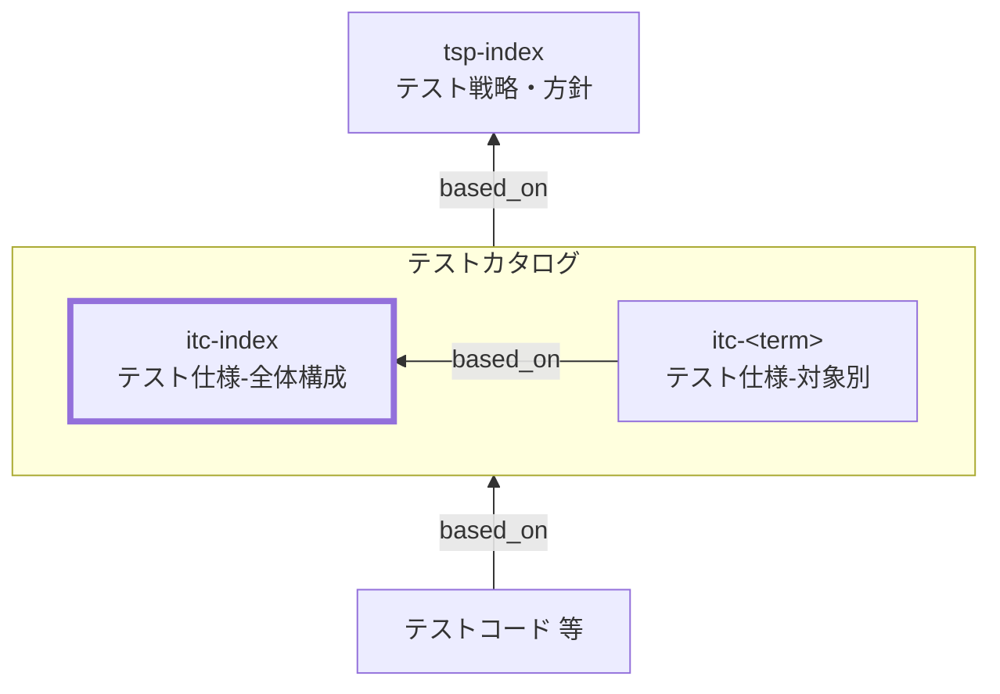

---
specdojo:
  id: specdojo:itc-index-rulebook
  type: rulebook
  deliverable_type: test
  status: draft
  recipe: undecided
  sample: specdojo:itc-index-sample
  template: undecided
---

# 内部結合テストカタログ概要 作成ルール

Internal Integration Test Catalog (ITC) Index Documentation Rules

内部結合テストカタログ（ITC）の全体概要 `itc-index` に、TSPに基づく共通方針を記述するためのルールです。対象別カタログ `itc-<term>` は [[specdojo:itc-rulebook|内部結合テストカタログ 作成ルール]] に従います。

## 1. 全体方針

- **正本の分担**: `itc-index` は共通方針、`itc-<term>` は対象別の観点・条件・ケース、テストコード／CIは実装と実行証跡を担う。
- **記載範囲**: `tsp-index` を根拠に、分割基準、観点/条件の立て方、依存境界、合格基準、証跡を定義し、対象外と例外条件を明示する。
- **検証範囲**: 複数コンポーネントを結合し、UTでMockしていた依存の一部を実装/実インフラに近づけて検証する。結果を不安定にする外部要因は制御する。
- **共通の運用**: 役割の割り当ては適用先のメンバー定義に、`status` の昇格と承認、改訂と廃止、未決事項の登録簿への引き継ぎは [[specdojo:document-metadata-standard|ドキュメントメタ情報標準]] に従う。文書の整形・lint はリポジトリの検証で扱い、業務の検証に含めない。

## 2. 位置づけ（他ドキュメントとの関係）



## 3. ファイル命名・ID規則

- **ファイル名**: `itc-index.md` とし、配置は成果物カタログの宣言に合わせる。
- **文書 ID**: [[specdojo:id-and-file-naming-standard|ID・ファイル命名標準]] に従い、プロダクト文書は `itc-index`、プロジェクト文書は `<project-id>:itc-index` とする。対象別も同じ区分で `itc-<term>` を使う。
- **対象名**: `<term>` は用語集の論理名キー（英小文字kebab-case）とし、日本語の表示名は本文先頭の H1 に記載する。

## 4. 推奨 Frontmatter 項目

### 4.1. 設定内容

許可キー・必須項目・型制約は [[specdojo:document-metadata-standard|ドキュメントメタ情報標準]] と `docs/specdojo/schemas/v1/deliverable-frontmatter.schema.yaml` に従う。

- `specdojo.id` は「ファイル命名・ID規則」の区分に従う。
- `specdojo.type` は `test`、`specdojo.rulebook` は `specdojo:itc-index-rulebook` とする。
- 文書名は `# 内部結合テストカタログ: 概要（<システム名>）` とする。

### 4.2. 推奨ルール

- `based_on` には、適用先の正規 ID で `tsp-index` を含める。
- BAC/NFR/BR 等は、境界・分配・共通合格基準・環境方針の判断に直接利用したものだけを列挙する。
- カタログの `depends_on` がある場合は、その推移閉包内の作成済み文書に限定する。

## 5. 本文構成（標準テンプレ）

`itc-index` は以下の見出し構成を **順序固定**で配置します。

| 番号 | 見出し                                          | 必須 |
| ---- | ----------------------------------------------- | ---- |
| 1    | 本ドキュメントの目的と適用対象                  | ○    |
| 2    | テスト対象の括り方と分割基準                    | ○    |
| 3    | 対象外・除外理由（共通）                        | ○    |
| 4    | 観点の立て方（共通）                            | ○    |
| 5    | 条件の立て方（共通）                            | ○    |
| 6    | 観点/条件の採用基準と対象別への分配方針（共通） | ○    |
| 7    | 内部結合テスト共通の境界/依存の扱い             | ○    |
| 8    | テスト環境・データの共通方針                    | ○    |
| 9    | ケース表の共通カラム                            | ○    |
| 10   | メモ / 将来課題                                 | 任意 |

成果物本文は上表の番号付き H2 とし、各章の内容は「記述ガイド」に従う。

## 6. 記述ガイド

### 6.1. 本ドキュメントの目的と適用対象

- 目的は対象別カタログの品質・粒度・責任範囲を揃えることとし、適用対象のシステム・コンポーネント群を明記する。
- UT/ET/ST/AT との責務分界を示し、各レベルの詳細はそれぞれの `*c-index` に委ねる。
- 保証する結合を具体化する（例：I/F変換、永続化、トランザクション境界、Repository実装・SQL・マイグレーション・シリアライズの妥当性）。

### 6.2. テスト対象の括り方と分割基準

- `<term>` は「結合のまとまり」（例：ユースケース×主要I/F、サブシステム境界、アプリ層＋DB層の縦スライス）とする
- 分割基準（推奨順）：
  1. **結合境界**：どのコンポーネント（層/モジュール/サービス）間を結合するかが説明できる
  2. **データ境界**：同じDBスキーマ/同じ集約/同じトランザクション境界に収まる
  3. **I/F境界**：API契約、メッセージ形式、永続化I/Fが同質
  4. **変更影響**：同時に変更されやすい結合が同じ単位に収まる
  5. **担当境界**：所有者（チーム/モジュール）が概ね一致する

- 過分割の禁止：`itc-<term>` が「1〜2ケースしかない」単位は原則統合する
- 肥大化の抑制（分割の目安）：
  - 観点が過剰（例：15以上）／表の行数が過剰（例：50以上）になったら分割候補
  - 依存境界や環境要件（DB種別、メッセージ基盤など）が混在する場合は分割候補

### 6.3. 対象外・除外理由（共通）

#### 6.3.1. 記述ルール

- 形式は **「対象外」「除外理由」「代替レベル/代替手段」「例外」** の4点セットを基本とする
- 「対象外」は **テストレベルの責務分界**（IT/ET/E2E/NFR）に紐づけて書く
- 「例外」を認める場合は **判断基準**（いつ/どの条件で）と **環境制御**（再現性担保）を明記する
- 個別対象（`itc-<term>`）固有の対象外は、`itc-<term>` 側に書く。本節は **IT共通** に限定する

#### 6.3.2. 推奨フォーマット（表）

| 対象外（やらないこと） | 除外理由 | 代替レベル/代替手段 | 例外（ITで扱う条件） |
| ---------------------- | -------- | ------------------- | -------------------- |

#### 6.3.3. 典型例（記載候補）

- 外部サービスとの実疎通（外部IdP、外部決済、外部SaaS 等）
- ブラウザ差分・端末差分のUI互換（表示崩れ、入力方式差）
- 大規模負荷・耐久・SLO検証（p95、スループット、長時間稼働）
- 本番相当のネットワーク障害・リージョン障害（DR含む）
- 人手オペレーションを伴う総合シナリオ（業務横断の受入）

### 6.4. 観点の立て方（共通）

観点（Perspective）は「結合したときに何を保証するか」の切り口であり、対象別カタログの章立て（見出し）として用います。

- 観点の型（最低限この順で検討）：
  - 結合インタフェースの契約（要求/応答、例外、エラーコード、イベント発行）
  - データ永続化の整合性（保存/取得、制約、マイグレーション、参照整合）
  - トランザクション境界（コミット/ロールバック、部分失敗、冪等）
  - 依存障害時の挙動（DB障害、キュー詰まり、タイムアウト等：※外部は基本除外）
  - 状態遷移の整合性（複数コンポーネントに跨る状態変化）
  - セキュリティ境界（認可伝播、テナント境界、監査ログ等：ITで担保する範囲）

- 命名規則：**「名詞＋品質/振る舞い」**（例：`永続化の整合性` / `トランザクション境界` / `I/F契約の互換性`）
- 粒度規則：
  - 観点は「条件を複数持てる」程度にまとめる
  - 観点が抽象的で条件が作れない場合は観点を再定義する

- 重複禁止：同一対象内で同義の観点名を乱立させない

### 6.5. 条件の立て方（共通）

条件（Condition）は、観点を確認するための前提状態・入力状態・環境条件のバリエーションです。
条件は「入力」「状態」「環境」に分解して作成します（ITでは **環境/データ条件** の比重が上がります）。

- 入力（Input）：代表値／境界値／異常値（形式不正、桁あふれ 等）
- 状態（State）：事前データ、権限、ステータス、関連レコード有無、ロック/競合状態
- 環境（Env）：DB設定、トランザクション分離レベル、時刻、リトライ設定、メッセージ基盤設定 等

組合せルール（増やし過ぎ防止）：

- まず代表ケース（正常系）を作る
- 次に境界（上限/下限/空/ゼロ、制約違反）を追加する
- 最後に重大例外（整合性破壊、二重計上、データ欠損につながるもの）を追加する
- 原則として直積は作らない。必要な場合は理由と管理方法（データセット参照等）を明記する

### 6.6. 観点/条件の採用基準と対象別への分配方針（共通）

#### 6.6.1. 採用基準（共通）

- 観点は「1観点=1合否命題」で採用する（複数命題の混在を禁止）
- 条件は「1条件=1差分（入力/状態/環境）」で採用する
- 追加時は、次のいずれかに該当する根拠を明示する
  - 失敗時の業務影響が大きい（誤更新/欠損/二重計上など）
  - 境界/例外/状態遷移の欠落が不具合につながりやすい
  - 上位仕様（BAC/NFR/BR等）に明示的な要求がある
- 「重要そうだから」など根拠不明の採用はしない

#### 6.6.2. 対象別への分配方針（共通）

- 観点/条件は、責務を持つ `itc-<term>` に **主担当1つ** を割り当てる（重複割当は例外扱い）
- 複数 `itc-<term>` に跨る場合は、主担当 + 従担当（参照）で表現し、重複記載を避ける
- 分配判断は「結合境界」「データ境界」「変更影響」の順で決める
- 分配結果は `itc-<term>` 側のケース表とトレース列で追跡可能にする

推奨フォーマット（例）:

| 観点/条件 | 採用理由 | 主担当 `itc-<term>` | 従担当（任意） | 備考 |
| --------- | -------- | ------------------- | -------------- | ---- |

### 6.7. 内部結合テスト共通の境界/依存の扱い

- DB：
  - 原則：**実DB（または実DB相当）** を用いる（コンテナDB等で再現性を担保）
  - 例外：DB以外の結合に集中したい場合のみ、Fake/Stubを許可（理由を明記）

- マイグレーション/スキーマ：
  - 原則：マイグレーション適用を前提に実行し、主要制約（NOT NULL/UNIQUE/FK等）を観測可能にする

- 外部API/外部サービス：
  - 原則：実疎通しない（Stub/Mockサーバで制御）。外部はETで担保する

- 時刻：
  - 原則：固定クロック、またはテスト実行時刻を基準に再現可能にする（TZ含む）

- 非同期/メッセージング：
  - 原則：制御可能な実装（インメモリブローカ、テスト用ブローカ、同期化）で決定性を担保

- 例外方針（Mock/Stub/Fakeの使い分け）：
  - Fake：状態を持つ簡易実装（インメモリキュー等）
  - Stub：応答固定で分岐を作る（外部I/F）
  - Mock：相互作用（回数/引数/順序）を検証する場合に使用

### 6.8. テスト環境・データの共通方針

- 環境の原則：
  - CIで再現可能（コンテナ、固定バージョン、固定設定）
  - 依存サービス（DB/Queue/Cache等）は **起動方法と設定を標準化**（compose/helm等）

- データの原則：
  - テストは独立（データ初期化、トランザクションロールバック、名前空間分離）
  - データセットは最小化し、必要なら参照方式（fixture seed）を採用する

- 並列実行の原則：
  - スキーマ/DBを分離、またはテストごとに namespace を分離し、相互干渉を避ける

- ログ/観測：
  - 失敗時の診断に必要なログ（SQL/リクエストID等）を取得可能にする（秘匿情報はマスク）

### 6.9. ケース表の共通カラム

`itc-<term>` のケース表は、次の共通カラム順とする。「推奨（運用必須）」の列も運用時には揃える。

| カラム                 | 区分             | 内容・受入条件                                                                                                   |
| ---------------------- | ---------------- | ---------------------------------------------------------------------------------------------------------------- |
| `case_id`              | 必須             | 対象別に一意で変更しない。`it-<term>-<perspective_key>-<nnn>` を推奨（例：`it-order-persistence-integrity-010`） |
| 条件                   | 必須             | 入力・状態・環境の要点。`入力:` `状態:` `環境:` の形を推奨                                                       |
| 手順（最小）           | 必須             | API呼出し・ジョブ実行等の最小手順。UIクリック列挙は禁止                                                          |
| 期待値                 | 必須             | 観測点を含む、判定可能な合格条件                                                                                 |
| 観測点（アサーション） | 推奨（運用必須） | レスポンス、DB状態、イベント、相互作用等の検証箇所                                                               |
| 境界/依存              | 推奨（運用必須） | DB種別、ブローカ、Stub等の扱い                                                                                   |
| トレース               | 推奨（運用必須） | 対象別カタログの根拠仕様への対応                                                                                 |
| 優先度                 | 推奨（運用必須） | P0/P1/P2                                                                                                         |
| 自動化                 | 推奨（運用必須） | manual/automated/mixed                                                                                           |
| 証跡                   | 推奨（運用必須） | テストコード/CI/レポート等の参照先                                                                               |

- `perspective_key` は英小文字・数字・ハイフンのkebab-caseで、原則変更しない。`nnn` は3桁・10刻み（010, 020, 030…）を推奨する。
- 表の1行は条件と期待値が一意な1テストとし、詳細手順はテストコードへ寄せる。
- **良い例**: 「一意制約違反の入力で登録APIを呼び、409応答とDB差分なしを確認する」。**悪い例**: 「正常に動くこと」（観測点も合格条件も不明）。

### 6.10. メモ / 将来課題

- 検討候補は fixture生成・匿名化・seed戦略、環境起動時間短縮（コンテナ最適化・キャッシュ）、flaky対策（リトライ方針・タイムアウト基準）、証跡リンク形式、ケースID重複・必須列の検査などとする。
- 未決事項は論点と、対象別カタログ・環境・データ・証跡への影響（当面の扱い、決定後に直す箇所）を記載する。
- 確定して共通方針となった内容は該当章へ移し、本節で言い直さない。

## 7. 禁止事項

| 項目                                                               | 理由                                                                                   |
| ------------------------------------------------------------------ | -------------------------------------------------------------------------------------- |
| `itc-index` に個別ケース（条件・手順・期待値）を大量に列挙する     | `itc-index` は共通方針のSSOTであり、個別は `itc-<term>` に集約するため                 |
| 環境前提（DB/Queue等）を対象ごとに無根拠に変更する                 | IT全体で再現性が崩れ、CIが不安定・レビュー困難になるため（例外は根拠とともに明記）     |
| 外部サービス疎通をITの必須範囲に含める                             | 外部要因で結果が揺れ、再現性が低く、責務はETへ分離すべきため                           |
| 手順にUI操作のクリック列挙を書く（末端表でも過剰な操作手順を書く） | 保守性が低く、変更に弱く、テストの意図が見えなくなるため                               |
| `case_id` を後から変更する（参照があるのに変更する）               | トレース・証跡リンクが壊れ、履歴追跡が不能になるため                                   |
| `itc-index` の対象外方針と矛盾するIT範囲を無説明で拡張する         | レベル間の責務分界が崩れるため（ITで必要なら、対象/根拠/再現性対策を明記して定義する） |

## 8. サンプル（最小）

対象外の判断を示す部分例です。成果物全体では「本文構成（標準テンプレ）」の必須章を揃えます。

```markdown
---
specdojo:
  id: itc-index
  type: test
  status: draft
  rulebook: specdojo:itc-index-rulebook
  based_on: [tsp-index]
---

# 内部結合テストカタログ: 概要（受注管理）

## 3. 対象外・除外理由（共通）

| 対象外（やらないこと）    | 除外理由                       | 代替レベル/代替手段  | 例外（ITで扱う条件）             |
| ------------------------- | ------------------------------ | -------------------- | -------------------------------- |
| 外部決済との実疎通        | 外部要因で結果が揺れる         | ET                   | なし。ITではStubで応答を制御する |
| ブラウザ/端末差分のUI互換 | 実行環境差が本質               | E2E                  | なし                             |
| 性能・負荷・耐久          | 測定設計と条件統制が別途必要   | NFR                  | なし                             |
| リージョン障害・DR        | 本番相当環境の再現コストが高い | ST/運用リハ、Chaos等 | なし                             |
```
