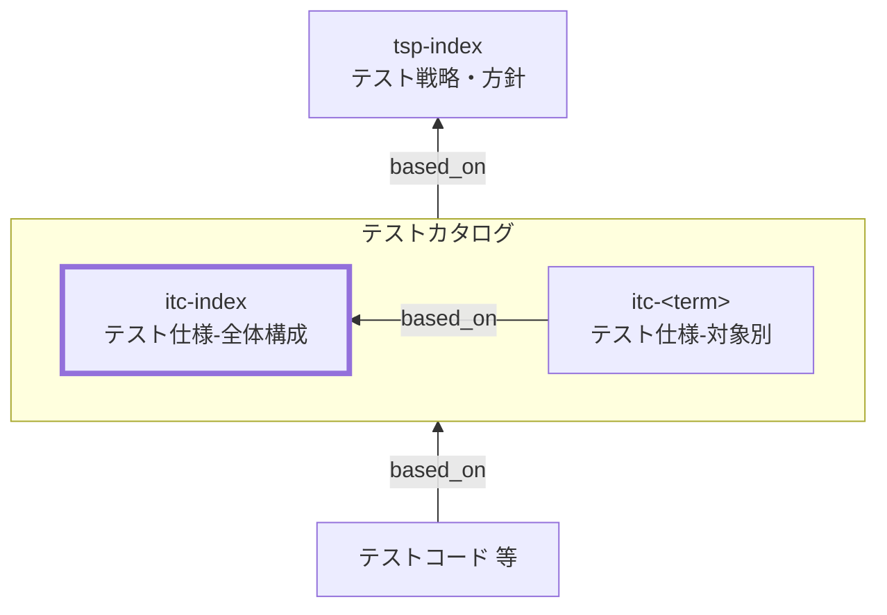

---
specdojo:
  id: specdojo:itc-index-rulebook
  type: rulebook
  deliverable_type: test
  status: draft
  recipe: undecided
  sample: specdojo:itc-index-sample
  template: undecided
---

# 内部結合テストカタログ概要 作成ルール

Internal Integration Test Catalog (ITC) Index Documentation Rules

内部結合テストカタログ（ITC）の全体概要 `itc-index` に、TSPに基づく共通方針を記述するためのルールです。対象別カタログ `itc-<term>` は [[specdojo:itc-rulebook|内部結合テストカタログ 作成ルール]] に従います。

## 1. 全体方針

- **正本の分担**: `itc-index` は共通方針、`itc-<term>` は対象別の観点・条件・ケース、テストコード／CIは実装と実行証跡を担う。
- **記載範囲**: `tsp-index` を根拠に、分割基準、観点/条件の立て方、依存境界、合格基準、証跡を定義し、対象外と例外条件を明示する。
- **検証範囲**: 内部結合テスト（IT）は、同一システム内の複数コンポーネントを結合し、単体テスト（UT）で Mock していた依存の一部を実装・実インフラに近づけて検証する。結果を不安定にする外部要因は制御する。
- **共通の運用**: 役割の割り当ては適用先のメンバー定義に、`status` の昇格と承認、改訂と廃止、未決事項の登録簿への引き継ぎは [[specdojo:document-metadata-standard|ドキュメントメタ情報標準]] に従う。文書の整形・lint はリポジトリの検証で扱い、業務の検証に含めない。

## 2. 位置づけ

## 3. ファイル命名・ID規則

- **ファイル名**: `itc-index.md` とし、配置は成果物カタログの宣言に合わせる。
- **文書 ID**: [[specdojo:id-and-file-naming-standard|ID・ファイル命名標準]] に従い、プロダクト文書は `itc-index`、プロジェクト文書は `<project-id>:itc-index` とする。対象別も同じ区分で `itc-<term>` を使う。
- **対象名**: `<term>` は用語集の論理名キー（英小文字kebab-case）とし、日本語の表示名は本文先頭の H1 に記載する。

## 4. 推奨 Frontmatter 項目

許可キー・必須項目・型制約は [[specdojo:document-metadata-standard|ドキュメントメタ情報標準]] と `docs/specdojo/schemas/v1/deliverable-frontmatter.schema.yaml` を正本とする。

- `specdojo.id` は「ファイル命名・ID規則」の区分に従い、`specdojo.type` は `test`、`specdojo.rulebook` は `specdojo:itc-index-rulebook` とする。
- 文書名は H1 に `# 内部結合テストカタログ: 概要（<システム名>）` と記載する。
- `based_on` には適用先の正規 ID で `tsp-index` を含め、BAC・NFR・BR 等は境界・分配・共通合格基準・環境方針の判断に直接使ったものだけを列挙する。カタログの `depends_on` がある場合は、その推移閉包内の作成済み文書に限定する。

## 5. 本文要件

`itc-index` は次の見出しを順序固定の番号付き H2 で配置する。各章の書き方は記述ガイドの同名の節に従う。

| 番号 | 見出し                                          | 必須 |
| ---- | ----------------------------------------------- | ---- |
| 1    | 本ドキュメントの目的と適用対象                  | ○    |
| 2    | テスト対象の括り方と分割基準                    | ○    |
| 3    | 対象外・除外理由（共通）                        | ○    |
| 4    | 観点の立て方（共通）                            | ○    |
| 5    | 条件の立て方（共通）                            | ○    |
| 6    | 観点/条件の採用基準と対象別への分配方針（共通） | ○    |
| 7    | 内部結合テスト共通の境界/依存の扱い             | ○    |
| 8    | テスト環境・データの共通方針                    | ○    |
| 9    | ケース表の共通カラム                            | ○    |
| 10   | メモ / 将来課題                                 | 任意 |

## 6. 記述ガイド

### 6.1. 本ドキュメントの目的と適用対象

- 目的は対象別カタログの品質・粒度・責任範囲を揃えることとし、適用対象のシステム・コンポーネント群を明記する。
- テストレベルは UT（単体）・IT（内部結合）・ET（外部結合）・ST（総合）・AT（受入）と、NFR に基づく非機能テスト（性能・負荷・耐久等）で表し、IT と他レベルの責務分界を示す。各レベルの詳細はそれぞれの `*c-index` に委ねる。
- 保証する結合を具体化する（例：I/F 変換、永続化、トランザクション境界、Repository 実装・SQL・マイグレーション・シリアライズの妥当性）。

### 6.2. テスト対象の括り方と分割基準

- `<term>` は結合のまとまり（例：ユースケース×主要 I/F、サブシステム境界、アプリ層＋DB 層の縦スライス）とする。
- 分割基準は次の優先順で判断する。
  1. 結合境界：どのコンポーネント（層・モジュール・サービス）間を結合するかが説明できる
  2. データ境界：同じ DB スキーマ・集約・トランザクション境界に収まる
  3. I/F 境界：API 契約・メッセージ形式・永続化 I/F が同質
  4. 変更影響：同時に変更されやすい結合が同じ単位に収まる
  5. 担当境界：所有者（チーム・モジュール）が概ね一致する
- 1〜2 ケースしかない単位は原則統合する。観点が 15 以上、表が 50 行以上、または依存境界・環境要件（DB 種別、メッセージ基盤など）が混在する場合は分割候補とする。

### 6.3. 対象外・除外理由（共通）

- 「対象外（やらないこと）」「除外理由」「代替レベル/代替手段」「例外（IT で扱う条件）」の 4 列の表で書き、代替レベルは「本ドキュメントの目的と適用対象」で定めたテストレベルの略語で書く。
- 例外を認める場合は、判断基準（いつ・どの条件で）と再現性を担保する環境制御を書く。
- 本節は IT 共通に限定し、`itc-<term>` 固有の対象外は対象別に書く。
- 記載候補：外部サービスとの実疎通（外部 IdP・決済・SaaS 等、ET へ）、ブラウザ・端末差分の UI 互換（ST へ）、大規模負荷・耐久・SLO 検証（非機能テストへ）、本番相当のネットワーク・リージョン障害（運用リハ・DR 訓練へ）、人手オペレーションを伴う業務横断シナリオ（ST・AT へ）。
- **良い例**: 「外部決済との実疎通｜外部要因で結果が揺れる｜ET｜なし。IT では Stub で応答を制御する」。**悪い例**: 「外部連携は対象外」（理由・代替・例外がなく、責務分界を判定できない）。

### 6.4. 観点の立て方（共通）

観点は「結合したときに何を保証するか」の切り口であり、`itc-<term>` の章立てに用いる。

- 次の型を順に検討する：結合 I/F の契約（要求・応答、例外、エラーコード、イベント発行）、データ永続化の整合性（保存・取得、制約、マイグレーション、参照整合）、トランザクション境界（コミット・ロールバック、部分失敗、冪等）、依存障害時の挙動（DB 障害、キュー詰まり、タイムアウト。外部は除外）、複数コンポーネントに跨る状態遷移の整合性、IT で担保する範囲のセキュリティ境界（認可伝播、テナント境界、監査ログ）。
- 観点名は「名詞＋品質/振る舞い」とし、条件を複数持てる粒度にまとめる。条件が作れない抽象的な観点は再定義し、同一対象内で同義の観点名を並べない。
- **良い例**: `永続化の整合性`、`トランザクション境界`。**悪い例**: `注文API`（何を保証するか不明）、`409応答`（条件の粒度で観点になっていない）。

### 6.5. 条件の立て方（共通）

条件は、観点を確認するための入力・状態・環境のバリエーションである。IT では環境・データ条件の比重が上がる。

- 入力：代表値・境界値・異常値（形式不正、桁あふれ等）。
- 状態：事前データ、権限、ステータス、関連レコードの有無、ロック・競合状態。
- 環境：DB 設定、トランザクション分離レベル、時刻、リトライ設定、メッセージ基盤設定。
- 代表（正常系）→ 境界（上限・下限・空・ゼロ、制約違反）→ 重大例外（整合性破壊、二重計上、データ欠損）の順に追加し、直積は作らない。必要な場合は理由と管理方法（データセット参照等）を書く。

### 6.6. 観点/条件の採用基準と対象別への分配方針（共通）

- 1 観点＝1 合否命題、1 条件＝1 差分（入力・状態・環境のいずれか）で採用する。
- 採用には、失敗時の業務影響が大きい（誤更新・欠損・二重計上）、境界・例外・状態遷移の欠落が不具合につながりやすい、上位仕様（BAC・NFR・BR 等）に明示要求がある、のいずれかの根拠を書く。根拠のない採用はしない。
- 観点・条件は責務を持つ `itc-<term>` に主担当を 1 つ割り当て、跨る場合は従担当（参照）で表して重複記載を避ける。分配は「結合境界」「データ境界」「変更影響」の順で決める。
- 分配表は「観点/条件」「採用理由」「主担当 `itc-<term>`」「従担当（任意）」「備考」の列で書く。従担当の `itc-<term>` は、ケース表のトレース列に主担当側の `case_id` を記して分配結果を追跡できるようにする。
- **良い例**: 「在庫引当の二重計上防止｜誤在庫で欠品を招く｜`itc-order`｜`itc-inventory`｜引当件数を DB で観測」。**悪い例**: 同じ観点を複数の `itc-<term>` に主担当として重複記載する。

### 6.7. 内部結合テスト共通の境界/依存の扱い

依存ごとに原則と例外を書き、再現性を担保する。

- DB：実 DB（または実 DB 相当のコンテナ DB 等）を用いる。DB 以外の結合に集中する場合に限り、理由を書いて Fake・Stub を許可する。
- マイグレーション・スキーマ：マイグレーション適用を前提に実行し、主要制約（NOT NULL・UNIQUE・FK 等）を観測可能にする。
- 外部 API・外部サービス：実疎通せず Stub・Mock サーバで制御し、実疎通は ET で担保する。
- 時刻：固定クロック、またはテスト実行時刻を基準に再現可能にする（TZ を含む）。
- 非同期・メッセージング：インメモリブローカ、テスト用ブローカ、同期化などの制御可能な実装で決定性を担保する。
- テストダブル：状態を持つ簡易実装は Fake、応答固定で分岐を作るのは Stub、相互作用（回数・引数・順序）を検証する場合は Mock を使う。
- **良い例**: 「DB はマイグレーション適用済みのコンテナ DB、決済 I/F は Stub で 200・402・タイムアウトを返し分ける」。**悪い例**: 「DB はモックで代用する」（理由がなく、永続化の整合性を観測できない）。

### 6.8. テスト環境・データの共通方針

- 環境：コンテナ・固定バージョン・固定設定で CI 上で再現可能にし、依存サービス（DB・Queue・Cache 等）の起動方法と設定を標準化する（compose・helm 等）。
- データ：テストごとに独立させ（データ初期化、トランザクションロールバック、名前空間分離）、データセットは最小化して必要なら参照方式（fixture seed）を採る。
- 並列実行：スキーマ・DB またはテストごとの namespace を分離し、相互干渉を避ける。
- ログ・観測：失敗時の診断に必要なログ（SQL・リクエスト ID 等）を取得可能にし、秘匿情報はマスクする。

### 6.9. ケース表の共通カラム

`itc-<term>` のケース表は、次の共通カラム順とする。区分が「推奨（運用必須）」の列は作成途中の空欄を許し、完成した `itc-<term>` では全行に記入する。

| カラム                 | 区分             | 内容・受入条件                                                                                                   |
| ---------------------- | ---------------- | ---------------------------------------------------------------------------------------------------------------- |
| `case_id`              | 必須             | 対象別に一意で変更しない。`it-<term>-<perspective_key>-<nnn>` を推奨（例：`it-order-persistence-integrity-010`） |
| 条件                   | 必須             | 入力・状態・環境の要点。`入力:` `状態:` `環境:` の形を推奨                                                       |
| 手順（最小）           | 必須             | API 呼出し・ジョブ実行等の最小手順。UI クリック列挙は禁止                                                        |
| 期待値                 | 必須             | 観測点を含む、判定可能な合格条件                                                                                 |
| 観測点（アサーション） | 推奨（運用必須） | レスポンス、DB 状態、イベント、相互作用等の検証箇所                                                              |
| 境界/依存              | 推奨（運用必須） | DB 種別、ブローカ、Stub 等の扱い                                                                                 |
| トレース               | 推奨（運用必須） | 根拠仕様（BAC・NFR・BR 等）の ID。従担当の場合は主担当側の `case_id` も記す                                      |
| 優先度                 | 推奨（運用必須） | P0 / P1 / P2                                                                                                     |
| 自動化                 | 推奨（運用必須） | manual / automated / mixed                                                                                       |
| 証跡                   | 推奨（運用必須） | テストコード・CI・レポート等の参照先                                                                             |

- `perspective_key` は英小文字・数字・ハイフンの kebab-case で、原則変更しない。`nnn` は 3 桁・10 刻み（010, 020, 030…）を推奨する。
- 表の 1 行は条件と期待値が一意な 1 テストとし、詳細手順はテストコードへ寄せる。
- 検査ツールが整うまでは、`case_id` の重複がないこと、必須列が全行で埋まっていること、完成した `itc-<term>` で「推奨（運用必須）」列が埋まっていることを手作業で確かめる。
- **良い例**: 「一意制約違反の入力で登録 API を呼び、409 応答と DB 差分なしを確認する」。**悪い例**: 「正常に動くこと」（観測点も合格条件も不明）。

### 6.10. メモ / 将来課題

- 未決事項は論点と、対象別カタログ・環境・データ・証跡への影響（当面の扱い、決定後に直す箇所）を記載する。確定して共通方針となった内容は該当章へ移し、本節で言い直さない。
- 記載候補：fixture 生成・匿名化・seed 戦略、環境起動時間の短縮（コンテナ最適化・キャッシュ）、flaky 対策（リトライ方針・タイムアウト基準）、証跡リンク形式、`case_id` 重複・必須列の自動検査。

## 7. 禁止事項

| 項目                                                               | 理由                                                                                   |
| ------------------------------------------------------------------ | -------------------------------------------------------------------------------------- |
| `itc-index` に個別ケース（条件・手順・期待値）を大量に列挙する     | `itc-index` は共通方針のSSOTであり、個別は `itc-<term>` に集約するため                 |
| 環境前提（DB/Queue等）を対象ごとに無根拠に変更する                 | IT全体で再現性が崩れ、CIが不安定・レビュー困難になるため（例外は根拠とともに明記）     |
| 外部サービス疎通をITの必須範囲に含める                             | 外部要因で結果が揺れ、再現性が低く、責務はETへ分離すべきため                           |
| 手順にUI操作のクリック列挙を書く（末端表でも過剰な操作手順を書く） | 保守性が低く、変更に弱く、テストの意図が見えなくなるため                               |
| `case_id` を後から変更する（参照があるのに変更する）               | トレース・証跡リンクが壊れ、履歴追跡が不能になるため                                   |
| `itc-index` の対象外方針と矛盾するIT範囲を無説明で拡張する         | レベル間の責務分界が崩れるため（ITで必要なら、対象/根拠/再現性対策を明記して定義する） |
