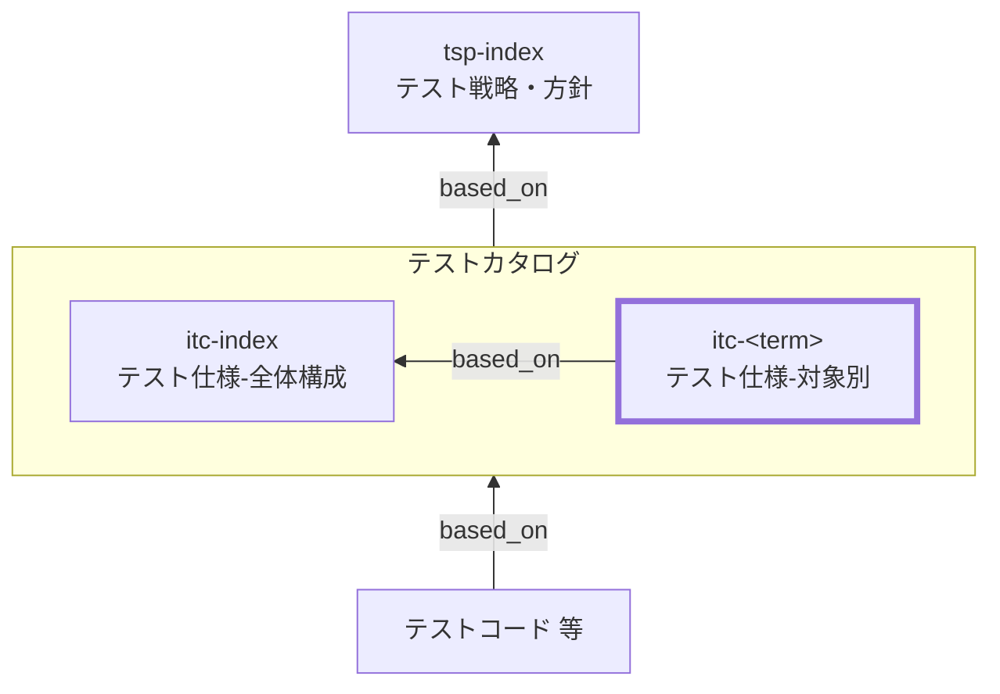

---
specdojo:
  id: specdojo:itc-rulebook
  type: rulebook
  deliverable_type: test
  status: draft
  recipe: undecided
  sample: specdojo:itc-sample
  template: undecided
---

# 内部結合テストカタログ 対象別 作成ルール

Internal Integration Test Catalog (ITC) Documentation Rules

内部結合テストカタログ（ITC）の対象別 `itc-<term>` に、責務・結合境界・依存、観点×条件＝ケース、根拠仕様と証跡を記述する基準を定めます。

## 1. 全体方針

- **正本の分担**: `itc-<term>` は対象固有の観点・ケースの正本とし、共通方針は `itc-index` に従う。詳細な操作・データはテストコードへ寄せる。
- **検証範囲**: 複数コンポーネントの結合としての振る舞いを決定的に検証する。UTでMockしていた境界の一部（Repository、SQL/制約、トランザクション等）を実装に近づけ、外部サービス実疎通・実ユーザUIは原則除外する。例外には根拠と再現性対策を明記する。
- **ケースの単位**: 表の1行を1テストとし、判定可能な条件・期待値、根拠仕様、テストコード／CI証跡を対応付ける。
- **共通の運用**: 役割の割り当ては適用先のメンバー定義に、`status` の昇格と承認、改訂と廃止、未決事項の登録簿への引き継ぎは [[specdojo:document-metadata-standard|ドキュメントメタ情報標準]] に従う。文書の整形・lint はリポジトリの検証で扱い、業務の検証に含めない。

## 2. 位置づけ（他ドキュメントとの関係）



## 3. ファイル命名・ID規則

- **文書 ID**: [[specdojo:id-and-file-naming-standard|ID・ファイル命名標準]] に従い、プロダクト文書は `itc-<term>`、プロジェクト文書は `<project-id>:itc-<term>` とする。
- **ファイル名**: `itc-<term>.md` を推奨し、既存文書の配置・名称は成果物カタログの宣言に合わせる。
- **対象名**: `<term>` は用語集の論理名キー（英小文字kebab-case）とし、日本語の表示名は H1 に記載する。

## 4. 推奨 Frontmatter 項目

### 4.1. 設定内容

許可キー・必須項目・型制約は [[specdojo:document-metadata-standard|ドキュメントメタ情報標準]] と `docs/specdojo/schemas/v1/deliverable-frontmatter.schema.yaml` に従う。

- `specdojo.id` は「ファイル命名・ID規則」の区分に従う。
- `specdojo.type` は `test`、`specdojo.rulebook` は `specdojo:itc-rulebook` とする。
- 文書名は `# 内部結合テストカタログ: <対象名>` とする。

### 4.2. 推奨ルール

- `based_on` は原則 `tsp-index` と `itc-index` を最低限とする。対象固有の根拠（`br-*` / `bac-*` / `spec-*` / `nfr-*` 等）は本文「トレース」に集約し、メタ情報にも列挙する場合は対応を揃える。
- 参照には適用先の正規 ID を用い、カタログの `depends_on` がある場合は、その推移閉包内の作成済み文書に限定する。
- 分割時は `itc-index` の分割基準に従い、`part_of` で集約先を示す。

## 5. 本文構成（標準テンプレ）

個別 ITC（`itc-<term>`）は以下の見出し構成を **順序固定** で配置します。

| 番号 | 見出し                 | 必須 |
| ---- | ---------------------- | ---- |
| 1    | 概要（`<term>`）       | ○    |
| 2    | 責務（結合として保証） | ○    |
| 3    | 対象外                 | ○    |
| 4    | 結合境界/依存/環境前提 | ○    |
| 5    | トレース               | ○    |
| 6    | テスト観点とケース     | ○    |

生成する `itc-<term>` は上表を番号付き H2 とする。「テスト観点とケース」配下は `### 6.1. 観点:<観点>`、`#### 6.1.1. 意図`、`#### 6.1.2. 条件・ケース表` とし、観点ごとに連番を振る。

## 6. 記述ガイド

### 6.1. 概要（`<term>`）

- 対象の結合単位（ユースケース×主要I/F、サブシステム境界等）を1〜3行で示す。
- レビューア／実装者／テスト実装者が構成・依存を把握できるよう、主要コンポーネント（App層、DB層、Queue等）を示す。
- 粒度は `itc-index` の分割基準に従う。仕様の詳細は「トレース」に委ねる。

### 6.2. 責務（結合として保証）

- 結合として保証する振る舞いを、動詞で始まる箇条書きで3〜7個程度示す。例：API入力を永続化モデルへ変換する／同一要求の冪等性を保証する。
- 制約違反、重複、部分失敗、競合等の異常系を含め、可能ならDB状態・レスポンス・イベント等の観測可能な成果を添える。
- 責務は観点の上位概念とし、観点はその分解とする。保証しないものは「対象外」へ記す。

### 6.3. 対象外

- `itc-index` の「対象外・除外理由（共通）」に従い、別サブシステム・別termの責務など対象固有の除外を記す。
- 形式は「対象外：xxx（理由：yyy、代替：zzz）」とし、代替レベル/手段を明記する。
- 例外としてITで扱う場合は、条件・根拠・再現性対策（スタブ、固定設定等）を示す。

### 6.4. 結合境界/依存/環境前提

- 入口／出口（API、ユースケースI/F等）と結合対象（Service＋Repository＋DB等）を明記する。
- 依存ごとに実/スタブ/モック/固定化を選び、`itc-index` の共通方針から対象固有の設定を具体化する。

| 依存                | 扱い・再現性条件                                          |
| ------------------- | --------------------------------------------------------- |
| DB                  | 原則実DB相当（コンテナ等）。スキーマ/制約を観測可能にする |
| 外部API             | 原則Stub/Mockサーバで成功/失敗/タイムアウトを再現         |
| 時刻、乱数/UUID     | TZを含む固定クロック・再現可能な基準時刻、シード/注入     |
| メッセージング      | テスト用ブローカ等で決定性を担保し、同期化/待機条件を明記 |
| ファイル/ストレージ | テスト用領域、Fake、I/F差替と再現性条件を明記             |

- 環境前提としてDB初期化、seed、並列実行の分離、タイムアウト、ログ取得を推奨する。レスポンス/DB状態/イベント/相互作用の観測点も整理してよい。

### 6.5. トレース

根拠仕様との対応の正本を本章の表とし、観点・ケース表では `trace_key`（`TR-xx`）を参照する。

#### 6.5.1. 記述ルール（`trace_key`）

- `trace_key` は文書内で一意の `TR-xx`（2桁、01始まり推奨）とし、追加順に採番する。並べ替えても維持し、削除時は欠番を詰めない。
- 新たな根拠は先にトレース表へ追加する。
- 観点・ケース表の「トレース」列には仕様IDを直書きせず、`TR-xx` を列挙する。

#### 6.5.2. トレース表（標準フォーマット）

| `trace_key` | 仕様ID  | 要点    | 備考 |
| ----------- | ------- | ------- | ---- |
| TR-01       | br-...  | （1行） | 任意 |
| TR-02       | bac-... | （1行） | 任意 |

- `要点` は「ケース作成の判断に使ったポイント」を **1行**で書く（冗長な仕様説明はしない）

### 6.6. テスト観点とケース

観点（見出し）→意図→ケース表（末端表）の順で構成する。

#### 6.6.1. 観点:<観点>

- 観点は `itc-index` の「観点の立て方（共通）」に従って命名する
- 観点の粒度は「条件が複数ぶら下がる」程度にまとめる（細かすぎる観点の乱立を避ける）
- 観点名（見出し）は改善のため変更してよいが、`perspective_key` は原則変更しない（変更が必要なら `supersedes` 等で追跡する）

##### 6.6.1.1. 意図

- 観点ごとに「意図（この観点で保証すること）」を 1〜2 行で書く

##### 6.6.1.2. 条件・ケース表

- ケース表の 1 行は「1テスト」を表す（条件×期待値が一意）
- 必須カラムは `itc-index` の定義に従う
- `case_id` は以下を推奨し、変更しない
  - 形式：`<level>-<term>-<perspective_key>-<nnn>`
  - `level`：`it`
  - `perspective_key`：kebab-case のキー文字列（英小文字＋数字＋ハイフン）で、原則変更しない
  - `nnn`：3桁、10刻み（010,020,030…）を推奨

- 条件は「入力/状態/環境」で表現する（`入力:` `状態:` `環境:` を推奨）
- 手順は最小化し、クリック列挙を禁止する（API呼び出し／ユースケース起動／ジョブ実行等の抽象手順で書く）
- 期待値は判定可能に書く（レスポンス、DB状態、イベント、ログ、トランザクション結果等の観測点を含める）
- 証跡はテストコードとCI実行結果へ接続できる形で書く（例：パス、CI run ID 等）

推奨：観点ごとのケース数は「代表→境界→重大例外」の順で増やし、直積（全組合せ）を原則避ける

## 7. 禁止事項

| 禁止事項                                                                                     | 理由                                                          |
| -------------------------------------------------------------------------------------------- | ------------------------------------------------------------- |
| `itc-index` の共通方針を `itc-<term>` 側で勝手に上書きする（環境前提・依存の扱い・対象外等） | IT全体の一貫性が崩れ、CI不安定・レビュー/保守が困難になるため |
| ケース表にUIクリック手順を大量に列挙する                                                     | ITの責務逸脱になりやすく、意図が読めず変更に弱くなるため      |
| 外部サービス実疎通を必須ケースとして恒久化する                                               | 外部要因で結果が揺れ、再現性が低く、ETへ分離すべき責務のため  |
| 期待値を曖昧に書く（例：「エラーにならないこと」「正常に動くこと」）                         | 合否判定ができず証跡にならないため                            |
| `case_id` を変更する／再利用する                                                             | トレース・証跡リンクが破壊され、履歴追跡が不能になるため      |
| `perspective_key` を観点名の修正に合わせて頻繁に変える                                       | ID体系が不安定になり参照が壊れるため                          |
| 直積（全組合せ）のケースを無条件に作る                                                       | ケース爆発で運用不能になるため（必要時は理由・範囲を明記）    |
| トレースや証跡を持たないケースを恒久的に残す                                                 | SSOTとして成立しないため（例外は暫定として明記）              |

## 8. サンプル（最小）

トレースとケースの対応を示す部分例です。成果物全体では「本文構成（標準テンプレ）」の必須6章を揃えます。仕様ID・証跡は例示です。

```markdown
---
specdojo:
  id: itc-order
  type: test
  status: draft
  rulebook: specdojo:itc-rulebook
  based_on: [tsp-index, itc-index]
---

# 内部結合テストカタログ: 受注（order）

## 5. トレース

| `trace_key` | 仕様ID        | 要点                 | 備考 |
| ----------- | ------------- | -------------------- | ---- |
| TR-01       | bac-order-01  | 受注登録の入力制約   |      |
| TR-02       | spec-order-05 | 重複時のエラーコード |      |

## 6. テスト観点とケース

### 6.1. 観点:永続化の整合性

#### 6.1.1. 意図

入力→保存→取得で、データが欠損/改変されず、制約と整合性が担保されることを検証する。

#### 6.1.2. 条件・ケース表

| `case_id`                          | 条件                             | 手順（最小） | 期待値                   | 観測点（アサーション）     | 境界/依存       | トレース | 優先度 | 自動化    | 証跡                                    |
| ---------------------------------- | -------------------------------- | ------------ | ------------------------ | -------------------------- | --------------- | -------- | ------ | --------- | --------------------------------------- |
| it-order-persistence-integrity-010 | 入力: 正常 / 状態: DB空          | POST /orders | 201 + DBに1件作成        | レスポンス/DB行/主要カラム | DB=実(コンテナ) | TR-01    | P0     | automated | tests/it/orders/create.test.ts, CI#123  |
| it-order-persistence-integrity-020 | 入力: 制約違反 / 状態: DB空      | POST /orders | 400 + DBに作成されない   | レスポンス/DB行0           | DB=実(制約観測) | TR-01    | P0     | automated | tests/it/orders/create.test.ts, CI#124  |
| it-order-persistence-integrity-030 | 入力: 重複 / 状態: 既存orderあり | POST /orders | 409 + DB状態が変化しない | エラーコード/DB差分なし    | DB=実           | TR-02    | P1     | automated | tests/it/orders/duplicate.test.ts, CI#9 |
```
