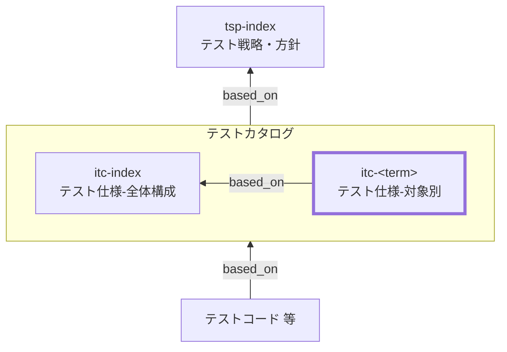

---
specdojo:
  id: specdojo:itc-rulebook
  type: rulebook
  deliverable_type: test
  status: draft
  recipe: undecided
  sample: specdojo:itc-sample
  template: undecided
---

# 内部結合テストカタログ 対象別 作成ルール

Internal Integration Test Catalog (ITC) Documentation Rules

内部結合テストカタログ（ITC）の対象別 `itc-<term>` に、責務・結合境界・依存、観点×条件＝ケース、根拠仕様と証跡を記述する基準を定めます。

## 1. 全体方針

- **正本の分担**: `itc-<term>` は対象固有の観点・ケースの正本とし、共通方針は `itc-index` に従う。詳細な操作・データはテストコードへ寄せる。
- **検証範囲**: 内部結合テスト（IT）として、複数コンポーネントの結合としての振る舞いを決定的に検証する。単体テスト（UT）でモックしていた境界の一部（Repository、SQL/制約、トランザクション等）を実装に近づけ、外部サービス実疎通・実ユーザUIは原則除外し、外部結合テスト（ET）へ分ける。例外には根拠と再現性対策を明記する。
- **ケースの単位**: 表の1行を1テストとし、判定可能な条件・期待値、根拠仕様、テストコード／CI証跡を対応付ける。
- **共通の運用**: 役割の割り当ては適用先のメンバー定義に、`status` の昇格と承認、改訂と廃止、未決事項の登録簿への引き継ぎは [[specdojo:document-metadata-standard|ドキュメントメタ情報標準]] に従う。文書の整形・lint はリポジトリの検証（`npm run lint:md`・`npm run lint:fm`）で扱い、業務の検証に含めない。
- _UNDECIDED_: `recipe`・`template` の要否は未判断である。いずれも PJR-WYTX（template の登録簿項目）で併せて判断し、ready 化前に解消する。

## 2. 位置づけ（他ドキュメントとの関係）

## 3. ファイル命名・ID規則

- **文書 ID**: [[specdojo:id-and-file-naming-standard|ID・ファイル命名標準]] に従い、プロダクト文書は `itc-<term>`、プロジェクト文書は `<project-id>:itc-<term>` とする。
- **ファイル名**: `itc-<term>.md` を推奨し、既存文書の配置・名称は成果物カタログの宣言に合わせる。
- **対象名**: `<term>` は用語集の論理名キー（英小文字kebab-case）とし、日本語の表示名は H1 に記載する。

## 4. 推奨 Frontmatter 項目

### 4.1. 設定内容

許可キー・必須項目・型制約は [[specdojo:document-metadata-standard|ドキュメントメタ情報標準]] と `docs/specdojo/schemas/v1/deliverable-frontmatter.schema.yaml` に従う。

- `specdojo.id` は「ファイル命名・ID規則」の区分に従う。
- `specdojo.type` は `test`、`specdojo.rulebook` は `specdojo:itc-rulebook` とする。
- 文書名は `# 内部結合テストカタログ: <対象名>` とする。

### 4.2. 推奨ルール

- `based_on` は原則 `tsp-index` と `itc-index` を最低限とする。対象固有の根拠（`br-*` / `bac-*` / `spec-*` / `nfr-*` 等）は本文「トレース」に集約し、メタ情報にも列挙する場合は対応を揃える。
- 参照には適用先の正規 ID を用い、カタログの `depends_on` がある場合は、その推移閉包内の作成済み文書に限定する。
- 分割時は `itc-index` の分割基準に従い、`part_of` で集約先を示す。

## 5. 本文要件

個別 ITC（`itc-<term>`）は以下の見出し構成を **順序固定** で配置します。

| 番号 | 見出し                 | 必須 |
| ---- | ---------------------- | ---- |
| 1    | 概要（`<term>`）       | ○    |
| 2    | 責務（結合として保証） | ○    |
| 3    | 対象外                 | ○    |
| 4    | 結合境界/依存/環境前提 | ○    |
| 5    | トレース               | ○    |
| 6    | テスト観点とケース     | ○    |

成果物は上表の番号・名称を `##` 見出しにする。「記述ガイド」の節番号は転記しない。「テスト観点とケース」の配下は `### 6.n. 観点: <観点>`、その直下の `perspective_key` 宣言行、`#### 6.n.1. 意図`、`#### 6.n.2. 条件・ケース表` の順とし、観点ごとに連番を振る。

## 6. 記述ガイド

本書は対象別に固有の判断だけを定める。

### 6.1. 概要（`<term>`）

- 対象の結合単位（ユースケース×主要I/F、サブシステム境界等）を1〜3行で示す。
- 主要コンポーネント（App層、DB層、Queue等）を示し、レビューア・実装者・テスト実装者が構成と依存を把握できるようにする。
- 粒度は `itc-index` の分割基準に従う。仕様の詳細は「トレース」に委ねる。
- 良い例: 「販売登録APIから販売サービス・在庫Repositoryを経てDBへ保存するまでの縦スライス」。悪い例: 「販売関連の処理」（結合単位と構成が判断できない）。

### 6.2. 責務（結合として保証）

- 結合として保証する振る舞いを、動詞で始まる箇条書きで3〜7個程度示す（例: API入力を永続化モデルへ変換する／同一要求の冪等性を保証する）。
- 制約違反、重複、部分失敗、競合等の異常系を含め、可能ならDB状態・レスポンス・イベント等の観測可能な成果を添える。
- 責務は観点の上位概念とし、観点はその分解とする。保証しないものは「対象外」へ記す。
- 良い例: 「在庫不足の販売登録をロールバックし、販売・在庫の両テーブルを変更しない」。悪い例: 「DBに正しく保存する」（観測点がなく観点へ分解できない）。

### 6.3. 対象外

- `itc-index` の「対象外・除外理由（共通）」と重複させず、別サブシステム・別termの責務など対象固有の除外だけを記す。
- 形式は「対象外: xxx（理由: yyy、代替: zzz）」とし、代替レベル/手段を明記する。
- 例外としてITで扱う場合は、条件・根拠・再現性対策（スタブ、固定設定等）を示す。

### 6.4. 結合境界/依存/環境前提

- 入口／出口（API、ユースケースI/F等）と結合対象（Service＋Repository＋DB等）を明記する。
- 依存の扱いは `itc-index` の「内部結合テスト共通の境界/依存の扱い」に従い、対象で使う依存ごとの扱い（実/スタブ/モック/固定化）と再現性条件だけを書く。共通方針から外れる場合は理由を書く。
- 環境前提としてDB初期化、seed、並列実行の分離、タイムアウト、ログ取得を書く。レスポンス/DB状態/イベント/相互作用の観測点も整理してよい。
- 良い例: 「DBはマイグレーション適用済みのコンテナDB、時刻はTZ付きの固定クロック」。悪い例: 「DBは適宜用意する」（再現条件が判断できない）。

### 6.5. トレース

根拠仕様との対応は「トレース」の表を正本とし、観点・ケース表は `trace_key`（`TR-xx`）で参照する。

| 列名        | 内容・判断条件                                     |
| ----------- | -------------------------------------------------- |
| `trace_key` | 観点・ケースから参照する文書内で一意なキー         |
| 仕様ID      | 根拠仕様の文書ID（`br-*` / `bac-*` / `spec-*` 等） |
| 要点        | ケース作成の判断に使ったポイントを1行で示す        |
| 備考        | 補足がある場合に記載する                           |

- `trace_key` は追加順に採番する（`TR-01` 始まりの2桁を推奨）。並べ替えや削除で振り直さず、欠番を詰めない。
- 観点・ケース表の「トレース」列は仕様IDを直書きせず `TR-01` / `TR-01,TR-02` のように記載する。根拠の追加時は先にトレース表へ行を追加する。
- 根拠仕様が改訂・廃止されたときは、トレース表の行を削除せず残し、備考に改訂内容または廃止と後継の仕様IDを書く。対応するケースは見直して、変更した場合は期待値を更新し、変更しない場合も備考に確認済みと記録する。廃止でケースが不要になる場合は、`case_id` を欠番にして備考へ理由を残す。

### 6.6. テスト観点とケース

ケース表のカラム順と必須・推奨（運用必須）の区分、`case_id` の形式（`it-<term>-<perspective_key>-<nnn>`）と付番は `itc-index` の「ケース表の共通カラム」に従う。本節は対象別に固有の判断だけを定める。

#### 6.6.1. 観点

- 観点は `itc-index` の「観点の立て方（共通）」に従って命名し、条件が複数ぶら下がる粒度にまとめる。
- 見出しは `観点: <観点>`（半角コロンと半角空白）とし、見出し直下の1行目に `perspective_key: <key>` の形で宣言する（例: `perspective_key: persistence-integrity`）。観点名は改善のため変更してよい。
- 観点の分割・統合で保証内容が変わる場合は、新しい `perspective_key` と `case_id` を採番し、旧ケースの行は残して備考に移行先の `case_id` を書く。
- 意図は観点ごとに「この観点で保証すること」を1〜2行で書く。

#### 6.6.2. 条件・ケース表

- 条件×期待値を一意にし、`case_id` は対象別で一意にする。
- 条件は `入力:` `状態:` `環境:` の形で書く。
- 手順はAPI呼び出し・ユースケース起動・ジョブ実行等の抽象手順で書き、期待値にはレスポンス・DB状態・イベント・ログ・トランザクション結果等の観測点を含める。
- 証跡はテストコードのパスとCI実行結果（CI run ID等）へ辿れる形で書く。
- ケースは代表→境界→重大例外の順で増やし、直積は作らない。
- 良い例: 条件「入力: 在庫数を超える数量 / 状態: 在庫3件」、期待値「409応答、販売・在庫テーブルの差分なし」。悪い例: 期待値「エラーにならないこと」（合否を判定できない）。

## 7. 禁止事項

| 禁止事項                                                                                     | 理由                                                          |
| -------------------------------------------------------------------------------------------- | ------------------------------------------------------------- |
| `itc-index` の共通方針を `itc-<term>` 側で勝手に上書きする（環境前提・依存の扱い・対象外等） | IT全体の一貫性が崩れ、CI不安定・レビュー/保守が困難になるため |
| ケース表にUIクリック手順を大量に列挙する                                                     | ITの責務逸脱になりやすく、意図が読めず変更に弱くなるため      |
| 外部サービス実疎通を必須ケースとして恒久化する                                               | 外部要因で結果が揺れ、再現性が低く、ETへ分離すべき責務のため  |
| 期待値を曖昧に書く（例：「エラーにならないこと」「正常に動くこと」）                         | 合否判定ができず証跡にならないため                            |
| `case_id` を変更する／再利用する                                                             | トレース・証跡リンクが破壊され、履歴追跡が不能になるため      |
| `perspective_key` を観点名の修正に合わせて変える                                             | ID体系が不安定になり参照が壊れるため                          |
| 直積（全組合せ）のケースを無条件に作る                                                       | ケース爆発で運用不能になるため（必要時は理由・範囲を明記）    |
| トレースや証跡を持たないケースを恒久的に残す                                                 | SSOTとして成立しないため（例外は暫定として明記）              |
