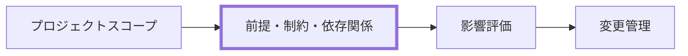

---
specdojo:
  id: specdojo:prj-assumptions-constraints-dependencies-rulebook
  type: rulebook
  deliverable_type: project
  status: ready
  target_format: markdown
  recipe: specdojo:prj-assumptions-constraints-dependencies-recipe
  sample: specdojo:prj-assumptions-constraints-dependencies-sample
  template: specdojo:prj-assumptions-constraints-dependencies-template
  based_on:
    - specdojo:rulebook-authoring-standard
  supersedes: []
---

# 前提・制約・依存関係 作成ルール

Assumptions, Constraints and Dependencies Documentation Rulebook

プロジェクトの成立条件、守るべき限界、外部・先行成果物への依存を整理し、変化時の影響と対応の判断基準を定める。

## 1. 全体方針

- 各項目には影響・確認方法・トリガー・所有者・対応方針を記載する。
- 前提は「成立するものとして置く条件」、制約は「守るべき限界」、依存関係は「他者・外部サービス・先行成果物などから受ける条件」として分離する。
- 上位文書で確定済みの対象外・境界・責務や、継続監視・記録先を持つ事項は再登録せず、該当章の冒頭で正本へ委譲する。結論だけで監視の仕組みがない条件は、展開元の文書・章を示し、確認方法・トリガー・所有者・対応方針を補って登録できる。委譲先に条件が実在することを確認する。
- 文書は計画・設計・実装の詳細やリスク登録簿を代替しない。必要な詳細はそれぞれの成果物に委譲する。
- **共通の運用**: 役割の割り当ては適用先のメンバー定義に、`status` の昇格と承認、改訂と廃止、未決事項の登録簿への引き継ぎは [[specdojo:document-metadata-standard|ドキュメントメタ情報標準]] に従う。文書の整形・lint はリポジトリの検証で扱い、業務の受入確認に含めない。

## 2. 位置づけ

## 3. ファイル命名・ID規則

### 3.1. 成果物の配置と文書 ID

- 配置・命名の共通規則は [[specdojo:docs-structure-guide|ドキュメント構成ガイド]] に従う。
- 本系統の成果物は `020-project-definition/prj-assumptions-constraints-dependencies.md` に配置し、文書 ID を `<project-id>:prj-assumptions-constraints-dependencies` とする。
- 文書 ID と項目 ID は区別し、別文書からの行参照には両者を使う。

### 3.2. 項目 ID

- 項目 ID は前提条件 `ACD-A01`、制約事項 `ACD-C01`、依存関係 `ACD-D01` から種別ごとに既採番の最大値に続ける。整数部は 2 桁未満をゼロ埋めし、100 件目以降は桁を増やす。
- 項目 ID は文書内で一意とし、採番後は内容の修正や並べ替えで変更しない。廃止した ID を別の条件に再利用しない。
- 種別変更は旧項目を廃止して新規採番し、変更記録に新旧 ID と理由を残す。

## 4. 推奨 Frontmatter 項目

- 共通項目の必須性、値・構文、未確定事項の目印は [[specdojo:document-metadata-standard|ドキュメントメタ情報標準]] を正とし、構造は `deliverable-frontmatter.schema.yaml` に従う。
- 本系統では `rulebook` に `specdojo:prj-assumptions-constraints-dependencies-rulebook` を必須で指定する。成果物の `type` は本書の `deliverable_type` に従う。
- `based_on` には、根拠として直接参照したスコープ・憲章などの上位成果物を記載する。計画や技術資料などへの影響先の参照と混同しない。

## 5. 本文要件

次の各章を表の順序で必須とする。前提条件・制約事項・依存関係は項目 ID ごとに管理し、登録対象がない章も省略せず、該当なしの理由と追加時の条件を記載する。

| 章                 | 目的と必須の判断材料                                                 |
| ------------------ | -------------------------------------------------------------------- |
| 前提条件           | 計画の成立に置く条件の根拠、崩れた場合の影響、確認と対応を示す。     |
| 制約事項           | 守るべき限界と適用範囲、逸脱の検知と対応を示す。                     |
| 依存関係           | 他者から受ける条件、必要となる理由、成立の判定と変化時の対応を示す。 |
| 影響評価と対応方針 | 変化が後続成果物・計画に及ぼす影響、一次対応と最終判断の分担を示す。 |
| 監視・変更管理     | 見直し契機、変更記録の内容と記録先、追従更新と報告の責任を示す。     |

## 6. 記述ガイド

### 6.1. 前提条件

- 確認方法は「誰が何を見れば変化を検知できるか」が分かる表現にする。
- 仮置きの前提には `_ASSUMPTION_`、根拠の確認待ちには `_TODO_` を付け、確認先を残す。
- リポジトリ、端末、作業環境、外部ツールなど、外部から継続的に提供される基盤の可用性は「依存関係」として扱う。人の参加見込みを前提とする場合も、特定の助言・承認・成果物を受け取る条件は依存関係として分ける。

良い例: 「代表試行への協力者を確保できる」に、募集の根拠、試行前の確認者、未確保時の延期判断を添える。悪い例: 「店頭で使う端末を利用できる」を前提に登録する、またはスコープで確定済みの単一店舗運用を再掲する。

推奨表:

| ID  | 内容 | 根拠 | 影響 | 監視・確認方法 | 変化のトリガー | 所有者 | 対応方針 |
| --- | ---- | ---- | ---- | -------------- | -------------- | ------ | -------- |

### 6.2. 制約事項

- 技術制約は、特定製品名の列挙ではなく、選択の自由度、互換性、公開適性、運用上の限界として書く。
- 公開情報の制約は、個人情報・機密情報・非公開情報を扱わない方針と、検知時の除去または判断手順を併記する。

良い例: 「承認済み予算枠がない間は追加支出を開始しない」に、発注前の承認証跡確認と、未承認時に人間の責任者へ判断を求める対応を添える。悪い例: 「予算に注意する」とだけ書き、適用範囲と逸脱条件を示さない。

推奨表:

| ID  | 内容 | 適用範囲 | 影響 | 監視・確認方法 | 逸脱のトリガー | 所有者 | 対応方針 |
| --- | ---- | -------- | ---- | -------------- | -------------- | ------ | -------- |

### 6.3. 依存関係

- 依存先は、外部サービスだけでなく、先行成果物、承認、意思決定、提供物も含めて明示する。
- 「受領・成立条件」には、成立したと判定する状態と、誰が何の証跡をいつ確認するかの両方を記載する。期限または判断イベントを示し、検証手順が別文書にある場合はその正本を参照する。
- 成果物の作成・受入を依存とする場合は、対象成果物 ID、適用する受入条件・品質ゲート、証跡の正本を参照できるようにする。単に本書の根拠として読んだ文書は、その理由だけで依存先にしない。
- 意思決定待ちの依存には `_UNDECIDED_` を付け、論点、不成立時の影響、当面の扱いを示す。
- 複数の判断を含む依存では、決定記録で確定した部分と未決部分を分離する。一部の決定だけで依存全体を成立済みとしない。

良い例: 店頭端末を依存先とし、「営業時間中に利用者代表が記録できることを、営業開始前の動作確認で確かめる」と書く。悪い例: 「端末がある」「承認済み」とだけ書き、利用可能性や承認対象を確かめる証跡を示さない。

推奨表:

| ID  | 依存先・条件 | 必要となる理由 | 受領・成立条件 | 変化のトリガー | 所有者 | 対応方針 |
| --- | ------------ | -------------- | -------------- | -------------- | ------ | -------- |

表の各列は必須の意味を表す。「依存先・条件」は受ける提供物・判断・継続提供を、「必要となる理由」はそれが必要な作業と不成立時の影響を示す。

### 6.4. 影響評価と対応方針

- 影響は、スコープ、期日、費用、品質、公開適性、運用責任など、該当する領域を具体的に示す。
- 対応方針には、除去、軽減、受容、再判断のいずれを行うかと、次に判断する人を記載する。
- 所有者は状態確認と一次対応を担う者とし、最終判断者と判断を求める範囲を区別する。

良い例: 「依存先の受入が遅れたら、所有者が影響する成果物と作業を特定し、順序・期日の変更案を判断者へ提示して開始可否を確認する」と書く。悪い例: 「遅れたら調整する」とだけ書き、影響先と次の判断者を示さない。

推奨表:

| 変化の種別 | 主な影響領域 | 最初に確認すること | 一次対応・判断 | 対応方針 |
| ---------- | ------------ | ------------------ | -------------- | -------- |

### 6.5. 監視・変更管理

- 「定期的に確認する」ではなく、スコープまたは実践の型一式が変わったときなど、具体的な見直しの契機を記載する。
- 変更記録には、項目 ID、変化内容、影響範囲、判断者、対応状況、再確認時期を残す。
- 条件の変化が影響するスコープ・計画・Schedule・受入条件を特定し、変更記録と追従作業を項目 ID で結ぶ。

良い例: 「端末の利用不能を検知したら、対象 ID と影響作業、代替策、再確認時期を変更記録に残す。復旧確認を Schedule の試用開始の先行作業にする」と書く。悪い例: 「必要に応じて更新する」とだけ書き、追従対象を示さない。

## 7. 禁止事項

| 禁止事項                                         | 理由                                           |
| ------------------------------------------------ | ---------------------------------------------- |
| スコープ等の上位文書の決定事項を行として再掲する | 正本との二重管理になり、更新漏れと矛盾を招く。 |
| 前提・制約・依存を種別なしに混在させる           | 条件の性質と対応方法を区別できない。           |
| 影響、トリガー、所有者、対応方針のない登録       | 変化時に判断・対応へ使えない。                 |
| 部分決定だけで依存全体を成立済みとする           | 未成立の条件に依存する作業を開始してしまう。   |
