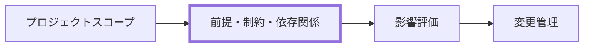

---
specdojo:
  id: specdojo:prj-assumptions-constraints-dependencies-rulebook
  type: rulebook
  deliverable_type: project
  status: ready
  target_format: markdown
  recipe: specdojo:prj-assumptions-constraints-dependencies-recipe
  sample: specdojo:prj-assumptions-constraints-dependencies-sample
  template: specdojo:prj-assumptions-constraints-dependencies-template
  based_on:
    - specdojo:rulebook-authoring-standard
  supersedes: []
---

# 前提・制約・依存関係 作成ルール

Assumptions, Constraints and Dependencies Documentation Rulebook

本書は、プロジェクトの成立条件、守るべき境界、外部または先行成果物への依存を、変更時に判断できる形で整理する規約である。各項目から計画への影響、確認責任、変更時の記録先を追跡できることを目的とする。

## 1. 全体方針

- 対象は、プロジェクトの前提条件、制約事項、依存関係、およびそれらの変化に対する影響評価と変更管理である。
- 各項目は、条件だけで終わらせず、影響、確認方法、変化または逸脱のトリガー、所有者、対応方針を一組で記載する。
- 前提は「成立するものとして置く条件」、制約は「守るべき限界」、依存関係は「他者・外部サービス・先行成果物などから受ける条件」として分離する。
- スコープなど上位文書で確定済みの決定事項（対象外、境界の判断基準、責務境界）は行として再掲しない。該当章の冒頭で参照先を明示して委譲し、本書には上位文書に現れない成立条件・限界・依存だけを登録する。
- 上位文書がすでに継続的な監視・記録先を持つ事項（判断ゲートの記録先が明示された章など）は、内容を要約して再登録せず参照にとどめる。上位文書が結論だけを示し継続監視の仕組みを持たない場合は、監視方法・トリガー・所有者・対応方針を付与して運用可能な形に展開してよいが、その場合は展開元の上位文書と章を明示する。
- 文書は計画・設計・実装の詳細やリスク登録簿を代替しない。必要な詳細はそれぞれの成果物に委譲する。
- AI Agent は作成・確認を支援できるが、承認、公開可否、エスカレーションなどの最終判断を委ねない。

## 2. 位置づけと用語定義

### 2.1. 位置づけ

### 2.2. 用語定義

| 用語     | 定義                                                                       |
| -------- | -------------------------------------------------------------------------- |
| トリガー | 前提の崩壊、制約の逸脱、依存先の変化を検知して見直しを始める条件。         |
| 所有者   | 項目の状態確認と一次対応を担うロールまたは責任者。最終判断者とは区別する。 |

## 3. ファイル命名・ID規則

### 3.1. 成果物の配置と文書 ID

- 配置・命名の共通規則は [[specdojo:docs-structure-guide|ドキュメント構成ガイド]] に従う。
- 本系統の成果物は `020-project-definition/prj-assumptions-constraints-dependencies.md` に配置し、文書 ID を `<project-id>:prj-assumptions-constraints-dependencies` とする。
- 文書 ID と、表の行を識別する項目 ID は区別する。別文書から行を追跡するときは、文書 ID と項目 ID の組で識別する。

### 3.2. 項目 ID

- 各登録行の必須キーは、前提条件では `ACD-A01`、制約事項では `ACD-C01`、依存関係では `ACD-D01` から始める。接頭辞に続く正の整数を種別ごとに既採番の最大値から順に増やし、2 桁未満はゼロ埋めする。100 件目以降は桁を増やす。
- 項目 ID は文書内で一意とし、採番後は内容の修正や並べ替えで変更しない。廃止した ID を別の条件に再利用しない。
- 種別を変更する場合は、旧項目を廃止して変更先の種別で新規採番し、変更記録に新旧 ID の対応と理由を残す。変更記録や登録簿でも同じ項目 ID を追跡キーに使う。

## 4. 推奨 Frontmatter 項目

- 共通項目の必須性、値・構文、未確定事項の目印は [[specdojo:document-metadata-standard|ドキュメントメタ情報標準]] を正とし、構造は `deliverable-frontmatter.schema.yaml` に従う。
- 本系統では `rulebook` に `specdojo:prj-assumptions-constraints-dependencies-rulebook` を必須で指定する。成果物の `type` は本書の `deliverable_type` に従う。
- `based_on` には、根拠として直接参照したスコープ・憲章などの上位成果物を記載する。計画や技術資料などへの影響先の参照と混同しない。

## 5. 本文要件

次の各章を表の順序で必須とする。前提条件・制約事項・依存関係は項目 ID ごとに管理し、登録対象がない章も省略せず、該当なしの理由と追加時の条件を記載する。

| 章                 | 目的と必須の判断材料                                                 |
| ------------------ | -------------------------------------------------------------------- |
| 前提条件           | 計画の成立に置く条件の根拠、崩れた場合の影響、確認と対応を示す。     |
| 制約事項           | 守るべき限界と適用範囲、逸脱の検知と対応を示す。                     |
| 依存関係           | 他者から受ける条件、必要となる理由、成立の判定と変化時の対応を示す。 |
| 影響評価と対応方針 | 変化が後続成果物・計画に及ぼす影響、一次対応と最終判断の分担を示す。 |
| 監視・変更管理     | 見直し契機、変更記録の内容と記録先、追従更新と報告の責任を示す。     |

## 6. 記述ガイド

### 6.1. 前提条件

- 前提には、なぜその条件を置くかを示す根拠と、崩れた場合の影響を記載する。
- 確認方法は「誰が何を見れば変化を検知できるか」が分かる表現にする。
- 根拠が不足する場合は事実として断定せず、_ASSUMPTION_: または _TODO_: として確認先を残す。
- スコープで定義済みの境界に該当する前提は、章冒頭でスコープの該当章へ委譲する。委譲先に条件が実在することを確認し、参照だけで未定義の条件を補ったことにしない。
- リポジトリ、端末、作業環境、外部ツールなど、外部から継続的に提供される基盤の可用性は「依存関係」として扱う。人の参加見込みを前提とする場合も、特定の助言・承認・成果物を受け取る条件は依存関係として分ける。

良い例: 「代表試行への協力者を確保できる」に、募集の根拠、試行前の確認者、未確保時の延期判断を添える。悪い例: 「店頭で使う端末を利用できる」を前提に登録する、またはスコープで確定済みの単一店舗運用を再掲する。

推奨表:

| ID  | 内容 | 根拠 | 影響 | 監視・確認方法 | 変化のトリガー | 所有者 | 対応方針 |
| --- | ---- | ---- | ---- | -------------- | -------------- | ------ | -------- |

### 6.2. 制約事項

- 制約には、適用範囲と、逸脱したと判断する条件を記載する。
- 技術制約は、特定製品名の列挙ではなく、選択の自由度、互換性、公開適性、運用上の限界として書く。
- 公開情報の制約は、個人情報・機密情報・非公開情報を扱わない方針と、検知時の除去または判断手順を併記する。
- スコープの対象外・境界の判断基準と同内容の制約は再掲しない。本章では、追加の運用制約、または「全体方針」に従って監視・対応を補う制約を扱う。

良い例: 「承認済み予算枠がない間は追加支出を開始しない」に、発注前の承認証跡確認と、未承認時に人間の責任者へ判断を求める対応を添える。悪い例: 「予算に注意する」とだけ書き、適用範囲と逸脱条件を示さない。

推奨表:

| ID  | 内容 | 適用範囲 | 影響 | 監視・確認方法 | 逸脱のトリガー | 所有者 | 対応方針 |
| --- | ---- | -------- | ---- | -------------- | -------------- | ------ | -------- |

### 6.3. 依存関係

- 依存先は、外部サービスだけでなく、先行成果物、承認、意思決定、提供物も含めて明示する。
- 「受領・成立条件」には、成立したと判定する状態と、誰が何の証跡をいつ確認するかの両方を記載する。期限または判断イベントを示し、検証手順が別文書にある場合はその正本を参照する。
- 成果物の作成・受入を依存とする場合は、対象成果物 ID、適用する受入条件・品質ゲート、証跡の正本を参照できるようにする。単に本書の根拠として読んだ文書は、その理由だけで依存先にしない。
- 依存先の詳細な契約条件や実装方式は、必要な管理・設計成果物へ委譲する。
- 意思決定待ちの依存は、プロジェクト登録簿の項目として登録し、本書からは登録項目 ID を参照する。決定後に本書へ影響がある場合は該当項目へ反映する。
- 複数の判断を含む依存では、決定記録で確定した部分と未決部分を分離する。一部の決定だけで依存全体を成立済みとしない。

良い例: 店頭端末を依存先とし、「営業時間中に利用者代表が記録できることを、営業開始前の動作確認で確かめる」と書く。悪い例: 「端末がある」「承認済み」とだけ書き、利用可能性や承認対象を確かめる証跡を示さない。

推奨表:

| ID  | 依存先・条件 | 必要となる理由 | 受領・成立条件 | 変化のトリガー | 所有者 | 対応方針 |
| --- | ------------ | -------------- | -------------- | -------------- | ------ | -------- |

表の各列は必須の意味を表す。「依存先・条件」は受ける提供物・判断・継続提供を、「必要となる理由」はそれが必要な作業と不成立時の影響を示す。

### 6.4. 影響評価と対応方針

- 影響は、スコープ、期日、費用、品質、公開適性、運用責任など、該当する領域を具体的に示す。
- 対応方針には、除去、軽減、受容、再判断のいずれを行うかと、次に判断する人を記載する。
- 一次対応を担うロールと最終判断者を区別し、人間の判断が必要な範囲を明示する。

良い例: 「依存先の受入が遅れたら、所有者が影響する成果物と作業を特定し、PM が順序・期日の変更案をまとめ、人間の責任者が開始可否を判断する」と書く。悪い例: 「遅れたら調整する」とだけ書き、影響先と次の判断者を示さない。

推奨表:

| 変化の種別 | 主な影響領域 | 最初に確認すること | 一次対応・判断 | 対応方針 |
| ---------- | ------------ | ------------------ | -------------- | -------- |

### 6.5. 監視・変更管理

- 「定期的に確認する」ではなく、スコープまたは実践の型一式が変わったときなど、具体的な見直しの契機を記載する。
- 変更記録には、項目 ID、変化内容、影響範囲、判断者、対応状況、再確認時期を残す。記録先はプロジェクト登録簿を第一候補とし、未定なら _TODO_: とする。
- 発生済みの支障は課題、将来の不確実な影響はリスク、承認済み範囲・計画の変更提案は変更要求、判断結果は決定記録へ接続する。PM が記録先・報告先を明示し、関連する Schedule の作業や PJR 項目から項目 ID を追跡できるようにする。
- 文書構造・配置・命名・技術制約・参照資料の整合確認を担うロールと、公開可否やスコープ変更などの最終判断を行う人間の責任者を区別して明示する。
- 改訂・廃止時の共通手順は [[specdojo:document-metadata-standard|ドキュメントメタ情報標準]] の「文書の改訂・廃止とライフサイクル変更管理」に従う。本系統では PM が計画・Schedule・PJR の追従作業を管理し、ARC が参照と技術制約、QE が受入条件・検証への影響を確認する。

良い例: 「端末の利用不能を検知したら、所有者が対象 ID と影響作業を課題に記録し、PM が代替策と再確認時期を報告する。開始条件が変わる場合は変更要求として人間の責任者へ上げる」と書く。悪い例: 「必要に応じて更新する」とだけ書き、記録先と判断責任を示さない。

## 7. 禁止事項

| 禁止事項                                         | 理由                                           |
| ------------------------------------------------ | ---------------------------------------------- |
| スコープ等の上位文書の決定事項を行として再掲する | 正本との二重管理になり、更新漏れと矛盾を招く。 |
| 前提・制約・依存を種別なしに混在させる           | 条件の性質と対応方法を区別できない。           |
| 影響、トリガー、所有者、対応方針のない登録       | 変化時に判断・対応へ使えない。                 |
| 根拠のない確定値や外部環境の断定                 | 誤った前提を固定し、更新漏れを招く。           |
| Agent に最終判断、承認、公開可否を委ねる         | 人間の判断責任を代替してしまう。               |
| API、DB、契約書全文などの詳細を記載する          | 本書の責務を越え、詳細成果物と重複する。       |
| 個人情報、非公開情報、機密情報を記載する         | 公開・再利用の前提を損なう。                   |
