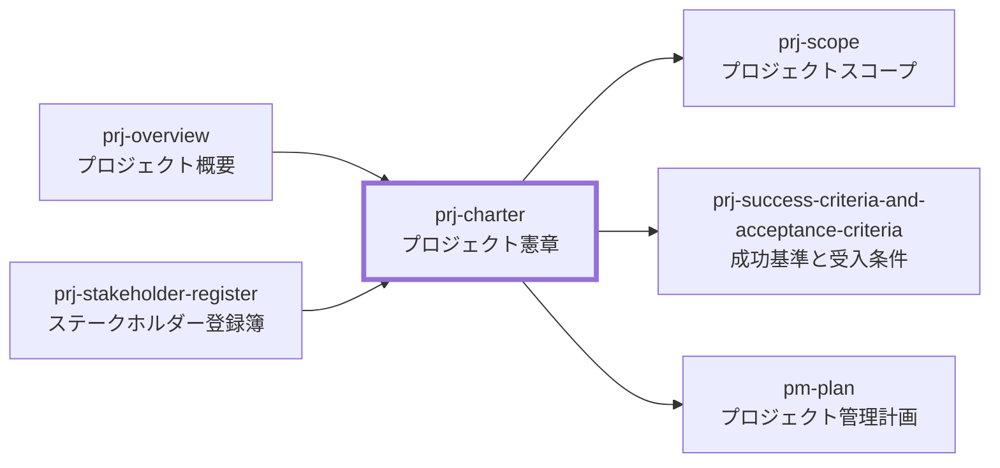

---
specdojo:
  id: specdojo:prj-charter-rulebook
  type: rulebook
  deliverable_type: project
  status: ready
  target_format: markdown
  recipe: specdojo:prj-charter-recipe
  sample: specdojo:prj-charter-sample
  template: specdojo:prj-charter-template
---

# プロジェクト憲章 作成ルール

Project Charter Documentation Rulebook

立ち上げ認可、権限委譲、後続判断条件を記録し、関係者が「誰が、何を、どの範囲まで承認したか」を確認できる憲章の記述基準を定める。

## 1. 全体方針

- 対象は、プロジェクトの存在を正式に認可し、詳細計画の策定と初期準備へ進む権限を委譲するプロジェクト憲章である。
- 目的は、プロジェクトの目的、認可対象、権限範囲、主要前提、予算枠を、承認責任者が判断できる形で明示することである。
- 憲章の承認は、本格実行開始、外部公開、主要投資、主要スコープ変更を自動的に承認するものではない。これらは後続の GO / Not GO 判断または変更判断で扱う。
- 背景、目的、期待効果はプロジェクト概要を根拠に要約し、詳細本文を二重管理しない。
- 関係者、期待、懸念、必要な合意はステークホルダー登録簿を根拠に要約する。
- 詳細なスコープ、成功基準、前提・制約、体制、スケジュール、リスク、コミュニケーションは後続文書へ委譲する。
- **共通の運用**: 役割の割り当て（スポンサーと PO の対応を含む）は適用先のメンバー定義に従い、本文では認可権限を持つ役割を「承認責任者」と呼ぶ。`status`・承認・改訂と廃止・未決事項の引き継ぎは [[specdojo:document-metadata-standard|ドキュメントメタ情報標準]] に従う。文書の整形・lint はリポジトリの検証で扱い、業務の受入確認に含めない。

## 2. 位置づけ

## 3. ファイル命名・ID規則

### 3.1. 配置（推奨）

- `docs/ja/projects/<project-id>/020-project-definition/prj-charter.md` に配置する。

### 3.2. ドキュメントID（推奨）

- 推奨: `<project-id>:prj-charter`
- 例: `prj-0001:prj-charter`

### 3.3. ファイル名（推奨）

- 推奨: `prj-charter.md`

## 4. 推奨 Frontmatter 項目

### 4.1. 設定内容

共通項目・値制約はドキュメントメタ情報標準を正とし、`type` は `project`、`rulebook` は `specdojo:prj-charter-rulebook` とする。

### 4.2. 推奨ルール

- `based_on` は、認可対象、目的、関係者、権限委譲を判断する直接根拠だけを列挙する。
- 初版では、原則として `prj-overview` と `prj-stakeholder-register` を中心にする。
- `pm-plan`、`pm-organization`、詳細スコープ、成功基準などは、憲章承認後に作成または詳細化する文書であり、初版憲章の直接根拠として扱う場合は理由を明記する。

## 5. 本文構成（標準テンプレ）

プロジェクト憲章は次の順序で構成する。

| 番号 | 見出し                          | 必須 | 内容（要点）                                                           |
| ---- | ------------------------------- | ---- | ---------------------------------------------------------------------- |
| 1    | 認可対象                        | ○    | プロジェクト名、ID、認可対象、認可しない範囲、直接根拠、承認責任       |
| 2    | プロジェクトの目的              | ○    | プロジェクト概要に基づく目的と期待効果の要約、成功基準文書への委譲     |
| 3    | ハイレベルスコープ              | ○    | 認可する対象範囲、対象外、未確定事項。成果物群は成果物カタログへ委譲   |
| 4    | 初期ステークホルダー            | ○    | 初期関係者、関与区分、Role code、認可判断上の責任                      |
| 5    | 権限委譲                        | ○    | 委譲する権限、承認責任者に留保する判断、証跡                           |
| 6    | 主要前提・制約                  | ○    | 認可判断に直結する前提、制約、予算枠。全量は前提・制約・依存文書へ委譲 |
| 7    | 本格実行開始の GO / Not GO 判断 | ○    | 本格実行前に確認する観点と記録先                                       |
| 8    | 承認                            | ○    | 承認日、承認者、承認対象、証跡リンク                                   |
| 9    | 未決事項                        | 任意 | 意思決定が必要な論点、認可や後続判断への影響、当面の扱い               |

## 6. 記述ガイド

### 6.1. 共通

- H1 にプロジェクト名を含める。直下の冒頭文には、立ち上げ認可の対象、誰にどの権限を委譲するか、承認責任者、本格実行開始・外部公開を承認しないことを 2〜3 文で書く。
- 立ち上げ認可と権限委譲に集中し、詳細計画や設計の本文を先取りしない。後続文書は根拠として先取りせず、詳細化先として参照する。

### 6.2. 認可対象

- プロジェクト名、プロジェクト ID、認可対象、認可しない範囲、直接根拠、承認責任を表で示す。
- 認可対象は、原則として立ち上げ、詳細計画策定、初期準備に限定する。
- 本格実行や公開まで認可する場合は、計画、体制、予算枠、品質条件が確認済みであることを明記する。
- 表は `項目`・`内容` の 2 列とし、承認に条件が付く場合のみ `認可条件` 行を追加する。承認の記録要件は「承認と未決事項」に従う。

### 6.3. プロジェクトの目的

- 冒頭は 1〜2 文の要約に留め、背景、必要性、目的の詳細はプロジェクト概要を正として参照する。
- 期待効果は、承認責任者が承認または保留を判断できる観点に分解する。表は `観点`・`認可判断で確認する期待効果` の 2 列とする。
- 数値目標、測定方法、中長期指標はプロジェクト概要の期待効果を正とし、憲章では再掲しない。
- 成功判定の観点と受入条件は成功基準文書を正とし、専用の章を設けず本章から参照する。

### 6.4. ハイレベルスコープ

- 立ち上げ時点で認可する大まかな対象範囲だけを示す。
- `区分`・`内容`・`詳細化先` の 3 列で、`対象`・`対象外`・`未確定` を分ける。対象と対象外はスコープ文書、未確定は未決事項へつなげる。
- AI Agent を利用するプロジェクトでは、支援対象の活動と委譲範囲を記載する。利用しない場合は記載を要しない。
- 成果物群の一覧・配置・派生関係と、憲章承認後に作成する文書の一覧は成果物カタログを正とし、専用の章を設けず本章から参照する。

### 6.5. 初期ステークホルダー

- ステークホルダー登録簿のうち、認可判断と権限委譲に関係する主要関係者だけを要約する。
- 関係者 ID、関係者名、関与区分、対応 Role code、認可判断における主な責任を示す。役割の定義や割り当ては再掲しない。

### 6.6. 権限委譲

- `項目`・`決裁者`・`実行責任者`・`協議先`・`証跡` の 5 列で、立ち上げ認可、詳細計画策定、本格実行開始の判断権限を示す。
- 委譲する権限と、承認責任者に留保する判断を分ける。予算枠、公開可否、ライセンス、主要スコープ変更、GO / Not GO を境界として明示する。

### 6.7. 主要前提・制約

- 前提・制約の全量は前提・制約・依存関係文書を正とし、認可判断に直結する事項（予算枠、公開適性、人間の判断責任）だけを載せる。
- 予算枠は、費用・外部支出・運用負担の上限、または追加支出を認めない制約として具体化する。
- 予算枠が未確定の場合は、未確定であること、追加支出を認めるかどうか、確定タイミングを明記する。

### 6.8. 本格実行開始の GO / Not GO 判断

- 本格実行開始、外部公開、主要投資へ進むか、継続・再計画・中止とするかを判断できる観点を定義する。
- 判断観点には、目的整合、公開適性、予算枠、体制、品質を含める。
- 観点ごとに確認内容、合格条件、判断結果の記録先を示す。目的整合は概要、体制は組織定義、品質は品質管理計画と照合し、予算枠と公開範囲の条件も確認する。未達条件が残れば開始判断を保留する。

### 6.9. 承認と未決事項

- 承認履歴は `承認日`・`承認者`・`承認対象`・`証跡リンク` の 4 列を必須とする。版番号は設けない。
- 証跡リンクには、承認の意思表示と承認対象の文書状態の両方を特定できる記録（決定記録、Pull Request、Issue、議事録など）を記載する。
- Frontmatter の `status` は文書の成熟度、承認履歴はプロジェクトの認可状態を表す独立した軸である。`ready` だけを根拠に正式認可済みとしない。認可状態は承認者・承認日・証跡と認可条件の充足で確認する。
- 未決事項は論点、認可や GO / Not GO への影響、当面の扱いを記載し、後続判断までに解消が必要な条件を識別する。

## 7. 禁止事項

| 項目                                                 | 理由                                         |
| ---------------------------------------------------- | -------------------------------------------- |
| 憲章承認を本格実行開始や外部公開の承認と混同する     | 立ち上げ認可と後続判断の責任境界が崩れるため |
| 認可対象または認可しない範囲を記載しない             | 承認責任者が認可範囲を判断できないため       |
| 予算枠または追加支出の扱いを記載しない               | 承認判断に必要なコスト境界が不明になるため   |
| 承認者、承認日、証跡が未確定なのに正式認可済みと書く | 説明責任と監査可能性が失われるため           |
| 詳細スコープ、受入条件、設計詳細を憲章に過剰記載する | 後続文書との二重管理を招くため               |
| 曖昧語だけで成功基準や GO / Not GO 条件を書く        | 判断可能性と再現性が下がるため               |
