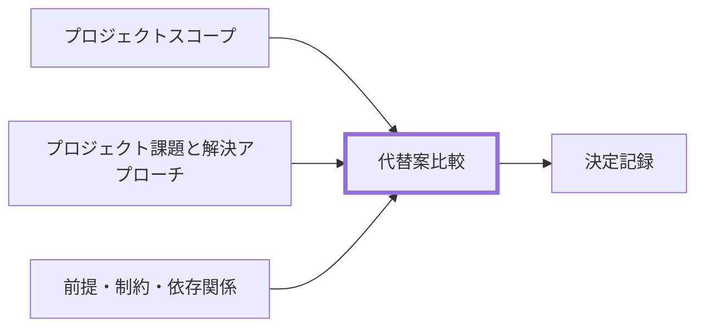

---
specdojo:
  id: specdojo:prj-comparison-of-alternatives-rulebook
  type: rulebook
  deliverable_type: project
  status: ready
  target_format: markdown
  recipe: specdojo:prj-comparison-of-alternatives-recipe
  sample: specdojo:prj-comparison-of-alternatives-sample
  template: specdojo:prj-comparison-of-alternatives-template
  based_on:
    - specdojo:rulebook-authoring-standard
  supersedes: []
---

# 代替案比較 作成ルール

Comparison of Alternatives Documentation Rulebook

複数案を同じ条件で比較し、採否の根拠と見直し条件を残す基準を定めます。

## 1. 全体方針

- 対象は、業務・利用者の課題を解く技術的・方針的な代替案の比較です。
- 比較レイヤー（同じ抽象度で比較する判断の単位）ごとに、単独で同じ目的を達成できる一式の案を最低 2 案比較します。
- 前段文書から課題・制約・必要能力・評価条件を引き継ぎ、外部調査で候補を広げ、検証できる根拠を残します。
- **共通の運用**: 役割の割り当ては適用先のメンバー定義に、`status`・承認・改訂と廃止・未決事項の引き継ぎは [[specdojo:document-metadata-standard|ドキュメントメタ情報標準]] に従います。文書の整形・lint はリポジトリの検証で扱い、業務の受入条件に含めません。

## 2. 位置づけ

## 3. ファイル命名・ID規則

- 共通の配置・命名は [[specdojo:docs-structure-guide|ドキュメント構成ガイド]] に従います。
- 配置は `docs/ja/projects/<project-id>/020-project-definition/`、ファイル名は `prj-comparison-of-alternatives.md` を推奨します。日本語名は `代替案比較.md` とし、プロジェクト内で統一します。
- ID は `<project-id>:prj-comparison-of-alternatives` を推奨します。

## 4. 推奨 Frontmatter 項目

- 値・構文・必須性は [成果物 Frontmatter スキーマ](../../../specdojo/schemas/v1/deliverable-frontmatter.schema.yaml) を正本とします。
- `type` は本書の `deliverable_type` に合わせ、`rulebook` には本書の ID を指定します。
- `based_on` には、スコープ、課題と解決アプローチ、前提・制約など、比較判断に直接使った文書を指定します。

## 5. 本文要件

見出し順・表・記入欄は Frontmatter の template を正本とし、内容の充足条件を以下に定めます。

- **比較目的と前提条件・比較対象案（必須）**: 決めること・対象外、候補カテゴリの選定根拠、各案の課題解決への道筋を示します。複数レイヤーでは決定 ID と判断順序も必要です。
- **評価軸と評価基準・比較結果と採択理由（必須）**: 課題・制約に結び付く判定条件、同一条件での評価と採否の根拠、技術的実現性・外部依存・後続への影響を示します。
- **リスクとトレードオフ（必須）**: 案ごとの不確実性と受容する不利益を区別し、軽減策と後続作業の対象・完了条件を示します。
- **決定と見直し（独立章は任意）**: 最終判断者、再評価トリガー、記録先は必須です。独立章がなければ「比較結果と採択理由」へ統合します。

## 6. 記述ガイド

### 6.1. 共通

- 採否の理由と証拠は評価結果に集約し、決定の要約から参照します。見積・リスク分析・検証結果は判断箇所から辿れるようにします。
- 詳細設計・製品仕様・実装・schema は正本を参照し、比較には採否を左右する差異・制約・影響だけを残します。

### 6.2. 比較目的と前提条件

- スコープと課題から決めること・対象外を定め、業務運用、解決方式、購入 / 構築、製品などのレイヤーに絞ります。開発戦略や作業管理は明示的な決定対象に限ります。
- 複数の判断には `D-01` などの決定 ID と判断順序を付けます。前段文書は課題・制約・評価条件の根拠として読みます。
- **良い例**: 「D-01 で販売記録を継続できる解決方式を選ぶ。製品選定は既存サービス案が残った場合に行い、EC は対象外とする」。
- **悪い例**: 「使う製品を先に決め、導入理由を比較表にする」。課題と比較範囲を判断できません。

### 6.3. 比較対象案

- 各案に目的達成への道筋、対象範囲、業務運用を含む主要構成を示します。相互に補完する部品は一式の案にまとめます。
- 同種の責務・統合範囲で候補カテゴリと選定基準を先に定め、現行運用改善、汎用ツール、既存製品、個別構築、外部委託から有力案を探します。専用ツールを使わない案や外部の直接競合も必要に応じて含めます。
- 標準・方法論と製品を区別し、公式資料で責務、データ保管、対応環境、移行可能性を確認します。市場代表と呼ぶ場合は客観的根拠を示します。
- **良い例**: 「紙帳票の統一、共有表計算、既存サービス、個別構築を同じ販売記録の課題で比較する」。
- **悪い例**: 「画面、データベース、開発ツールを別案にし、すべて採択する」。一つの意思決定を代替していません。

### 6.4. 評価軸と評価基準

- 最低ラインは **効果、コスト、期間、リスク、業務適合、技術実現性** の 6 観点です。業務適合は利用者の手順・体制への適合、必要に応じて分ける運用・保守性は継続運用の負荷を指します。
- レイヤーごとに軸を変えても、最低観点の省略には観点名と不要な理由、統合には対応先と判定条件が必要です。別章の説明だけで省略理由を代替できません。
- 同一レイヤーの全候補に同じ軸・判定境界・評価方向を使用します。
- 技術実現性は既存環境、移行、外部依存、運用継続、後続成果物への影響から判定します。製品比較ではロックイン・可逆性・成熟度、判断に影響する場合は適応性・追跡性・人間の統制・AI Agent の長期作業と検証可能性を追加します。

評価基準表には次の情報を示します。情報を失わなければ列を統合できます。

| 情報           | 記述・判定の基準                                                     |
| -------------- | -------------------------------------------------------------------- |
| 評価軸と根拠   | 観点の意味と、対応する課題 ID・制約を示す                            |
| 判定基準       | 測定値または観察可能な状態で評価の境界と有利な方向を定める           |
| 重み・集約方法 | 使用時は理由、優先順位か加重計算か、総合評価・採否への反映方法を示す |

- **良い例**: 「期間は 2 週以内の試行開始を High、2 週超 4 週以内を Middle、それ超を Low とする。リスクは継続運用軸へ統合し、通信断時の記録保持で判定する」。
- **悪い例**: 「不要な軸を削除する」「リスクは別章に書いたので評価しない」。削除の妥当性と全候補への適用を確認できません。

### 6.5. 比較結果と採択理由

- 各候補に採択・一部採択・比較試行・保留・非採択などの判定と再評価条件を付けます。結果表は評価軸に対応させ、測定値・定性理由・根拠資料への参照で評価と採否を追跡可能にします。
- 実現性と影響は決定・案ごとの表で示します。外部ツールは仕様・状態の正本、導入時期、同期方向、停止時の移行・取り出し方法を明示します。
- 比較試行は正式採用や標準と区別し、同じ入力・範囲・評価軸で行います。測定項目、完了条件、採用・撤退の閾値、記録先を事前に定めます。未確認を確認済みの高評価にせず、仮定と確認作業を分けます。
- **良い例**: 「ALT-02 は操作検証で 10 件中 2 件の記録漏れがあり、漏れ 0 件の基準を満たさず非採択。入力手順改善後に再試行する」。
- **悪い例**: 「新しい製品なので High、採択する」。評価条件と証拠がなく再現できません。

### 6.6. リスクとトレードオフ

- リスクには起きうる事象と軽減策、トレードオフには先送りする範囲・受容する負荷・後続への影響を記し、決定 ID・案 ID または全候補共通で対象を特定します。
- 後続作業となる軽減策には担当、依存作業・成果物、完了条件を示します。計画書・台帳名は実在を確認し、詳細設計は後続成果物へ委譲します。
- **良い例**: 「ALT-04 の残高移行漏れを抑えるため、移行後に `QE` が元ノートとの全件照合を行い、差分 0 件を受入条件とする」。
- **悪い例**: 「移行には注意する」。対象、実施者、完了条件がなく計画へ渡せません。

### 6.7. 決定と見直し

- 採択・試行・保留は決定 ID ごとに要約し、最終判断者を示します。再評価トリガーは期間・測定値・制約や依存の変化で定め、特定製品の自動採用条件にしません。
- 方針変更の理由、評価結果、影響範囲、移行・撤退方法を記録先から辿れるようにします。未決の比較条件には論点と採否・後続作業への影響を示します。
- **良い例**: 「ALT-04 を採択。2 週間の試行で記録継続が営業日の 90% 未満なら再比較し、判断理由を決定記録へ残す」。
- **悪い例**: 「必要に応じて採用ツールを変更する」。再評価条件を判断できません。

## 7. 禁止事項

| 項目                                                           | 理由                                                 |
| -------------------------------------------------------------- | ---------------------------------------------------- |
| 単一案のみの比較                                               | 意思決定の妥当性が検証できないため                   |
| 同じ戦略の構成要素を別々の代替案として比較する                 | 単独で目的を達成できず、比較結果が全案採択に偏るため |
| 業務の解決案と開発戦略・作業管理ツールを同じ表で採点する       | 解く課題と抽象度が異なり、評価結果を解釈できないため |
| 対象プロジェクトの課題と無関係な開発・管理方式を比較する       | 成果物が利用者の意思決定に使えないため               |
| 候補カテゴリと選定基準を定めず、知っている製品だけを比較する   | 候補集合が恣意的になり、有力な代替案を見落とすため   |
| 標準・方法論と製品・ツールを同じ意味で扱う                     | 成熟度と適用範囲を誤って評価するため                 |
| 根拠なく特定製品を市場の代表または標準と断定する               | 比較対象の妥当性を説明できないため                   |
| 正本と移行・撤退方法を定めず外部ツールを採択する               | 二重管理とベンダーロックインを招くため               |
| 前段文書の候補案を名称変更して再掲するだけで外部案を調査しない | 結論の追認となり、有力な代替手段を見落とすため       |
| 評価軸なしの採択結論                                           | 判断根拠が不透明になるため                           |
| 非採択理由の未記載                                             | 将来再評価時に経緯追跡できないため                   |
