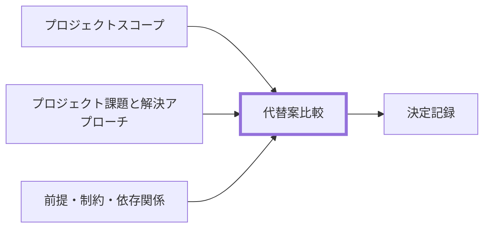

---
specdojo:
  id: specdojo:prj-comparison-of-alternatives-rulebook
  type: rulebook
  deliverable_type: project
  status: ready
  target_format: markdown
  recipe: specdojo:prj-comparison-of-alternatives-recipe
  sample: specdojo:prj-comparison-of-alternatives-sample
  template: specdojo:prj-comparison-of-alternatives-template
  based_on:
    - specdojo:rulebook-authoring-standard
  supersedes: []
---

# 代替案比較 作成ルール

Comparison of Alternatives Documentation Rulebook

複数の実行案を同じ条件で比較し、採否の根拠と見直し条件を残すためのルールです。`PM` が後続作業・依存・リスクを計画へ接続し、人間の `PO` が判断できる記載水準を定めます。

## 1. 全体方針

- 対象は、技術的・方針的な代替案の比較です。業務・利用者の課題から必要な意思決定を定め、比較過程を後から検証できるようにします。
- 比較レイヤーごとに、同じ課題を解決できる一式の案を最低 2 案比較します。前段文書から課題・制約・必要能力・評価条件を引き継ぎ、候補集合は外部調査も含めて構成します。
- 評価基準、採否の根拠、リスク、再評価条件を判断に必要な粒度で残します。詳細設計や製品仕様の転載は避け、正本を参照します。
- 最終判断は人間の `PO` が行います。AI Agent は調査・比較分析・検証を支援します。

## 2. 位置づけと用語定義

### 2.1. 位置づけ（他ドキュメントとの関係）

### 2.2. 用語定義（本ルール内）

| 用語         | 定義                                                                                |
| ------------ | ----------------------------------------------------------------------------------- |
| 代替案       | 同一の意思決定を代替でき、単独でも目的達成への道筋を説明できる一式の候補案          |
| 比較レイヤー | 業務運用、解決方式、購入 / 構築、製品、開発方式など、同じ抽象度で比較する判断の単位 |
| 候補カテゴリ | 同種の責務・統合範囲を持つ方式をまとめ、具体候補を探索する単位                      |
| 正本         | 現在の状態または判断根拠について、最終的に正しいものとして参照する情報源            |
| 比較試行     | 正式採用前に、入力、評価軸、完了条件を固定して適合性と可逆性を確認する活動          |
| トレードオフ | 採択に伴って受容する不利条件                                                        |

## 3. ファイル命名・ID規則

- 共通の配置・命名は [[specdojo:docs-structure-guide|ドキュメント構成ガイド]] に従います。
- 配置は `docs/ja/projects/<project-id>/020-project-definition/`、ファイル名は `prj-comparison-of-alternatives.md` を推奨します。日本語名を採用する場合は `代替案比較.md` とし、プロジェクト内で統一します。
- ID は `<project-id>:prj-comparison-of-alternatives` を推奨します。例: `prj-0001:prj-comparison-of-alternatives`。

## 4. 推奨 Frontmatter 項目

- 共通項目とライフサイクルは [[specdojo:document-metadata-standard|ドキュメントメタ情報標準]]、値・構文・必須性は [成果物 Frontmatter スキーマ](../../../specdojo/schemas/v1/deliverable-frontmatter.schema.yaml) を正本とします。
- `type` は本書の `deliverable_type` に合わせ、`rulebook` には本書の ID を指定します。
- `based_on` には、スコープ、課題と解決アプローチ、前提・制約など、比較判断に直接使った文書だけを指定します。本文では判断箇所から見積・リスク分析・検証結果へ参照を接続します。

## 5. 本文要件

見出し順・表・記入欄の骨組みは Frontmatter で宣言した template を正本とし、本書では内容の充足条件を定めます。

- **比較目的と前提条件・比較対象案（必須）**: 何を決め、何を扱わないかを示し、候補カテゴリの選定根拠と各案の課題解決への道筋を説明します。複数レイヤーでは決定 ID と判断順序を明示します。
- **評価軸と評価基準・比較結果と採択理由（必須）**: 課題・制約に結び付く判定条件と、同一条件での各案の評価、採否の根拠を示します。技術的実現性、外部依存、後続成果物への影響を含めます。
- **リスクとトレードオフ（必須）**: 案に対応する不確実性と受容する不利益を区別し、軽減策を示します。後続作業へ渡す対象と確認条件を識別できる粒度にします。
- **決定と見直し（独立章は任意）**: 最終判断者、再評価トリガー、記録先は必須です。独立章を省く場合は「比較結果と採択理由」へ統合します。

## 6. 記述ガイド

### 6.1. 共通

- 共通のメタ情報・ラベル・文書の改訂と廃止は [[specdojo:document-metadata-standard|ドキュメントメタ情報標準]] を正本とし、ここでは比較固有の判断を扱います。
- 章はタイトルで参照し、同じ採否理由や見直し条件を複数箇所へ転載しません。評価結果を説明する箇所に理由と証拠を集約し、決定の要約から参照します。
- 実装、schema、リファレンスが定める値・構文・データ構造は正本への参照で示し、比較には採否を左右する差異・制約・影響だけを残します。

### 6.2. 比較目的と前提条件

- スコープと課題に対して決めること・決めないことを定めます。業務運用、解決方式、購入 / 構築、製品、アーキテクチャなど必要な比較レイヤーだけを扱い、開発戦略や作業管理は明示的な決定対象である場合に限ります。
- 複数の判断には `D-01` などの決定 ID を付け、上位判断から後続判断への順序を示します。前段文書は候補の答えではなく、課題・制約・評価条件の根拠として読みます。
- **良い例**: 「D-01 で販売記録を継続できる解決方式を選ぶ。製品選定は既存サービス案が残った場合に行い、EC は対象外とする」。
- **悪い例**: 「使う製品を先に決め、導入理由を比較表にする」。課題と比較範囲を判断できません。

### 6.3. 比較対象案

- 各案は、単独でも目的達成への道筋、対象範囲、主要な構成を説明できる業務運用込みの解決案にします。相互に補完する部品を別案にせず、同じ抽象度の候補を並べます。
- 候補カテゴリと選定基準を先に定め、現行運用改善、汎用ツール、既存製品、個別構築、外部委託などから有力案を探します。専用ツールを使わない案や外部の直接競合も必要に応じて含めます。
- 標準・方法論と製品を区別し、公式資料で責務、データ保管、対応環境、移行可能性を確認します。市場代表と呼ぶ場合は客観的根拠を示します。
- **良い例**: 「紙帳票の統一、共有表計算、既存サービス、個別構築を同じ販売記録の課題で比較する」。
- **悪い例**: 「画面、データベース、開発ツールを別案にし、すべて採択する」。一つの意思決定を代替していません。

### 6.4. 評価軸と評価基準

- 最低ラインは **効果、コスト、期間、リスク、業務適合、技術実現性** の 6 観点です。業務適合は利用者の手順・体制への適合を指し、運用・保守性は継続運用に要する負荷として必要に応じて分けます。
- レイヤーごとに軸を変えてよいものの、最低観点を省略する場合は、観点名と比較目的上不要な理由を明示します。別名の軸へ統合する場合は対応先と判定条件を示します。別章にリスクや実現性の説明があるだけでは、評価軸の省略理由を記したことにはなりません。
- 同一レイヤー内では全候補に同じ軸・判定境界・評価方向を使用します。各軸を根拠資料の課題 ID・制約に対応付け、重みを使う場合は優先順位なのか加重計算なのかを明記します。
- 技術実現性は既存環境、移行、外部依存、運用継続、後続成果物への影響から判定します。製品比較ではロックイン・可逆性・成熟度、判断に影響する場合は適応性・追跡性・人間の統制・AI Agent の長期作業と検証可能性を追加します。

評価基準表では、次の情報を読み取れるようにします。列の統合は、判定情報を失わない範囲で行います。

| 情報           | 記述・判定の基準                                             |
| -------------- | ------------------------------------------------------------ |
| 評価軸と根拠   | 観点の意味と、対応する課題 ID・制約を示す                    |
| 判定基準       | 測定値または観察可能な状態で評価の境界と有利な方向を定める   |
| 重み・集約方法 | 使用する場合に、重みの理由と総合評価・採否への反映方法を示す |

- **良い例**: 「期間は 2 週以内の試行開始を High、2 週超 4 週以内を Middle、それ超を Low とする。リスクは継続運用軸へ統合し、通信断時の記録保持で判定する」。
- **悪い例**: 「不要な軸を削除する」「リスクは別章に書いたので評価しない」。削除の妥当性と全候補への適用を確認できません。

### 6.5. 比較結果と採択理由

- 各候補に採択・一部採択・比較試行・保留・非採択などの判定を付け、評価軸に結び付く理由と再評価条件を記載します。結果表は採用した評価軸と対応させ、測定値や定性理由、根拠資料へのリンクで評価を追跡できるようにします。
- 技術的実現性と影響は、決定または案ごとの表で示します。外部ツールは仕様・状態の正本、導入時期、同期方向、停止時の移行・取り出し方法を明示します。
- 比較試行では同じ入力・範囲・評価軸を使用し、測定項目、完了条件、採用・撤退の閾値、記録先を事前に定めます。試行候補は正式採用や標準と区別し、未確認事項は確認済みの高評価にせず、仮定と確認作業を分けます。
- **良い例**: 「ALT-02 は操作検証で 10 件中 2 件の記録漏れがあり、漏れ 0 件の基準を満たさず非採択。入力手順改善後に再試行する」。
- **悪い例**: 「新しい製品なので High、採択する」。評価条件と証拠がなく再現できません。

### 6.6. リスクとトレードオフ

- リスクは起きうる事象と軽減策、トレードオフは先送りする範囲・受容する負荷・後続への影響を記します。決定 ID または案 ID で対象を特定し、全候補に共通する場合はその旨を示します。
- 軽減策を後続作業にする場合は、担当 Role code、依存する作業・成果物、完了を確認する条件を示します。具体的な計画書名や台帳名は根拠資料で実在を確認し、詳細設計は後続成果物へ委譲します。
- **良い例**: 「ALT-04 の残高移行漏れを抑えるため、移行後に `QE` が元ノートとの全件照合を行い、差分 0 件を受入条件とする」。
- **悪い例**: 「移行には注意する」。対象、実施者、完了条件がなく計画へ渡せません。

### 6.7. 決定と見直し

- 現時点の採択・試行・保留を決定 ID 単位で短く要約し、最終判断者を明記します。再評価トリガーは期間、測定値、制約や依存の変化で定め、特定製品の自動採用条件にしません。
- 方針変更は理由、評価結果、影響範囲、移行・撤退方法とともに、実在するプロジェクト登録簿または決定記録へ残します。恒久的なリスク・課題・変更要求・未決事項は種類を分け、担当 Role code と転送先レコードを示します。
- 改訂・廃止時は `PM` が後続成果物・Schedule・PJR の追従作業を管理します。`BA` は業務影響、`ARC` は技術制約と外部依存、`DEV` は関連実装、`QE` は受入条件と検証、`PO` は方針変更を確認・判断します。
- **良い例**: 「`PO` が ALT-04 を採択。2 週間の試行で記録継続が営業日の 90% 未満なら `PM` が再比較を計画し、判断理由を既存の決定記録へ残す」。
- **悪い例**: 「Agent が必要に応じて採用ツールを変更する」。再評価条件と人間の判断責任が不明です。

## 7. 禁止事項

| 項目                                                           | 理由                                                 |
| -------------------------------------------------------------- | ---------------------------------------------------- |
| 単一案のみの比較                                               | 意思決定の妥当性が検証できないため                   |
| 同じ戦略の構成要素を別々の代替案として比較する                 | 単独で目的を達成できず、比較結果が全案採択に偏るため |
| 業務の解決案と開発戦略・作業管理ツールを同じ表で採点する       | 解く課題と抽象度が異なり、評価結果を解釈できないため |
| 対象プロジェクトの課題と無関係な開発・管理方式を比較する       | 成果物が利用者の意思決定に使えないため               |
| 候補カテゴリと選定基準を定めず、知っている製品だけを比較する   | 候補集合が恣意的になり、有力な代替案を見落とすため   |
| 標準・方法論と製品・ツールを同じ意味で扱う                     | 成熟度と適用範囲を誤って評価するため                 |
| 根拠なく特定製品を市場の代表または標準と断定する               | 比較対象の妥当性を説明できないため                   |
| 正本と移行・撤退方法を定めず外部ツールを採択する               | 二重管理とベンダーロックインを招くため               |
| 前段文書の候補案を名称変更して再掲するだけで外部案を調査しない | 結論の追認となり、有力な代替手段を見落とすため       |
| 評価軸なしの採択結論                                           | 判断根拠が不透明になるため                           |
| 非採択理由の未記載                                             | 将来再評価時に経緯追跡できないため                   |
| 根拠資料リンクなし                                             | 説明責任を果たせないため                             |
| Agent に採択案の最終判断を委ねる                               | 人間の判断責任を代替してしまうため                   |
| 公開リポジトリに個人名・個人連絡先・非公開の組織情報を記載する | 公開範囲とプライバシーに反するため                   |
